<p align="center"></p>

# Photo Estate

**Your whole photo library, on your own disk, searchable by what's in a photo, who's in it and where it was taken.**

Photo Estate gathers every photo and video from Google Photos, iCloud Photos, Flickr and your
iPhone onto one disk, removes the duplicates, keeps each service's metadata (dates, places, albums, people,
favourites), and gives you a fast local app to browse and search it all. Type "latte art" or "dog
in the snow" and it finds those photos, and the videos with that moment in them, with no tags and
nothing sent to the cloud. Name the people
in your photos once, and "ben and matthew on a beach" or "ben san diego" finds exactly them, there.

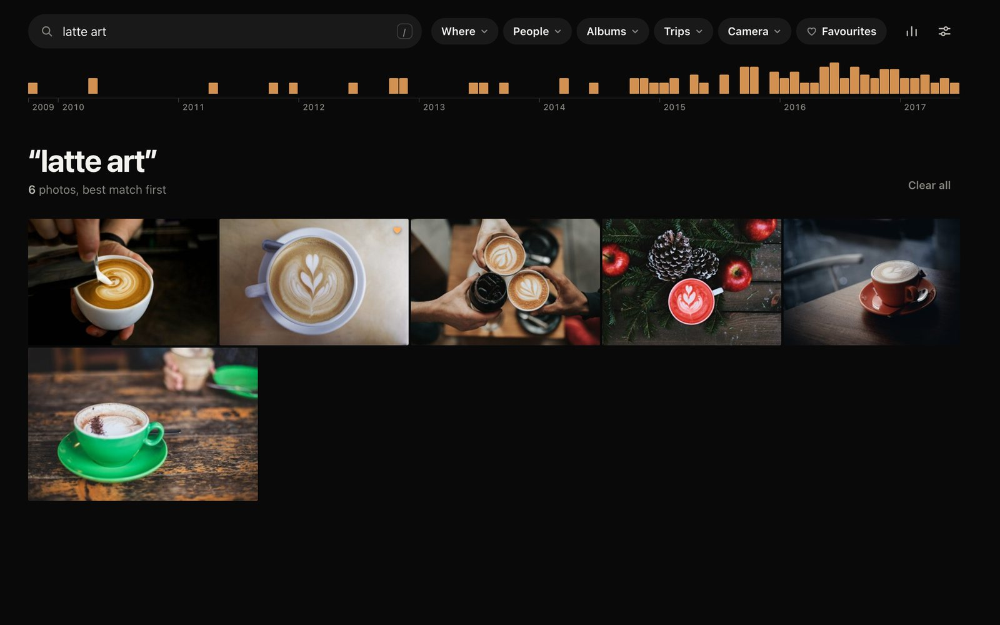

**📖 [Read the book](https://jflam.github.io/photo-estate/)**: a technical book on how it all works, chapter by chapter, with diagrams. It covers the pipeline, the search, the faces and the native iPhone app.

## The AI in it

Every model here runs on your own computer, on the CPU, and none of them is sent a photo. Four
things are built on them:

| | What it does | What it runs on |
|---|---|---|
| **Describe a photo to find it** | "dog in the snow" finds those photos, with no tags | SigLIP 2 image and text embeddings |
| **Who is in it** | Name a person once and they are found everywhere, from baby to adult | InsightFace face embeddings, compared a couple of years at a time |
| **Your best photos first** | The cover of a year, the order of a month and the top of a burst are the photos you would pick | Two small scorers on the same SigLIP 2 embeddings |
| **An agent that asks first** | "Hide the photos from the school" becomes a set of photos for you to look over | Any MCP client, or Claude Code on the library's computer |

The last two are new.

**Your best photos first.** A library of 100,000 photos has a few thousand that matter. Photo Estate
now scores every photo twice: a *quality* scorer tells a real photo from junk (it was taught by a
general aesthetic model on 20,000 sample photos), and a *taste* scorer orders the good ones the way
their owner would (it was taught on 653 "which of these two is better?" picks, made in a small
judging app). A scorer is one weight per embedding dimension, so a photo's score is a dot product
with numbers the app already holds: scoring 100,000 photos takes milliseconds when the catalog
loads, and a photo that arrives tomorrow needs no extra step. The scores are used wherever the app
chooses a photo for you. Each year, month and trip is shown by its best photo:

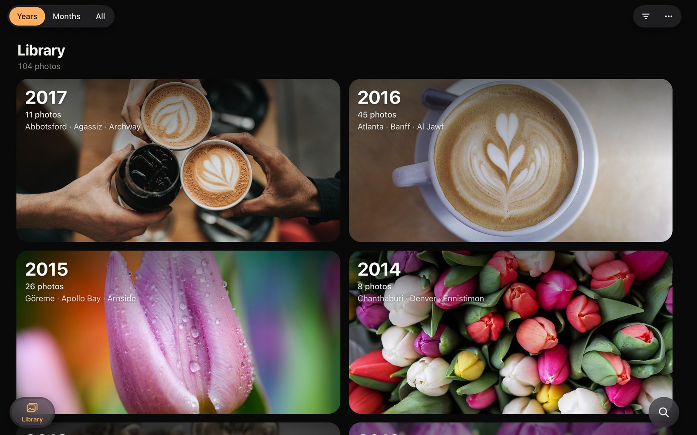

A month can be put **best first**, and so can a described search, which then keeps only the closest
matches and shows the best of them first:

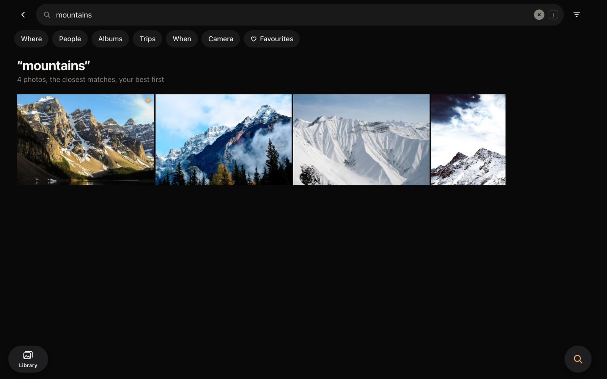

**Stacks.** Shots taken within ten seconds of each other that look almost the same (a burst, or
the same photo saved twice) show as one photo with the others behind it, and the one on top is the
best. On a 106,000-photo library that is about 13,200 stacks holding 34,600 photos. Nothing is
deleted; open the stack to see them all.

**An agent that asks first.** The running app is also an [MCP](https://modelcontextprotocol.io/)
server (`/mcp`), so an agent can search the library with the same models you do. Two rules keep
that safe. The agent never sees a photo: every tool answers with ids, scores, dates, places and
names, so nothing of what a photo shows leaves your computer. And it cannot change anything: all it
can do is propose a **change set**, a list of photos and what to do to them. You look the set over
as a wall of photos, mark the ones to keep, and apply it; a set can be reverted as one unit until
you commit it. The first operation is *hide*, which leaves a photo in the store and takes it out of
every view.

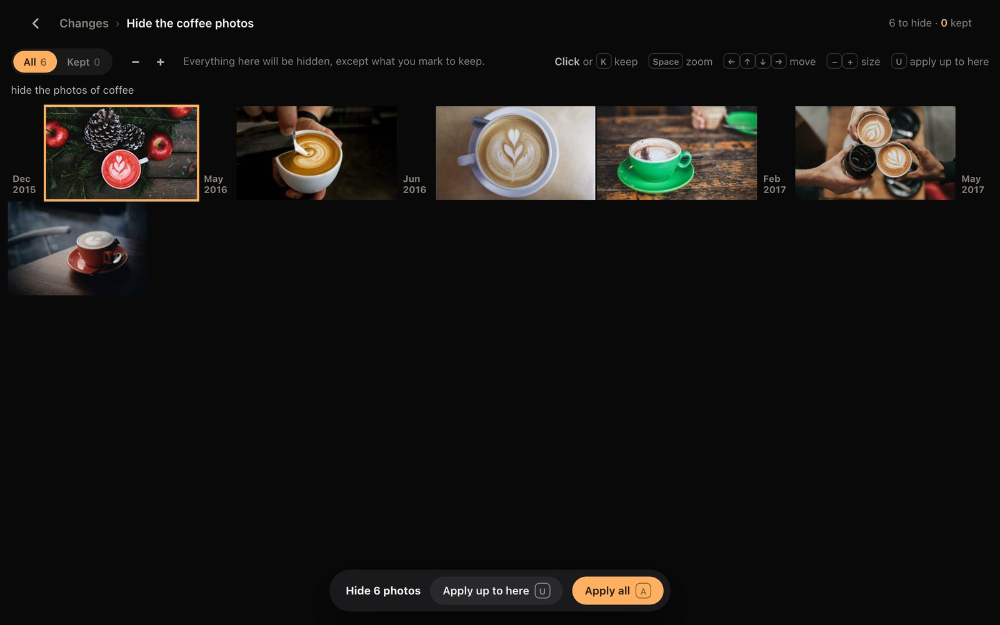

You can also type the request into the Changes page. It is then worked on by an agent on the
library's own computer (Claude Code, run with every built-in tool switched off, so it can call the
library's tools and nothing else), and ends in a change set like the one above.

The demo library has no scorers, so it has no "Best first" and its covers are the middle photo of
each period; these pictures are of the demo photos with the author's scorers installed.
[Chapter 25 of the book](docs/book/25-best-photos.md) tells how the scorers were made, including
the first plan, which was wrong.

## Plain files underneath

Everything runs on your own machine. The archive is deliberately boring: **plain files plus one
SQLite file.** No app, this one included, is needed to read it. If every script here disappeared,
your photos would still be ordinary JPEG/HEIC/MP4 files in folders, and the catalog would still be
readable with `sqlite3`.

## Try it in two minutes

The repo includes a small demo library: 104 CC0 photos, run through the full pipeline and
checked in with their catalog. You need [`uv`](https://docs.astral.sh/uv/getting-started/installation/)
and git; uv fetches the right Python and every dependency.

```bash
git clone https://github.com/jflam/photo-estate.git
cd photo-estate/photo-estate
uv run embed.py serve --demo
```

Open <http://127.0.0.1:8767/>. Browsing works immediately. The first typed search waits for a
one-time download of PyTorch and the SigLIP 2 model (a few GB); after that, searches take
milliseconds on a laptop CPU. No GPU needed.

Things to try:

- Search for **latte art**, **kitten**, **dog in the snow**, **waterfall in autumn** or
  **city at night**.
- Search for something that isn't there, like **kangaroo**: you get "Nothing found", not the
  least-bad guesses.
- Open a photo, then press **More like this**.
- In the Library, zoom out to **Years** or **Months**; in Search, filter by **Where**, **When** or **Camera**.
- Open **Changes** from the Library's **⋯** menu to see where an agent's proposals are reviewed.

The demo photos come in groups of eight that look alike (lighthouses, coffee, kittens, snowy
peaks, hot air balloons, sand dunes...), and nothing in the catalog says which group a photo is
in: search finds them from the pixels alone. The demo runs from a scratch copy, so it never writes
to the repo, and it uses port 8767 so it can run beside a real library on 8766.

## A quick tour

**Describe a photo to find it.** Search ranks every photo by how well it matches your words,
using [SigLIP 2](https://huggingface.co/google/siglip2-base-patch16-256) embeddings, and stops
where the matches stop: results that only resemble the surroundings ("latte art" drifting into
plain coffee) are cut, and a search for something you never photographed says so.

**Search by who and where.** An image model can't know who your kids are, and it can only guess
a place from how it looks (a sunny street near Disney World passes for San Diego). So names and
places in a search are read as filters before anything is ranked:

| You type | Read as |
|---|---|
| ben and matthew on a beach | photos with both Ben and Matthew, ranked by "on a beach" |
| matthew's birthday | Matthew's photos, ranked by "birthday" |
| ben san diego | Ben's photos taken in or around San Diego (La Jolla and Carlsbad too), newest first |
| seattle skyline | photos taken in Seattle, ranked by "skyline" |
| trip to florida | every photo taken in Florida |

People come from the service's tags and the faces you've named; places from the photo's GPS. A
name or place that's also an everyday word (Sunny, Celebration, Golden) only counts when you
capitalize it, and the title says how a search was read, with a link to search your exact words
instead.

**Name the people in your photos.** The People page (`/people`) starts from Google's people tags
and finds the same faces everywhere else, following children from baby to adult a couple of years
at a time. You confirm in bulk and fix the exceptions:

- **Is this Ben?** shows the faces that might be, least certain first. Every face is labelled with
  what it will be saved as; click the few that are wrong (someone else, a stranger, or not sure
  yet), then save the page. Strangers are never asked about again; "not sure" waits for later, or
  for someone else in the family.
- **Yes to all**, then **Find mistakes**: name everything waiting at once, then review Ben's faces
  least like his others first, which is where wrong matches end up.
- **See it in the photo.** Space (or the corner button) opens the whole photo with that face
  highlighted, for the ones a face crop can't settle; the arrow keys step through the page.
- Two faces in one photo are never the same person, and every decision is kept in a plain log
  file next to the catalog.

**More like this.** From any photo, find the ones closest in look and subject: here, other
lighthouses first, then the sea and sunsets around them.

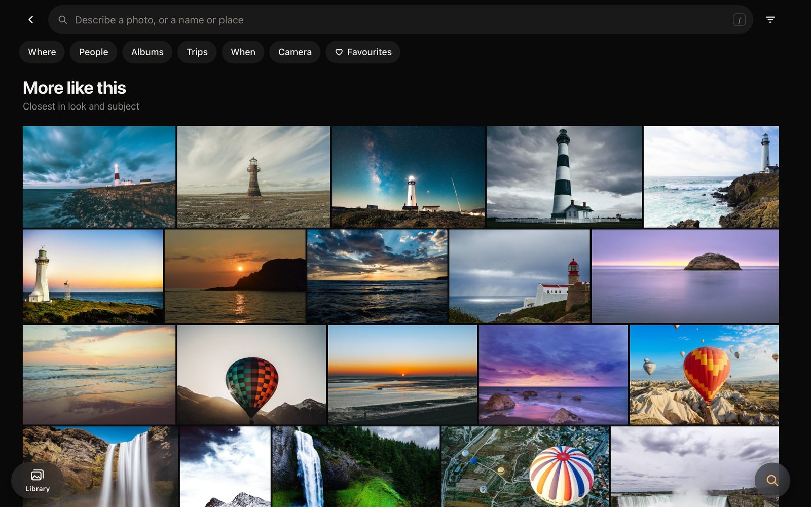

**Videos and Live Photos.** A video is searched by stills taken from it every few seconds, through
the same model as the photos, so "birthday cake" finds the ten seconds of cake in a party video, and
the result says where in it they are. A Live Photo is one item, its still, with the short clip beside it; the clips
are not counted or shown as videos of their own. Videos stream from your own disk, with nothing to
install: frames are read with PyAV, which carries its own FFmpeg. `is:video` in a search, or
`kind=video` for an agent, keeps to videos.

**Every photo's story.** The viewer shows local time and timezone, place (worked out offline from
GPS), the event and trip it belongs to, camera, lens and exposure. Each of those is a link to the
photos that share it.

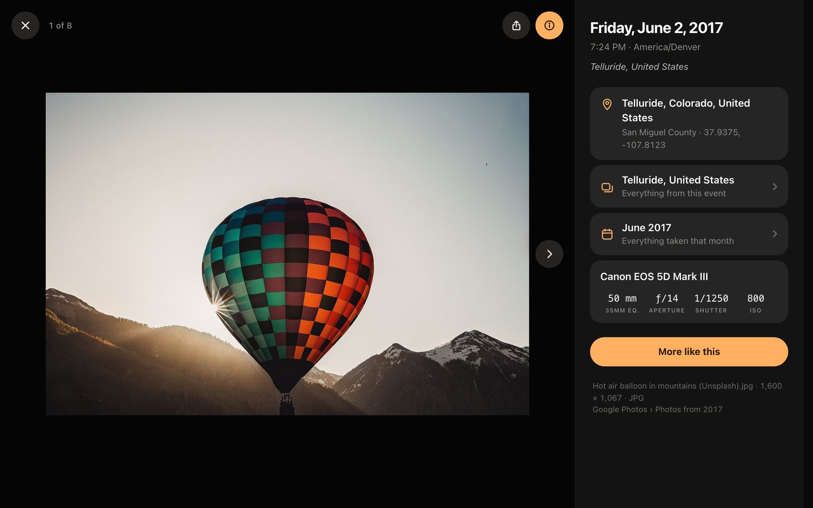

**Filters with live counts.** Where, People, Albums, Trips, When, Camera and Favourites narrow
whatever is showing, and combine with a description. The web app is laid out as the iPhone app is:
a Library tab (every photo, or a card a year or a month) and a Search tab, with the same view
options (order, five photo sizes, stack near-identical shots, hide screenshots).

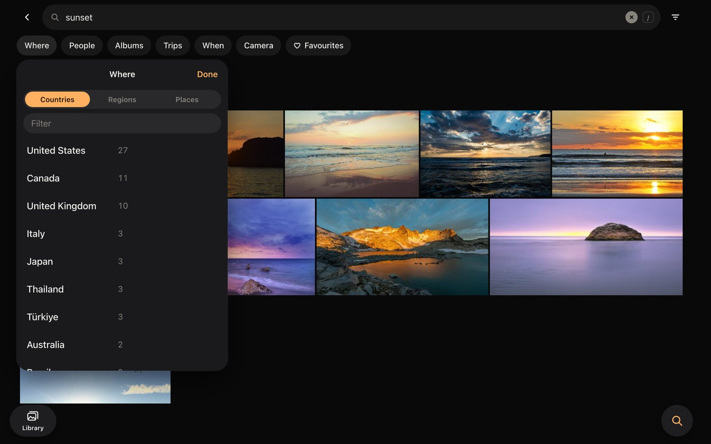

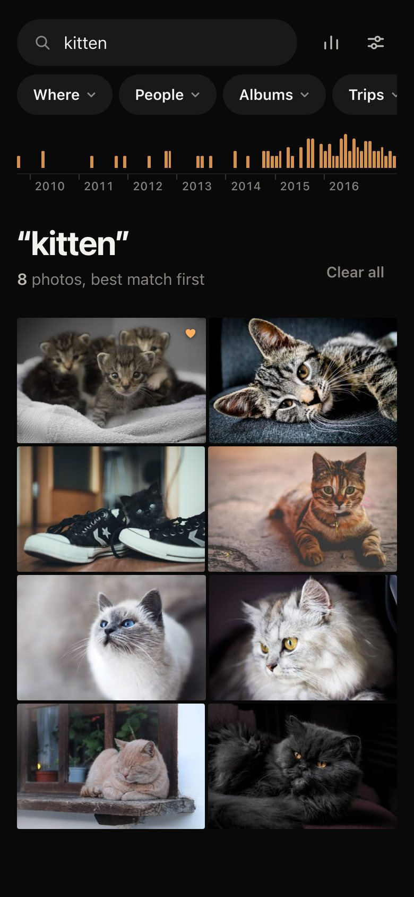

**At home on a phone.** Add it to your home screen and it behaves like an app: swipe between
photos, swipe down to close, swipe up for details, and pinch or double-tap to zoom. Sharing sends
the original file, so **Save Image** keeps its date and place. Put it behind
[Tailscale](https://tailscale.com/kb/1312/serve) or any reverse proxy to use it away from home.

**Library info.** The chart icon in the header (`/stats`) shows what the library is and what it costs:
photos, videos and gigabytes on disk, the size of the catalog by table, cache and free space, photos per
year and by hour and weekday, busiest day and longest streak, top cameras, lenses, places and people,
and how far the pipeline has got.

**Typed filters** work in the search field too, for anything names and places don't cover: `sunset place:denmark`,
`kids album:"Summer 2019"`, `camera:d300`, `date:2010-07`, `is:fav`.

<br clear="right">

## A native iPhone app

Beyond the home-screen web app there is a real iPhone app in [`ios/`](ios/), and it works with no
network at all. The server is the only writer, so the phone keeps a read-only copy of the catalog
(synced from `GET /api/sync`, a change feed) in its own SQLite file, plus a thumbnail of every photo
and full-screen copies of favourites and anything you've opened, within a size cap you choose.

<table>
<tr>
<td width="25%">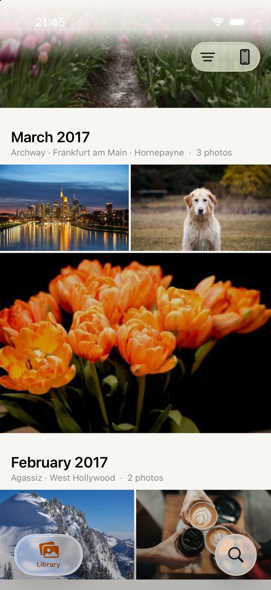</td>
<td width="25%">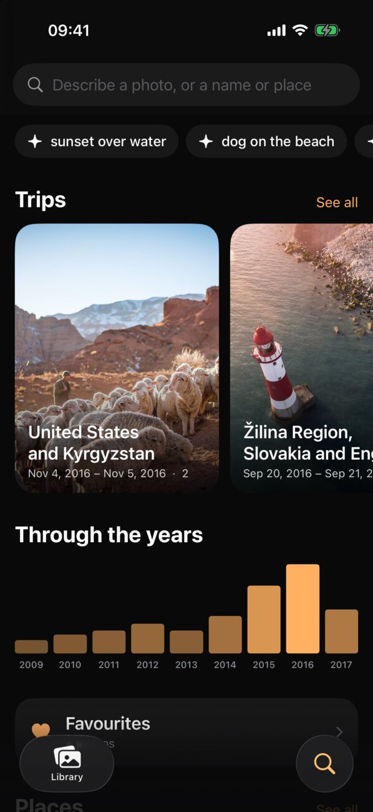</td>
<td width="25%">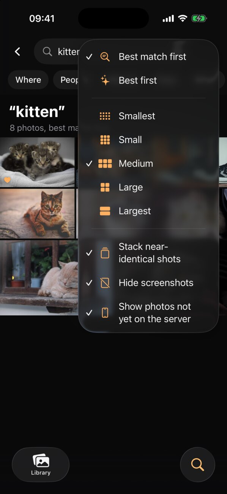</td>
<td width="25%">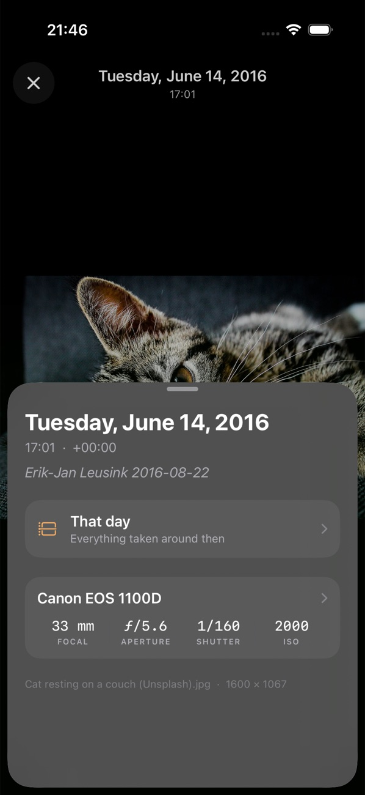</td>
</tr>
</table>

- **Library** is a justified grid grouped by month and place, or a card for each year or month,
  with a viewer (zoom, swipe, share) and details like the back of a print: date, camera and
  exposure, with a tap to "everything taken around then".
- **Best first, covers and stacks** work as on the web, and offline: the server sends each photo's
  score and stack with the catalog, so the phone orders and stacks them itself.
- **Search** runs on the phone against its own copy: people, places, dates, albums, cameras and
  typed filters (`place:denmark`), with the same live-count filters as the web app. Trips and a
  photos-per-year chart sit under the search field.
- **Offline.** Everything above works on a plane. Describing a photo ("dog in the snow", "More like
  this") needs the image model, so online it asks your server; offline it falls back to matching
  words in names, places, albums and captions, and says so.
- **Uploads.** An optional upload extension sends new photos from the phone to your server in the
  background (see [Bring your own photos](#bring-your-own-photos)).

To try it against the demo library, run `uv run embed.py serve --demo --port 8791` and build
`ios/project-sim.yml` for the Simulator (see the comments at the top of that file). To use it for
real, set `SERVER_BASE` in `ios/project.yml` to your server's address.

## Bring your own photos

The easiest way is to let the app walk you through it:

```bash
cd photo-estate
uv run embed.py serve
```

With no library yet, <http://127.0.0.1:8766/> opens a setup page. It asks where the library should
live (your Pictures folder or an external disk), then where your photos are now, with step-by-step
instructions for each service: Google Photos (Takeout zips), Flickr's export, or any folder. It
brings them in, shows progress as it goes, and opens your library once the first photos are
searchable. Add more later from the **+** in the library's header. To try the whole flow first,
with practice sources made from the demo photos and no accounts, run `uv run embed.py serve --sandbox`
(<http://127.0.0.1:8769/>). iCloud, Google Drive, Dropbox and OneDrive are next
([INTAKE-PLAN.md](docs/notes/INTAKE-PLAN.md)).

By hand, every source goes through the same steps, and each step only does new work, so adding photos
later is cheap: **ingest → link → exif → places → embed**. Run from `photo-estate/`, with `DB` and
`STORE` set to where you want the catalog and the photos:

```bash
DB=~/estate/estate.db STORE=/Volumes/photos/store
E="uv run estate.py --db $DB"

$E ingest --store $STORE takeout-*.zip          # Takeout zips, Flickr zips, or any folder
$E link                                         # attach each service's metadata
$E exif --store $STORE                          # camera, lens, exposure; pairs Live Photos (needs exiftool)
uv run places.py --db $DB run                   # places, local time, events, trips (offline)
uv run embed.py --db $DB run --store $STORE     # SigLIP 2 embeddings for search, photos then videos
uv run embed.py --db $DB serve --store $STORE   # the app: http://127.0.0.1:8766/
uv run faces.py --db $DB run --store $STORE     # optional: find every face, then name people at /people
```

Where to get your photos:

- **Google Photos:** a [Google Takeout](https://takeout.google.com/) export (photos come as zips
  with JSON sidecars). `pull-drive.sh` ingests Takeout zips straight from Google Drive with
  rclone, one at a time, so you don't need room for all of them at once.
- **iCloud Photos:** `pull-icloud.sh` mirrors your libraries with
  [icloudpd](https://github.com/icloud-photos-downloader/icloud_photos_downloader) and ingests them.
- **Flickr:** the zips from Flickr's "Download all your data".
- **Your iPhone:** the [native app](#a-native-iphone-app) uploads new photos to your server in the
  background (`PUT /api/upload`, into an inbox folder). The server then catalogues just the new
  ones by itself: link, exif, places, embeddings and faces each skip everything already done, so a
  photo is searchable within seconds to a minute of arriving, and the app reloads its catalog
  without restarting. `ingest-iphone.sh` does the same from a timer if you'd rather.
- **Anything else:** a folder of photos and videos works too; EXIF supplies the dates.

The same photo in two services is stored once. Ingest is resumable, and nothing is ever modified
or deleted: near-duplicates (resized copies, edits, bursts, RAW+JPEG pairs) are reported for you
to review with `$E review --store $STORE`, never removed.

[DISK-SETUP.md](docs/guides/DISK-SETUP.md) covers choosing storage and running a large pull
overnight. [deploy/MAC-MINI.md](photo-estate/deploy/MAC-MINI.md) shows how to keep the app
running all the time and reach it from your other devices, using a Mac mini as the example; on
Linux the same thing is a systemd user service.

## How it works

```
 Google Takeout zips ─┐
 iCloud (icloudpd)  ──┼─▶ estate.py ingest ─▶ store/ab/cd/<sha256>.<ext>   every unique file, once
 Flickr data zips   ──┤
 iPhone uploads     ──┘        │                       (content-addressed, never modified)
                               ▼
                         estate.db (SQLite)
                               │
        estate.py link ────────┤  match each service's sidecars to its files; merge onto the asset
        estate.py exif ────────┤  every file's EXIF/XMP/QuickTime tags (exiftool); camera, lens, exposure
        places.py run ─────────┤  place names, local time, events, trips (offline, seconds)
        estate.py dupes/review ┤  exact + near-duplicate report, local review page
        embed.py run ──────────┤  SigLIP 2 embeddings: every photo, every video's frames
        faces.py run ──────────┤  every face, embedded; named from Google's tags and by you at /people
        embed.py serve ────────┘  the photo app at http://127.0.0.1:8766/
```

Each step has a chapter of [the book](https://jflam.github.io/photo-estate/):

| Step | What it does | Read |
|---|---|---|
| **Ingest** | Streams each file out of a zip or folder while hashing it; a file already in the store becomes another *occurrence* of the same *asset*, and is not written again | [4](docs/book/04-store-and-ingest.md) |
| **Link** | Matches each service's sidecars to its files (Takeout's truncated JSON names, iCloud's XMP, Flickr's split zips) and merges them; Google wins, then iCloud, then EXIF, then Flickr | [6](docs/book/06-linking.md) |
| **EXIF** | exiftool over every asset; camera, lens and exposure become columns. Needs exiftool (`brew install exiftool`, `apt install libimage-exiftool-perl`, `pacman -S perl-image-exiftool`) | [7](docs/book/07-places-events-trips.md) |
| **Places and events** | GPS becomes a place and a timezone offline, photos are grouped into events and trips; recomputed in seconds on each run | [7](docs/book/07-places-events-trips.md) |
| **Search** | Full-text over names, albums, people and tags, plus SigLIP 2 embeddings for "describe the photo"; names, places and typed filters are read out of a query before anything is ranked | [9](docs/book/09-text-search-and-tags.md), [10](docs/book/10-embeddings.md), [12](docs/book/12-search-language.md) |
| **Faces** | InsightFace on the CPU; names start from Google's tags and follow a child from baby to adult two years at a time; every decision is also kept in `face-labels.jsonl` | [14](docs/book/14-faces.md), [15](docs/book/15-human-corrections.md) |
| **Best photos and stacks** | Two scorers kept in the catalog, applied as a dot product when it loads; near-identical shots within 10 seconds become one stack | [25](docs/book/25-best-photos.md) |
| **Albums, change sets, agents** | Albums made by you or an agent; bulk edits proposed, reviewed and applied (or undone) by a person; the library as MCP tools | [26](docs/book/26-albums-and-agents.md) |
| **The app** | One process holding the library in memory; also keeps `query-log.jsonl` of searches, on your machine only, for picking evaluation queries | [11](docs/book/11-server.md), [13](docs/book/13-photo-app.md) |

The face model weights are for non-commercial use.

## Where it runs

The software makes very few assumptions about the machine and disks it runs on:

| Piece | Requirement |
|---|---|
| **Store** (`--store`) | Any directory you can read and write: a USB disk, an internal drive, an SMB/NFS share on a NAS, an `rclone mount` of a bucket. Files are named by their SHA-256, so any filesystem works, case-insensitive ones included. Files are only ever added, never changed. |
| **Catalog** (`--db`) | One SQLite file. **Keep it on a local disk, not a network share**: SQLite's locking isn't reliable over SMB or NFS. It can live on a different disk from the store (an internal SSD beside a USB hard disk, say). It's small (about 1 GB for 120k photos, mostly embeddings). |
| **Backups** | The store only ever grows, so `rsync` or `restic` it. The catalog is the one thing that changes: `--backup-dir DIR` makes the app copy it (and the face-label journal) every `--backup-every` hours, keeping `--backup-keep` copies, using SQLite's backup API so it is consistent while the app runs. |
| **Thumbnail cache** | `review/` next to the catalog by default (`--cache` to move it). For 100k photos, about 1.7 GB of grid thumbnails (WebP) and, made in the background, about 33 GB of viewer previews (it stops while the disk has under 20 GB free; `--no-pregenerate` turns it off). If the catalog's disk is a spinning one, add `--fast-cache` on an SSD. |
| **A machine to run it** | Anything that runs Python through [`uv`](https://docs.astral.sh/uv/): macOS or Linux, Intel or ARM. 16 GB of RAM is enough to serve 100k photos. No GPU needed; SigLIP runs on the CPU. |
| **Remote access** (optional) | The app listens on `127.0.0.1` only. Put whatever you like in front of it: [Tailscale](https://tailscale.com/kb/1312/serve) `serve`, Caddy, nginx, or nothing if you only use it on that machine. |

`--db` and `--store` are separate arguments everywhere, so the catalog and the photos can live on
different devices. Ingest and embedding read every original, so they run at the store's speed (a
USB hard disk does about 150–200 MB/s); browsing and search only touch the catalog and thumbnail
cache, which is why those should stay local.

**At scale:** the author's own library is about 102k photos and 19.6k videos (485 GB) from all three
services (16,185 of the videos are Live Photo clips, leaving 3,427 videos of their own), with ~10k duplicates collapsed and ~130 trips found, served from an M1 Mac mini with
16 GB of RAM and a USB hard disk.

## How it's built: Claude Code, often from a phone

Nearly all of this code was written by [Claude Code](https://claude.com/claude-code): 133 of the first
159 commits name a Claude model as co-author, over nine days. One person decided what to build, looked
at the result, and merged. Much of the web app was worked on from a phone:

1. In the Claude app, start a cloud session on this repository and say what you want ("the album page
   should say how many photos it has").
2. The session changes the code, runs the tests and the app on the demo library, and looks at its own
   screenshots in light and dark mode.
3. It pushes a branch with [`tools/cloud-preview.sh`](photo-estate/tools/cloud-preview.sh); a Mac mini
   at home serves the newest pushed branch on the demo library, on the tailnet, as a user that can
   reach nothing else. You open it in the phone's browser and try it.
4. You say what's wrong; it pushes again. Then it opens a pull request, and you merge it from the
   GitHub app.

What makes that work is mostly ordinary good practice: a thirty-line [CLAUDE.md](CLAUDE.md), a demo
library in the repository so no session needs your photos, no setup step (`uv run` and inline
dependencies), tests that are self-running scripts, and one file per feature. What doesn't work from a
phone yet: building the iPhone app (it needs Xcode on a Mac), touching the real library, and deploying.
[Chapter 27](docs/book/27-built-with-claude.md) tells the whole story, and
[deploy/CLOUD-SESSIONS.md](photo-estate/deploy/CLOUD-SESSIONS.md) is the setup, step by step.

## Documentation

- **[The book](https://jflam.github.io/photo-estate/)** ([source](docs/book/README.md)): how every piece
  works, 27 chapters and three appendices. [Chapter 2](docs/book/02-code-tour.md) is the map of the
  code, with line counts; [appendix A](docs/book/appendix-a-commands.md) every command;
  [appendix B](docs/book/appendix-b-http-api.md) the HTTP API.
- **[docs/README.md](docs/README.md)**: every other document (guides, plans, research and
  measurements) and where it lives.

In round numbers the project is 22,000 lines of code: a 7,100-line Python server, 4,300 lines of web
pages, a 5,300-line iPhone app, and 5,000 lines of tests and tools.

## What's next

The backlog is the [open issues](https://github.com/jflam/photo-estate/issues?q=is%3Aissue+is%3Aopen+label%3Abacklog).
Roughly in order, the larger ones:

1. **Dates in a search** ([#16](https://github.com/jflam/photo-estate/issues/16)): "ben 2019" and
   "summer 2022" should become date filters the way names and places do.
2. **Score search on real queries** ([#17](https://github.com/jflam/photo-estate/issues/17)), so every
   later change to search is measured rather than judged by eye; then **a bigger image model**
   ([#18](https://github.com/jflam/photo-estate/issues/18)).
3. **Text in photos** ([#19](https://github.com/jflam/photo-estate/issues/19)): OCR on documents,
   receipts, signs and screenshots.
4. **The rest of videos** ([#20](https://github.com/jflam/photo-estate/issues/20)): videos are searched,
   played and in the iPhone app; left are a 720p copy for playing away from home, faces in videos, saving
   a true Live Photo back to the phone, and keeping videos on the phone for offline use
   ([VIDEO-PLAN.md](docs/notes/VIDEO-PLAN.md)).
5. **Event captions** ([#21](https://github.com/jflam/photo-estate/issues/21)) from a local
   vision-language model.
6. **Backups of the store** ([#22](https://github.com/jflam/photo-estate/issues/22)) and **less memory**
   ([#23](https://github.com/jflam/photo-estate/issues/23); the app uses about 1.7 GB for 100k photos).

## Contributing

Contributions are welcome: bug reports, ideas, and pull requests. The demo library means you can
work on the app without any photos of your own.

```bash
cd photo-estate
for t in tests/*.py; do uv run "$t" || break; done   # all 16 test scripts; no accounts or models needed
uv run embed.py serve --demo                          # the app on the demo library
```

Good places to start:

- **Anything in [What's next](#whats-next)**, or any [open issue](https://github.com/jflam/photo-estate/issues). Dates in a search is the smallest.
- **Open performance tasks** in [PERFORMANCE.md](docs/notes/PERFORMANCE.md), each written up
  so it can be picked up as-is.
- **Not yet supported:** RAW files aren't embedded yet, and faces aren't found in RAW files or videos
  ([#34](https://github.com/jflam/photo-estate/issues/34), [#20](https://github.com/jflam/photo-estate/issues/20));
  videos are streamed as stored, with no smaller copy for a slow connection.
- **The next tagging tiers** (captions, objects, OCR) are designed in
  [TAGGING-RESEARCH.md](docs/notes/TAGGING-RESEARCH.md).
- **More sources:** Google Drive, Dropbox, OneDrive and iCloud from the setup page are each a new
  module in `intake/sources/` ([#35](https://github.com/jflam/photo-estate/issues/35),
  [#36](https://github.com/jflam/photo-estate/issues/36)); `local.py` is the simplest example.
- **Better demo photos:** `demo/photos.json` is the list; `uv run tools/make_demo.py` rebuilds it.

Each script declares its own dependencies inline, so there's no environment to set up. If you work with
Claude Code, [CLAUDE.md](CLAUDE.md) already tells it how to run the app and the tests. Please keep
the archive's promise in any change: files are only added, never modified or deleted, and the
catalog stays readable without this code.

## Credits

The demo photos are CC0 Unsplash photos hosted on Wikimedia Commons; each one's author and source
is in [photo-estate/demo/CREDITS.md](photo-estate/demo/CREDITS.md). Search uses Google's
[SigLIP 2](https://huggingface.co/google/siglip2-base-patch16-256), the quality scorer was taught by
[Aesthetic Predictor V2.5](https://github.com/discus0434/aesthetic-predictor-v2-5) (used as a teacher
only; it is not part of the app), places use
[GeoNames](https://www.geonames.org/) through `reverse_geocode`, and metadata comes from
[ExifTool](https://exiftool.org/).

## License

The code is [MIT](LICENSE). The demo photos are CC0 (public domain dedication), as listed in
[CREDITS.md](photo-estate/demo/CREDITS.md).
