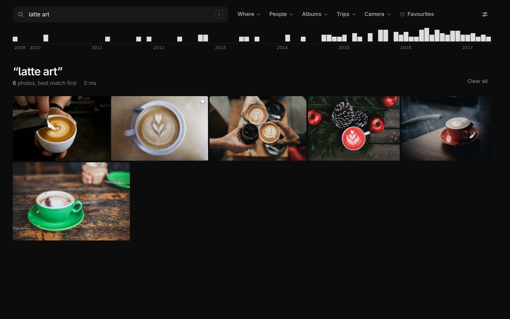
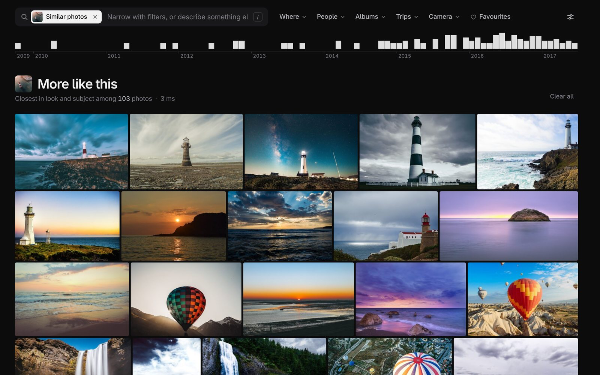
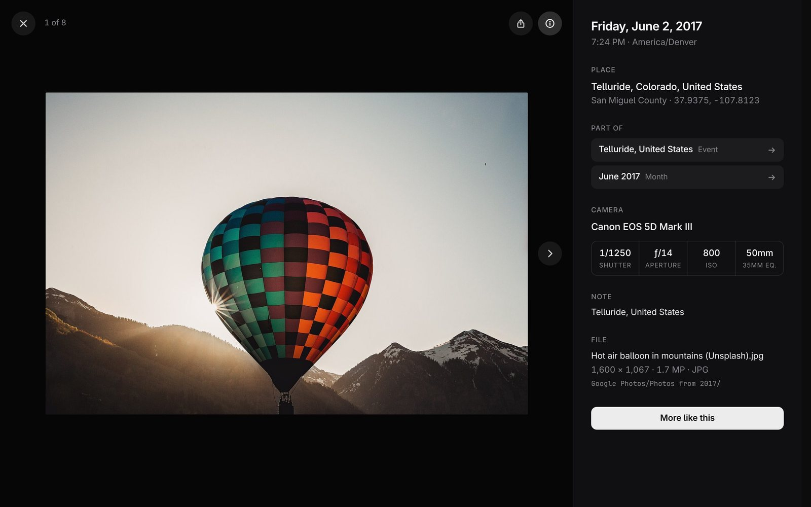
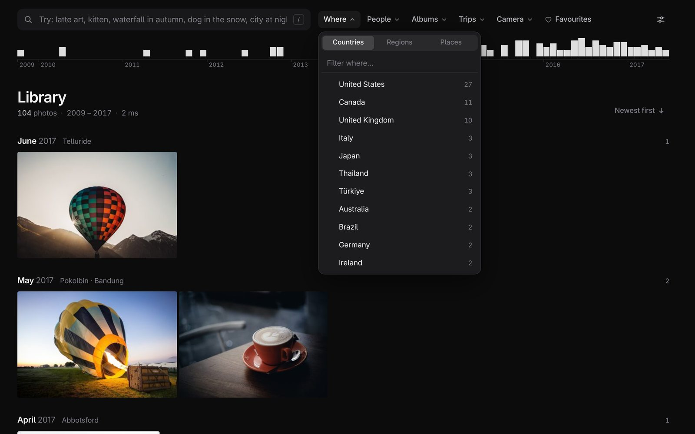
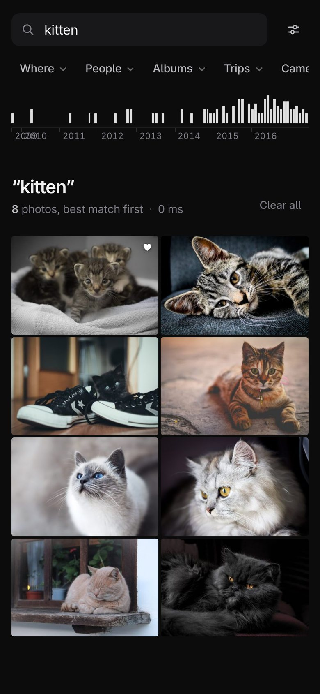

# Photo Estate

**Your whole photo library, on your own disk, searchable by describing what's in a photo.**

Photo Estate gathers every photo and video from Google Photos, iCloud Photos and Flickr onto one
disk, removes the duplicates, keeps each service's metadata (dates, places, albums, people,
favourites), and gives you a fast local app to browse and search it all. Type "latte art" or "dog
in the snow" and it finds those photos, with no tags and nothing sent to the cloud.



Everything runs on your own machine. The archive is deliberately boring: **plain files plus one
SQLite file.** No app, this one included, is needed to read it. If every script here disappeared,
your photos would still be ordinary JPEG/HEIC/MP4 files in folders, and the catalog would still be
readable with `sqlite3`.

## Try it in two minutes

The repo includes a small demo library: 104 CC0 photos, run through the full pipeline and
checked in with their catalog. You need [`uv`](https://docs.astral.sh/uv/getting-started/installation/)
and git; uv fetches the right Python and every dependency.

```bash
git clone https://github.com/jflam/photo-estate.git
cd photo-estate/photo-estate
uv run embed.py serve --demo
```

Open <http://127.0.0.1:8767/>. Browsing works immediately. The first typed search waits for a
one-time download of PyTorch and the SigLIP 2 model (a few GB); after that, searches take
milliseconds on a laptop CPU. No GPU needed.

Things to try:

- Search for **latte art**, **kitten**, **dog in the snow**, **waterfall in autumn** or
  **city at night**.
- Search for something that isn't there, like **kangaroo**: you get "Nothing found", not the
  least-bad guesses.
- Open a photo, then press **More like this**.
- Filter by **Where** or **Camera**, or drag across the timeline to pick a date range.

The demo photos come in groups of eight that look alike (lighthouses, coffee, kittens, snowy
peaks, hot air balloons, sand dunes...), and nothing in the catalog says which group a photo is
in: search finds them from the pixels alone. The demo runs from a scratch copy, so it never writes
to the repo, and it uses port 8767 so it can run beside a real library on 8766.

## A quick tour

**Describe a photo to find it.** Search ranks every photo by how well it matches your words,
using [SigLIP 2](https://huggingface.co/google/siglip2-base-patch16-256) embeddings, and stops
where the matches stop: results that only resemble the surroundings ("latte art" drifting into
plain coffee) are cut, and a search for something you never photographed says so.

**More like this.** From any photo, find the ones closest in look and subject: here, other
lighthouses first, then the sea and sunsets around them.



**Every photo's story.** The viewer shows local time and timezone, place (worked out offline from
GPS), the event and trip it belongs to, camera, lens and exposure. Each of those is a link to the
photos that share it.



**Filters with live counts.** Where, People, Albums, Trips, Camera and Favourites narrow whatever
is showing, and combine with a description. Drag across the timeline to pick a date range, or
click a year.





**At home on a phone.** Add it to your home screen and it behaves like an app: swipe between
photos, swipe down to close, swipe up for details, and pinch or double-tap to zoom. Sharing sends
the original file, so **Save Image** keeps its date and place. Put it behind
[Tailscale](https://tailscale.com/kb/1312/serve) or any reverse proxy to use it away from home.

**Typed filters** work in the search field too: `sunset place:denmark`,
`kids album:"Summer 2019"`, `camera:d300`, `date:2010-07`, `is:fav`.

<br clear="right">

## Bring your own photos

Every source goes through the same steps, and each step only does new work, so adding photos
later is cheap: **ingest → link → exif → places → embed**. Run from `photo-estate/`, with `DB` and
`STORE` set to where you want the catalog and the photos:

```bash
DB=~/estate/estate.db STORE=/Volumes/photos/store
E="uv run estate.py --db $DB"

$E ingest --store $STORE takeout-*.zip          # Takeout zips, Flickr zips, or any folder
$E link                                         # attach each service's metadata
$E exif --store $STORE                          # camera, lens, exposure (needs exiftool)
uv run places.py --db $DB run                   # places, local time, events, trips (offline)
uv run embed.py --db $DB run --store $STORE     # SigLIP 2 embeddings for search
uv run embed.py --db $DB serve --store $STORE   # the app: http://127.0.0.1:8766/
```

Where to get your photos:

- **Google Photos:** a [Google Takeout](https://takeout.google.com/) export (photos come as zips
  with JSON sidecars). `pull-drive.sh` ingests Takeout zips straight from Google Drive with
  rclone, one at a time, so you don't need room for all of them at once.
- **iCloud Photos:** `pull-icloud.sh` mirrors your libraries with
  [icloudpd](https://github.com/icloud-photos-downloader/icloud_photos_downloader) and ingests them.
- **Flickr:** the zips from Flickr's "Download all your data".
- **Anything else:** a folder of photos and videos works too; EXIF supplies the dates.

The same photo in two services is stored once. Ingest is resumable, and nothing is ever modified
or deleted: near-duplicates (resized copies, edits, bursts, RAW+JPEG pairs) are reported for you
to review with `$E review --store $STORE`, never removed.

[DISK-SETUP.md](photo-estate/DISK-SETUP.md) covers choosing storage and running a large pull
overnight. [deploy/MAC-MINI.md](photo-estate/deploy/MAC-MINI.md) shows how to keep the app
running all the time and reach it from your other devices, using a Mac mini as the example; on
Linux the same thing is a systemd user service.

## How it works

```
 Google Takeout zips ─┐
 iCloud (icloudpd)  ──┼─▶ estate.py ingest ─▶ store/ab/cd/<sha256>.<ext>   every unique file, once
 Flickr data zips   ──┘        │                       (content-addressed, never modified)
                               ▼
                         estate.db (SQLite)
                               │
        estate.py link ────────┤  match each service's sidecars to its files; merge onto the asset
        estate.py exif ────────┤  every file's EXIF/XMP/QuickTime tags (exiftool); camera, lens, exposure
        places.py run ─────────┤  place names, local time, events, trips (offline, seconds)
        estate.py dupes/review ┤  exact + near-duplicate report, local review page
        embed.py run ──────────┤  SigLIP 2 image embeddings
        embed.py serve ────────┘  the photo app at http://127.0.0.1:8766/
```

**Ingest** streams each file out of a zip or folder while hashing it. A file whose SHA-256 is
already in the store is recorded as another *occurrence* (source, path, album) of the same
*asset*, and isn't written again. A zip that's already been ingested is skipped.

**Link** is where each service's quirks are handled:
- *Google Takeout* puts metadata in JSON sidecars whose names are truncated, numbered and
  sometimes in a different zip from their photo. Live Photo clips share the still's sidecar.
- *iCloud* (via `icloudpd --xmp-sidecar`) gives XMP files whose timestamps carry the UTC offset, so
  an iCloud copy and a Google copy of the same photo land on the same instant.
- *Flickr* ships originals (`<title>_<id>_o.jpg`) and metadata (`photo_<id>.json`) in separate
  zips; they're joined by photo id.

Where sources disagree, Google's sidecar wins, then iCloud's XMP, then EXIF, then Flickr. Link can
be re-run at any time and gives the same result.

**EXIF.** `estate.py exif` runs exiftool over every asset (images, RAW and video) and keeps the
whole tag dump as JSON, minus maker notes and binary blobs. Camera, lens, focal length, aperture,
shutter, ISO, software, and video duration and frame rate are also promoted to columns, and camera
names are normalised ("NIKON CORPORATION / NIKON D300" becomes "Nikon D300"). Needs exiftool
(`brew install exiftool` on macOS, `sudo pacman -S perl-image-exiftool` on Arch,
`sudo apt install libimage-exiftool-perl` on Debian/Ubuntu).

**Places and events.** `places.py run` works out where and when from what's already in the
catalog, with no network: GPS becomes a place name (offline GeoNames, with big cities winning over
their suburbs: the Eiffel Tower is in Paris, not Vanves) and a timezone; UTC times from Google and
iCloud become wall-clock time where the photo was taken; photos are grouped into events (a gap of
3+ hours ends one) and runs of events far from that year's home into trips ("Trip to Denmark and
Belgium"). Photos without GPS borrow their event's place and zone. Everything is recomputed on
each run, in a few seconds.

**Search** has two layers: SQLite FTS5 over filenames, albums, people, descriptions and tags
(`estate.py search`), and SigLIP 2 embeddings for "describe the photo" search (`embed.py search`
and the app). A typed search keeps the photos within 0.04 cosine similarity of its best match and
above 0.085; both numbers were measured on the demo and on a 100k-photo library, and
`--match-window` / `--match-floor` change them.

**Query log.** The app appends every search and every photo opened from a result list to
`query-log.jsonl` next to the catalog, on your machine only (`--query-log` to move it). It's there
to pick evaluation queries from real use; nothing in the app reads it back.

## Where it runs

The software makes very few assumptions about the machine and disks it runs on:

| Piece | Requirement |
|---|---|
| **Store** (`--store`) | Any directory you can read and write: a USB disk, an internal drive, an SMB/NFS share on a NAS, an `rclone mount` of a bucket. Files are named by their SHA-256, so any filesystem works, case-insensitive ones included. Files are only ever added, never changed. |
| **Catalog** (`--db`) | One SQLite file. **Keep it on a local disk, not a network share**: SQLite's locking isn't reliable over SMB or NFS. It's small (about 1 GB for 120k photos, mostly embeddings). |
| **Thumbnail cache** | `review/` next to the catalog by default (`--cache` to move it). About 2.5 GB for 100k photos. If the catalog's disk is a spinning one, add `--fast-cache` on an SSD. |
| **A machine to run it** | Anything that runs Python through [`uv`](https://docs.astral.sh/uv/): macOS or Linux, Intel or ARM. 16 GB of RAM is enough to serve 100k photos. No GPU needed; SigLIP runs on the CPU. |
| **Remote access** (optional) | The app listens on `127.0.0.1` only. Put whatever you like in front of it: [Tailscale](https://tailscale.com/kb/1312/serve) `serve`, Caddy, nginx, or nothing if you only use it on that machine. |

`--db` and `--store` are separate arguments everywhere, so the catalog and the photos can live on
different devices. Ingest and embedding read every original, so they run at the store's speed (a
USB hard disk does about 150–200 MB/s); browsing and search only touch the catalog and thumbnail
cache, which is why those should stay local.

**At scale:** the author's own library is about 102k photos and 19k videos (485 GB) from all three
services, with ~10k duplicates collapsed and ~130 trips found, served from an M1 Mac mini with
16 GB of RAM and a USB hard disk.

## Layout

```
docs/screenshots/      the screenshots in this README (tools/screenshots.py retakes them)
photo-estate/
  estate.py            ingest, link, exif, dupes, review, tag (any OpenAI-compatible VLM), search, stats
  embed.py             SigLIP 2 embeddings: run, search, serve (the photo app)
  places.py            place names, local time, events, trips
  search.html          the photo app served by embed.py
  app/                 home-screen app files: manifest, icons, service worker
  review.html          the near-duplicate review page served by estate.py
  pull-drive.sh        pull Takeout zips from Google Drive one at a time and ingest them
  pull-icloud.sh       mirror iCloud libraries with icloudpd and ingest them
  demo/                104 CC0 photos as a ready-made library (`embed.py serve --demo`)
  tests/test_poc.py    end to end on a synthetic Takeout + iCloud + Flickr export
  tools/               demo builder, screenshots, icon maker, speed benchmarks
  deploy/              running the app as an always-on service (launchd agents, Mac mini guide)
  PLAN.md              the overall plan and phases
  DISK-SETUP.md        choosing and preparing storage, the overnight pull, checking the archive
  TAGGING-RESEARCH.md  the tiered tagging pipeline (what comes after embeddings)
  PERFORMANCE.md       where the photo app's time goes, and open tasks
  BENCHMARK.md         library stats and the benchmark set used to compare models
```

## Contributing

Contributions are welcome: bug reports, ideas, and pull requests. The demo library means you can
work on the app without any photos of your own.

```bash
cd photo-estate
uv run tests/test_poc.py          # end-to-end test; no accounts or models needed
uv run embed.py serve --demo      # the app on the demo library
```

Good places to start:

- **Open performance tasks** in [PERFORMANCE.md](photo-estate/PERFORMANCE.md), each written up
  so it can be picked up as-is.
- **Not yet supported:** RAW files and videos aren't embedded yet, and there are no faces.
- **The next tagging tiers** (captions, objects, OCR) are designed in
  [TAGGING-RESEARCH.md](photo-estate/TAGGING-RESEARCH.md).
- **More sources:** Amazon Photos, OneDrive, Dropbox, or a phone's camera roll would each be a new
  set of sidecar rules in `estate.py link`.
- **Better demo photos:** `demo/photos.json` is the list; `uv run tools/make_demo.py` rebuilds it.

Each script declares its own dependencies inline, so there's no environment to set up. Please keep
the archive's promise in any change: files are only added, never modified or deleted, and the
catalog stays readable without this code.

## Credits

The demo photos are CC0 Unsplash photos hosted on Wikimedia Commons; each one's author and source
is in [photo-estate/demo/CREDITS.md](photo-estate/demo/CREDITS.md). Search uses Google's
[SigLIP 2](https://huggingface.co/google/siglip2-base-patch16-256), places use
[GeoNames](https://www.geonames.org/) through `reverse_geocode`, and metadata comes from
[ExifTool](https://exiftool.org/).

## License

The code is [MIT](LICENSE). The demo photos are CC0 (public domain dedication), as listed in
[CREDITS.md](photo-estate/demo/CREDITS.md).
