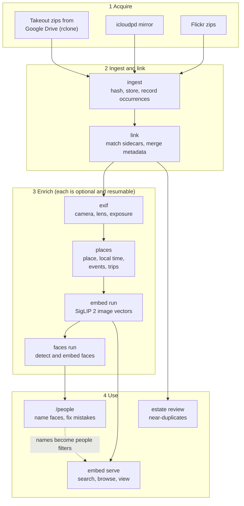
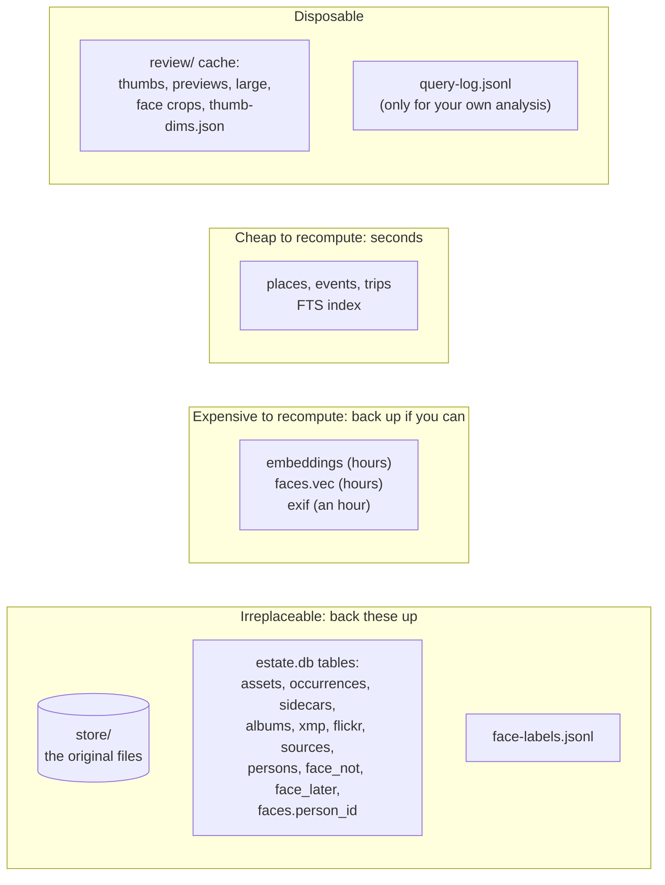
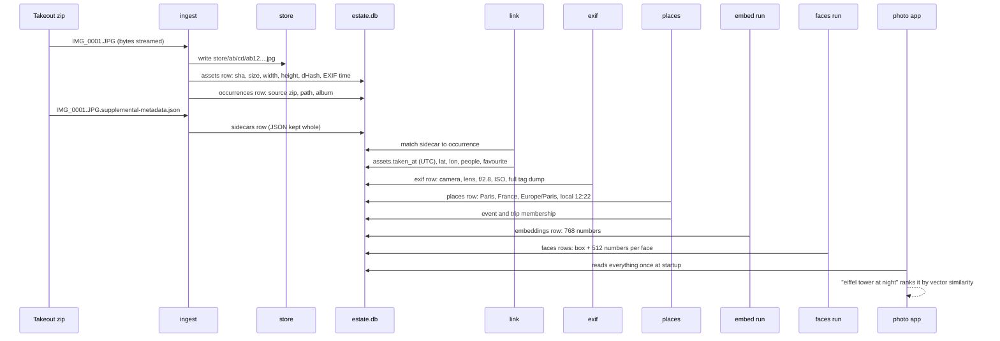

# 1. The big picture

## The problem

By the 2020s a typical person's photos live in three or four services at once. A phone uploads to
iCloud. An Android phone or an old camera roll uploads to Google Photos. A decade-old Flickr
account still holds the pictures of the first digital camera. Each service stores *your* pictures
but keeps *its own* idea of what they mean: Google knows who is in a photo and has an edited date,
iCloud knows which ones you marked as favourites, Flickr knows the title you gave it in 2009.

Three things go wrong with that arrangement:

1. **You do not own it.** If the account is closed, the service changes its terms or the
   storage plan lapses, the photos go with it.
2. **The same photo is in several places**, usually with different file names, different sizes and
   different metadata, so no single service has the whole truth about it.
3. **Search is what the service gives you.** You cannot ask a service to find "dog in the snow" in
   a way you control, or to find photos in a way that works the same across all of them.

Photo Estate is a pipeline and an app that fixes all three, on hardware you already own.

## The approach in five decisions

Almost every file in the repository follows from five decisions. Understanding these is
understanding the program.

### 1. The archive is plain files plus one SQLite file

Photos sit on disk as ordinary JPEG, HEIC and MP4 files. Everything else the system knows is in a
single SQLite database. No app, this one included, is needed to read the archive. If every script
disappeared, you would have a folder of photos and a database you can open with `sqlite3`.

### 2. Files are named by what they contain

A file is stored at `store/ab/cd/<sha256>.<ext>`, where `<sha256>` is the hash of its bytes. This
one choice gives de-duplication for free (the same bytes get the same name), makes the store safe
to copy and merge (names never collide, and a name collision means identical content), and makes
corruption detectable on any filesystem (re-hash the file and compare with its name). See
[chapter 4](04-store-and-ingest.md).

### 3. Nothing is ever modified or deleted

Ingest only adds. Duplicate detection only *reports*. The review page only *records choices*. The
store is append-only, which makes backup trivial (`rsync` copies only new files) and makes every
bug in later stages recoverable: the originals are still there.

### 4. Every stage is a resumable script that does only new work

The pipeline is `ingest → link → exif → places → embed → faces`. Each stage records what it has
finished in the database, so re-running it after adding photos processes only what is new, and
re-running it after a crash picks up where it stopped. Where a result is cheap and depends on
everything (places, events, trips), the stage simply recomputes it from scratch every time, which
is simpler than keeping it consistent incrementally.

### 5. Search is read before it is ranked

An image model can tell a lighthouse from a latte, but it cannot know who your children are, and
it can only guess a location from how a place looks. So a typed query is first read for typed
filters (`place:denmark`), then for names of people and places the library knows about, and only
the words left over are given to the image model. "ben san diego" becomes *Ben's photos taken in
San Diego*, not *photos that look like a sunny street*. See [chapter 12](12-search-language.md).

## The pipeline

Two of the arrows deserve a note.

- **`places` runs after `exif`** because it uses the timezone offsets that cameras write into EXIF
  to work out local time for photos without GPS.
- **`faces` feeds back into search.** Names you confirm on the People page become people in the
  catalog's search facets, alongside the people Google tagged.

## What is stored where

The sidecar JSON from Google is the one that surprises people: Google's date and location
*edits* exist only in those sidecar files, not in the photo. That is why `sidecars` is kept in the
catalog in full (as JSON), and why `link` can be re-run at any time.

## A day in the life of one photo

Follow a single photo, `IMG_0001.JPG`, taken in Paris in 2019 and found in a Google Takeout zip.

Each of those arrows is a chapter.

## What the app can do

The following is the complete list of user-visible features; each is explained where it is built.

| Feature | Where explained |
|---|---|
| Describe a photo to find it ("dog in the snow"); a search for something not in the library says "Nothing found" | [10](10-embeddings.md), [12](12-search-language.md) |
| More like this (find the closest photos to one you are looking at) | [10](10-embeddings.md), [11](11-server.md) |
| Names and places in a query become filters ("ben and matthew on a beach", "ben san diego") | [12](12-search-language.md) |
| Typed filters: `place:`, `camera:`, `album:`, `person:`, `year:`, `date:`, `event:`, `trip:`, `is:fav` | [12](12-search-language.md) |
| Filter pills with live counts: Where, People, Albums, Trips, Camera, Favourites | [11](11-server.md), [13](13-photo-app.md) |
| Drag-to-select timeline with a month histogram | [13](13-photo-app.md) |
| Justified photo grid grouped by month, day, or not at all | [13](13-photo-app.md) |
| Full-screen viewer with a details panel: local time, place, event and trip, camera and exposure, each a link | [13](13-photo-app.md) |
| Phone gestures: swipe between photos, swipe down to close, swipe up for details, pinch and double-tap zoom, thumbnail scrubber | [13](13-photo-app.md) |
| Share or save the original file (keeps its date and place) | [13](13-photo-app.md) |
| Hide near-identical shots (Google + iCloud copies, bursts) | [11](11-server.md) |
| Installable as a home-screen app, with a friendly offline page | [13](13-photo-app.md) |
| People page: confirm faces in bulk, find mistakes, follow a child through the years, name unknown groups | [14](14-faces.md), [15](15-human-corrections.md) |
| Near-duplicate review page | [8](08-duplicates.md) |
| Full-text search from the command line, over filenames, albums, people, descriptions, tags, camera, place | [9](09-text-search-and-tags.md) |
| Local vision-model captions and tags (any OpenAI-compatible server) | [9](09-text-search-and-tags.md) |
| A query log for picking evaluation queries from real use | [11](11-server.md) |
| A demo library of 104 CC0 photos | [17](17-testing-and-demo.md) |
| Always-on service, thumbnails on a fast disk, reachable over Tailscale | [16](16-operations.md) |
