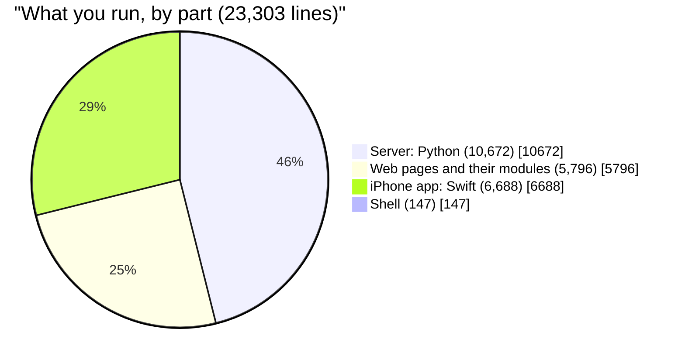
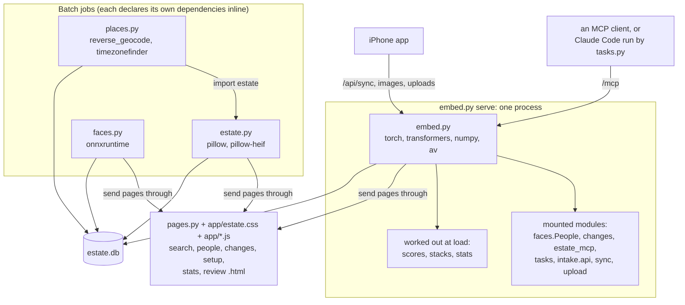

# 2. A tour of the code

## How much code is there?

Measured with `tokei` on 2026-11-21 (219 commits, 2026-11-11 to 2026-11-21), counting lines of code
(not blanks or comments), with the CSS and JavaScript inside each web page counted as code, and
leaving out the checked-in demo library and every Markdown file:

| | Files | Code lines |
|---|---:|---:|
| **Server** (Python: `photo-estate/*.py`, `intake/` and `core/`) | 41 | 10,672 |
| **Web pages** (seven pages, the shared stylesheet, the service worker) | 9 | 4,664 |
| **The pages' script modules** (`app/*.js`, without their tests) | 21 | 1,132 |
| **iPhone app** (Swift, plus `deploy.sh`) | 34 | 6,705 |
| Shell scripts the pipeline runs (`pull-drive.sh`, `pull-icloud.sh`, `ingest-iphone.sh`) | 3 | 130 |
| Tests (`tests/`: 16 self-running scripts, 20 pytest files, `conftest.py`) | 37 | 7,741 |
| The script modules' unit tests (`app/tests/`) | 22 | 2,619 |
| Developer tools (`tools/`: demo, screenshots, benchmarks, the book's site, the scorers' tools, cloud scripts, square export and embedding, the video demo) | 27 | 3,506 |
| The cloud preview on the Mac mini (`deploy/*.sh`) | 4 | 330 |
| **Total** | **198** | **37,499** |

The web pages' 4,664 lines are 3,085 of JavaScript, 950 of CSS and 629 of HTML markup (tokei counts
the script of `setup.html`, a module it does not parse, as markup). What you run (the server, its pages
and their modules, the iPhone app and the three pipeline scripts) is **23,303 lines of code**:



When this book was first written, on 2026-11-13, the server and its pages were 5,483 lines and there
was no iPhone app. Eight days later the server, pages and modules are 15,487 lines and the iPhone app
is 5,734. A few things stand out:

- **Most of the code is interface.** The web pages, their modules and the iPhone app are 11,547 lines,
  54% of what you run. A justified grid, a viewer that grows out of its tile, pinch zoom, a filter
  sheet with live counts and a video player take more code than any model.
- **The AI models are a small fraction of the code.** The embedding job is about 150 lines in
  `embed.py` (`_decode`, `_decode_video` and `cmd_run`, videos included); face detection, alignment
  and recognition (`Models`) are about 80 lines in `faces.py`; the two "best photo" scorers are applied
  in under 100 lines of `scores.py`. The rest deals with the unglamorous parts: reconciling metadata
  from three services, laying out a grid, keeping a phone's copy in step, and making it fast.
- **The server has grown by adding modules, not by growing modules.** Each feature since the first
  week is a file of its own with a `handle(method, path, body)` method that `embed.py serve` mounts:
  `faces.People`, `changes.Changes` (albums and change sets), `intake.api` (the setup page),
  `estate_mcp` (the MCP endpoint) and `tasks.Tasks` (the agent). The exception was `cmd_serve`
  itself, which grew from 660 lines to about 1,640; on 2026-11-19 it was split the same way, into
  `catalog.py`, `browse.py`, `images.py`, `admin.py` and `encoder.py` ([chapter 11](11-server.md)).
  Videos (2026-11-21) followed the rule: `video.py` is new, and the rest is a few dozen lines in each
  module that a video passes through.
- **The tests are about a quarter of the code.** Sixteen scripts, each run with `uv run tests/<file>`,
  twenty ordinary pytest files, and a small harness that runs them all with one command and in CI;
  7,741 lines, and 2,619 more of unit tests for the pages' script modules
  ([chapter 17](17-testing-and-demo.md)).
- **The documentation is a third as large as the code.** The Markdown in the repository is about
  11,200 lines, 8,900 of them this book.

## File by file

Code lines, measured as above (a script module's JSDoc comments are not counted).

```
photo-estate/                  the server and the web app (Python run with uv; no build step)
  embed.py             351  image and video embeddings: run, search, and serve (cmd_serve: find the library, build a PhotoApp, serve it)
  photo_app.py         813  the photo app as an object: PhotoApp (wiring, who a request is for and what it may do, the
                            request-access page and /members' routes, favourites, reloads) and its HTTP
                            handler, which streams uploads, album downloads and videos (/video/, with Range)
  http_util.py         186  what the servers share: Response, bounded JSON bodies, int_param (400s), byte_range, the Auth rules
  members.py           180  who the estate knows: members, their Tailscale logins, roles and upload policies; the first
                            start from --upload-user, the demo's members; every change journaled; a member's own
                            agents, one per device (agent_bindings: pending, approved, revoked) (chapter 11)
  journal.py            63  the estate's append-only log: append(con, actor, kind, subject, data) in the caller's
                            transaction, since(con, id); the kinds, where each is appended and who may read it;
                            by_agent (a member's own agent's writes) and for_member (journal_since) (chapter 11)
  lenses.py            360  what each member sees: filter lenses and series, subscriptions (live, snapshot, opting
                            out of an estate default), "show it anyway", each member's favourites, why a photo is
                            hidden; State, the looks every member view is worked out from (chapter 11)
  private.py           745  photos private to their sharer (chapter 11): who may be shown a photo, the sharer ingest
                            records from the inbox's member folder, withdrawing and releasing (now, or on a day:
                            the app's timer), the hold at ingestion (PROMPTS and HOLD_AT, in one place, and the
                            phone's screenshot mark), the one-off run over the library (`private.py library
                            --dry-run`) and looking held photos over (/held: review_list, its order and sections,
                            and review, "Reviewed up to here"); every writer of a row takes the write lock and
                            reads it again first (_begin); the phone gate's tombstones (a member's opt-outs)
  hold-prompts.json         the hold's prompts as SigLIP text vectors, made once by `embed.py hold-prompts`
  member_inbox.py      169  each member's inbox (inbox_items; not the upload folder): put, close and retitle, called by the
                            code that makes and decides each kind, what an item opens, the member's list,
                            dismissing; a lens that changed tells its live subscribers once (chapter 11)
  stories.py           486  questions and stories (chapter 11): ask (only photos the recipient may be shown), the
                            inbox's weekly allowance, ranking and grouping (deal), answering typed or spoken,
                            telling a story, who may read one, a recording into the store with no assets row
  listeners.py         211  what the estate does by itself: listeners reading the journal from their cursors, at
                            least once; series kept up to date as photos arrive, an answer that wakes the agent
  transcribe.py        210  a story's recording written out on this computer (Parakeet TDT 0.6B v2: MLX on a Mac, ONNX
                            on an NVIDIA GPU or the CPU elsewhere; PyAV reads the audio, no ffmpeg); `fetch` the model by hand; the app's queued job (chapter 11)
  catalog.py           840  the photo app's library in memory: load(), Catalog (videos, their frames, Live Photo
                            clips, the same for every member), View (what one member sees: mask, stacks, trip
                            cards, counts, favourites), Live and visible_for, the one way to ask (chapter 11)
  browse.py            389  search, similar, facets, Years and Months, layout; an agent's searches; kind and is:video
  images.py            251  thumbnails (WebP), previews, large images and originals, a video's from its poster;
                            making them in the background; which file /video/ sends
  video.py             112  still frames out of a video with PyAV: when to look, frames, the poster, which to keep (chapter 10); a heavy video's copy to play from (chapter 11)
  admin.py             326  phone uploads (a tombstoned one refused, before its body when its hash is sent), the
                            ingest, restart, /stats, backups
  encoder.py           174  SigLIP's text (and image) side, for the photo app: loaded when asked for, let go when idle
  compare.py           340  an experiment: a fixed list of searches ranked by a second model beside the app's own, voted on, and a report, at /compare (chapter 10)
  compare-terms.txt     30  the searches a comparison asks, one a line
  estate.py          1,219  ingest, link, exif, live (Live Photo pairs), dupes, review, tag, search, stats; purge (one
                            photo for good, by hand) and migrate (every photo's first sharer, the Estate defaults lens,
                            owners and favourites); the immutable flag (chapter 4)
  faces.py             979  faces: run, serve, and the People class (who is who)
  changes.py           473  albums and change sets: proposed, reviewed, applied, reverted, discarded as a mark (chapter 26)
  places.py            388  place names, local time, events, trips
  estate_mcp.py        423  the library as MCP tools for an agent, at /mcp: who a call is for (a login, a run's
                            token), ask_member, stories in get_photos (chapter 26)
  upload.py            340  receives phone uploads into an inbox (chapter 24)
  tasks.py             317  a request in words, worked on by Claude Code on the library's computer: the estate's
                            agent, a token per run, who started each run (chapter 26)
  stats.py             181  the numbers behind the /stats page
  sync.py               98  the change feed a phone syncs from (chapter 20)
  scores.py             88  which photos are best: the two scorers (chapter 25)
  stacks.py             74  near-identical shots as one stack (chapter 25)
  pages.py              82  puts the shared stylesheet into each page as it is sent, and says which
                            script modules (app/*.js) a server sends at /app/<name>.js; the request-access page
  intake/            1,235  the setup page's engine: sources, jobs, the pipeline every source feeds (chapter 16)
  core/                     what several parts must agree on, standard library only (issue #85):
    media.py                  file types: extension -> MIME, the image/video/RAW/upload sets, what each decoder skips,
                              what /video/ sends each video as (VIDEO_TYPES)
    schema.py                 every SQLite table of every database, and the additive migrations: ensure(con, area);
                              the protected tables' triggers (chapter 5)
    config.py                 the default ports (8766 real, 8767 demo, 8768 preview, 8769 sandbox, 8765 review, 8764 faces)
    states.py                 the finite string domains as StrEnums (change set op/status/state, decisions, task,
                              ingest, intake job and stage, clustering), each value the string already stored (issue #90)
                              and the moves each job lifecycle may make (TASK_MOVES, JOB_MOVES) with check_move,
                              which raises IllegalMove for any other (issue #86)
    lifecycle.py              Lifecycle: idle | loading | ready | failed for what loads in a thread (the search
                              model, the People page), under a lock, so a request hears "loading" or "failed" (issue #82)
    procs.py                  stop(proc, grace): SIGTERM, then SIGKILL after the grace (tasks, intake jobs; issue #86)
    events.py                 the steps' event lines (`@@pe {json}`, version 1.0, only with PHOTO_ESTATE_EVENTS=1):
                              progress and new_assets/catalog_ready, emitted by estate, places, embed, faces and
                              ingest-iphone.sh, read by intake/engine.py and upload.py (issue #84, chapter 16)

  search.html        2,092  the photo app: Library, Albums and Search (HTML + CSS + its own script, a module)
  people.html          796  the People page
  changes.html         601  reviewing an album or change set, at /changes; and in its held mode, looking held
                              photos over, at /held (the same wall: mark to release, "Reviewed up to here")
  setup.html           429  bringing photos in, at /setup
  stats.html           282  library info, at /stats
  members.html         128  the sysadmin's members: let in, turn off, role, upload policy, person, at /members
  inbox.html           102  a member's inbox: what waits for them, each opening the page that decides it, at /inbox
  agents.html          143  Connect your agent, at /agents: the command and a configuration with this app's address,
                            where an agent can run, and the member's own agents, allowed or turned off (chapter 11)
  review.html          255  the near-duplicate review page
  compare.html         226  a run of the model comparison: two unlabelled columns a search, a vote, and the report, at /compare
  app/estate.css        97  the stylesheet every page shares
  app/sw.js             38  service worker: the "can't reach your photos" page
  app/                      the script every page shares: native ES modules with JSDoc types, imported by
                            address (/app/dom.js), no bundler (issue #89, chapter 13):
    dom.js              19    $, $$, the one esc() (& < > " '), on, the icon's picture (MARK)
    api.js              69    api(path, body, options): JSON in and out, one ApiError (status, message, body),
                              cancelled by an AbortSignal, an optional timeout
    fsm.js             120    machine() (a state machine with a table of steps), flow() (a strict machine whose
                              states own their data), latest() (one piece of async work at a time; a stale
                              answer is dropped), poll() (bounded, cancellable); the rule about refused steps
    toast.js            19    the line of text that rises from the bottom of a page, with an optional Undo
    format.js           12    fmt, plural, dateParts, duration (a video's length as a clock)
    query.js            37    search.html's question as a value and as the address: blank, toParams, fromParams
    layout.js           22    the justified grid's arithmetic: packRows, clampShape, shapeFromByte
                              search.html's state over time (issue #81; chapter 13, "The machines"):
    grid-flow.js        99    one list of photos: its first page, more at either end, the retry after a page
                              that did not come; another list aborts the one before
    library-flow.js     61    the Library: the scale showing with its anchor and trail, and what is known of the
                              months (unknown, asking, known, failed)
    albums-flow.js      75    the Albums tab: the list or an album; the list of albums; an album made from a
                              search, cancellable until the request that makes it is sent
    compare-flow.js     92    a run of the model comparison (compare.html): its steps, votes sent as models not sides
    viewer-flow.js      64    the photo viewer and its history entry (closed, open, leaving), what the open
                              viewer owns, and the table of a touch on the photo
    favourite.js        84    the heart, and an album's "make all favourites": shown at once, saved one request at a time, put back when a save fails
                              what the secondary pages do over time (issue #80; "The web pages" below):
    loop.js             51    loop(): a page asking the server again and again, one step at a time, paused and
                              stopped from outside; until(): poll() that answers how it ended instead of throwing
    work.js             48    single() (a save that can not overlap itself, free again when it fails), batch()
                              (which of several requests were done when one failed), serial() (one at a time, in order)
    save-queue.js       58    review.html's saves: one request at a time, a failed one retried under newer choices
    changes-flow.js     23    changes.html: settle() (the bounded wait for the library), edits() (marks put right
                              from the server when one fails)
    people-flow.js      21    people.html: unknownFaces(), the bounded wait for the groups of unnamed faces
    stats-watch.js      50    stats.html's one loop for the figures and the uploads
    setup-flow.js       45    setup.html's two strict state machines (the page, the source panel) and their tables
    members-flow.js     51    members.html's strict machine (loading, ready, saving one change at a time, failed)
                              and what each member's row offers
    lens-flow.js       165    lenses on the pages: search.html's Albums tab (the lenses, one change at a time;
                              what each row says and offers), the viewer's "why" line (asked once a photo
                              stays, "show it anyway"), and the words for a lens that changes.html shares
    inbox-flow.js       60    inbox.html's strict machine (loading, ready, dismissing one item at a time, failed),
                              what each kind's button says, and the count the Library's menu shows
    agents-flow.js     173    agents.html's strict machine (loading, ready, deciding one agent at a time, failed; a
                              refresh that fails keeps the page), how each agent is said, the command and configuration
    private-flow.js    133    private photos on search.html: the viewer's private line (withdraw, release, a release
                              day) and the held view (`is:held`: what it shows of what is held, the way to /held,
                              and releasing those chosen)
    held-flow.js       113    changes.html's held mode (/held): its strict machine (loading, reviewing, sending,
                              failed), what "Reviewed up to here" covers, why a photo is held, the page's words
    story-flow.js      266    telling a story, typed or spoken (the teller: its strict machine, the browser's
                              MediaRecorder and microphone, the component's HTML, mountTeller), a story's words and
                              HTML, follow() (a transcript asked for again until it is written), and the viewer's
                              stories of the photo showing; inbox.html and search.html share it
    ask-flow.js         70    inbox.html's questions view (/inbox?ask=<group>): an item's questions, answered or put
                              away one at a time, and who asks
    video-flow.js       63    what plays in search.html's viewer: still, video, failed, live; every step out of
                              video or live lets the element's stream go (chapter 13)
    tests/           2,800    their unit tests (video-flow.test.js, lens-flow.test.js among them), run by Node's own runner: `npm test` (chapter 17)
    package.json              TypeScript, pinned, to check the modules' types (`npm run typecheck`); with
    package-lock.json         tsconfig.json and .npmrc (the lockfile names no registry). Nothing here is
                              shipped: the browser loads the modules as they are

  pull-drive.sh         58  rclone: Takeout zips from Drive, one at a time
  ingest-iphone.sh      49  catalogue what the phone uploaded, touching only the new photos
  pull-icloud.sh        23  icloudpd: mirror iCloud, then ingest
  tests/             7,994  16 self-running test scripts and 23 pytest files; conftest.py runs the scripts under pytest,
                            test_harness.py checks it;
                            test_photo_app.py, test_http_util.py and test_compare_app.py call the app in process (chapter 17);
                            test_members.py checks members.py and its journal entries on a scratch catalog;
                            test_journal.py checks journal.py and the one entry each write appends;
                            test_lenses.py checks lenses.py's rules and writes on a scratch catalog;
                            test_member_inbox.py checks member_inbox.py and each kind's making and closing there;
                            test_agent.py checks the estate's agent: a run's token (from this computer only, while
                            the run lasts, for its member; X-Estate-Task refused) and each kind of MCP caller;
                            test_personal_agents.py checks a member's own agent: every kind of /mcp caller, binding
                            (never from the agent's own device), no task tools, journal_since kind by kind and its
                            cursors, privacy, a series kept up to date end to end;
                            test_listeners.py checks listeners.py with a stand-in app, then end to end with a
                            stand-in agent: a family series and a member's own kept up to date, an answer waking a run;
                            test_stories.py checks questions and stories: nothing private through a question, a story
                            or a recording; the allowance, ranking and grouping on a fake clock; a spoken answer
                            through upload, the queue and a stand-in transcriber; the triggers; a purge;
                            test_tombstones.py checks the phone gate's tombstones: the endpoints, an upload refused
                            before its body and dropped from staging, one member's opt-out against another's copy,
                            a purge, the phone's screenshot mark reaching the hold;
                            test_private_states.py replays, on a scratch catalog, each way the model of a private
                            row (specs/PrivatePhoto.tla) found it could go against its sharer's word: a day set on
                            a photo not checked yet, and a release or withdrawal landing while check, the library
                            run or the timer is between its read and its write;
                            test_specs.py runs TLC on every model in specs/ (skipped without Java and tla2tools.jar);
                            test_private.py checks private photos: who may be shown one with one to three sharers,
                            every way a photo leaves the app (over real HTTP too), People, release on a day, an
                            agent, ingest's sharers and the hold before any reload, the one-off run, and the
                            review of held photos (its order, up to here, the inbox item, every caller refused alike);
                            test_multiplayer.py checks, as the demo's three members, what each sees everywhere, and
                            that no route asks it any way but Live.visible_for (it reads the code);
                            test_append_only.py checks the protected tables, the sources only adding, the
                            immutable flag, purge and migrate on scratch catalogs and stores;
                            test_core.py checks core/ against what the code before it did;
                            test_types.py checks the typed contracts (Catalog's fields, the enums) and runs pyright;
                            test_lifecycle.py makes the background loaders fail and race on purpose (issue #82);
                            test_live_races.py races reloads, favourites, Browse's cache and the gate (issue #83);
                            test_faces_consistency.py keeps People's memory, SQLite and the face journal agreeing (issue #87);
                            test_job_lifecycles.py races the ingest job, tasks, intake jobs and the sync cursor (issue #86);
                            test_events.py checks the steps' event lines at both ends (issue #84);
                            test_pregenerate.py checks the WebP thumbnails and the background thumbnails and previews (#26, #104);
                            test_video.py checks video.py, the Live Photo pairing and videos in the catalog, on small
                            videos it makes (fast tier); test_video_app.py (slow tier) tries videos in the running app
                            over HTTP, on the library tools/video_demo.py builds;
                            test_pages.py checks that every page imports only script modules and names that exist,
                            and that the servers send the modules as JavaScript (issue #89);
                            test_pages_browser.py (734 lines, slow tier) drives the secondary pages in a real
                            browser with Playwright and makes their requests fail or never end (issue #80);
                            test_video_browser.py (slow tier) plays videos and Live Photos in search.html, in Chrome;
                            test_lenses_browser.py (slow tier) uses the lenses on the pages as Ada, Ben and Cleo;
                            test_inbox_browser.py (slow tier) uses the inbox as them, and a stranger asking in;
                            test_agents_browser.py (slow tier) connects Ben's and Cleo's agents and allows and turns
                            them off from the inbox and /agents;
                            test_private_browser.py (slow tier) withdraws, releases and reviews held photos as Ben and Cleo;
                            test_held_browser.py (slow tier) looks Ben's held photos over on /held a stretch at a time;
                            test_stories_browser.py (slow tier) answers questions typed and spoken, tells stories,
                            grows a series and asks the agent for the family, as them
  tests/fixtures/           schema_baseline.json (sqlite_master as older code made it, and the tables and columns
                            added since), screenshot_rules.json
                            (which photos are screenshots, for the server's and the iPhone app's tests)
  pyproject.toml            dependency groups (core, ml, faces, places, tools, dev), pytest, ruff and pyright settings (chapter 17)
  uv.lock                   every dependency of those groups, pinned; CI installs from it (chapter 17)
  tools/             3,506  demo builder, screenshots, icons, benchmarks (bench_views.py: the member views on a
                            library of the real size), book site, aesthetics/, cloud-*.sh,
                            video_demo.py (a copy of the demo library with videos and Live Photos, chapter 17),
                            export_squares.py (the Library as square JPEGs in tar shards, for embedding experiments),
                            embed_squares.py (a second model's vectors for those shards, for /compare),
                            thumb_formats.py (what a thumbnail costs in each image format, on a sample of the library)
  deploy/              330  launchd plists, photo-search.service (systemd) and HOME-COMPUTE.md for the Linux PC, the cloud
                            preview's scripts, MAC-MINI.md, CLOUD-SESSIONS.md
  specs/               193  TLA+ models of state the code keeps, checked by TLC (tests/test_specs.py; README.md
                            says when a change needs one, how to read one and how to run them; chapter 17):
                            PrivatePhoto.tla, one `private` row and everything that writes it; <Name>.cfg is the
                            code as it is, <Name>.before.<invariant>.cfg the code before a fix, which must still fail
  demo/                     104 CC0 photos, their catalog, and credits

ios/                 6,705  the iPhone app (chapters 19-24, 26)
  PhotoEstate/Library/   4,066  grid, viewer, Library and Search tabs, albums, filter sheets, the phone's own photos,
                                Movie.swift (178: a video and a Live Photo's clip in the viewer, its bar),
                                Private.swift (71: the viewer's private mark, withdraw and release)
  PhotoEstate/Catalog/     985  the replica of the catalog, reading a search, the server's JSON API
  PhotoEstate/Images/      306  thumbnails and kept photos
  PhotoEstate/Gate/      1,044  the Inbox tab and the phone gate's half in the app: who I am, batches to look over,
                                older photos by chunk, kept back and "share after all" (chapter 24); a question
                                answered natively, typed or spoken (QuestionsView.swift, Teller.swift: the recorder,
                                a story's row and its player), StoryModel.swift (plain values and functions, checked on the Mac)
  PhotoEstate/*.swift      432  the tab bar, the look, This iPhone, uploads, the in-app web view
  UploadExtension/         106  the background upload extension (jobs, or candidates for the Inbox)
  Shared/                  347  the server's address (and a debug build's demo member), the upload request, the
                                extension's log, PhoneGate.swift (217: the gate's rules and state, in the app group)
  Tests/                   220  the phone's unit tests (the gate, the upload request, questions and stories): run.sh
                                compiles them with Shared/ and StoryModel.swift for the Mac and runs them
  project.yml, project-sim.yml, deploy.sh, build-number   XcodeGen specs; build and install on the phone
```

The largest Swift files are `Viewer.swift` (762), `Grid.swift` (698), `Albums.swift` (490),
`SearchView.swift` (470), `LibraryModel.swift` (434) and `Query.swift` (378).

### estate.py: the catalog tool

This is where a library becomes a catalog. Its sections (marked by comment banners in the file) are:

| Section | What it does | Chapter |
|---|---|---|
| `SCHEMA` and helpers | The catalog's tables (`core/schema.py`'s `CATALOG`), `connect()`, `blob_path()`; file types from `core/media.py` | [5](05-catalog.md) |
| `ingest` | Stream files out of zips or folders, hash, store, record | [4](04-store-and-ingest.md) |
| `link` | Match sidecars to media; merge Google, iCloud and Flickr metadata onto assets | [6](06-linking.md) |
| `exif` | Run `exiftool`, keep the dump, promote camera/lens/exposure | [7](07-places-events-trips.md) |
| `live` | Pair Live Photo clips with their stills (`pair_live`, also run at the end of `exif`) | [6](06-linking.md) |
| `reindex` | Rebuild the full-text index | [9](09-text-search-and-tags.md) |
| `dupes` | Near-duplicate clustering and the report | [8](08-duplicates.md) |
| `review` | The local web server for the review page | [8](08-duplicates.md) |
| `tag` | Caption and tag images with any OpenAI-compatible vision model | [9](09-text-search-and-tags.md) |
| `search`, `stats` | Command-line full-text search and a summary | [9](09-text-search-and-tags.md) |

It depends only on Pillow and pillow-heif. It deliberately does *not* import PyTorch, so the catalog
tools stay light.

### embed.py: embeddings and the photo server

The file's name is historical. It began as "compute image embeddings" and grew into the server
that is the main product. Its parts:

| Part | What it does |
|---|---|
| Constants | Model name, the match floor and windows, `SKIP_EXT` |
| `_decode`, `_decode_video`, `video_rows`, `load_model`, `cmd_run` | Compute and store an embedding for every image, then every video's frames and their mean |
| `cmd_search` | Command-line semantic search |
| `_library_or_setup` | No library yet: serve the setup page instead (intake/) |
| `cmd_serve` | **The photo server**: finds the library (or serves the setup page), builds a `PhotoApp` (photo_app.py), starts it and serves it |
| `parser`, `main` | The command line, including `serve --demo` and `serve --sandbox`; `parser()` is also what tests build a `PhotoApp`'s options from |

`cmd_serve` began as about 660 lines holding the whole app as closures over the NumPy arrays loaded
at startup (the embedding matrix, the metadata columns, the facet codes). Closures were simpler than
classes that pass the arrays around, but the function grew to about 1,640 lines that way, 14% of all
application code. On 2026-11-19 it was split the way the newer features were already built: a module
per area, each with an object whose `handle(method, path, qs, body, ...)` answers its own routes, all
reading one shared state object instead of closing over variables.

| Module | What it holds |
|---|---|
| `catalog.py` | `load()`: the catalog read into a `Catalog`, a slotted dataclass with every field typed (vectors, per-photo `PhotoMeta` dicts, columns, facets, the name and place vocabulary), the same for every member; a `View` of it per member (`Catalog.view`: the mask, stacks, trip cards, counts and favourites, with the questions every route asks: `combine`, `facet_counts`, `take`, `periods`, `row`, `feed_row`, ...); and `Live`, the catalog being served, swapped under a gate after an ingest, with `visible_for(member)`, the one way a route asks what a member sees, and a `generation` that counts every change |
| `browse.py` | `Browse`: the search language and `/api/search`, `/api/similar`, `/api/facets`, `/api/periods`, `/api/layout`, `/api/log`, plus the same searches for an agent (`/mcp`) |
| `images.py` | `Images`: `/thumb/` (WebP), `/preview/`, `/large/`, `/original/`, and pre-generating thumbnails and previews; a video's are made from its poster frame, and `video_file` says which file `/video/` streams |
| `admin.py` | `Admin`: phone uploads, the ingest, restart, the `/stats` page, preparing arrivals; catalog backups |
| `encoder.py` | `Encoder`: the model's text side for typed searches, and its image side for uploads |

What was left in `cmd_serve` after that (about 500 lines of wiring: demo mode, the request handler,
the page and app files, `/api/info`, `/api/sync`, favourites, album downloads and reloads) became the
`PhotoApp` class in `photo_app.py` the same day: its state is attributes instead of closures and
mutable dicts, `PhotoApp.handle(Request) -> Response` answers a request in process, and the HTTP
handler in front of it only reads the request and writes the answer. `http_util.py` holds what the
servers share: the frozen `Response`, bounded JSON bodies (400, 413), `int_param` (400 for a query
parameter that isn't a number), and the `Auth` rules for who may write. Chapter 11 goes through it all.

### faces.py: faces, and who they are

Two things live here. The first is a batch job, `faces.py run`, that detects and embeds faces using
two ONNX models. The second is the `People` class, which holds every face in memory and decides
who each one is, using Google's tags and your corrections. `People` is mounted two ways: by
`faces.py serve` on its own port, and by `embed.py serve` at `/people` so one server handles
everything.

### places.py: where and when

A pure function from catalog contents to four derived tables (`places`, `events`, `trips`, plus the
search index). It imports `estate` (same folder) for the schema and `reindex`. It recomputes
everything on each run, in seconds.

### The web pages

Each page (`search.html`, `people.html`, `changes.html`, `setup.html`, `stats.html`, `review.html`, `compare.html`, `members.html`, `inbox.html`, `agents.html`) is one HTML file with its CSS and its own JavaScript inline: no build step, no
framework, no dependencies, no bundler. The server reads the file from disk on every request for `/`
(with an ETag), so editing a page and reloading shows the change at once.

What the pages have in common is not copied into each: the stylesheet is `app/estate.css`, put into the
page as it is sent, and the script is a handful of native ES modules in `app/` that a page's
`<script type="module">` imports by address:

```js
import { $, esc, MARK } from "/app/dom.js";
import { api } from "/app/api.js";
import { toast } from "/app/toast.js";
```

| Module | What it is |
|---|---|
| [app/dom.js](../../photo-estate/app/dom.js) | `$`, `$$`, `on`, the icon's picture, and the one `esc()`: it escapes `& < > " '`, so text is safe between tags and inside an attribute quoted either way |
| [app/api.js](../../photo-estate/app/api.js) | `api(path, body, options)`: a GET, or a POST of JSON when there is a body. A request that fails throws one `ApiError` with the HTTP `status` (0 when no answer came), the server's own message (the `error` of a JSON body, as `http_util.py` sends) and the parsed `body`; a request cancelled through `options.signal` throws the `AbortError` itself |
| [app/fsm.js](../../photo-estate/app/fsm.js) | `machine(name, steps, state)` and `flow()`, a strict machine whose states own their data: the state machines of [chapter 13](13-photo-app.md#the-machines) and of the setup page; `latest()`, which owns the `AbortController` of one piece of async work and drops an answer that arrives after its question was replaced; `poll()`, which asks until done, bounded by tries and time |
| [app/toast.js](../../photo-estate/app/toast.js) | `toast(message, { action })` |
| [app/format.js](../../photo-estate/app/format.js) | `fmt`, `plural`, `dateParts`, `duration` |
| [app/query.js](../../photo-estate/app/query.js), [app/layout.js](../../photo-estate/app/layout.js) | The parts of `search.html` that are pure functions: the question and its address, and the justified grid's rows |
| [app/grid-flow.js](../../photo-estate/app/grid-flow.js), [app/library-flow.js](../../photo-estate/app/library-flow.js), [app/albums-flow.js](../../photo-estate/app/albums-flow.js), [app/viewer-flow.js](../../photo-estate/app/viewer-flow.js), [app/video-flow.js](../../photo-estate/app/video-flow.js), [app/favourite.js](../../photo-estate/app/favourite.js), [app/lens-flow.js](../../photo-estate/app/lens-flow.js) | `search.html`'s state over time: its machines, their tables, what each state owns, and the requests they make and cancel ([chapter 13](13-photo-app.md#the-machines), [issue #81](https://github.com/jflam/photo-estate/issues/81)). The page gives them its `fetch`es and is told what to draw |
| [app/loop.js](../../photo-estate/app/loop.js) | `loop(step)`: asking the server again and again for as long as a page is open. One step at a time (a timer and a click can never both start one), the step says how long to wait, a failing step does not end it, `pause()`/`resume()` for a hidden page, `stop()` aborts the step under way. `until(step, options)`: `poll()` that resolves to `{ state: "done" \| "timeout" \| "error" }` for a page that shows how the wait ended |
| [app/work.js](../../photo-estate/app/work.js) | `single()`: work that must not overlap itself, not busy any more when it fails; `batch(items, step)`: several requests in a row, and which were done when one failed; `serial({ settle })`: requests one at a time in the order asked, and one call to put the page right after a failure |
| [app/save-queue.js](../../photo-estate/app/save-queue.js), [app/changes-flow.js](../../photo-estate/app/changes-flow.js), [app/people-flow.js](../../photo-estate/app/people-flow.js), [app/stats-watch.js](../../photo-estate/app/stats-watch.js), [app/setup-flow.js](../../photo-estate/app/setup-flow.js), [app/members-flow.js](../../photo-estate/app/members-flow.js), [app/inbox-flow.js](../../photo-estate/app/inbox-flow.js), [app/ask-flow.js](../../photo-estate/app/ask-flow.js), [app/story-flow.js](../../photo-estate/app/story-flow.js) | One page's behaviour over time each, kept out of the page so it can be unit-tested: see below |

The browser fetches each module as it is, from `/app/<name>.js`: [pages.py](../../photo-estate/pages.py)'s
`module()` says which files those are (the modules, not their tests or `package.json`), and every server
that sends a page sends them through it, as `text/javascript`; the photo app adds an `ETag` and
`Cache-Control: no-cache`, as for the page itself, so an edit shows on reload. A module's names are its
own: nothing a page's script defines is on `window`, so markup never calls into it (`onclick="..."`);
handlers are attached in the script.

The modules carry JSDoc types, which TypeScript checks without compiling anything, and unit tests that
run under Node with no browser ([chapter 17](17-testing-and-demo.md)).

#### What a page does when a request fails or never ends

A page that saves as you go, or waits for the server to finish something, is a small program in time,
and the ways it goes wrong are all of one kind: a flag set before an `await` and never cleared when the
request fails, a timer that calls itself for ever, a failed save put back on top of a newer choice
([issue #80](https://github.com/jflam/photo-estate/issues/80)). The five secondary pages therefore keep
that behaviour in the modules above, where each rule is a unit test, and ask the server only through
`api.js` (so an answer that is not 2xx is an error, never drawn as data; `tests/test_pages.py` refuses a
`fetch()` in them). What each page now keeps true:

| Page | What holds | Bounds |
|---|---|---|
| `review.html` | `saveQueue`: one save in flight, the rest gathered into the next. A save that fails goes back in the queue *under* what was chosen since (`{ ...failed, ...pending }`), so the retry sends the newer choice. The status line says so, with **Try now** | sent 400 ms after the last click; retried after 3, 6, 12, 24, then every 30 s |
| `people.html` | Saving a page of faces is one request under `single()`: when it fails the toast says why, the choices stay and Save works again. Taking faces off a person is several requests under `batch()`: the ones that were done leave the page, the rest keep their marks, and the button sends only what is left. Every other change (naming a group, renaming, the photo's buttons) says so in a toast when it fails. A view that can not be loaded says so, with **Try again** | the wait for the groups of unnamed faces (`unknownFaces`): asked after 1.5 s, then half as long again each time up to 10 s, for at most 10 minutes; ends on `ready` or `failed`; cancelled when the view changes |
| `changes.html` | Marks, apply, revert, commit and reopen go one at a time in the order made (`edits`, over `serial()`). If one fails, the set is read again from the server once nothing more is on its way and the page shows that; if it can not be read either, the page says it may be wrong, with **Read it again**. After apply or revert, `settle` asks the set's check until the app has taken the change in | `settle`: every 700 ms for at most 2 minutes, then "Still updating" with **Check again**; cancelled by a newer change, by leaving, and while the page is hidden |
| `stats.html` | `statsWatch`: one `loop()` asks for the uploads and the figures in turn, so two requests are never in flight. A failed `/api/stats` is "Couldn't take stock" or "Can't reach the library" with **Try again**; a catalogue run or a restart that can not be started says why in the uploads panel | figures every 1.5 s while the server is measuring; uploads every 2 s during a run, else every 15 s; after a restart `/api/info` every 4 s for at most 5 minutes; paused while the page is hidden |
| `members.html` | One strict machine from `members-flow.js`: `idle`, `loading`, `ready` (owning the server's answer), `saving` (that, and the member being changed: the page takes no other change until the server answers), `failed`. A change the server refuses (the last sysadmin turned off) goes back to `ready` with the members as they were, and the toast says why | none: it asks once, and again only when told to |
| `inbox.html` | One strict machine from `inbox-flow.js`: `idle`, `loading`, `ready` (owning the server's answer), `dismissing` (that, and the item being put away: one at a time), `failed`. A dismissal the server refuses goes back to `ready` with the items as they were, and the toast says why. Opening a lens that changed puts it away first, then goes there | none: it asks once, and again only when told to |
| `agents.html` | One strict machine from `agents-flow.js`: `idle`, `loading` (keeping what was shown), `ready` (owning the server's answer), `deciding` (that, and the agent being allowed or turned off: one at a time), `failed` (only when nothing was shown yet). A refusal (allowing it from its own device) goes back to `ready` and the toast says why | a gentle refresh: every 4 s for two minutes, then every 20 s, only while the page is visible; drawn again only when something changed |
| `inbox.html?ask=<group>` | `ask-flow.js`'s strict machine: `idle`, `loading`, `ready` (owning the item's questions still waiting and those answered here, each with its story; a step `ready` to `ready` for an answer, or a transcript written down), `dismissing` ("I don't know", one at a time), `failed`. Each question has a teller (`story-flow.js`): `idle`, `asking` (the microphone, only when Record is pressed), `refused`, `recording` (owning the recorder and when it started), `recorded` (owning the clip: listened to, redone, or sent), `sending`, `sent`, `failed` (owning what to send again) | a spoken answer's transcript: `follow()`, every 3 s growing to 20 s, at most ten minutes, cancelled on leaving; asked again when the page is shown again |
| `setup.html` | Two strict machines from `setup-flow.js`, each state owning its data. The page: `loading`, `place`, `idle`, `watching`, `answering` (the states in which `/api/intake` is asked), `opening` (waiting for the photo app), `stuck`, `app`. The source panel: `closed`, `open`, `checking`, `checked`, `starting`, with `{ id, config, preview }` handed from state to state, so a preview never outlives the text it was made for and an answer for a panel that has moved on is dropped | asked every 1.2 s while a job is live, else every 8 s; `opening` asks `/api/info` every 1.5 s for at most 10 minutes, then "Still not open" with **Try again** |

`compare.html` is a run of the model comparison, held by one strict machine from
[app/compare-flow.js](../../photo-estate/app/compare-flow.js): `idle`, `starting`, `waiting` (the second
model is loading; at most five minutes), `asking` (a search's two rankings), `judging` (on the page, with
which model is on the left), `saving` (the vote; one that is not saved goes back to `judging`),
`finishing`, `report`, `failed`. A second press, or an answer that comes after the run has moved on,
changes nothing.

## How the pieces depend on each other



The batch jobs never import one another, except that `places.py` uses `estate.py`'s schema and
`reindex`; what they must agree on (file types, tables, ports) is in `core/`, which imports only the
standard library; they are connected only through the SQLite file, which is why each can be run, tested,
understood and re-run on its own. The server is the one place modules come together: `embed.py serve`
imports each feature's module (and its own parts: `catalog.py`, `browse.py`, `images.py`, `admin.py`,
`encoder.py`, which never import `embed.py`) and hands it requests, and every page goes out through `pages.py` so
that the programs that send pages (`embed.py`, `faces.py`, `estate.py`, and the setup server in
`intake/server.py`) cannot drift apart in how they look or in the script they share.

### Why `uv run` and inline dependencies?

Every script starts with a block like this:

```python
#!/usr/bin/env -S uv run --script
# /// script
# requires-python = ">=3.11,<3.14"
# dependencies = ["torch", "transformers>=4.49", "pillow>=10.0", ...]
# ///
```

This is [PEP 723](https://peps.python.org/pep-0723/) inline script metadata. `uv run embed.py`
reads the block, builds (and caches) a virtual environment with exactly those packages, and runs
the script. Consequences:

- There is **no setup step**, no `requirements.txt`, no virtual environment to activate.
  (`photo-estate/pyproject.toml` and `uv.lock` exist for development only: one locked environment
  for pytest, ruff, pyright and CI, [chapter 17](17-testing-and-demo.md#one-command-pytest-ruff-and-ci). A
  script with a header still ignores them and builds its own environment.)
- Each script has the **dependencies it needs and no more**. `estate.py` needs only Pillow, so
  ingesting a library never installs PyTorch (about 2 GB). `faces.py` uses `onnxruntime`, which is
  far lighter than PyTorch, for the same reason.
- `requires-python = "<3.14"` on the model scripts is deliberate: it keeps `uv` choosing a Python
  version that PyTorch and onnxruntime have wheels for.

## Cross-cutting patterns

A handful of idioms repeat across the files. Recognising them makes the code quick to read.

**1. `connect()` is also the migration.** Every script's `connect()` opens the database in WAL mode
and runs `CREATE TABLE IF NOT EXISTS ...` for its own tables. There is no migration framework:
running any script creates what it needs, and adding a table is adding a statement.

**2. Resumability through "what is not done yet".** Each batch job selects its work with a
`NOT EXISTS`/`NOT IN` query against its own results table (`embeddings`, `face_scans`, `exif`,
`sources`). Interrupt it, run it again, and it takes the remaining work. Results are committed in
batches, so an interruption loses at most one batch.

**3. Never raise from a worker.** Image decoding runs in worker processes (`Pool`). Every worker
function (`_decode`, `images._make`, `image_facts`) catches everything and returns an error string or
`None`. One corrupt file must never stop an overnight run; it is recorded (`error` columns) and
skipped.

**4. Decode small.** `Image.draft("RGB", (side, side))` asks the JPEG decoder to decode at
reduced scale (1/2, 1/4, 1/8) directly, which is several times faster than decoding a 12 MP photo
and then shrinking it. It is used by ingest (for the 9×8 dHash), embedding, face detection and every
thumbnail.

**5. Atomic writes.** Anything written to the cache or the store is written to a temp name and then
`os.replace()`d into place, so a reader never sees half a file and a crash never leaves one.

**6. Derived tables are dropped and rebuilt.** `places.py` drops `places`, `events` and `trips` and
recreates them from the schema each run. Compare this with `embeddings` and `faces`, which are
append-only because they are expensive.

**7. One in-memory snapshot, many cheap queries.** The server reads the catalog once at startup into
NumPy arrays and answers every request from memory (chapter 11). The catalog on disk is touched
again only to save your face corrections.

**8. Optional tables.** The server wraps reads of `exif`, `places`, `events`, `trips` and `faces` in
`optional()`, which returns `[]` if the table does not exist. A library that has only been ingested
and embedded still works in the app; each later stage adds capability.

## The files of the repository that are not code

| File | Purpose |
|---|---|
| [README.md](../../README.md) | The public introduction, quick start and tour |
| [docs/README.md](../README.md) | A map of every document in the repository |
| [CLAUDE.md](../../CLAUDE.md) | What Claude Code is told about the project at the start of every session ([chapter 27](27-built-with-claude.md)) |
| [PLAN.md](../notes/PLAN.md) | The original plan: why Takeout, why rolling ingest, the tagging tiers |
| [DISK-SETUP.md](../guides/DISK-SETUP.md) | Choosing and preparing storage; the overnight pull; checking the archive |
| [PERFORMANCE.md](../notes/PERFORMANCE.md) | Where the app's time goes and the measured before/after |
| [BENCHMARK.md](../notes/BENCHMARK.md) | Library statistics and the benchmark album for comparing models |
| [TAGGING-RESEARCH.md](../notes/TAGGING-RESEARCH.md) | The tiered tagging pipeline and model comparison |
| [INTAKE-PLAN.md](../notes/INTAKE-PLAN.md) | The plan for bringing photos in from the app, by phases |
| [VIDEO-PLAN.md](../notes/VIDEO-PLAN.md) | Videos and Live Photos: the plan, what was measured, what is left |
| [deploy/MAC-MINI.md](../../photo-estate/deploy/MAC-MINI.md) | Running as an always-on service |
| [deploy/HOME-COMPUTE.md](../../photo-estate/deploy/HOME-COMPUTE.md) | The same on a Linux PC with an NVIDIA GPU |
| [deploy/CLOUD-SESSIONS.md](../../photo-estate/deploy/CLOUD-SESSIONS.md) | Working on the app from a phone: cloud sessions and the preview |
| [demo/CREDITS.md](../../photo-estate/demo/CREDITS.md) | Author and source of every demo photo |
| [.github/workflows/ci.yml](../../.github/workflows/ci.yml) | CI on every pull request and push to main: the lockfile, ruff, pyright, the fast tests ([chapter 17](17-testing-and-demo.md#one-command-pytest-ruff-and-ci)) |
| [.github/workflows/book.yml](../../.github/workflows/book.yml) | Builds this book and publishes it to GitHub Pages |
