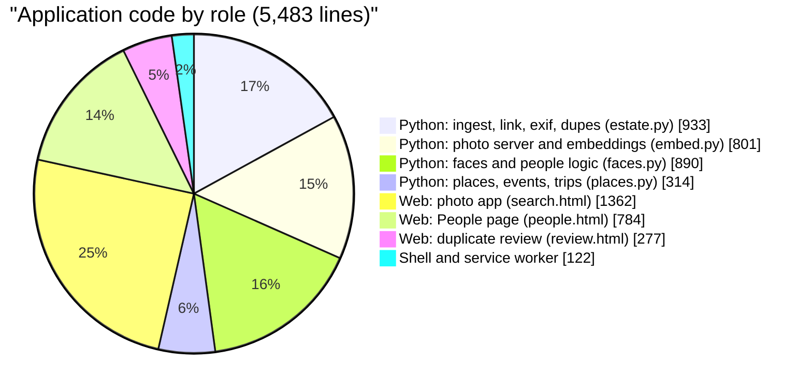
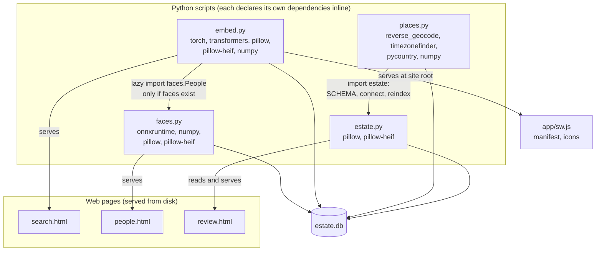

# 2. A tour of the code

## How much code is there?

Measured with `tokei` on 2026-11-13, excluding the checked-in demo library and Markdown:

| | Files | Code lines | Comment lines | Blank | Total lines |
|---|---:|---:|---:|---:|---:|
| Python | 11 | 3,684 | 145 | 410 | 4,239 |
| JavaScript inside the three web pages | 3 | 1,705 | 26 | 19 | 1,750 |
| CSS inside the three web pages | 3 | 588 | 15 | 13 | 616 |
| HTML markup of the three web pages | 3 | 130 | 0 | 4 | 134 |
| Shell | 2 | 81 | 30 | 14 | 125 |
| JavaScript (service worker) | 1 | 41 | 4 | 4 | 49 |
| **Total** | **17** | **6,229** | **220** | **464** | **6,913** |

Of those 6,229 lines, 746 are tests and developer tools (`tests/`, `tools/`). The application
itself, the thing you run, is **5,483 lines of code**:



A few things stand out:

- **Roughly half the code is in the browser.** The three web pages are 2,423 lines of code
  (HTML, CSS and JavaScript), 44% of the application. The photo app's justified grid, timeline,
  swipe viewer and pinch zoom are as much of the work as any model.
- **The AI models are a small fraction of the code.** The embedding job is under 100 lines in
  `embed.py` (`_decode` plus `cmd_run`); face detection, alignment and recognition (`Models`) are
  about 80 lines in `faces.py`, and about 140 with the batch job around them. The remaining thousands of
  lines deal with the unglamorous parts: reconciling metadata from three services, laying out a
  grid, and making it fast.
- **The documentation is about as large as the code.** The Markdown files in the repository
  (README plus `PLAN.md`, `DISK-SETUP.md`, `PERFORMANCE.md`, `BENCHMARK.md`, `TAGGING-RESEARCH.md`
  and the deploy guide) add up to roughly 1,100 lines.

## File by file

```
photo-estate/
  estate.py           933  ingest, link, exif, dupes, review, tag, search, stats
  embed.py            801  image embeddings: run, search, serve (the photo server)
  faces.py            890  faces: run, serve, and the People class (who is who)
  places.py           314  place names, local time, events, trips
  search.html       1,362  the photo app (HTML + CSS + JS in one file)
  people.html         784  the People page
  review.html         277  the near-duplicate review page
  app/sw.js            41  service worker: the "can't reach your photos" page
  app/manifest...      16  the home-screen app manifest, plus four PNG icons
  pull-drive.sh        58  rclone: Takeout zips from Drive, one at a time
  pull-icloud.sh       23  icloudpd: mirror iCloud, then ingest
  tests/test_poc.py   249  end-to-end test on a synthetic Takeout + iCloud + Flickr export
  tools/                   make_demo, screenshots, icons, three benchmark scripts (~540)
  deploy/                  launchd plists and the Mac mini guide
  demo/                    104 CC0 photos, their catalog, and credits
```

### estate.py: the catalog tool

This is where a library becomes a catalog. Its sections (marked by comment banners in the file) are:

| Section | What it does | Chapter |
|---|---|---|
| `SCHEMA` and helpers | Every table in the catalog, `connect()`, `blob_path()` | [5](05-catalog.md) |
| `ingest` | Stream files out of zips or folders, hash, store, record | [4](04-store-and-ingest.md) |
| `link` | Match sidecars to media; merge Google, iCloud and Flickr metadata onto assets | [6](06-linking.md) |
| `exif` | Run `exiftool`, keep the dump, promote camera/lens/exposure | [7](07-places-events-trips.md) |
| `reindex` | Rebuild the full-text index | [9](09-text-search-and-tags.md) |
| `dupes` | Near-duplicate clustering and the report | [8](08-duplicates.md) |
| `review` | The local web server for the review page | [8](08-duplicates.md) |
| `tag` | Caption and tag images with any OpenAI-compatible vision model | [9](09-text-search-and-tags.md) |
| `search`, `stats` | Command-line full-text search and a summary | [9](09-text-search-and-tags.md) |

It depends only on Pillow and pillow-heif. It deliberately does *not* import PyTorch, so the catalog
tools stay light.

### embed.py: embeddings and the photo server

The file's name is historical. It began as "compute image embeddings" and grew into the server
that is the main product. Its parts:

| Part | Lines (approx.) | What it does |
|---|---:|---|
| Constants | 33-57 | Model name, the match floor and window, word lists for name and place reading |
| `_decode`, `_thumb`, `load_model`, `cmd_run` | 68-171 | Compute and store an embedding for every image |
| `cmd_search` | 178-198 | Command-line semantic search |
| `cmd_serve` | 219-877 | **The photo server**: one function containing the whole app, as a set of closures over in-memory arrays |

`cmd_serve` is about 660 lines because everything in it shares one set of NumPy arrays loaded at
startup (the embedding matrix, the metadata columns, the facet codes). Closures over those arrays
are simpler than classes that pass them around, and the server is a single process, so there is no
cost to keeping them together. Chapter 11 breaks it into its logical pieces.

### faces.py: faces, and who they are

Two things live here. The first is a batch job, `faces.py run`, that detects and embeds faces using
two ONNX models. The second is the `People` class, which holds every face in memory and decides
who each one is, using Google's tags and your corrections. `People` is mounted two ways: by
`faces.py serve` on its own port, and by `embed.py serve` at `/people` so one server handles
everything.

### places.py: where and when

A pure function from catalog contents to four derived tables (`places`, `events`, `trips`, plus the
search index). It imports `estate` (same folder) for the schema and `reindex`. It recomputes
everything on each run, in seconds.

### The three web pages

Each page is one self-contained HTML file with inline CSS and JavaScript: no build step, no
framework, no dependencies, no bundler. The server reads the file from disk on every request for `/`
(with an ETag), so editing a page and reloading shows the change at once.

## How the pieces depend on each other



There are only two imports between modules in the whole codebase: `places.py` imports `estate.py`,
and `embed.py serve` imports `faces.People` lazily in a background thread. Everything else is
connected through the SQLite file. This is why each script can be run, tested, understood and
re-run independently.

### Why `uv run` and inline dependencies?

Every script starts with a block like this:

```python
#!/usr/bin/env -S uv run --script
# /// script
# requires-python = ">=3.11,<3.14"
# dependencies = ["torch", "transformers>=4.49", "pillow>=10.0", ...]
# ///
```

This is [PEP 723](https://peps.python.org/pep-0723/) inline script metadata. `uv run embed.py`
reads the block, builds (and caches) a virtual environment with exactly those packages, and runs
the script. Consequences:

- There is **no setup step**, no `requirements.txt`, no virtual environment to activate.
- Each script has the **dependencies it needs and no more**. `estate.py` needs only Pillow, so
  ingesting a library never installs PyTorch (about 2 GB). `faces.py` uses `onnxruntime`, which is
  far lighter than PyTorch, for the same reason.
- `requires-python = "<3.14"` on the model scripts is deliberate: it keeps `uv` choosing a Python
  version that PyTorch and onnxruntime have wheels for.

## Cross-cutting patterns

A handful of idioms repeat across the files. Recognising them makes the code quick to read.

**1. `connect()` is also the migration.** Every script's `connect()` opens the database in WAL mode
and runs `CREATE TABLE IF NOT EXISTS ...` for its own tables. There is no migration framework:
running any script creates what it needs, and adding a table is adding a statement.

**2. Resumability through "what is not done yet".** Each batch job selects its work with a
`NOT EXISTS`/`NOT IN` query against its own results table (`embeddings`, `face_scans`, `exif`,
`sources`). Interrupt it, run it again, and it takes the remaining work. Results are committed in
batches, so an interruption loses at most one batch.

**3. Never raise from a worker.** Image decoding runs in worker processes (`Pool`). Every worker
function (`_decode`, `_thumb`, `image_facts`) catches everything and returns an error string or
`None`. One corrupt file must never stop an overnight run; it is recorded (`error` columns) and
skipped.

**4. Decode small.** `Image.draft("RGB", (side, side))` asks the JPEG decoder to decode at
reduced scale (1/2, 1/4, 1/8) directly, which is several times faster than decoding a 12 MP photo
and then shrinking it. It is used by ingest (for the 9×8 dHash), embedding, face detection and every
thumbnail.

**5. Atomic writes.** Anything written to the cache or the store is written to a temp name and then
`os.replace()`d into place, so a reader never sees half a file and a crash never leaves one.

**6. Derived tables are dropped and rebuilt.** `places.py` drops `places`, `events` and `trips` and
recreates them from the schema each run. Compare this with `embeddings` and `faces`, which are
append-only because they are expensive.

**7. One in-memory snapshot, many cheap queries.** The server reads the catalog once at startup into
NumPy arrays and answers every request from memory (chapter 11). The catalog on disk is touched
again only to save your face corrections.

**8. Optional tables.** The server wraps reads of `exif`, `places`, `events`, `trips` and `faces` in
`optional()`, which returns `[]` if the table does not exist. A library that has only been ingested
and embedded still works in the app; each later stage adds capability.

## The files of the repository that are not code

| File | Purpose |
|---|---|
| [README.md](../../README.md) | The public introduction, quick start and tour |
| [PLAN.md](../../photo-estate/PLAN.md) | The original plan: why Takeout, why rolling ingest, the tagging tiers |
| [DISK-SETUP.md](../../photo-estate/DISK-SETUP.md) | Choosing and preparing storage; the overnight pull; checking the archive |
| [PERFORMANCE.md](../../photo-estate/PERFORMANCE.md) | Where the app's time goes and the measured before/after |
| [BENCHMARK.md](../../photo-estate/BENCHMARK.md) | Library statistics and the benchmark album for comparing models |
| [TAGGING-RESEARCH.md](../../photo-estate/TAGGING-RESEARCH.md) | The tiered tagging pipeline and model comparison |
| [deploy/MAC-MINI.md](../../photo-estate/deploy/MAC-MINI.md) | Running as an always-on service |
| [demo/CREDITS.md](../../photo-estate/demo/CREDITS.md) | Author and source of every demo photo |
