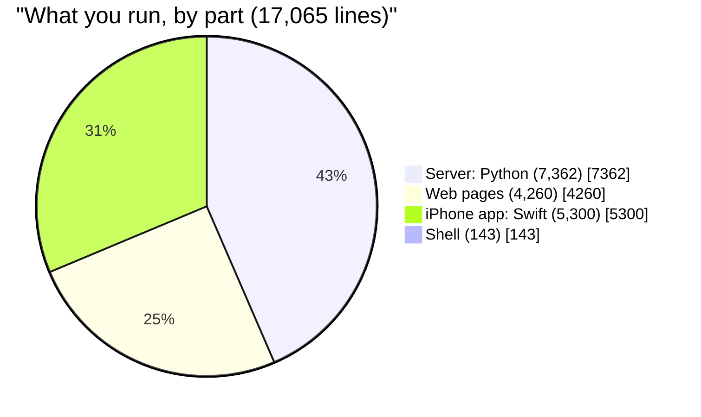
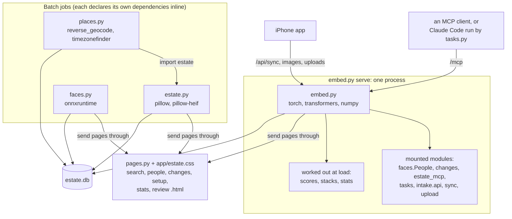

# 2. A tour of the code

## How much code is there?

Measured with `tokei` on 2026-11-19 (159 commits, 2026-11-11 to 2026-11-19), counting lines of code
(not blanks or comments), with the CSS and JavaScript inside each web page counted as code, and
leaving out the checked-in demo library and every Markdown file:

| | Files | Code lines |
|---|---:|---:|
| **Server** (Python: `photo-estate/*.py` and `intake/`) | 27 | 7,362 |
| **Web pages** (six pages, the shared stylesheet, the service worker) | 8 | 4,260 |
| **iPhone app** (Swift, plus `deploy.sh`) | 29 | 5,317 |
| Shell scripts the pipeline runs (`pull-drive.sh`, `pull-icloud.sh`, `ingest-iphone.sh`) | 3 | 126 |
| Tests (`tests/`, each a self-running script) | 15 | 2,098 |
| Developer tools (`tools/`: demo, screenshots, benchmarks, the book's site, the scorers' tools, cloud scripts, square export) | 24 | 3,072 |
| The cloud preview on the Mac mini (`deploy/*.sh`) | 4 | 330 |
| **Total** | **110** | **22,565** |

The web pages' 4,260 lines are 2,886 of JavaScript, 865 of CSS and 509 of HTML markup. What you run
(the server, its pages, the iPhone app and the three pipeline scripts) is **17,065 lines of code**:



When this book was first written, on 2026-11-13, the server and its pages were 5,483 lines and there
was no iPhone app. Six days later the server and pages are 11,748 lines and the iPhone app is 5,300.
A few things stand out:

- **Most of the code is interface.** The web pages and the iPhone app are 9,560 lines, 56% of what
  you run. A justified grid, a viewer that grows out of its tile, pinch zoom and a filter sheet with
  live counts take more code than any model.
- **The AI models are a small fraction of the code.** The embedding job is under 100 lines in
  `embed.py` (`_decode` plus `cmd_run`); face detection, alignment and recognition (`Models`) are
  about 80 lines in `faces.py`; the two "best photo" scorers are applied in under 100 lines of
  `scores.py`. The rest deals with the unglamorous parts: reconciling metadata from three services,
  laying out a grid, keeping a phone's copy in step, and making it fast.
- **The server has grown by adding modules, not by growing modules.** Each feature since the first
  week is a file of its own with a `handle(method, path, body)` method that `embed.py serve` mounts:
  `faces.People`, `changes.Changes` (albums and change sets), `intake.api` (the setup page),
  `estate_mcp` (the MCP endpoint) and `tasks.Tasks` (the agent). The exception was `cmd_serve`
  itself, which grew from 660 lines to about 1,640; on 2026-11-19 it was split the same way, into
  `catalog.py`, `browse.py`, `images.py`, `admin.py` and `encoder.py` ([chapter 11](11-server.md)).
  (The counts in this chapter are from just after that split.)
- **The tests are about a ninth of the code.** Fifteen scripts, 2,098 lines, each run with
  `uv run tests/<file>`, none needing a network, an account or a model download
  ([chapter 17](17-testing-and-demo.md)).
- **The documentation is half as large as the code.** The Markdown in the repository is about 8,800
  lines, 7,000 of them this book.

## File by file

Code lines, measured as above.

```
photo-estate/                  the server and the web app (Python run with uv; no build step)
  embed.py             663  image embeddings: run, search, and serve (cmd_serve: setting the app up and wiring it)
  catalog.py           519  the photo app's library in memory: load(), Catalog, Live (chapter 11)
  browse.py            366  search, similar, facets, Years and Months, layout; an agent's searches
  images.py            135  thumbnails, previews, large images and originals
  admin.py             256  phone uploads, the ingest, restart, /stats, backups
  encoder.py            60  SigLIP's text (and image) side, for the photo app
  estate.py          1,005  ingest, link, exif, dupes, review, tag, search, stats
  faces.py             897  faces: run, serve, and the People class (who is who)
  changes.py           455  albums and change sets: proposed, reviewed, applied, reverted (chapter 26)
  places.py            388  place names, local time, events, trips
  estate_mcp.py        383  the library as MCP tools for an agent, at /mcp (chapter 26)
  upload.py            312  receives phone uploads into an inbox (chapter 24)
  tasks.py             273  a request in words, worked on by Claude Code on the library's computer (chapter 26)
  stats.py             181  the numbers behind the /stats page
  sync.py               96  the change feed a phone syncs from (chapter 20)
  scores.py             92  which photos are best: the two scorers (chapter 25)
  stacks.py             74  near-identical shots as one stack (chapter 25)
  pages.py              38  puts the shared stylesheet into each page as it is sent
  intake/            1,169  the setup page's engine: sources, jobs, the pipeline every source feeds (chapter 16)

  search.html        2,051  the photo app: Library, Albums and Search (HTML + CSS + JS in one file)
  people.html          749  the People page
  changes.html         444  reviewing an album or change set, at /changes
  setup.html           354  bringing photos in, at /setup
  review.html          272  the near-duplicate review page
  stats.html           255  library info, at /stats
  app/estate.css        97  the stylesheet every page shares
  app/sw.js             38  service worker: the "can't reach your photos" page

  pull-drive.sh         58  rclone: Takeout zips from Drive, one at a time
  ingest-iphone.sh      45  catalogue what the phone uploaded, touching only the new photos
  pull-icloud.sh        23  icloudpd: mirror iCloud, then ingest
  tests/             2,098  15 self-running test scripts (chapter 17)
  tools/             3,072  demo builder, screenshots, icons, benchmarks, book site, aesthetics/, cloud-*.sh,
                            export_squares.py (the Library as square JPEGs in tar shards, for embedding experiments)
  deploy/              330  launchd plists, the cloud preview's scripts, MAC-MINI.md, CLOUD-SESSIONS.md
  demo/                     104 CC0 photos, their catalog, and credits

ios/                 5,317  the iPhone app (chapters 19-24, 26)
  PhotoEstate/Library/   3,478  grid, viewer, Library and Search tabs, albums, filter sheets, the phone's own photos
  PhotoEstate/Catalog/     934  the replica of the catalog, reading a search, the server's JSON API
  PhotoEstate/Images/      306  thumbnails and kept photos
  PhotoEstate/*.swift      398  the tab bar, the look, This iPhone, uploads, the in-app web view
  UploadExtension/          94  the background upload extension
  Shared/                   90  the server's address, the upload request, the extension's log
  project.yml, project-sim.yml, deploy.sh, build-number   XcodeGen specs; build and install on the phone
```

The largest Swift files are `Grid.swift` (679), `Viewer.swift` (580), `Albums.swift` (490),
`SearchView.swift` (457), `LibraryModel.swift` (436) and `Query.swift` (383).

### estate.py: the catalog tool

This is where a library becomes a catalog. Its sections (marked by comment banners in the file) are:

| Section | What it does | Chapter |
|---|---|---|
| `SCHEMA` and helpers | Every table in the catalog, `connect()`, `blob_path()` | [5](05-catalog.md) |
| `ingest` | Stream files out of zips or folders, hash, store, record | [4](04-store-and-ingest.md) |
| `link` | Match sidecars to media; merge Google, iCloud and Flickr metadata onto assets | [6](06-linking.md) |
| `exif` | Run `exiftool`, keep the dump, promote camera/lens/exposure | [7](07-places-events-trips.md) |
| `reindex` | Rebuild the full-text index | [9](09-text-search-and-tags.md) |
| `dupes` | Near-duplicate clustering and the report | [8](08-duplicates.md) |
| `review` | The local web server for the review page | [8](08-duplicates.md) |
| `tag` | Caption and tag images with any OpenAI-compatible vision model | [9](09-text-search-and-tags.md) |
| `search`, `stats` | Command-line full-text search and a summary | [9](09-text-search-and-tags.md) |

It depends only on Pillow and pillow-heif. It deliberately does *not* import PyTorch, so the catalog
tools stay light.

### embed.py: embeddings and the photo server

The file's name is historical. It began as "compute image embeddings" and grew into the server
that is the main product. Its parts:

| Part | What it does |
|---|---|
| Constants | Model name, the match floor and windows, `SKIP_EXT` |
| `_decode`, `load_model`, `cmd_run` | Compute and store an embedding for every image |
| `cmd_search` | Command-line semantic search |
| `_library_or_setup` | No library yet: serve the setup page instead (intake/) |
| `cmd_serve` | **The photo server**: sets it up, wires its modules together, and sends each request to the one that answers it |
| `main` | The command line, including `serve --demo` and `serve --sandbox` |

`cmd_serve` began as about 660 lines holding the whole app as closures over the NumPy arrays loaded
at startup (the embedding matrix, the metadata columns, the facet codes). Closures were simpler than
classes that pass the arrays around, but the function grew to about 1,640 lines that way, 14% of all
application code. On 2026-11-19 it was split the way the newer features were already built: a module
per area, each with an object whose `handle(method, path, qs, body, ...)` answers its own routes, all
reading one shared state object instead of closing over variables.

| Module | What it holds |
|---|---|
| `catalog.py` | `load()`: the catalog read into a `Catalog` (vectors, per-photo dicts, columns, facets, stacks, the name and place vocabulary), its shared questions (`combine`, `facet_counts`, `take`, `periods`, ...), and `Live`, the catalog being served, swapped under a gate after an ingest |
| `browse.py` | `Browse`: the search language and `/api/search`, `/api/similar`, `/api/facets`, `/api/periods`, `/api/layout`, `/api/log`, plus the same searches for an agent (`/mcp`) |
| `images.py` | `Images`: `/thumb/`, `/preview/`, `/large/`, `/original/`, and pre-generating thumbnails |
| `admin.py` | `Admin`: phone uploads, the ingest, restart, the `/stats` page, preparing arrivals; catalog backups |
| `encoder.py` | `Encoder`: the model's text side for typed searches, and its image side for uploads |

What stays in `cmd_serve` (about 500 lines) is the wiring: options and demo mode, the request
handler, the page and app files, `/api/info`, `/api/sync`, favourites, album downloads and reloads.
Chapter 11 goes through it all.

### faces.py: faces, and who they are

Two things live here. The first is a batch job, `faces.py run`, that detects and embeds faces using
two ONNX models. The second is the `People` class, which holds every face in memory and decides
who each one is, using Google's tags and your corrections. `People` is mounted two ways: by
`faces.py serve` on its own port, and by `embed.py serve` at `/people` so one server handles
everything.

### places.py: where and when

A pure function from catalog contents to four derived tables (`places`, `events`, `trips`, plus the
search index). It imports `estate` (same folder) for the schema and `reindex`. It recomputes
everything on each run, in seconds.

### The web pages

Each page (`search.html`, `people.html`, `changes.html`, `setup.html`, `stats.html`, `review.html`) is one self-contained HTML file with inline CSS and JavaScript: no build step, no
framework, no dependencies, no bundler. The server reads the file from disk on every request for `/`
(with an ETag), so editing a page and reloading shows the change at once.

## How the pieces depend on each other



The batch jobs never import one another, except that `places.py` uses `estate.py`'s schema and
`reindex`; they are connected only through the SQLite file, which is why each can be run, tested,
understood and re-run on its own. The server is the one place modules come together: `embed.py serve`
imports each feature's module (and its own parts: `catalog.py`, `browse.py`, `images.py`, `admin.py`,
`encoder.py`, which never import `embed.py`) and hands it requests, and every page goes out through `pages.py` so
that the three programs that send pages (`embed.py`, `faces.py`, `estate.py`) cannot drift apart in how
they look.

### Why `uv run` and inline dependencies?

Every script starts with a block like this:

```python
#!/usr/bin/env -S uv run --script
# /// script
# requires-python = ">=3.11,<3.14"
# dependencies = ["torch", "transformers>=4.49", "pillow>=10.0", ...]
# ///
```

This is [PEP 723](https://peps.python.org/pep-0723/) inline script metadata. `uv run embed.py`
reads the block, builds (and caches) a virtual environment with exactly those packages, and runs
the script. Consequences:

- There is **no setup step**, no `requirements.txt`, no virtual environment to activate.
- Each script has the **dependencies it needs and no more**. `estate.py` needs only Pillow, so
  ingesting a library never installs PyTorch (about 2 GB). `faces.py` uses `onnxruntime`, which is
  far lighter than PyTorch, for the same reason.
- `requires-python = "<3.14"` on the model scripts is deliberate: it keeps `uv` choosing a Python
  version that PyTorch and onnxruntime have wheels for.

## Cross-cutting patterns

A handful of idioms repeat across the files. Recognising them makes the code quick to read.

**1. `connect()` is also the migration.** Every script's `connect()` opens the database in WAL mode
and runs `CREATE TABLE IF NOT EXISTS ...` for its own tables. There is no migration framework:
running any script creates what it needs, and adding a table is adding a statement.

**2. Resumability through "what is not done yet".** Each batch job selects its work with a
`NOT EXISTS`/`NOT IN` query against its own results table (`embeddings`, `face_scans`, `exif`,
`sources`). Interrupt it, run it again, and it takes the remaining work. Results are committed in
batches, so an interruption loses at most one batch.

**3. Never raise from a worker.** Image decoding runs in worker processes (`Pool`). Every worker
function (`_decode`, `images._thumb`, `image_facts`) catches everything and returns an error string or
`None`. One corrupt file must never stop an overnight run; it is recorded (`error` columns) and
skipped.

**4. Decode small.** `Image.draft("RGB", (side, side))` asks the JPEG decoder to decode at
reduced scale (1/2, 1/4, 1/8) directly, which is several times faster than decoding a 12 MP photo
and then shrinking it. It is used by ingest (for the 9×8 dHash), embedding, face detection and every
thumbnail.

**5. Atomic writes.** Anything written to the cache or the store is written to a temp name and then
`os.replace()`d into place, so a reader never sees half a file and a crash never leaves one.

**6. Derived tables are dropped and rebuilt.** `places.py` drops `places`, `events` and `trips` and
recreates them from the schema each run. Compare this with `embeddings` and `faces`, which are
append-only because they are expensive.

**7. One in-memory snapshot, many cheap queries.** The server reads the catalog once at startup into
NumPy arrays and answers every request from memory (chapter 11). The catalog on disk is touched
again only to save your face corrections.

**8. Optional tables.** The server wraps reads of `exif`, `places`, `events`, `trips` and `faces` in
`optional()`, which returns `[]` if the table does not exist. A library that has only been ingested
and embedded still works in the app; each later stage adds capability.

## The files of the repository that are not code

| File | Purpose |
|---|---|
| [README.md](../../README.md) | The public introduction, quick start and tour |
| [docs/README.md](../README.md) | A map of every document in the repository |
| [CLAUDE.md](../../CLAUDE.md) | What Claude Code is told about the project at the start of every session ([chapter 27](27-built-with-claude.md)) |
| [PLAN.md](../notes/PLAN.md) | The original plan: why Takeout, why rolling ingest, the tagging tiers |
| [DISK-SETUP.md](../guides/DISK-SETUP.md) | Choosing and preparing storage; the overnight pull; checking the archive |
| [PERFORMANCE.md](../notes/PERFORMANCE.md) | Where the app's time goes and the measured before/after |
| [BENCHMARK.md](../notes/BENCHMARK.md) | Library statistics and the benchmark album for comparing models |
| [TAGGING-RESEARCH.md](../notes/TAGGING-RESEARCH.md) | The tiered tagging pipeline and model comparison |
| [INTAKE-PLAN.md](../notes/INTAKE-PLAN.md) | The plan for bringing photos in from the app, by phases |
| [deploy/MAC-MINI.md](../../photo-estate/deploy/MAC-MINI.md) | Running as an always-on service |
| [deploy/CLOUD-SESSIONS.md](../../photo-estate/deploy/CLOUD-SESSIONS.md) | Working on the app from a phone: cloud sessions and the preview |
| [demo/CREDITS.md](../../photo-estate/demo/CREDITS.md) | Author and source of every demo photo |
