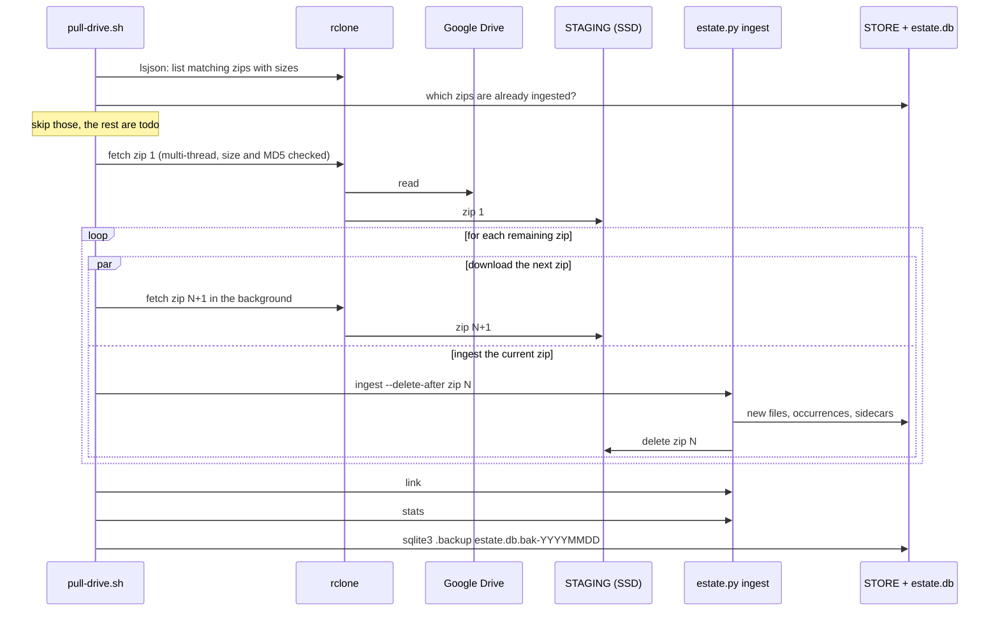
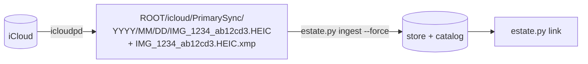

# 3. Repatriating your photos

"Repatriation" is the project's word for getting your photos back from the services that hold them.
It has two halves that are easy to confuse:

1. **Acquiring** the bytes and each service's metadata (this chapter).
2. **Ingesting** them into the store and catalog (chapter 4), then **linking** the metadata to the
   right photo (chapter 6).

This chapter covers the first half for each of the three services: what each one will and will not
give you, exactly what to ask for, how the repository's two shell scripts automate it, and what the
files look like when they arrive.

## What each service gives you

None of the three services hands over a clean "export" in a standard format. What they give you is
the original file plus *something* that describes it, and the something is different each time.

| | Google Photos | iCloud Photos | Flickr |
|---|---|---|---|
| **Mechanism** | Google Takeout (zip files) | `icloudpd`, an open-source downloader | "Request my Flickr data" (zip files) |
| **The photo** | Original file, or the compressed one if you used "Storage saver" | Original file (HEIC/JPEG/MOV), edits excluded | Original upload (`..._o.jpg`) |
| **Where the metadata is** | A JSON **sidecar** next to each file | An **XMP sidecar** next to each file | A separate **account-data** zip of `photo_<id>.json` files |
| **Capture time** | `photoTakenTime` (UTC, editable by you) | `photoshop:DateCreated` (with UTC offset) | `date_taken` (camera-local, no offset) |
| **GPS** | `geoData`, falling back to `geoDataExif` | `exif:GPSLatitude/Longitude` | `geo` (micro-degrees as strings) |
| **People** | Names of people you tagged | Not exported | Not used |
| **Albums** | Folder names and `metadata.json` per album | Not exported (the mirror is organised by date) | Album titles in each photo's JSON |
| **Favourite** | `favorited` | `xmp:Rating` = 5 | Not used |
| **Text** | `description` | Keywords (`rdf:li`) | Title, description (may contain HTML), tags |

Two observations explain a lot of the code that follows:

- **Google's date and location edits live only in the sidecar.** If you corrected a photo's date
  in Google Photos, the photo file is unchanged: the correction is in the JSON. So the sidecar is
  not optional garnish; it is the more truthful of the two files, and the catalog keeps it whole.
- **No two services agree on the file name, the hash or the time zone.** The same iPhone photo can
  arrive from iCloud as a HEIC and from Google as a (re-encoded) JPEG, with different names and
  different byte content. Chapter 8 explains how they are matched when their bytes differ.

## Google Photos

### Why Takeout, and nothing else

The Google Photos Library API no longer works for this purpose. Since 31 March 2025 it only
returns media that *your own app uploaded*, and the Picker API requires you to hand-select items.
Neither can export a whole library. **Google Takeout is the only complete export**, so the entire
Google path is built around Takeout's quirks (see [PLAN.md](../../photo-estate/PLAN.md)).

### Asking for the export

At [takeout.google.com](https://takeout.google.com/):

1. Deselect everything; select only **Google Photos**.
2. File type **.zip**. Size: the plan recommends **2 GB or 4 GB** per zip if you will download
   them to a laptop, so a rolling ingest never needs the whole library on disk. (The author's
   actual export was nine zips of about 50 GB, delivered into Google Drive, because the Drive route
   below makes the large size painless.)
3. Delivery: either "send download link by email" (links last about 7 days, with a limited number
   of downloads per file), or "add to Drive" (which counts against your Google storage quota).

Takeout returns what Google stored. Anything uploaded at "Storage saver" quality comes back
compressed; there is no way to get the originals back.

To pick up photos added *after* a big export, run a second Takeout selecting only the newest
"Photos from YYYY" folder. Files already in the store are de-duplicated by hash, so overlap costs
only the download.

### What a Takeout looks like

```
Takeout/Google Photos/
  Photos from 2019/
    IMG_0001.JPG
    IMG_0001.JPG.supplemental-metadata.json     <- the sidecar
    IMG_0001-edited.JPG                          <- Google's edit; shares the original's sidecar
    IMG_0002(1).JPG                              <- second photo with the same name
    IMG_0002.JPG.supplemental-metadata(1).json   <- note where the (1) went
    PXL_20200704_183015123.PORTRAIT.ORIGINAL_EXPORTED_FROM_CAMERA.jpg
    PXL_20200704_183015123.PORTRAIT.ORIGINAL_EXPORTED_FRO.json   <- name cut at ~51 chars
  Paris Trip/                                    <- an album: copies of photos from the year folders
    IMG_0001.JPG
    metadata.json                                <- {"title": "Paris Trip"}
  Photos from 2020/ ...
```

Everything that makes Takeout awkward is visible here, and each item has a rule in
`estate.py link` (chapter 6):

- Sidecars are named `X.jpg.json`, `X.jpg.supplemental-metadata.json`, or the older `X.json`.
- Long names are **truncated** so the sidecar name fits roughly 51 characters.
- Duplicate names get a `(1)` suffix, and the `(1)` moves to a different place in the sidecar
  name.
- `-edited` copies (in any of eight languages) share the original's sidecar.
- Each album folder holds a *copy* of the photo that is already in a year folder. These are
  byte-identical, so ingest collapses them while remembering the album.
- A photo and its sidecar can land in **different zips**. After ingesting zip 1, some sidecars
  are missing; `link` reports them as "without a sidecar (may be in a zip not yet ingested)" and
  is simply run again after the next zip.
- Live Photos (and Android motion photos) export a still and a short video clip, but only the still
  has a sidecar.

### Pulling a large export from Google Drive: `pull-drive.sh`

When the export is tens of gigabytes per zip, the practical approach is to have Google drop the
zips in Drive and pull them one at a time with [`rclone`](https://rclone.org/). The script
[pull-drive.sh](../../photo-estate/pull-drive.sh) does this unattended.

```bash
./pull-drive.sh /Volumes/estate          # the estate root
REMOTE=gdrive:Takeout PATTERN='takeout-2026*.zip' STAGING=~/estate-staging ./pull-drive.sh ROOT
```

| Variable | Default | Meaning |
|---|---|---|
| `REMOTE` | `gdrive:Takeout` | The rclone remote and folder holding the zips |
| `PATTERN` | *the author's export name* | Which zips to take. **You must set this**: the default is hard-coded to the author's 2026-05-23 export |
| `STAGING` | `~/estate-staging` | A fast local disk where the current zip is unpacked from |
| `DB` / `STORE` | `ROOT/estate.db`, `ROOT/store` | Where the catalog and photos go; override `DB` to keep the catalog off a network share |

What it does:



Design points worth knowing:

- **Drive is only read.** The rclone remote is used with `copy` and `lsjson`; nothing in Google is
  changed.
- **The next zip downloads while the current one ingests**, so network and disk work overlap. It
  needs room for about two zips in staging (about 110 GB for 50 GB zips).
- **Free-space guard.** `fetch` refuses to start a download unless there is room for the zip plus
  5 GiB, and waits up to 15 minutes for a filesystem (btrfs) to release the space from the zip it
  just deleted.
- **Idempotent and safe to stop.** `ingested()` asks the catalog whether a zip has a finished
  `sources` row and skips it without downloading. A half-ingested zip resumes (chapter 4). Press
  Ctrl-C and re-run the same command.
- **It ends with a catalog snapshot** (`sqlite3 .backup`), a consistent copy of the database that
  is safe to take while it is in WAL mode.
- **Portability note.** The script uses bash 4's `mapfile` and GNU `df --output=avail -B1`. On
  macOS, install Homebrew's bash and GNU coreutils (or adapt the free-space line). The macOS recipe
  in [DISK-SETUP.md](../../photo-estate/DISK-SETUP.md) runs it under `caffeinate -i` so the machine
  stays awake.

rclone's shared Google API key is rate-limited, and [DISK-SETUP.md](../../photo-estate/DISK-SETUP.md)
has a ten-minute recipe for creating your own OAuth client ID so a long pull is not cut off.

### Time to pull

The README quotes the author's numbers: a 428 GiB export is about 2 hours at 500 Mbit/s and about
10 hours at 100 Mbit/s, with ingest overlapping the downloads.

## iCloud Photos

### Why `icloudpd`

Apple has no equivalent of Takeout for the full-fidelity library, so the project uses
[`icloudpd`](https://github.com/icloud-photos-downloader/icloud_photos_downloader), which signs in
as you (with two-factor approval) and downloads the originals. The script
[pull-icloud.sh](../../photo-estate/pull-icloud.sh) wraps it.

```bash
icloudpd --username you@example.com --auth-only     # once: password and 2FA; session lasts about two months
ICLOUD_USER=you@example.com ./pull-icloud.sh /Volumes/estate
```

### The `icloudpd` flags, one by one

```
icloudpd --username "$ICLOUD_USER" --adp-web-access --library "$lib" -d "$ROOT/icloud/$lib"
         --size original --live-photo-size original
         --file-match-policy name-id7 --xmp-sidecar
```

| Flag | Why |
|---|---|
| `--library PrimarySync` | Your own library. A shared iCloud library has its own id: list them with `--list-libraries` and set `LIBRARIES="PrimarySync SharedSync-<id>"` |
| `-d ROOT/icloud/<lib>` | A **persistent mirror**. `icloudpd` looks at what is already in this folder to know what it has, so a re-run fetches only new photos. Keep it |
| `--size original` | The original, not a resized rendition |
| `--live-photo-size original` | Also fetch the Live Photo's video, at full size |
| `--file-match-policy name-id7` | Files are named `IMG_1234_<7 characters of the asset id>.HEIC`, so two photos with the same camera name never overwrite each other |
| `--xmp-sidecar` | Write an `X.HEIC.xmp` next to each file with the capture time (with UTC offset), GPS, rating and keywords. This is the only way iCloud metadata arrives |
| `--adp-web-access` | Needed only if you have **Advanced Data Protection** on: without it iCloud answers `ACCESS_DENIED`. The first run asks you to approve a prompt on an Apple device |

**iCloud is only read.** The script's header says it plainly: never add
`--delete-after-download` or `--keep-icloud-recent-days`.

### After the download



Three details connect the mirror to the rest of the system:

- **`ingest --force`.** A folder source is named by its directory (`PrimarySync`). The first
  ingest records that name as finished, so a re-ingest of the mirror would be skipped; `--force`
  re-scans it. It is cheap: files already catalogued for that path are skipped on the
  `occurrences(source, path)` check, and files whose bytes are already in the store are recorded as
  extra occurrences without being written again.
- **Date folders are not albums.** The mirror is organised `YYYY/MM/DD`. The `DATE_DIR` regular
  expression tells `default_album()` that such folders are dates, so iCloud photos do not get
  hundreds of bogus albums named "14".
- **XMP times carry the offset.** `parse_xmp` converts `2024-06-13T21:06:35-0700` to UTC. That is
  what lets an iCloud copy and a Google copy of the same photo land on the same instant, which is
  what the near-duplicate classifier uses to call them "copies" rather than "same day, different
  times" (chapter 8).

## Flickr

Flickr's "Request my Flickr data" produces **two different kinds of zip**, and you need both:

| Zip | Contains | Looks like |
|---|---|---|
| **Data download** (`data-download-N.zip`) | The original photos | `sunset-at-rialto_12345678901_o.jpg` or `12345678901_0a1b2c3d4e_o.jpg` |
| **Account data** (`<nsid>_<hash>_partN.zip`) | One JSON per photo, plus albums and profile | `photo_12345678901.json`, `albums.json`, `account_profile.json` |

The two are joined by the **numeric Flickr photo id**, which appears in the original's file name
and in the JSON's `id`.

```bash
uv run estate.py --db estate.db ingest --store STORE flickr/*.zip
uv run estate.py --db estate.db link
```

Ingest recognises a Flickr JSON by two keys (`photopage` and `date_taken`) and stores it in the
`flickr` table keyed by id. `link` then finds each original's JSON by extracting the id with the
`FLICKR_FILE` regular expression (and, since a title ending in digits can fool it, trying every
number in the filename).

What `link` does with a Flickr record is deliberately conservative (chapter 6):

- **Date**: Flickr's `date_taken` is camera-local with no time zone, like EXIF, so it is used only
  as a *last* fallback after the file's own EXIF date.
- **Location**: converted from micro-degrees (`"47920800"` → `47.9208`) and used only if nothing
  better supplied GPS.
- **Title and description** become the photo's description, with HTML tags and entities
  removed. A title that is just a camera filename (`DSC_5300.jpg`, Flickr copies those at upload)
  is thrown away because it says nothing.
- **Tags** are stored as tags from a pseudo-model named `flickr`, which makes them searchable.
- **Albums** come from the JSON's album list.

## Anything else

A folder of photos works too:

```bash
uv run estate.py --db estate.db ingest --store STORE ~/Pictures/old-camera
```

There are no sidecars, so the date comes from EXIF (`DateTimeOriginal`), and there are no albums
except the folder name. The same ingest, hash and de-duplication apply.

## Where metadata wins: the precedence rules

When two services describe the same photo, the order of precedence (set in `cmd_link`) is:


For *capture time*, the rule is `coalesce(google_utc, icloud_utc, exif_local, flickr_local)`. For
GPS and description, "first one to supply it". For **people** and **favourite**, values are
*unioned* (a photo is a favourite if any service says so; people are the set of every name).

The precedence puts the sources with a real time zone first, then the one that the user may have
edited, then the camera's own record, then the least precise.

## Be careful before deleting anything in the cloud

The store gives you one copy. Until there is a second, **the services are still your backup**.
[DISK-SETUP.md](../../photo-estate/DISK-SETUP.md) closes with exactly that advice and with how to
make the second copy (`rsync`, or `restic` to object storage), plus a script that re-hashes every
file in the store to find silent corruption.

## Where to look in the code

| Topic | Code |
|---|---|
| Google Drive pull | [pull-drive.sh](../../photo-estate/pull-drive.sh) |
| iCloud pull | [pull-icloud.sh](../../photo-estate/pull-icloud.sh) |
| Recognising Takeout, XMP and Flickr JSON on ingest | `handle_json`, `handle_xmp`, `parse_xmp` in [estate.py](../../photo-estate/estate.py) |
| Zip or folder enumeration | `iter_entries` |
| Language-specific year and "edited" folder names | `YEAR_DIR`, `EDITED` |
| Flickr file and title recognition | `FLICKR_FILE`, `FILENAME_TITLE`, `flickr_for`, `flickr_text` |
