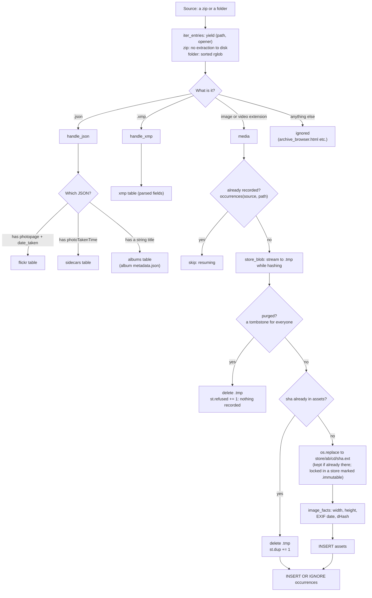
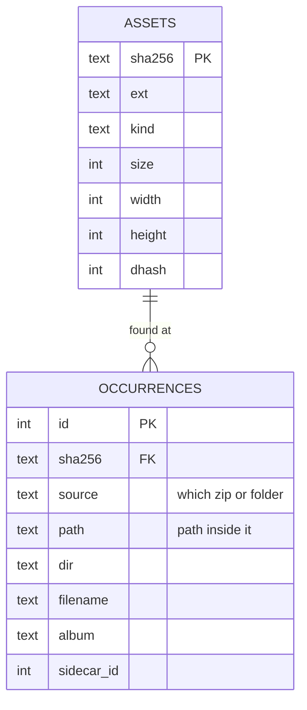
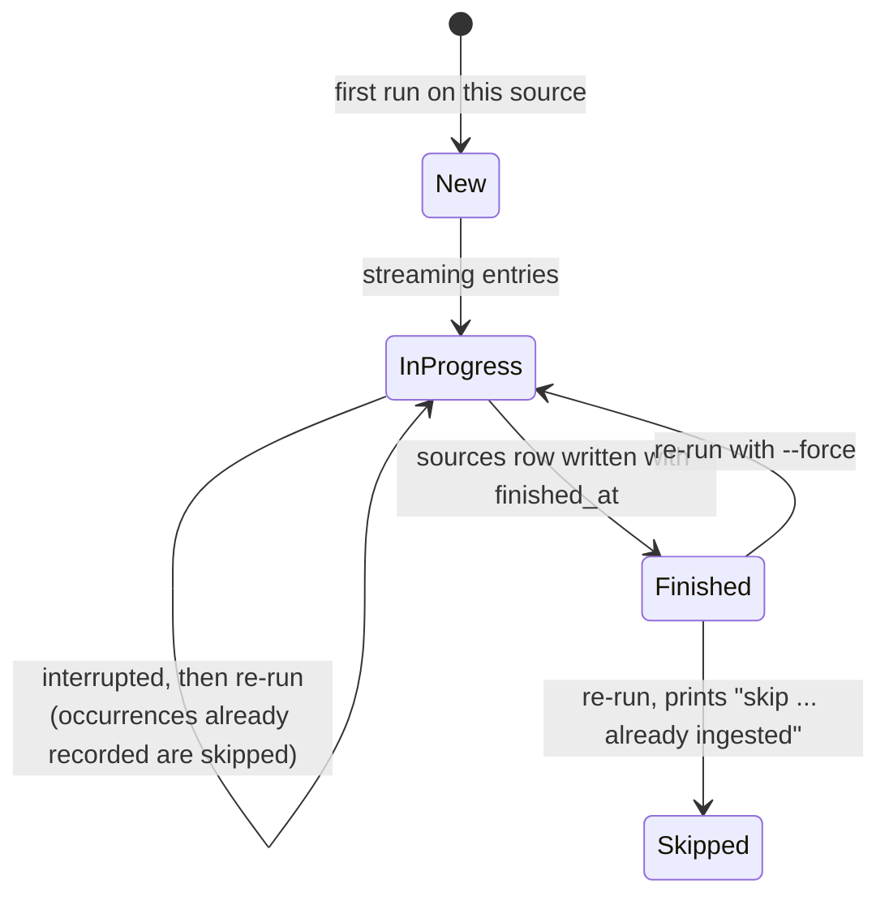

# 4. The store and ingest

This chapter is about how photos are *saved*: the layout of the store on disk, how a file gets
there, and why the design makes de-duplication, resumption and integrity checking nearly free.

## The store: a content-addressed directory

```
STORE/
  .tmp/                              scratch space for files being written
  00/57/0057478789f6...6355584.jpg   store/<first 2 hex>/<next 2 hex>/<sha256><ext>
  00/8e/008e50f1e39f...1c0a2d.jpg
  ...
```

A file's path is computed from its content, by `blob_path()`:

```python
def blob_path(store: Path, sha: str, ext: str) -> Path:
    return store / sha[:2] / sha[2:4] / f"{sha}{ext}"
```

Properties that follow, and that the rest of the system relies on:

| Property | Why it holds |
|---|---|
| **Same bytes, one file** | The name is the hash. A second copy of identical bytes maps to the path that already exists |
| **Names never collide** | Different content has a different hash (SHA-256: no known collisions) |
| **Safe to merge two stores** | Copy one into the other; every name either is new or refers to identical bytes |
| **Integrity is checkable anywhere** | Re-hash a file; it must equal its own name. Works on any filesystem, with or without checksums |
| **Case-insensitive filesystems are fine** | Names are lowercase hex |
| **Two levels of fan-out** | 256 × 256 = 65,536 directories, so a 120k-photo library averages about 2 files per directory; no directory is ever huge |
| **The path is derivable** | Anything that has the sha and the extension (both in the `assets` table) can find the file without a lookup |

The extension is kept (`.heic`, `.jpg`) so that other tools, and a human with a file browser, can
still tell what a file is. The database stores it in `assets.ext`, lower-cased.

### What the store is not

It is *not* organised by date, album or place. Those are properties of the catalog, because they
change (you re-date a photo; an album is renamed) and because one photo can be in many albums.
Putting that in the file path would mean moving files. The store never moves anything.

## Ingest: from a zip or folder to the store

`estate.py ingest` takes any number of sources (zip files or directories). For each one it
streams every entry, hashes it, writes it if it is new, and records where it came from.



### `store_blob`: hash while writing

```python
def store_blob(con, store, fp, ext, lock=False):
    tmp = store / ".tmp" / f"{os.getpid()}.{time.time_ns()}"
    h, n = hashlib.sha256(), 0
    with open(tmp, "wb") as out:
        while chunk := fp.read(1 << 20):      # 1 MiB at a time
            h.update(chunk); out.write(chunk); n += len(chunk)
    sha = h.hexdigest()
    if purged(con, sha):                       # the sysadmin purged it: no source brings it back
        tmp.unlink()
        raise Purged(sha)
    if con.execute("SELECT 1 FROM assets WHERE sha256=?", (sha,)).fetchone():
        tmp.unlink()                           # already stored: discard the copy
        return sha, n, None
    dest = blob_path(store, sha, ext)
    dest.parent.mkdir(parents=True, exist_ok=True)
    if dest.exists():                          # same bytes, from a run stopped before it recorded them
        tmp.unlink()
    else:
        os.replace(tmp, dest)                  # atomic on one filesystem
    if lock:
        set_immutable(dest)                    # chflags uchg (a warning where it cannot be set)
    return sha, n, dest
```

Why it is written this way:

- **One pass.** The bytes stream from the zip entry straight to a temp file while the hash is
  computed, in 1 MiB chunks. Nothing is held in memory and no file is extracted to a scratch
  directory first. A 50 GB zip is processed as a stream.
- **The temp file lives inside the store** (`STORE/.tmp`), on the same filesystem as its final
  destination, so `os.replace` is an atomic rename rather than a copy. A crash leaves a stray file
  in `.tmp`, never a half-written file with a content-addressed name.
- **A duplicate costs one write to `.tmp` and a delete.** The hash is only known after the bytes
  have been read, so a duplicate's bytes are written once and then discarded. This is the price of
  never trusting names. In exchange, a duplicate is detected with certainty regardless of what it
  is called or where it was found.
- **The temp name** includes the process id and a nanosecond timestamp, so several ingest
  processes (or a crashed one's leftovers) never collide.
- **A file already at its place is never replaced.** An ingest stopped after it wrote a file and before
  it committed the row leaves the file behind; the next run keeps it (it is the same bytes) rather than
  renaming over it, which an immutable file would refuse.

### `assets` versus `occurrences`

This is the most important modelling decision in the catalog.



- An **asset** is a unique piece of content: one row per sha.
- An **occurrence** is one place that content was found: a zip (`source`), a path in it, and the
  album implied by its folder. Ten copies of a photo scattered across ten Takeout album folders is
  *one asset with ten occurrences*.

So when the copies collapse, **nothing is lost**: each copy's album and sidecar link survive as its
own occurrence. A photo can still belong to many albums.

### Facts computed at ingest: `image_facts`

For every new image, ingest computes a few facts from the stored file and saves them on the asset:

| Fact | How | Used by |
|---|---|---|
| `width`, `height` | `Image.open(...).size` | Layout fallback; resized-copy detection |
| `exif_taken_at` | `DateTimeOriginal` (tag 36867) from the Exif sub-IFD, else `DateTime` (306); parsed from `YYYY:MM:DD HH:MM:SS` | Date when no sidecar exists |
| `dhash` | A 64-bit perceptual hash (below) | Near-duplicate detection |

`image_facts` **never raises**: RAW formats and corrupt files return an `error` key, the asset is
still stored (with no hash), and the run prints how many "were not decodable (kept, no dHash)".
A photo is never refused because Pillow cannot read it.

### The perceptual hash (dHash)

A cryptographic hash changes completely if one pixel changes, so it can find only *exact* copies.
To find *resized and re-encoded* copies, ingest also computes a **difference hash**:

1. Decode the image small (`im.draft("L", (128, 128))` gets the JPEG decoder to do most of the
   shrinking), apply the EXIF rotation, convert to grey.
2. Resize to **9 × 8** pixels.
3. For each of the 8 rows, compare each pixel to its right-hand neighbour: 8 comparisons × 8 rows =
   **64 bits**, each saying "is this pixel brighter than the next one?"

```
   9x8 grey thumbnail            bit (r, c) = px[r][c] > px[r][c+1]
   ┌─┬─┬─┬─┬─┬─┬─┬─┬─┐
   │ │ │ │ │ │ │ │ │ │   8 rows × 8 comparisons
   └─┴─┴─┴─┴─┴─┴─┴─┴─┘   = a 64-bit fingerprint of the photo's brightness gradients
```

Brightness *gradients* survive resizing, recompression and mild colour changes, so two versions of
a photo have hashes that differ in only a few bits (a small **Hamming distance**). The hash is
stored as a signed 64-bit integer, because SQLite integers are signed:

```python
facts["dhash"] = bits - (1 << 64) if bits >= (1 << 63) else bits
```

Chapter 8 shows how these hashes are turned into groups.

### Videos

Videos (`.mp4`, `.mov`, `.m4v`, `.3gp`, ...) are hashed and stored exactly like images but get no
`image_facts`: no dHash, so a video's duplicates are exact copies only, and no dimensions. What a
video gets later comes from other steps:

| What | From |
|---|---|
| Duration, frame rate, Apple's content identifier | `estate.py exif`: exiftool reads them (`exif.duration`, `exif.fps`, `Keys:ContentIdentifier` in `exif.data`) |
| Whether it is a Live Photo's clip | `pair_live`, when `exif` finishes ([chapter 6](06-linking.md#step-2-live-photos-and-motion-photos)) |
| Its frames' vectors, its own vector, its upright `width` and `height` | `embed.py run` ([chapter 10](10-embeddings.md#videos)) |
| Its thumbnail and preview | the app, from its poster frame ([chapter 11](11-server.md)) |

A Live Photo's clip is stored like any other video, as its own asset; it is the still it belongs
to that is shown.

## Resumability and the `sources` table



Two mechanisms cooperate:

1. **Whole-source skip.** `sources(name, ..., finished_at)` has a row only when a source finished.
   At the start of each source, `cmd_ingest` looks up its name; if `finished_at` is set and `--force`
   is not given, it prints `skip <name>: already ingested at ...` and moves on. This is what lets
   `pull-drive.sh` skip finished zips *without downloading them*.
2. **Per-file skip inside an unfinished source.** Before reading an entry, ingest checks
   `occurrences` for `(source, path)`. If a previous run recorded it, the file is skipped without
   being read. Commits happen every 200 entries, so a crash redoes at most the last 200.

The source's *name* is its file or directory name (`src.name`), not its full path, so moving a zip
to a different disk does not make it look new.

### Cost accounting

At the end of each source ingest prints a line of statistics:

```
takeout-...-001.zip: 12403 entries, 11832 media -> 9120 new, 2712 exact dups, 9871 sidecars,
  41234.5 MB written (118.4 MB/s)
```

and records the same numbers in `sources` (`entries`, `media`, `new_assets`, `bytes_seen`,
`bytes_new`). `estate.py dupes` later uses `occurrences` and `assets` to report how many bytes
exact-duplicate collapsing saved. For the author's library that was about 1%: the real
de-duplication problem is not exact copies, it is near-copies (chapter 8).

### `--delete-after`

`ingest --delete-after zip` deletes the *source zip* once it is fully ingested. Apart from `purge`
(below), this is the one place the system deletes anything, and it is opt-in. It is what keeps the
rolling pull's local disk use to about one zip: the disk never holds more than the zip being ingested
plus the one being downloaded.

## Append-only: sources only add

The estate only grows ([the multiplayer plan](../notes/MULTIPLAYER-PLAN.md#append-only)). A photo deleted
on an iPhone, in iCloud, in the OneDrive mirror or from a Takeout stays in the estate: ingest reads what a
source has and adds what is new, and nothing it does removes a row or a file because a source no longer
has it. `tests/test_append_only.py` checks this for each kind of source (a Takeout zip downloaded again
without a photo, an iCloud folder, the OneDrive mirror, the phone's inbox read with `--force` as
`ingest-iphone.sh` does): the catalog and the store are the same after the second run. Four more things
hold it in place:

- **The protected tables.** SQLite triggers refuse a `DELETE` from `assets`, `occurrences`, `sharers`,
  `tombstones`, `members`, `member_logins` and the journal, any `UPDATE` of the journal, and an `UPDATE`
  that changes a key (a sha, an id). The other columns stay correctable: `link`, `exif` and `embed`
  rewrite dates, places and sizes as they always have ([chapter 5](05-catalog.md#protected-tables)).
- **The immutable flag.** In a store whose root holds a file named `.immutable` (the Mac mini's), ingest
  sets the user-immutable flag (`chflags uchg`) on each file it writes, so even `rm -rf` in the wrong
  folder fails. A store without that file (a scratch one, a test's, the setup page's practice library)
  is written as before and can be deleted as usual, and the checked-in demo store never gets it, even if
  marked (git must be able to change it). On a system without file flags, ingest says so and goes on.
  The flag guards against accidents, not intent: the estate disk ignores ownership, so any user of the
  Mac can clear it. The files stored before the flag came are given it once, by hand
  ([MAC-MINI.md](../../photo-estate/deploy/MAC-MINI.md#append-only-the-one-off-steps)).
- **The journal.** Each source that added anything is one `ingest.finished` entry (how many new, how
  many copies of photos already stored, how many refused), not one per photo; a run that found nothing
  new leaves none.
- **Purge, by hand.** `estate.py purge <sha> --reason "..."` is the one way a photo leaves the estate:
  run by the sysadmin on the Mac, never from a page, a phone or an agent. It takes a catalog backup
  first (`PRAGMA quick_check` on the copy, or it stops), then in one transaction appends a
  `photo.purged` journal entry (who, when, why, where it came from: the fact survives the bytes), adds a
  **tombstone** for everyone (`tombstones`, member 0) and deletes the photo's rows: `assets`,
  `occurrences` and `sharers` (the one place their `*_no_delete` triggers are dropped, and made again
  before the commit) and everything worked out from it (vectors, faces, places, tags, its line in the
  text index, album items, favourites, Live Photo pairs). Then it clears the flag, removes the file and,
  with `--cache DIR`, its thumbnails, previews and face crops. A purged photo is refused by every later
  ingest, from any source: `store_blob` drops it before it reaches the store (`N refused (purged)`). The
  photo stays in older catalog backups until they rotate out, in `face-labels.jsonl`'s lines, in the
  source metadata keyed by path (`sidecars`, `xmp`, `flickr`), and in the sources themselves, which purge
  lists and never touches.

## Who shared it

Ingest records, in the transaction that records each photo, who shared it (`sharers`, multiplayer phase 5;
[private.py](../../photo-estate/private.py) `record_sharer`): for every file it reads, new or a copy of a
photo already stored, the first sysadmin, or, for the phone's inbox read with `--uploads` (as
ingest-iphone.sh reads it), the member whose folder it is in (`m<member id>/YYYY/MM/DD/...`; a folder of
no member's, or none, is the first sysadmin's). A photo that was in the estate with no sharer (before
`estate.py migrate` gave every photo one) was the first sysadmin's, so that row is written first. With
`--uploads`, an image nobody else is shown yet (a new photo, or one all of whose sharers hold it private)
also gets a `new` row in `private`: it is private to its sharer until `private.py check` has scored it
([chapter 11](11-server.md#private-photos)). A member folder is not an album (`default_album` reads
`m3/2026/11/14` as a date, as it reads `2026/11/14`).

## The catalog-side effects of ingest

After an ingest the database holds, for the new source:

| Table | What was added |
|---|---|
| `assets` | One row per new unique file |
| `occurrences` | One row per file found, new or duplicate |
| `sharers` | Who shared each file found (the first sysadmin, or the inbox folder's member) |
| `private` | With `--uploads`: a `new` row for each phone upload the family is not shown yet |
| `sidecars` | One row per Google photo JSON (whole JSON kept) |
| `albums` | One row per album folder's `metadata.json` (its localised title) |
| `xmp` | One row per iCloud XMP sidecar, with the few parsed fields as JSON |
| `flickr` | One row per Flickr photo JSON |
| `sources` | A finished row for the source |

Notice that ingest stores sidecars *as data* and does not try to attach them to photos. It cannot:
the sidecar for a photo may be in a zip that has not arrived yet. Attaching is `link`'s job, and
since `link` can be run any number of times, the order in which zips arrive does not matter.

## Checking the store

Because the filename is the hash, the store can verify itself. [DISK-SETUP.md](../guides/DISK-SETUP.md)
includes a 12-line Python snippet that walks `??/??/*`, re-hashes every file, and prints any whose
digest does not match its name. It takes about as long as copying the store (roughly an hour per
500 GB on a USB hard disk). This is how a store on a filesystem with no checksums (APFS, ext4) can
still catch bit rot.

## Where to look in the code

| Topic | Code in [estate.py](../../photo-estate/estate.py) |
|---|---|
| Path computation | `blob_path` |
| Streaming hash and atomic write | `store_blob` |
| The immutable flag, purged photos | `immutable`, `set_immutable`, `purged` |
| Removing a photo for good; the one-off sharers migration | `cmd_purge`, `cmd_migrate` |
| Dimensions, EXIF date, dHash | `image_facts` |
| The ingest loop | `cmd_ingest` |
| Source enumeration | `iter_entries` |
| Which folder names are albums | `default_album`, `YEAR_DIR`, `DATE_DIR` |
