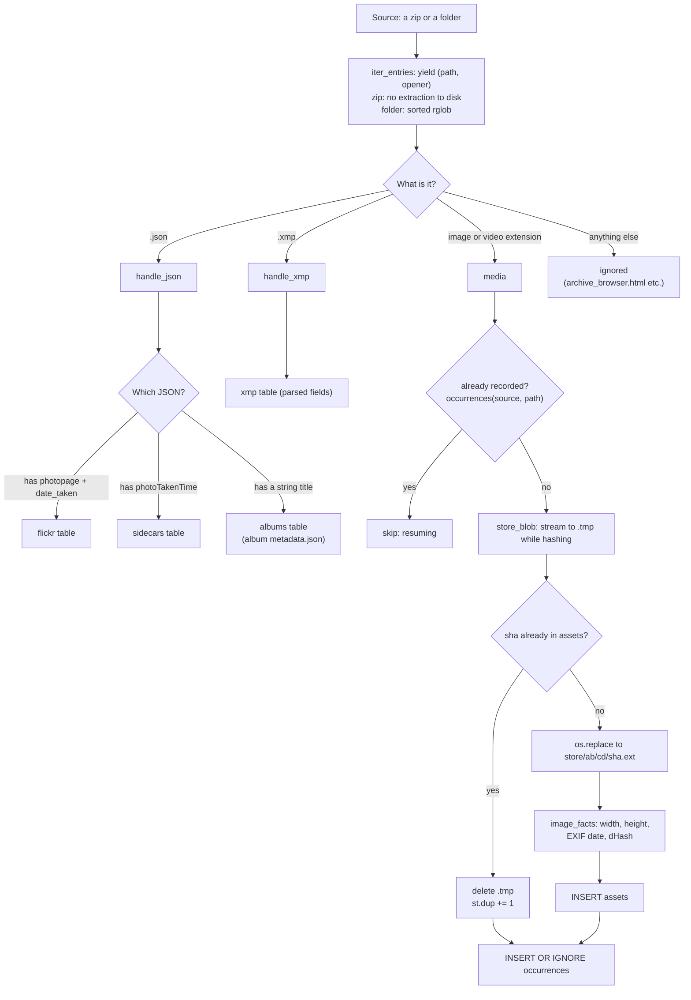
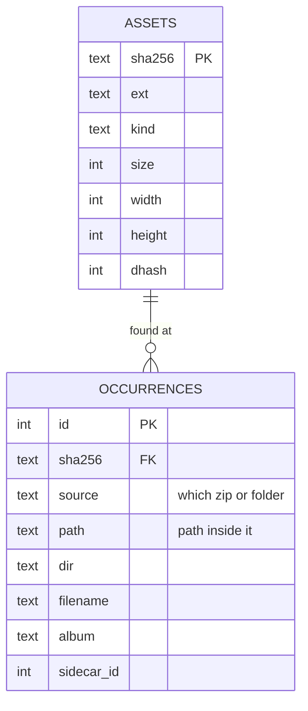
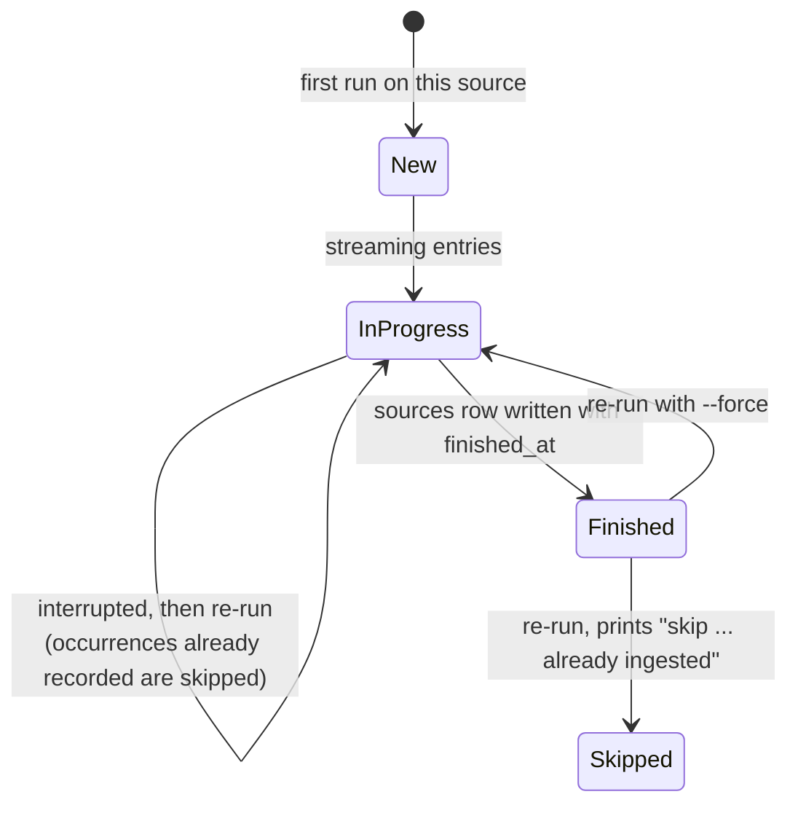

# 4. The store and ingest

This chapter is about how photos are *saved*: the layout of the store on disk, how a file gets
there, and why the design makes de-duplication, resumption and integrity checking nearly free.

## The store: a content-addressed directory

```
STORE/
  .tmp/                              scratch space for files being written
  00/57/0057478789f6...6355584.jpg   store/<first 2 hex>/<next 2 hex>/<sha256><ext>
  00/8e/008e50f1e39f...1c0a2d.jpg
  ...
```

A file's path is computed from its content, by `blob_path()`:

```python
def blob_path(store: Path, sha: str, ext: str) -> Path:
    return store / sha[:2] / sha[2:4] / f"{sha}{ext}"
```

Properties that follow, and that the rest of the system relies on:

| Property | Why it holds |
|---|---|
| **Same bytes, one file** | The name is the hash. A second copy of identical bytes maps to the path that already exists |
| **Names never collide** | Different content has a different hash (SHA-256: no known collisions) |
| **Safe to merge two stores** | Copy one into the other; every name either is new or refers to identical bytes |
| **Integrity is checkable anywhere** | Re-hash a file; it must equal its own name. Works on any filesystem, with or without checksums |
| **Case-insensitive filesystems are fine** | Names are lowercase hex |
| **Two levels of fan-out** | 256 × 256 = 65,536 directories, so a 120k-photo library averages about 2 files per directory; no directory is ever huge |
| **The path is derivable** | Anything that has the sha and the extension (both in the `assets` table) can find the file without a lookup |

The extension is kept (`.heic`, `.jpg`) so that other tools, and a human with a file browser, can
still tell what a file is. The database stores it in `assets.ext`, lower-cased.

### What the store is not

It is *not* organised by date, album or place. Those are properties of the catalog, because they
change (you re-date a photo; an album is renamed) and because one photo can be in many albums.
Putting that in the file path would mean moving files. The store never moves anything.

## Ingest: from a zip or folder to the store

`estate.py ingest` takes any number of sources (zip files or directories). For each one it
streams every entry, hashes it, writes it if it is new, and records where it came from.



### `store_blob`: hash while writing

```python
def store_blob(con, store, fp, ext):
    tmp = store / ".tmp" / f"{os.getpid()}.{time.time_ns()}"
    h, n = hashlib.sha256(), 0
    with open(tmp, "wb") as out:
        while chunk := fp.read(1 << 20):      # 1 MiB at a time
            h.update(chunk); out.write(chunk); n += len(chunk)
    sha = h.hexdigest()
    if con.execute("SELECT 1 FROM assets WHERE sha256=?", (sha,)).fetchone():
        tmp.unlink()                           # already stored: discard the copy
        return sha, n, None
    dest = blob_path(store, sha, ext)
    dest.parent.mkdir(parents=True, exist_ok=True)
    os.replace(tmp, dest)                      # atomic on one filesystem
    return sha, n, dest
```

Why it is written this way:

- **One pass.** The bytes stream from the zip entry straight to a temp file while the hash is
  computed, in 1 MiB chunks. Nothing is held in memory and no file is extracted to a scratch
  directory first. A 50 GB zip is processed as a stream.
- **The temp file lives inside the store** (`STORE/.tmp`), on the same filesystem as its final
  destination, so `os.replace` is an atomic rename rather than a copy. A crash leaves a stray file
  in `.tmp`, never a half-written file with a content-addressed name.
- **A duplicate costs one write to `.tmp` and a delete.** The hash is only known after the bytes
  have been read, so a duplicate's bytes are written once and then discarded. This is the price of
  never trusting names. In exchange, a duplicate is detected with certainty regardless of what it
  is called or where it was found.
- **The temp name** includes the process id and a nanosecond timestamp, so several ingest
  processes (or a crashed one's leftovers) never collide.

### `assets` versus `occurrences`

This is the most important modelling decision in the catalog.



- An **asset** is a unique piece of content: one row per sha.
- An **occurrence** is one place that content was found: a zip (`source`), a path in it, and the
  album implied by its folder. Ten copies of a photo scattered across ten Takeout album folders is
  *one asset with ten occurrences*.

So when the copies collapse, **nothing is lost**: each copy's album and sidecar link survive as its
own occurrence. A photo can still belong to many albums.

### Facts computed at ingest: `image_facts`

For every new image, ingest computes a few facts from the stored file and saves them on the asset:

| Fact | How | Used by |
|---|---|---|
| `width`, `height` | `Image.open(...).size` | Layout fallback; resized-copy detection |
| `exif_taken_at` | `DateTimeOriginal` (tag 36867) from the Exif sub-IFD, else `DateTime` (306); parsed from `YYYY:MM:DD HH:MM:SS` | Date when no sidecar exists |
| `dhash` | A 64-bit perceptual hash (below) | Near-duplicate detection |

`image_facts` **never raises**: RAW formats and corrupt files return an `error` key, the asset is
still stored (with no hash), and the run prints how many "were not decodable (kept, no dHash)".
A photo is never refused because Pillow cannot read it.

### The perceptual hash (dHash)

A cryptographic hash changes completely if one pixel changes, so it can find only *exact* copies.
To find *resized and re-encoded* copies, ingest also computes a **difference hash**:

1. Decode the image small (`im.draft("L", (128, 128))` gets the JPEG decoder to do most of the
   shrinking), apply the EXIF rotation, convert to grey.
2. Resize to **9 × 8** pixels.
3. For each of the 8 rows, compare each pixel to its right-hand neighbour: 8 comparisons × 8 rows =
   **64 bits**, each saying "is this pixel brighter than the next one?"

```
   9x8 grey thumbnail            bit (r, c) = px[r][c] > px[r][c+1]
   ┌─┬─┬─┬─┬─┬─┬─┬─┬─┐
   │ │ │ │ │ │ │ │ │ │   8 rows × 8 comparisons
   └─┴─┴─┴─┴─┴─┴─┴─┴─┘   = a 64-bit fingerprint of the photo's brightness gradients
```

Brightness *gradients* survive resizing, recompression and mild colour changes, so two versions of
a photo have hashes that differ in only a few bits (a small **Hamming distance**). The hash is
stored as a signed 64-bit integer, because SQLite integers are signed:

```python
facts["dhash"] = bits - (1 << 64) if bits >= (1 << 63) else bits
```

Chapter 8 shows how these hashes are turned into groups.

### Videos

Videos (`.mp4`, `.mov`, `.m4v`, `.3gp`, ...) are hashed and stored exactly like images but get no
`image_facts` (no dHash, no dimensions) and no embedding. The roadmap lists video support
(keyframes for search) as future work.

## Resumability and the `sources` table



Two mechanisms cooperate:

1. **Whole-source skip.** `sources(name, ..., finished_at)` has a row only when a source finished.
   At the start of each source, `cmd_ingest` looks up its name; if `finished_at` is set and `--force`
   is not given, it prints `skip <name>: already ingested at ...` and moves on. This is what lets
   `pull-drive.sh` skip finished zips *without downloading them*.
2. **Per-file skip inside an unfinished source.** Before reading an entry, ingest checks
   `occurrences` for `(source, path)`. If a previous run recorded it, the file is skipped without
   being read. Commits happen every 200 entries, so a crash redoes at most the last 200.

The source's *name* is its file or directory name (`src.name`), not its full path, so moving a zip
to a different disk does not make it look new.

### Cost accounting

At the end of each source ingest prints a line of statistics:

```
takeout-...-001.zip: 12403 entries, 11832 media -> 9120 new, 2712 exact dups, 9871 sidecars,
  41234.5 MB written (118.4 MB/s)
```

and records the same numbers in `sources` (`entries`, `media`, `new_assets`, `bytes_seen`,
`bytes_new`). `estate.py dupes` later uses `occurrences` and `assets` to report how many bytes
exact-duplicate collapsing saved. For the author's library that was about 1%: the real
de-duplication problem is not exact copies, it is near-copies (chapter 8).

### `--delete-after`

`ingest --delete-after zip` deletes the *source zip* once it is fully ingested. This is the one
place the system deletes anything, and it is opt-in. It is what keeps the rolling pull's local
disk use to about one zip: the disk never holds more than the zip being ingested plus the one being
downloaded.

## The catalog-side effects of ingest

After an ingest the database holds, for the new source:

| Table | What was added |
|---|---|
| `assets` | One row per new unique file |
| `occurrences` | One row per file found, new or duplicate |
| `sidecars` | One row per Google photo JSON (whole JSON kept) |
| `albums` | One row per album folder's `metadata.json` (its localised title) |
| `xmp` | One row per iCloud XMP sidecar, with the few parsed fields as JSON |
| `flickr` | One row per Flickr photo JSON |
| `sources` | A finished row for the source |

Notice that ingest stores sidecars *as data* and does not try to attach them to photos. It cannot:
the sidecar for a photo may be in a zip that has not arrived yet. Attaching is `link`'s job, and
since `link` can be run any number of times, the order in which zips arrive does not matter.

## Checking the store

Because the filename is the hash, the store can verify itself. [DISK-SETUP.md](../../photo-estate/DISK-SETUP.md)
includes a 12-line Python snippet that walks `??/??/*`, re-hashes every file, and prints any whose
digest does not match its name. It takes about as long as copying the store (roughly an hour per
500 GB on a USB hard disk). This is how a store on a filesystem with no checksums (APFS, ext4) can
still catch bit rot.

## Where to look in the code

| Topic | Code in [estate.py](../../photo-estate/estate.py) |
|---|---|
| Path computation | `blob_path` |
| Streaming hash and atomic write | `store_blob` |
| Dimensions, EXIF date, dHash | `image_facts` |
| The ingest loop | `cmd_ingest` |
| Source enumeration | `iter_entries` |
| Which folder names are albums | `default_album`, `YEAR_DIR`, `DATE_DIR` |
