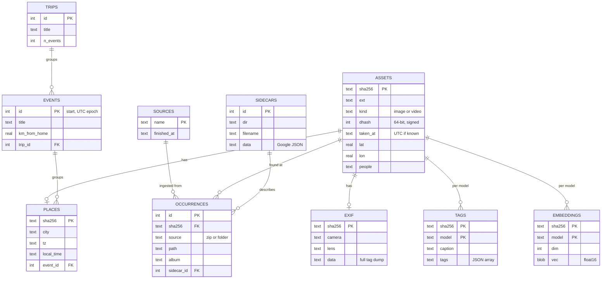
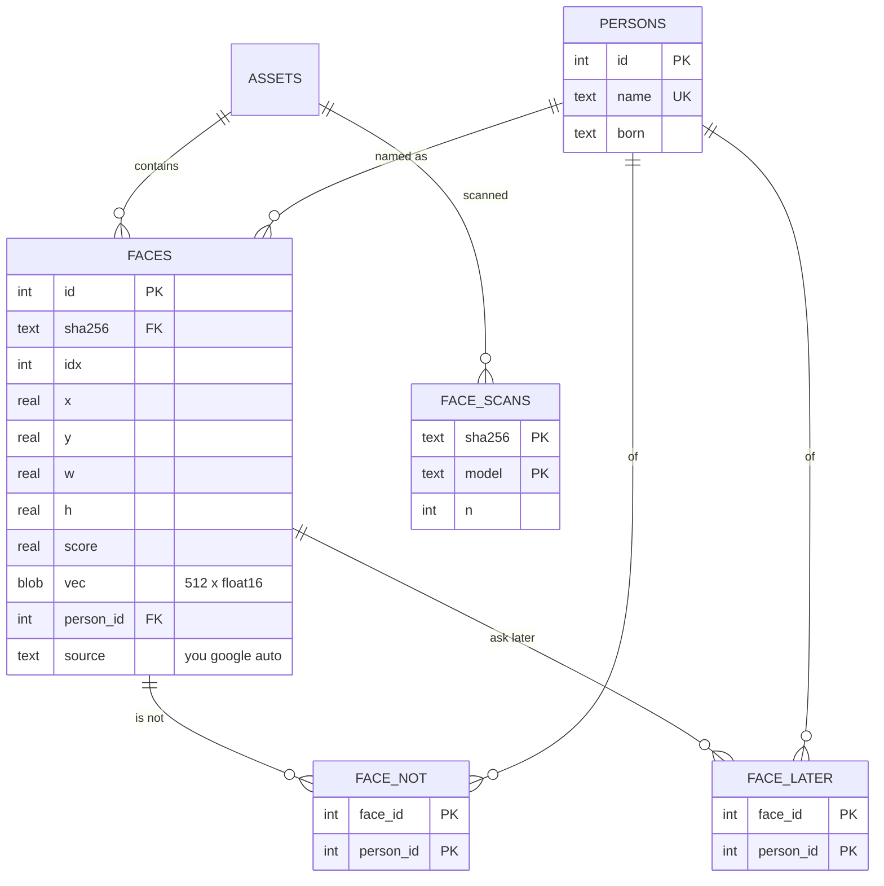
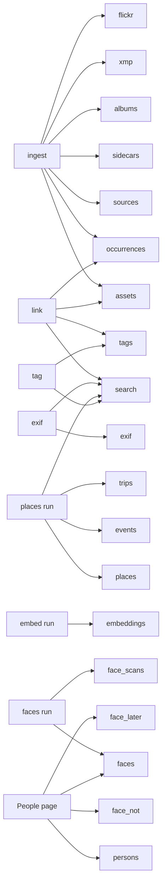

# 5. The catalog

The catalog is one SQLite file, `estate.db`. It holds everything the system knows about the photos
except the photos themselves. This chapter documents every table, how they relate, which program
writes and reads each one, and the handful of SQLite settings that make a multi-process pipeline
work.

## Why SQLite

- **One file.** Backing up the catalog is copying a file (or `sqlite3 db ".backup 'copy'"` while it
  is in use). Moving the library to a new machine is `rsync`.
- **Readable without this software.** The promise in the README is that if every script
  disappeared, `sqlite3 estate.db` still works. The schema uses plain tables, plain column types
  and JSON text for the awkward parts.
- **Fast enough.** The server reads the catalog into memory at startup (chapter 11), so SQLite's
  job is durable storage and batch queries, not serving requests.
- **Concurrent enough.** Every script opens the file in **WAL mode** (`PRAGMA journal_mode=WAL`)
  with `synchronous=NORMAL`, so a reader (the running app) and a writer (an ingest or embedding
  job) can work at the same time, and a power cut cannot corrupt the database. The embed, faces
  and places scripts also set a busy timeout (60-120 s) so a writer waits for a lock instead of
  failing.
- **Keep it on a local disk.** SQLite's locking is not reliable over SMB or NFS. The store can
  be on a network share; the catalog should not be.

## The tables at a glance



The side tables that are only ever read by `link` (`albums`, `xmp`, `flickr`) are omitted from the
diagram. The faces and people tables form their own cluster:



Plus one more table that SQLite creates for the full-text index: `search`, an FTS5 virtual table
(`sha256 UNINDEXED, text`), described in chapter 9.

The relationships are *by convention*, not enforced by foreign keys. The scripts keep them
consistent. This keeps the schema simple, lets stages be re-run independently, and means a
half-finished pipeline never fails on a constraint.

## Table by table

Group by stage. "Writer" is the command that fills the table; "readers" is who consumes it.

### Ingest

| Table | Key | Purpose | Writer | Readers |
|---|---|---|---|---|
| `sources` | `name` | One row per zip or folder ingested, with counts and `finished_at` | `ingest` | `ingest` (skip logic), `pull-drive.sh` (`ingested()`), `stats` |
| `assets` | `sha256` | **One row per unique file.** Facts about the bytes (`ext`, `kind`, `size`, `width`, `height`, `dhash`, `exif_taken_at`) plus merged metadata (`taken_at`, `lat`, `lon`, `description`, `people`, `favorited`) | `ingest` creates; `link` fills the metadata columns | everything |
| `occurrences` | `id`; unique `(source, path)` | **One row per place a file was found**; `album` is the folder-derived album, `sidecar_id` the matched Google sidecar | `ingest` creates; `link` sets `sidecar_id` and `album` | `link`, the app (albums, first path), `reindex` |
| `sidecars` | `id`; unique `(dir, filename)` | The Google photo JSON, kept whole in `data` | `ingest` | `link` |
| `albums` | `dir` | Each album folder's localised title (from its `metadata.json`) | `ingest` | `link` |
| `xmp` | `(dir, filename)` | iCloud XMP, reduced to `taken` (UTC), `lat`, `lon`, `rating`, `keywords` | `ingest` | `link` |
| `flickr` | `id` | Flickr photo JSON, whole | `ingest` | `link` |

`assets.taken_at` is deliberately of two kinds. If a Google or iCloud sidecar supplied it, it is an
ISO timestamp **with** `+00:00` (a UTC instant). If it fell back to EXIF or Flickr, it is **without** an
offset (a camera wall-clock time). `places.py` reads that distinction to decide whether a time
needs converting (chapter 7).

`assets.people` is a comma-separated string of names rather than a join table because it is only
ever consumed whole, by the full-text index and by the server's startup load, which splits it.

### Enrichment

| Table | Key | Purpose | Writer | Readers |
|---|---|---|---|---|
| `exif` | `sha256` | `camera`, `make`, `model`, `lens`, `focal`, `focal35`, `fnumber`, `exposure`, `iso`, `software`, `duration`, `fps` promoted to columns; the **full tag dump** as JSON in `data` | `exif` | `places` (offset tags), app (camera facet, viewer), `reindex` |
| `places` | `sha256` | `city`, `locality`, `admin2`, `admin1`, `country`, `cc`, `place_source` (`gps`/`event`), `tz`, `tz_source`, `local_time`, `utc_time`, `event_id` | `places run` | app, `reindex` |
| `events` | `id` = start time as UTC epoch seconds | A burst of photos: `start_local`, `end_local`, `n`, `title`, `place`, `lat`, `lon`, `km_from_home`, `trip_id` | `places run` | app, `reindex` |
| `trips` | `id` = first event's id | A run of away-from-home events: `start_local`, `end_local`, `n`, `n_events`, `title`, `place` | `places run` | app, `reindex` |
| `tags` | `(sha256, model)` | Caption and tags *per model*: the pseudo-model `flickr` (Flickr's own tags) or the name of a local vision model | `link` (flickr), `tag` | `reindex`, `search` |
| `embeddings` | `(sha256, model)` | `vec` BLOB: L2-normalised **float16** vector; `dim` records its length; `error` records an undecodable file | `embed run` | app, `embed search` |

Two conventions here are worth highlighting.

**Per-model rows.** `tags` and `embeddings` are keyed by `(sha256, model)`. A better model is added
as new rows without touching the old ones, and queries must use the same model as the vectors they
search. This is what makes "try a bigger image model" a non-destructive experiment.

**Stable event ids.** An event's id is its start time in epoch seconds, so re-running `places` after
adding photos does not renumber existing events, and `?event=123` links stay valid.

### Faces and people

| Table | Key | Purpose | Writer | Readers |
|---|---|---|---|---|
| `faces` | `id` | One row per detected face: `sha256`, `idx` (face number within the photo), `model`, the box `x y w h` as **fractions of the upright image**, detector `score`, `px` (the box's longer side in pixels), `vec` (512 × float16), `person_id`, `source`, `labeled_at` | `faces run` creates; the People page updates `person_id`, `source` | `People` class, app |
| `face_scans` | `(sha256, model)` | Every image *looked at*, including those with zero faces, so a re-run does not rescan them | `faces run` | `faces run`, `stats` |
| `persons` | `id`; unique `name` | A named person, with optional `born` (`YYYY` or `YYYY-MM`) | `People` (seeded from Google's tags; created by you) | `People`, app |
| `face_not` | `(face_id, person_id)` | "This face is **not** that person": never suggest it again | People page | `People` |
| `face_later` | `(face_id, person_id)` | "Is this ...?" skipped for now: still unnamed, asked about again later | People page | `People` |

`faces.person_id` has three meanings: a positive id (a person), `0` (**you chose not to name it**: a
stranger), and `NULL` (nobody has said). `faces.source` says who said it: `'you'`, `'google'`, or
`'auto'` (chapter 15).

### Search

| Table | Purpose | Writer |
|---|---|---|
| `search` (FTS5) | One row per asset; `text` is a concatenation of description, people, every file name and album, tags, camera, lens, place names, event and trip titles | `reindex` (called at the end of `link`, `exif`, `places`, and per image by `tag`) |

## What writes what, and when



Reading the picture: **`link` is the only stage that rewrites columns of `assets` after ingest**, and
`search` is rebuilt by four different stages because it indexes data from `assets`, `occurrences`,
`tags`, `exif` and `places`.

## SQLite practice used throughout

| Practice | Where | Why |
|---|---|---|
| `PRAGMA journal_mode=WAL` | every `connect()` | Readers and a writer do not block each other |
| `PRAGMA synchronous=NORMAL` | every `connect()` | Safe with WAL; far fewer fsyncs on a spinning disk |
| `sqlite3.connect(db, timeout=60)` | embed, faces | A second process waits for the write lock |
| `PRAGMA busy_timeout=120000` | places | `places` may be run while the app is up |
| `INSERT OR IGNORE` / `INSERT OR REPLACE` | ingest, embed | Makes batches idempotent |
| `executescript(SCHEMA)` with `IF NOT EXISTS` | every `connect()` | Self-initialising; no migration step |
| Commit every N rows (200 ingest; batch embed; 64 faces) | batch jobs | At most N rows of work lost on a crash |
| `sqlite3 db ".backup 'file'"` | end of both pull scripts | A consistent snapshot while the file is open |
| Reads in table order, sorted in memory | server startup | On a spinning disk, walking an index turns each row into a seek |
| A *covering index* `exif_app` | server startup | Holds just the 8 EXIF columns the app reads (19 MB) so startup does not scan the 700 MB table |

The last two come straight from measurement ([PERFORMANCE.md](../../photo-estate/PERFORMANCE.md)): on a
USB hard disk, reading the `exif` table was 8.7 s of startup, a correlated subquery into
`occurrences` 5.8 s, and reading embeddings `ORDER BY sha256` via the primary key 2.7 s (against
0.15 s unordered).

## Sizes

Per-row sizes that explain where the bytes go:

| Data | Per row | For 100,000 photos |
|---|---|---|
| Embedding (768 × float16) | 1,536 bytes | about 150 MB |
| Face vector (512 × float16) | 1,024 bytes, plus the box | about 1 KB × number of faces |
| `exif.data` JSON | several KB | the largest table by far: 705 MB for the author's 120k assets |
| dHash | 8 bytes | under 1 MB |

The README's rule of thumb is about 1 GB of catalog per 120k photos, and 2.5 GB of thumbnail cache
per 100k photos.

## Reading the catalog yourself

Because it is plain SQLite, you can answer questions without any of this code:

```sql
-- how many unique photos and videos, and how big?
SELECT kind, count(*), round(sum(size)/1e9, 1) AS gb FROM assets GROUP BY kind;

-- where did a photo come from, and which albums is it in?
SELECT o.source, o.path, o.album
FROM occurrences o JOIN assets a USING(sha256)
WHERE a.sha256 LIKE 'ab12%';

-- photos from Denmark in July 2019
SELECT a.sha256, p.city, p.local_time
FROM places p JOIN assets a USING(sha256)
WHERE p.country = 'Denmark' AND p.local_time LIKE '2019-07%';

-- the ten busiest events
SELECT start_local, n, title FROM events ORDER BY n DESC LIMIT 10;

-- faces named by you, per person
SELECT p.name, count(*) FROM faces f JOIN persons p ON p.id = f.person_id
WHERE f.source = 'you' GROUP BY p.name ORDER BY 2 DESC;

-- the original file for a sha
--   store/<sha[0:2]>/<sha[2:4]>/<sha><ext>
```

## Where to look in the code

| Topic | Code |
|---|---|
| Schema for ingest, enrichment, tags, search | `SCHEMA` at the top of [estate.py](../../photo-estate/estate.py) |
| Schema for embeddings | `SCHEMA` in [embed.py](../../photo-estate/embed.py) |
| Schema for faces and people | `SCHEMA` in [faces.py](../../photo-estate/faces.py) |
| Rebuild-from-scratch of derived tables | the "write" section of `cmd_run` in [places.py](../../photo-estate/places.py) |
