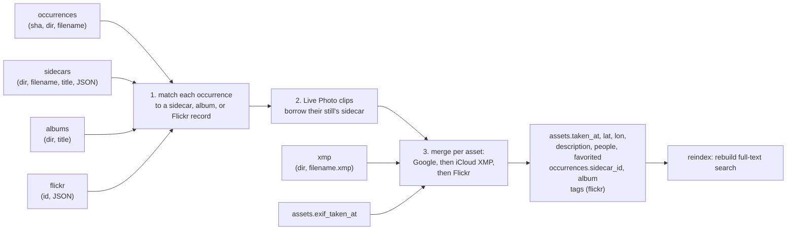
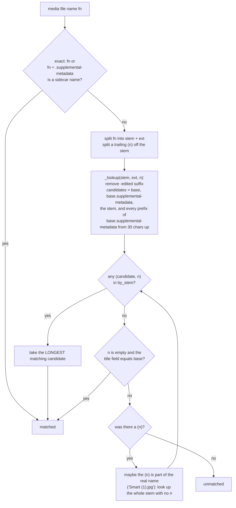
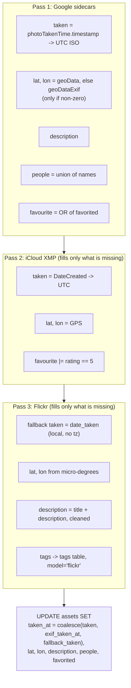

# 6. Linking metadata

Ingest stores photos and stores each service's metadata files *as data*. **Linking** connects the
two and merges what each service said onto the photo. It is `estate.py link`, about 150 lines in
`cmd_link` and its helpers, and it is where most of the real-world mess of three services is
handled.

Two properties define it:

- **It is idempotent and order-independent.** It reads rows (occurrences, sidecars, XMP, Flickr
  JSON) and recomputes every merged column from scratch, so it can be run after every batch of zips
  and always gives the same answer for the same inputs.
- **It never touches the store.** Linking is purely a catalog operation.

## The inputs and outputs



## Step 1: matching a sidecar to a photo

Google Takeout puts a JSON file next to each photo, but it does not name it simply. The matcher has
to reconstruct the pairing from the file names, within each folder (the *directory string inside
the zip*, so a photo and its sidecar still match when they arrive in different zips).

### Indexing the sidecars of a folder

For each folder, `SidecarIndex` keeps three dictionaries, so that each lookup costs the length of
the file name rather than the number of sidecars in the folder (a year folder can hold 10,000):

| Dictionary | Key | Built from |
|---|---|---|
| `raw` | the sidecar name without `.json` | `IMG_0001.JPG.supplemental-metadata` |
| `by_stem` | `(name without .json and without a trailing "(n)", "(n)")` | `("IMG_0002.JPG.supplemental-metadata", "(1)")` |
| `by_title` | the `title` field inside the JSON, for sidecars with no `(n)` | `"IMG_0001.JPG"` |

`split_dupn` peels a trailing `(1)`, `(2)`, ... off a name. This is the key to Takeout's
duplicate-name rule: **the `(n)` goes on the photo before the extension (`IMG_0002(1).JPG`) but on
the sidecar after the whole name (`IMG_0002.JPG(1).json` or
`IMG_0002.JPG.supplemental-metadata(1).json`)**. Splitting it off lets both sides be compared on
the same footing.

### The matching rules, in order



Each quirk from chapter 3 maps to a line in that flowchart:

| Takeout quirk | Example | How it matches |
|---|---|---|
| Plain sidecar | `A.jpg` ↔ `A.jpg.json` | exact (`raw` has `A.jpg`) |
| New suffix | `A.jpg` ↔ `A.jpg.supplemental-metadata.json` | exact, second form |
| Old style, no extension | `A.jpg` ↔ `A.json` | the bare `stem` is one of the candidates |
| Duplicate names | `A(1).jpg` ↔ `A.jpg(1).json` | `n="(1)"` removed from the photo, compared to the sidecar's `n` |
| **Truncated name** | `PXL_..._EXPORTED_FROM_CAMERA.jpg` ↔ `PXL_..._EXPORTED_FRO.json` | every prefix of `base.supplemental-metadata` from 30 characters up is a candidate; the longest one present wins |
| Google edit | `A-edited.jpg` ↔ `A.jpg.json` | `EDITED` strips `-edited` (and the same word in German, French, Spanish, Italian, Dutch, Danish and Finnish) |
| A real `(1)` in the name | `WP_..._Smart (1).jpg` | second attempt with the whole stem and no `n` |
| Renamed file | title in JSON is the original name | the `by_title` fallback |

The truncation rule is the cleverest and the easiest to misread. Takeout cuts the sidecar's name at
about 51 characters. So instead of knowing the cut point, the matcher tries *every possible* prefix
length of the expected name, from 30 up to full length, and takes the longest candidate that
actually exists as a sidecar. "Longest wins" is what prevents a short ambiguous prefix from matching
the wrong photo when two photos share a long common start.

### Album names

An occurrence's album is `albums.get(dir)` (the title from that folder's `metadata.json`, which
Google localises, e.g. "Paris Trip 🇫🇷") or, if there is none, `default_album(dir)`: the folder name
unless it looks like a year folder (`Photos from 2019` in six languages), a date folder
(`2019/07/14`, from iCloud), or a generic root (`Takeout`, `Google Photos`).

Because every occurrence carries its own album, the "same photo in five album folders" case ends
as one asset in five albums.

### Flickr

If no Google sidecar matched, `link` tries `flickr_for(fn, flickr)`: extract the Flickr photo id
from the file name and look it up in the `flickr` table. A hit replaces the album with the photo's
Flickr album titles, joined with commas, and stages the record for the merge in step 3.

## Step 2: Live Photos and motion photos

A Live Photo is a still plus a 2-3 second video. Takeout exports `IMG_1.HEIC` and `IMG_1.MP4`, but
only the still gets a sidecar. Without help, the clip would be an orphan with no date.

After the main pass, every media file *without* a match goes in a `pending` list. For each video
there, `link` looks for an image **in the same folder with the same stem** that already has a
sidecar, and gives the video that sidecar. Two details keep this right:

- **Plain names go first.** `pending.sort(key=...)` puts `IMG_1904.MP4` before `IMG_1904(1).MP4`.
  When two stills share a name (`IMG_1904.JPG` and `IMG_1904.HEIC`), Takeout calls the second clip
  `IMG_1904(1).MP4`; handling plain names first means each clip takes the right still.
- **A used sidecar is not reused** if another candidate is free (`used` set), so two clips do not
  both claim one still.

The count of rescued clips is printed: `... (N Live Photo clips via their still ...)`. On the
author's library about 16,500 of the roughly 18,900 videos were motion clips, not real videos
(BENCHMARK.md).

Anything still unmatched after this is printed (up to 20) with the hint that its sidecar may be in
a zip not yet ingested.

## Step 3: merging onto assets

Every occurrence now points at (at most) one sidecar. The merge works *per asset*, gathering
across all of its occurrences, in three passes of decreasing authority:



Details that matter:

- **First writer wins** for time, GPS and description: the code tests `"taken" not in acc` before
  setting. Google therefore beats iCloud beats Flickr, as described in chapter 3.
- **Time is a coalesce.** `coalesce(sidecar_or_xmp_utc, exif_taken_at, flickr_local)`. A UTC instant
  from a service is preferred over the camera's wall-clock time because it can be placed on a
  timeline unambiguously; the camera time is preferred over Flickr's because it is the camera's own.
- **Zero coordinates are "no location".** Google writes `0.0, 0.0` when there is no GPS, so a
  coordinate counts only if `latitude` or `longitude` is non-zero.
- **People and favourites are unioned**, because "someone said this photo has Alice in it" is a
  statement that stays true however many other copies exist.
- **Flickr tags are rebuilt** on every link: `DELETE FROM tags WHERE model='flickr'` then re-insert,
  which is what makes the whole step idempotent (the test asserts that running `link` twice leaves
  exactly two Flickr tag rows).
- **The Flickr description** is built by `flickr_text`: strip HTML tags, unescape entities (`&amp;`
  → `&`), collapse whitespace, drop a title that looks like a filename (`FILENAME_TITLE`), and
  join title and description with an em dash.

### Why iCloud and Google copies land on the same instant

The XMP time carries a UTC offset (`2024-06-13T21:06:35-0700`). `parse_xmp` converts it to UTC.
Google's `photoTakenTime.timestamp` is already UTC seconds. So a photo that is in both services gets
the *same* `taken_at` from both, and later the duplicate classifier can recognise the pair as one
moment ([chapter 8](08-duplicates.md)). The end-to-end test builds exactly this case: an iCloud copy
whose EXIF time is local and whose XMP time carries the offset must land on the same UTC instant.

### The XMP parser is a regular expression

```python
XMP_FIELDS = {"taken": "photoshop:DateCreated", "lat": "exif:GPSLatitude",
              "lon": "exif:GPSLongitude", "rating": "xmp:Rating"}
re.search(rf"<{tag}>([^<]+)</{tag}>", text)
```

This is deliberate. `icloudpd` writes a *flat* XMP with one element per field, so a regular
expression per tag is enough, and avoids pulling in an XML library for four fields.

## What `link` prints

```
linked 11/11 occurrences to sidecars (0 Live Photo clips via their still, 2 Flickr photos);
metadata merged onto 11 assets
```

and, if applicable, the list of media still without a sidecar.

## Where to look in the code

All in [estate.py](../../photo-estate/estate.py):

| Topic | Code |
|---|---|
| Sidecar indexing | `SidecarIndex`, `split_dupn` |
| The matching algorithm | `match_sidecar`, `_lookup` |
| Album naming | `default_album`, `YEAR_DIR`, `DATE_DIR` |
| The command | `cmd_link` |
| iCloud XMP | `parse_xmp`, `XMP_FIELDS` |
| Flickr | `flickr_for`, `flickr_text`, `FLICKR_FILE`, `FILENAME_TITLE` |
| Test | `build_takeout` in [tests/test_poc.py](../../photo-estate/tests/test_poc.py): every quirk above is built synthetically and asserted |
