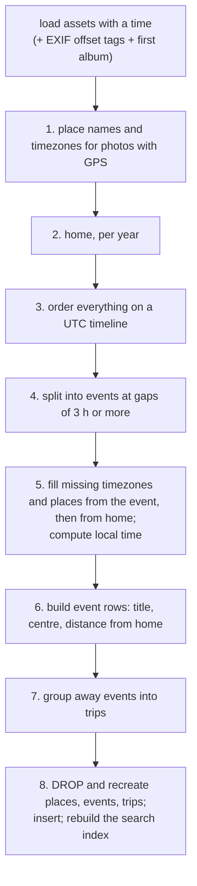
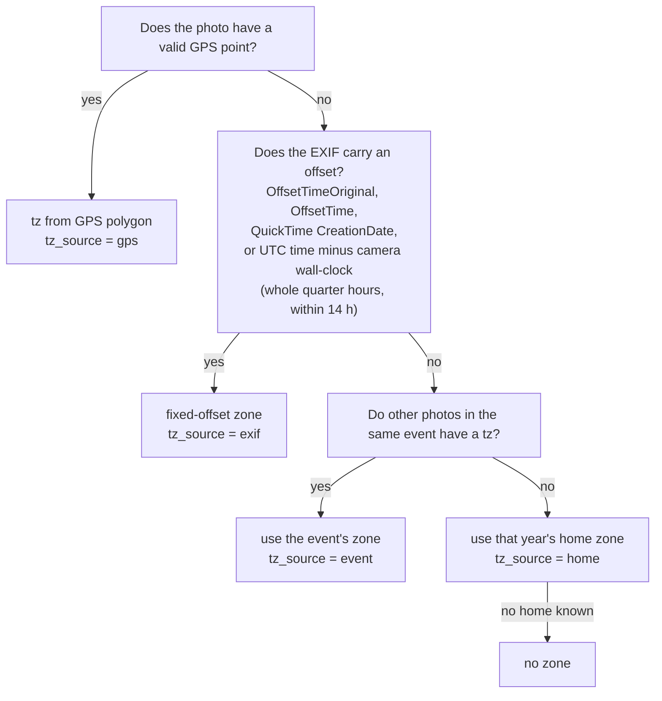
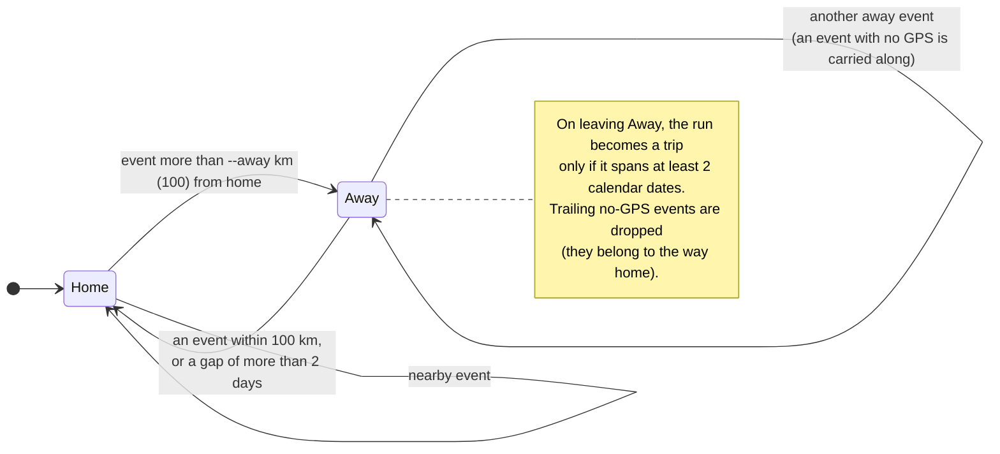

# 7. EXIF, places, events and trips

By now every photo has a date, maybe a GPS point, and some description. This chapter covers the two
stages that turn those into the facts the app actually shows and filters on:

- `estate.py exif` reads the camera's own record of the shot (camera, lens, exposure).
- `places.py run` answers *where* and *when, locally* and groups photos into **events** and
  **trips**, using no network and no model.

Both are cheap, deterministic, and (for `places`) recomputed from scratch each run.

## `estate.py exif`: what the camera recorded

### Running exiftool at scale

[ExifTool](https://exiftool.org/) is the reference tool for reading photo and video metadata, and
it understands formats Pillow does not (RAW, QuickTime). The command runs it over every asset in
batches:

```
exiftool -json -n -G1 -a --MakerNotes:all -charset filename=utf8 -@ -
```

| Flag | Meaning |
|---|---|
| `-json` | One JSON object per file |
| `-n` | **Numeric** values: `ExposureTime` as `0.004`, not `"1/250"`; GPS as decimal degrees |
| `-G1` | Prefix each tag with its group (`ExifIFD:ISO`, `Keys:CreationDate`), because the same tag name appears in several places |
| `-a` | Keep duplicate tags |
| `--MakerNotes:all` | **Exclude** maker notes, vendor-specific blobs that are huge and useless here |
| `-@ -` | Read the list of file paths from stdin, so a batch is one process start, not 200 |

The work is spread over a thread pool (`--workers`, default half the CPUs), each thread running
`exiftool` as a subprocess on a batch (`--batch`, default 200). Threads suffice because the real
work is in the subprocess. As each batch returns, its rows are written and committed, so the job is
**resumable**: the work list is `assets NOT IN exif`. `--force` redoes everything; `--limit` tries a
few.

### What is kept

Per file the *whole* dump is stored as JSON in `exif.data`, minus the `System:` and `ExifTool:`
groups (file-system facts and the tool's own chatter) and any value that is a `(Binary data ...)`
placeholder. A set of fields is also **promoted to columns** so they can be filtered cheaply:

| Column | From tag(s), first non-empty wins |
|---|---|
| `camera` | `Make` + `Model`, normalised (below) |
| `lens` | `LensModel`, `Lens`, `LensID`, `LensType` |
| `focal`, `focal35` | `FocalLength`; `FocalLengthIn35mmFormat`, `FocalLength35efl` |
| `fnumber` | `FNumber`, `ApertureValue` |
| `exposure` | `ExposureTime` (seconds) |
| `iso` | `ISO`, `ISOSpeedRatings`, `RecommendedExposureIndex` |
| `software` | `Software` |
| `duration`, `fps` | `Duration`, `VideoFrameRate` (for video) |

Keeping the full dump costs a lot of space (it is the biggest table, 705 MB for the author's
library), but it means a later question ("which photos have `OffsetTimeOriginal`?") needs no re-read of
120,000 files. The app avoids paying for it at startup with a covering index (chapter 5).

### Naming cameras

Cameras report their make and model in every shape. `camera_name` makes one readable name:

| Make | Model | Result |
|---|---|---|
| `NIKON CORPORATION` | `NIKON D300` | `Nikon D300` |
| `Canon` | `Canon EOS R5` | `Canon EOS R5` |
| `Apple` | `iPhone 15 Pro` | `Apple iPhone 15 Pro` |
| `EASTMAN KODAK COMPANY` | `KODAK EASYSHARE...` | `Kodak EASYSHARE...` |

It looks up the first word of the make in a table (`MAKERS`: Nikon, Canon, Fujifilm, Sony, Olympus,
Panasonic, Samsung, LG, Kodak, Motorola, HTC, Google, Apple, Microsoft, Nokia, Ricoh, Pentax, Leica,
Hasselblad, DJI, GoPro, Huawei, Xiaomi, OnePlus, Minolta, Konica Minolta, Casio), title-cases an
all-caps make not in the table, and removes a duplicated brand word from the front of the model.
This is what makes the **Camera** filter list "Nikon D300" once instead of five spellings.

## `places.py run`: where, and when, locally

Run it and a few seconds later every photo with a time has: a place name, a timezone, a *local* time,
an event and perhaps a trip. Nothing leaves the machine: GeoNames city data ships with the
`reverse_geocode` package and timezone polygons with `timezonefinder`.



### 1. Place names from GPS

For each photo with a valid coordinate (finite, within range, and not exactly 0,0):

1. **Nearest place.** `reverse_geocode.search` returns the nearest GeoNames city, with its county
   (`admin2`), state/region (`admin1`) and country code.
2. **Big city beats nearby suburb.** A second search is made restricted to cities of at least
   100,000 people. If that "big city" differs from the nearest place and is within
   `min(25 km, 0.006 × √population)` km, the big city is used as `city` and the nearer name is kept
   as `locality`. The Eiffel Tower is nearest to Vanves, a suburb; but Paris (2.1 million) is within
   8.7 km, so the photo's city is **Paris** and Vanves is the locality. The radius grows with the
   square root of population, so a village is never absorbed by a distant big city, but Paris
   claims its suburbs.
3. **Timezone.** `timezonefinder` maps the point to an IANA zone (`Europe/Paris`). Results are
   cached per 0.01° cell (about 1 km) because most photos in a library cluster.

### 2. Home, per year

Trips need a notion of "away", so the program estimates where you live *in each year*:

> The ~10 km grid cell (coordinates rounded to 0.1°) in which photos were taken on the **most
> distinct days** that year.

Counting *days*, not photos, matters: a one-day party with 800 photos at a venue does not outvote a
home with a photo on 200 different days. Counting per year follows you when you move. A year with no
GPS photos borrows the nearest year's home (ties go to the later year). `home_cc`, the home country,
is taken from the most recent year.

### 3. The timezone and the local time of every photo

This is the part that makes "when was this *really*?" correct. Each photo's timezone is decided by a
cascade, most trustworthy first:



Then the *time* is made local:

| `taken_at` looks like | Meaning | Local time |
|---|---|---|
| `2019-07-14T10:22:33+00:00` (carries an offset) | A UTC instant from Google or iCloud | Convert to the photo's zone and drop the offset: `12:22:33` in Paris |
| `2010-06-01T08:00:00` (no offset) | Already camera wall-clock (EXIF, Flickr) | Keep as is |

The end-to-end test asserts precisely this: a Paris photo whose sidecar says 10:22:33 UTC gets a
local time of 12:22:33 (CEST), while an EXIF-only photo keeps its wall-clock time.

For ordering, every photo also gets a provisional **UTC instant** (`utc_time`): for aware times, the
instant itself; for wall-clock times, the wall clock interpreted in the photo's zone (or the year's
home zone, or UTC as a last resort).

### 4. Events: split on gaps

Sort everything by UTC and cut a new event wherever the gap between consecutive photos exceeds
`--gap` hours (default 3):

```
time ──────────────────────────────────────────────────────────────▶
 photos:  ● ●● ● ●●●          ● ● ●                 ● ●●
          └─ event A ──┘        └ event B ┘          └ event C ┘
                       ▲ gap > 3 h        ▲ gap > 3 h
```

A single sorted pass with one comparison per photo, so it is linear in the number of photos.

### 5. Filling in what is missing

- **Zone:** photos with no zone take the dominant zone of their event (preferring zones that came
  from GPS), else the year's home.
- **Place:** a photo with no GPS takes its event's **dominant place** and is marked
  `place_source = 'event'`. The app says "Inferred from the photos around it" for these, so you can
  tell. This is why a screenshot taken in the middle of a trip shows up in that trip's city.

### 6. Event rows

For each event:

| Field | Rule |
|---|---|
| `id` | The event's earliest UTC instant, as epoch seconds (bumped by 1 if it collides). **Stable** across re-runs |
| `start_local`, `end_local` | Earliest and latest local time |
| `place` | `place_label` of the dominant place: `"Springfield, Illinois"` at home, `"Toronto, Canada"` abroad |
| `lat`, `lon` | The **median** of its GPS photos (robust to a stray outlier) |
| `km_from_home` | Haversine distance from the home of the event's start year |
| `title` | The album most of its photos share, if at least half its photos have an album and one album covers at least half; otherwise the place label |

An event titled by its album ("Matthew's birthday") is more useful than one titled by its place
("Seattle"), so albums win.

### 7. Trips

A **trip** is a run of consecutive events that are far from home. The rule, in `cmd_run`:



The trip's **title** is generated from where its GPS photos were:

| If... | Title |
|---|---|
| One city has at least 60% of the photos | `Trip to Paris, France` (city and state when at home, city and country abroad) |
| Several countries, none of them home | `Trip to Denmark and Belgium` (the two largest, each at least 15%) |
| Several regions in one foreign country | `Trip to Quebec and Ontario, Canada` |
| Regions that mix home and abroad | `Trip to Florida and Ontario, Canada` |
| Nothing usable | `Trip to somewhere` |

A trip's id is its first event's id, and each event stores its `trip_id`.

### 8. Writing: drop and recreate

```python
con.execute("BEGIN")
for t in ("places", "events", "trips"):
    con.execute(f"DROP TABLE IF EXISTS {t}")
for stmt in estate.SCHEMA.split(";"):
    ... recreate those three tables (and the places_event index) ...
```

Because the three tables are *fully derived*, they are dropped and recreated rather than updated.
That has two benefits: schema changes need no migration, and a bug in the rules can never leave stale
rows behind. The whole thing is in one transaction. It ends by calling `estate.reindex`, since place
names, event titles and trip titles are searchable.

The run prints where its zones and places came from (the numbers here are illustrative):

```
done in 4s: 104 assets with a time | zone from gps 98, exif 0, event 6, home 0, none 0 |
  place from gps 98, event 6, none 0
```

### Using it

```bash
uv run places.py --db estate.db run                  # compute (seconds, any time)
uv run places.py --db estate.db run --gap 2 --away 60
uv run places.py --db estate.db events --trips       # list trips, newest first
uv run places.py --db estate.db events --min 20      # events with at least 20 photos
```

`--gap` is the quiet period that ends an event (hours); `--away` the distance from home that makes
an event part of a trip (km).

## Where to look in the code

| Topic | Code |
|---|---|
| exiftool batching | `_exiftool_batch`, `cmd_exif` in [estate.py](../../photo-estate/estate.py) |
| Tag promotion and camera naming | `exif_row`, `_pick`, `camera_name`, `MAKERS` |
| Offsets and zones | `parse_offset`, `offset_between`, `tz_label` in [places.py](../../photo-estate/places.py) |
| Distance and place labels | `haversine_km`, `place_label`, `country_name`, `dominant` |
| The whole algorithm | `cmd_run` |
