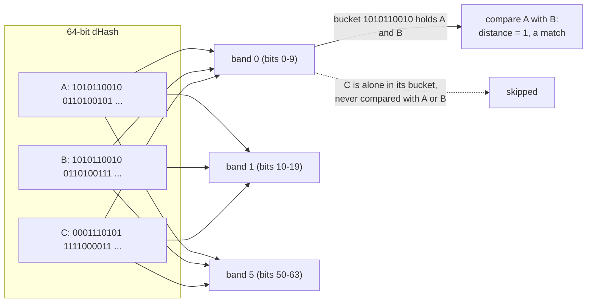
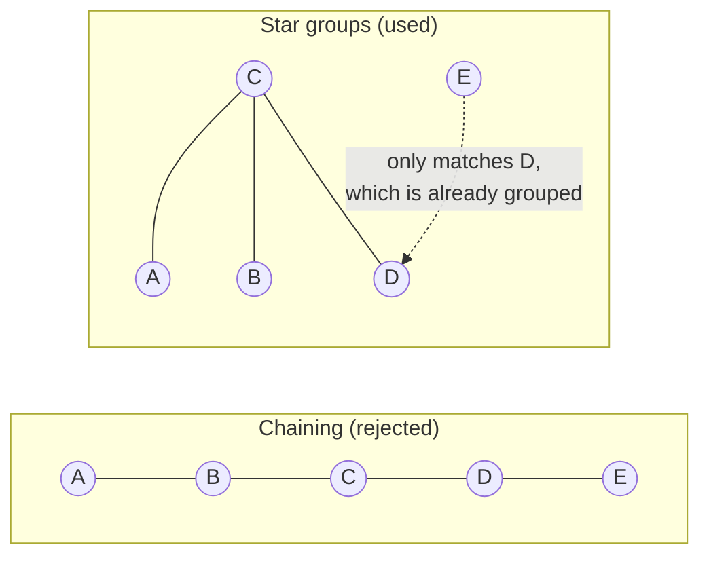
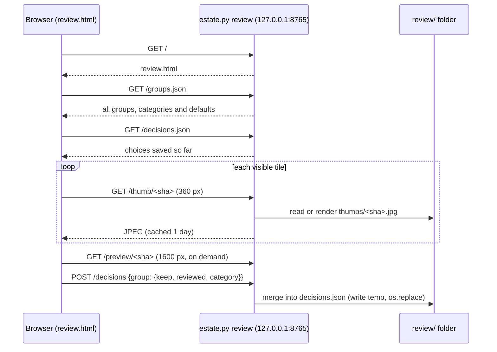
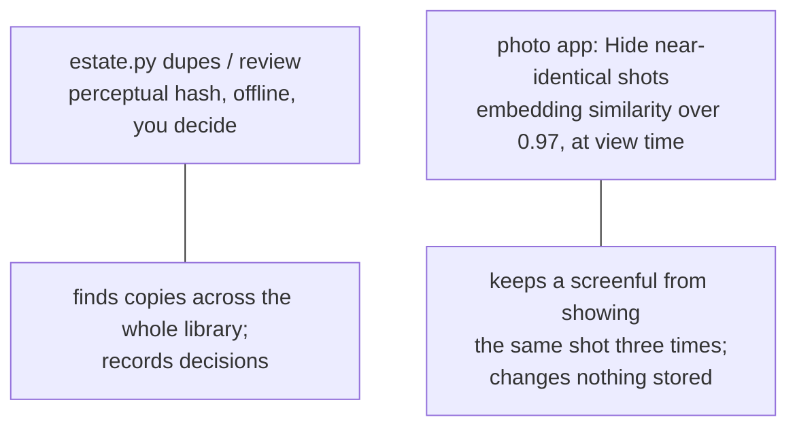

# 8. Duplicates

Photo libraries are full of copies, and there are two very different kinds.

| Kind | Example | Detected by | What the system does |
|---|---|---|---|
| **Exact** | The same file in a year folder and three album folders | SHA-256 of the bytes | Collapses automatically at ingest: one asset, several occurrences |
| **Near** | The iCloud HEIC and the Google JPEG of the same shot; a WhatsApp-resized copy; a Google "-edited" version; a burst; a RAW+JPEG pair | A 64-bit perceptual hash (dHash) | **Reports only.** Nothing is merged or deleted without you |

The asymmetry is the point. Exact duplicates are *provably* the same, so merging them is free and
safe. Near-duplicates are *probably* the same, and which one to keep is a judgement (the bigger
file? the edit? both?), so the system finds and presents them and records what you decide.

For the author's library, exact duplicates saved only about 1% of storage (BENCHMARK.md), and about
10,000 duplicates were collapsed in total. The near-duplicate problem is the larger one.

## Finding near-duplicates

Every image has a 64-bit dHash computed at ingest (chapter 4). Two photos of the same scene have
hashes that differ in a few bits. The task is: **find all pairs within Hamming distance `t`**
(default `t = 5`) among 100,000 hashes, without comparing all 5 billion pairs.

### Pigeonhole banding

The trick: if two 64-bit hashes differ in at most `t` bits, and you cut each hash into `t + 1`
pieces, then **at least one piece must be identical** (otherwise they would differ in at least `t+1`
bits, one per piece). So:

1. Cut the hash into `t + 1 = 6` bands of 10 bits (the last band takes the remaining 14).
2. For each band, group photos by the value of that band: a hash-table bucket per value.
3. Compare only photos *within the same bucket*, and keep pairs whose full distance is `≤ t`.



Any true match shares a bucket in at least one band, so no pair is missed (no false negatives),
while the vast majority of non-matching pairs are never compared. The edges found are stored as
`(i, j) -> distance`.

### Three guards against false matches

A perceptual hash is crude, and in a real library a purely distance-based rule produces nonsense
groups. `near_dupe_clusters` adds three guards, each from real failure cases:

1. **Near-blank images are skipped.** If a hash has almost all bits the same (`flat = 2`: fewer
   than 3 or more than 61 set bits), it came from a nearly uniform picture (a black frame, a blank
   screenshot), and says nothing about content. Many unrelated images would all match.
2. **Crowded regions need a tighter match.** If an image has 10 or more neighbours (`crowd = 10`),
   it probably belongs to a family of look-alikes, such as screenshots of the same app. A pair
   within a crowded region is only accepted if its distance is `≤ strict` (2), **or** both photos
   were taken within 2 seconds of each other.
3. **Groups are stars, not chains.** Naively, A≈B, B≈C, C≈D would merge A and D, which may be
   unrelated; over a large library chains can swallow thousands of photos. Instead, nodes are
   processed in order of how many neighbours they have, and each group is *one centre plus its direct
   neighbours that are not yet grouped*. Every member is a direct match of the centre.



## Classifying each group

Not every near-duplicate group means the same thing, and the right default differs. `near_dupe_report`
builds each group's members (largest resolution first, then largest file), and assigns one of seven
**categories** with a default decision:

| Category | Rule (checked in this order) | Typical cause | Default keep |
|---|---|---|---|
| `edit` | A member's name contains `-edited` | Google's edited version beside the original | all |
| `raw` | The group mixes RAW and non-RAW extensions | A RAW+JPEG pair | all |
| `copies` | Taken within 2 s of each other, or within a day *and* the same aspect ratio with different resolutions | Re-encoded, resized or re-uploaded copy: WhatsApp, iCloud+Google | **largest only** |
| `screens` | Every member is a PNG | Screenshots that look alike | all |
| `burst` | Span of at most 2 minutes | Burst shots and quick retakes | all |
| `sameday` | Span of at most a day | Often a copy whose time zone differs, so the two clocks disagree | all |
| `otherdays` | Anything else | Re-uploads, scans, or genuine look-alikes | all |

Only `copies` defaults to deleting-in-principle (keep the largest). Everything else defaults to
"keep all", because those are the cases where the near-copy may be a real, different photo.

### Why the time span works for iCloud+Google pairs

The category `copies` depends on the two photos having the same moment. `_ts()` converts a photo's
`taken_at` to epoch seconds. Because both Google and iCloud supply **UTC with an offset** (chapter 6),
the two copies of one photo give the *same* instant, span 0, so they are `copies`. If instead one
copy's time were a naive local time, the interpretation would depend on the machine's clock and the
pair would drift into `sameday`, which is exactly what the end-to-end test guards against.

A small subtlety: `taken_at` values *without* an offset (EXIF or Flickr times) are interpreted in
the machine's local zone by `datetime.timestamp()`. That is harmless for ordering photos from the
same source but is why mixed-source pairs depend on the UTC-carrying metadata.

### Group identity

A group's id is the first 16 characters of the sha of its largest member. Because ids are derived
from content, decisions recorded earlier still apply after the groups are recomputed, as long as the
largest member is the same.

## The command line: `dupes`

```bash
uv run estate.py --db estate.db dupes                  # exact + near report
uv run estate.py --db estate.db dupes --threshold 8 --json near.json
```

It prints the exact-duplicate savings, then for each category the number of groups, images and the
size "beyond the largest copy":

```
EXACT: 11 files in Takeout -> 9 unique assets (…MB seen, …MB stored, …MB saved)
NEAR (dHash distance <= 5): 2 groups covering 4 images. Review these; nothing is deleted.
       1 groups       2 images    0.0 GB beyond the largest copy   Original + Google edit [default: keep all]
       1 groups       2 images    0.0 GB beyond the largest copy   Same moment, different file ... [default: keep largest]
```

and the biggest groups with each member's distance from the centre, dimensions, size and path.
`--json` writes the full report (members, categories, default decisions) to a file.

## The review page: `review`

```bash
uv run estate.py --db estate.db review --store STORE     # http://127.0.0.1:8765/
```

A small local web app ([review.html](../../photo-estate/review.html), 277 lines, served by a
`ThreadingHTTPServer` inside `cmd_review`) for going through the groups:



How it behaves:

- **Tabs by category** (Copies, Edits, RAW + JPEG, Bursts, Same day, Screenshots, Different days),
  each group a row of thumbnails with the kept ones highlighted.
- **Keyboard:** `j`/`k` next/previous group, `l` keep largest only, `a` keep all, `Enter` accept and
  move on, `Esc` close the preview.
- **Thumbnails** are rendered in the background across `cpu_count - 2` processes (a
  `ProcessPoolExecutor` with the `fork` start method) in page order, so the top of the page is ready
  first, and any thumbnail requested before it exists is rendered on demand.
- **Decisions** are merged into `review/decisions.json` under a lock and written atomically. A
  decision is accepted only if its `keep` list is non-empty: a group can never be "keep nothing".

> **Important:** the review page only *records* decisions. Nothing in the repository reads
> `decisions.json` and removes files; the page, like the rest of the system, never deletes a photo.
> The file is the input for a later "apply" step, which does not exist yet.

## Duplicates you do not review: hiding at view time

A different, automatic mechanism sits in the photo app, not here. When you scroll results, the
server skips a photo whose image embedding is more than **0.97 cosine similarity** to one of the
last 8 it just showed, and says "N near-identical shots hidden". That is a *display* choice, can be
switched off in View options, and changes nothing in the catalog (chapter 11).



## Where to look in the code

All in [estate.py](../../photo-estate/estate.py) unless noted:

| Topic | Code |
|---|---|
| dHash computation | `image_facts` |
| Banding and star groups | `near_dupe_clusters` |
| Categories and defaults | `DUPE_CATEGORIES`, `near_dupe_report`, `_resized_copies` |
| CLI report | `cmd_dupes` |
| Review server | `cmd_review`, `_render_jpeg` |
| Review page | [review.html](../../photo-estate/review.html) |
| View-time hiding | `take()` in `cmd_serve` of [embed.py](../../photo-estate/embed.py) |
| Test | the `dupes` assertions in [tests/test_poc.py](../../photo-estate/tests/test_poc.py) |
