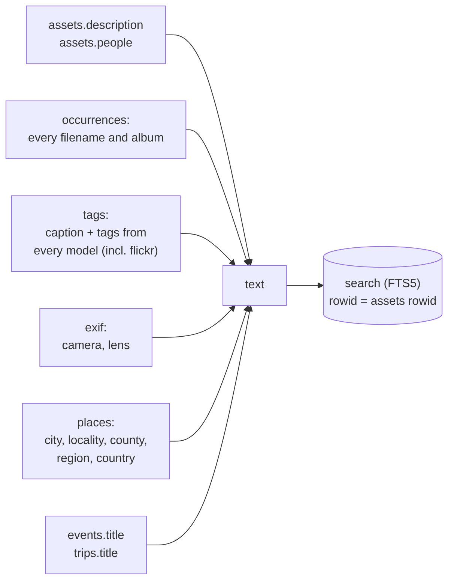
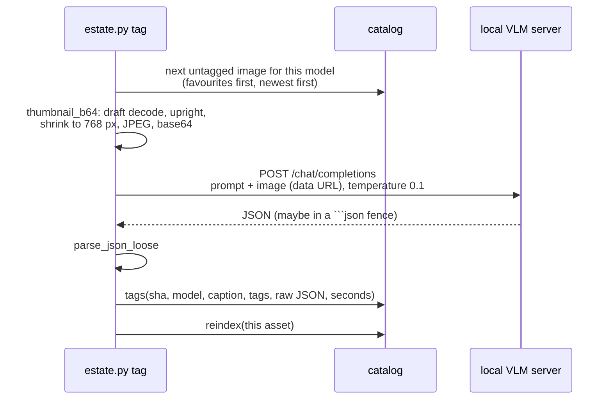
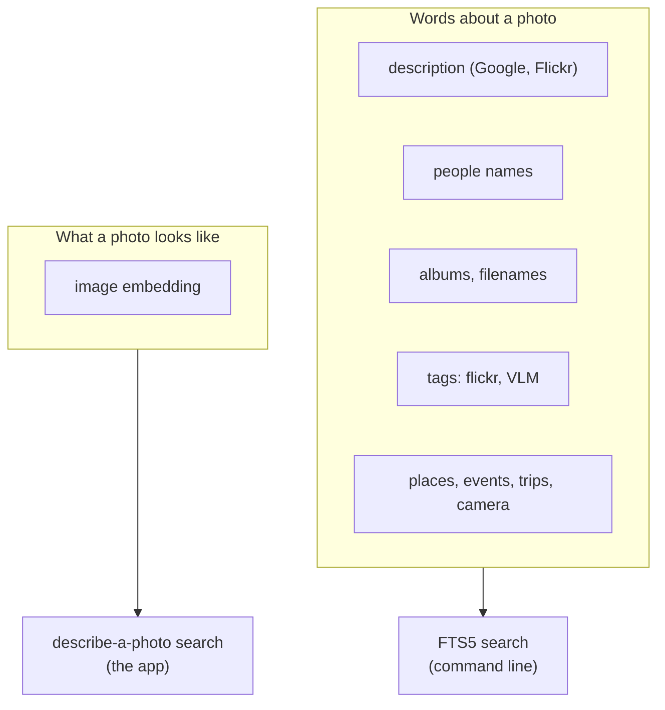

# 9. Full-text search and tags

Before there were embeddings, there was text. The oldest search in the system is **SQLite FTS5**
over everything the catalog knows *as words*: file names, albums, people, descriptions, camera,
place names, event and trip titles, and tags. It is still there, it is what `estate.py search`
uses, and it is where a local vision-language model (VLM) could add captions. This chapter covers
both, and explains how they relate to the newer embedding search (chapter 10).

## The full-text index

### One document per asset

```sql
CREATE VIRTUAL TABLE search USING fts5(sha256 UNINDEXED, text);
```

FTS5 is SQLite's built-in full-text engine. Each asset gets one row whose `text` column is the
concatenation of every word-bearing fact about it, built by `reindex()`:



Why the document is built from *all occurrences*: a photo in three albums should be found by any of
the three album names, and by every file name it ever had (`IMG_1234.HEIC` from iCloud and
`IMG_1234.JPG` from Google).

### The rowid trick

```python
con.execute("INSERT INTO search(rowid, sha256, text) VALUES (?,?,?)", (rid, sha, ...))
```

`reindex` gives each FTS row the *same rowid as the asset's row in `assets`*. When re-indexing a
single asset (the `tag` command does this after each image), it can delete the old FTS row with
`DELETE FROM search WHERE rowid=?`, a direct lookup. The alternative, `WHERE sha256=?`, would scan
the whole FTS table, because FTS5 cannot index an `UNINDEXED` column. At 100k photos that
difference is the gap between instant and a long pause.

### When it is rebuilt

| Caller | Scope |
|---|---|
| `link` | The whole index (`DELETE FROM search`, then everything) |
| `exif` | The whole index |
| `places run` | The whole index |
| `tag` | One asset, after each captioned image |

Re-indexing is cheap relative to the stages that call it, and calling it at the end of each stage
means the text index is never stale relative to the data it summarises.

### Searching

```bash
uv run estate.py --db estate.db search 'paris OR beach'
uv run estate.py --db estate.db search '"new york"' --limit 50 --store STORE
uv run estate.py --db estate.db search alice
```

The query is passed straight to FTS5, so its syntax applies: `OR`, `AND`, `NOT`, `"phrases"`,
prefix `word*`, column filters. Results are ordered by FTS5 `rank` (BM25), and each shows its date,
kind, first path and, if tagged, its caption; `--store` also prints the blob path.

The end-to-end test uses it to check that every kind of metadata is findable: a person's name from
a Google sidecar, an album with an emoji, a Flickr tag ("bicycle"), a Flickr description phrase
("sea stacks"), a camera ("D300"), and a town derived from Flickr geo ("Forks").

### What full-text search is and is not

| FTS5 is good at | FTS5 cannot do |
|---|---|
| Exact words: a person, a place, an album, a camera, a file name | Find a photo by what it *looks like* with no words attached |
| Combining them: `alice AND paris` | Handle synonyms or typos ("puppy" will not find "dog") |
| Being instant, tiny and exact | Rank by meaning |

That gap is exactly what embeddings fill. In the **photo app**, the two are not blended: the app's
text-ish features (facets, typed filters, names and places) read the *structured* data in memory,
and free text goes to the embeddings. FTS5 remains the command-line search and the substrate for
anything that wants literal words.

## `estate.py tag`: captions and tags from a local vision model

`tag` is Tier 5 of the tagging plan ([TAGGING-RESEARCH.md](../../photo-estate/TAGGING-RESEARCH.md)) and
the only part of the pipeline that talks over HTTP to another program. It sends each image to **any
OpenAI-compatible vision server** (llama.cpp's `llama-server` on port 8080 by default, or Ollama at
`:11434/v1`) and stores what comes back.

```bash
uv run estate.py --db estate.db tag --store STORE --model qwen3.5-9b --limit 50
uv run estate.py --db estate.db tag --store STORE --endpoint http://127.0.0.1:11434/v1 --model llava
```



Details:

- **The prompt** asks for *only* a JSON object: a one-sentence `caption`, 5-15 lowercase `tags`
  (subjects, objects, animals, activity, setting, landmark, season, weather, event), `scene`
  (`indoor`/`outdoor`/`unknown`), `people_count`, and any legible `text`. Temperature is 0.1 for
  consistency; `max_tokens` is 400.
- **Tolerant parsing.** Models wrap JSON in ```` ```json ```` fences or add chatter. `parse_json_loose`
  tries `json.loads`, then falls back to extracting the first `{...}` span.
- **Per-model rows.** The primary key is `(sha256, model)`. Run a second model and both sets of tags
  coexist and are searchable; nothing is overwritten. `--model` is required precisely so it is
  never ambiguous.
- **Resumable and prioritised.** It selects images with a dHash and no row for this model, ordered
  by `favorited DESC, taken_at DESC`, so the photos you care about get tagged first. `--limit`
  caps a trial run.
- **Timing built in.** After a run it prints average seconds per image and an estimate in hours for
  the rest, which is how the benchmark in [TAGGING-RESEARCH.md](../../photo-estate/TAGGING-RESEARCH.md)
  was gathered.
- **Failures are counted, not fatal.** If every request fails the command exits non-zero; if some
  succeed it reports the failure count and carries on.
- **Why `--max-side 768`.** A vision model does not need more pixels than that to name a scene, and
  smaller images are faster over HTTP and in the model.

The end-to-end test runs this against a mock OpenAI-compatible server that checks the image really
arrives (decoding it and asserting its longest side is at most 768) and replies with a caption
naming the dominant colour.

### Where tags sit relative to the rest



The README's roadmap names the next steps on the words side: OCR text in photos
(PP-OCRv5), and one VLM caption per *event* ("Matthew's 10th birthday at home"), so every photo in
an event can be found by the occasion. Both would feed `tags` and therefore this index.

## Where to look in the code

| Topic | Code |
|---|---|
| Index schema | `SCHEMA` (the `search` virtual table) in [estate.py](../../photo-estate/estate.py) |
| Index build | `reindex` |
| Command-line search | `cmd_search` |
| VLM client | `PROMPT`, `thumbnail_b64`, `parse_json_loose`, `ask_vlm`, `cmd_tag` |
| Tagging plan and model comparison | [TAGGING-RESEARCH.md](../../photo-estate/TAGGING-RESEARCH.md) |
