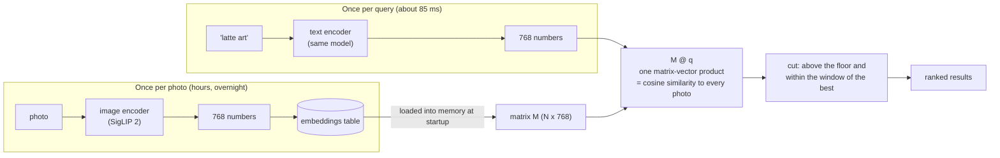
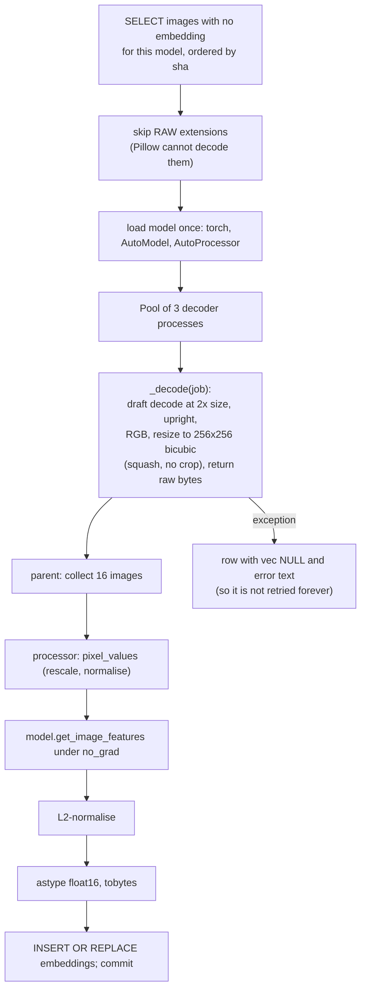

# 10. Image embeddings: searching by what a photo looks like

This is the chapter behind the headline feature: type "latte art" or "dog in the snow" and find
those photos, with no tags and nothing sent to the cloud. It explains what an embedding is, how
every photo gets one, how a sentence becomes comparable to a photo, and, just as importantly, how
the system decides *where to stop* so that a search for something you never photographed says
"Nothing found" instead of showing the least-bad guesses.

## The idea: one space for pictures and words

An **embedding** is a list of numbers that represents the *meaning* of an input. A **joint**
image-text model is trained on hundreds of millions of (image, caption) pairs so that a photo and
a caption that describes it land at nearby points in the same space. After training:

- A photo of a lighthouse and the sentence "a red and white lighthouse" are close.
- That photo and the sentence "birthday cake" are far apart.

So search reduces to geometry: **embed the query's words, then rank photos by how close their
vectors are**.



A two-dimensional cartoon of what that space looks like (the real one has 768 dimensions):

```
                    ▲ dimension 2
                    │        ● lighthouse photos
                    │      ● ●  ◆ "red lighthouse"
                    │       ●
                    │
   ■ "birthday cake"│                                    ○ latte photos
   ■ ■ cake photos  │                                  ○ ○  ◇ "latte art"
                    │                                   ○
                    └──────────────────────────────────────▶ dimension 1
        ● ◆  photo and caption close together    ■ far from ●, ○
```

## The model: SigLIP 2

The system uses **SigLIP 2** (Google), specifically `google/siglip2-base-patch16-256`:

| Property | Value |
|---|---|
| Family | A vision-language "dual encoder": an image tower and a text tower, no cross-attention between them |
| Input size | 256 × 256 pixels, cut into 16 × 16-pixel patches (256 patches) |
| Output | **768 numbers** per image or sentence (recorded in `embeddings.dim`) |
| Training signal | A sigmoid loss: each image-text pair is scored independently as "match or not", rather than CLIP's softmax over a batch |
| Text length | Padded to 64 tokens |
| Licence | Apache-2.0 |
| Run on | CPU, PyTorch float32; no GPU needed |

Because the two encoders are separate, an image's vector can be **computed once and stored**, and
any later text query needs only the (small) text tower. That is the property that makes a
whole-library search take milliseconds.

The choice of the *base* model is a measured trade-off. On the author's CPU (8 threads) the three
candidates were:

| Variant | Images/s | For ~96.5k photos |
|---|---:|---|
| `siglip2-base-patch16-256` (used) | 6.8 | about 6 hours |
| `siglip2-so400m-patch16-256` | 1.7 | about 18 hours |
| `siglip2-so400m-patch14-384` | 0.6 | about 46 hours |

(Measured in [TAGGING-RESEARCH.md](../../photo-estate/TAGGING-RESEARCH.md): PyTorch on CPU, 96
benchmark photos.) Two further findings from that measurement are encoded in the code: **8 threads
was fastest** (12 was no faster) and **bfloat16 was slower than float32** on that CPU, which is why
`load_model` uses `dtype=torch.float32` and `--threads` defaults to 8. A bigger model is item 3 on
the roadmap and would mean re-embedding the whole library, which is why vectors are stored per model.

## Embedding every photo: `embed.py run`

```bash
uv run embed.py --db estate.db run --store STORE            # resumable
uv run embed.py --db estate.db run --store STORE --limit 50 --workers 3 --batch 16
```



The design choices, one by one:

- **Decoding and the model run in parallel.** JPEG and especially HEIC decoding is CPU work that
  would otherwise leave the model idle. Three worker *processes* (Python threads would fight over
  the GIL) decode and shrink images while the parent runs the model on the previous batch.
- **Squash, do not crop.** `resize((side, side))` stretches the image to a square. SigLIP was
  trained on squashed images, so squashing matches training and ensures that the whole photo, not just
  its centre, influences the vector.
- **`im.draft("RGB", (2*side, 2*side))`** asks the JPEG decoder to decode at the smallest scale that is
  still at least twice the target, which is several times faster than a full decode.
- **Batch of 16** amortises per-call overhead in PyTorch without exhausting memory.
- **L2-normalise, then float16.** After normalisation every vector has length 1, so *cosine
  similarity is just a dot product*, and float16 halves storage (1,536 bytes per photo) with an error
  far below anything that changes a ranking.
- **`_features`.** Different `transformers` versions return either a tensor or an object whose
  `pooler_output` holds it; this one-line helper accepts both.
- **Errors are data.** An undecodable file gets a row with `vec NULL` and the error text, so the
  work list (`NOT EXISTS ... embeddings`) does not retry it on every run, and `embed.py stats` can
  say how many were undecodable.
- **Progress.** Every 60 s it prints images per second, the undecodable count and an ETA in hours.
- **RAW files are skipped** (`.dng`, `.cr2`, `.nef`, ...). They stay in the store and catalog but
  are not searchable by content yet; the README lists this as a limitation.
- **Videos** are not embedded (`kind='image'` only).

A property of the `Pool.imap` the script uses: decoded images can pile up in memory if decoding
outpaces the model. That is acceptable at 256×256×3 bytes per image, but `faces.py` decodes at 1280
pixels and needed an explicit bound (chapter 14).

## Turning a query into a vector

The server's `text_vec` function:

```python
def text_vec(q):
    prompts = [q.lower(), f"a photo of {q.lower()}"]
    ti = tok(prompts, padding="max_length", max_length=64, return_tensors="pt")
    v = normalize(model.get_text_features(**ti), dim=-1).mean(0)
    return v / np.linalg.norm(v)
```

Three details that each matter for quality:

1. **Lower-case.** SigLIP's tokenizer was trained on lower-cased text.
2. **`padding="max_length", max_length=64`.** The text tower was trained with every caption padded to
   64 tokens, and its output degrades if you feed it shorter, unpadded sequences. This is a known
   quirk of the SigLIP family and is easy to get wrong.
3. **A two-prompt average.** The raw query ("latte art") and a captioned form ("a photo of latte
   art") are both embedded, normalised and averaged, then renormalised. SigLIP was trained on
   *captions*, so a bare noun phrase sits slightly off the region where captions live; averaging with
   the framed form moves the query toward it and makes scores more stable. The thresholds below were
   *measured with this averaging*, so changing the prompts means re-measuring them.

The command-line `embed.py search` uses a single prompt (the lower-cased query), so its scores are
close to, but not identical to, the app's.

## Ranking, and knowing where to stop

With `M` the (N × 768) matrix of photo vectors (float32 in memory) and `q` the query vector:

```python
sims = M @ q                                   # cosine similarity to every photo, in milliseconds
sims = np.where(mask, sims, -np.inf)           # photos excluded by filters can never appear
sims[sims < max(MATCH_FLOOR, sims.max() - MATCH_WINDOW)] = -np.inf
order = np.argsort(-sims)[: number_finite]
```

The last line is the **match cut**, and it is what separates a search engine from a sorted list. Two
constants, measured empirically:

| Constant | Value | Meaning |
|---|---|---|
| `MATCH_FLOOR` | 0.085 | A photo must score at least this to count as a match at all |
| `MATCH_WINDOW` | 0.04 | ...and be within this of the *best* match |

How they were found (comments in [embed.py](../../photo-estate/embed.py), measured on the demo and
on a 100k-photo library):

- A photo of the thing asked for scores **0.085 to 0.16**. Unrelated photos stay under about
  **0.07**. So the floor sits in the gap, and a search for something that is not there ("kangaroo" in
  the demo library: best score 0.069) finds **nothing**, instead of showing the nearest
  look-alikes.
- In a big library there is no clean gap between "this" and "something nearby": scores fall
  smoothly. About **0.04 below the best match** is where results drift from *the thing* to *its
  surroundings* ("latte art" → plain coffee; "unicorn" → horses). A narrower window drops real
  matches from a small library.

```
 cosine
 similarity
  0.16 ┤ ●
       │  ●●
  0.13 ┤    ●●●          ← the best match defines the window's top
       │       ●●
  0.09 ┤─ ─ ─ ─ ─●●─ ─ ─ ← best − 0.04: cut here (window)
 0.085 ┤╌╌╌╌╌╌╌╌╌╌╌╌●╌╌╌ ← floor: nothing below this is ever shown
       │              ●● ·  ·  ·  ·   (the rest of the library: unrelated)
  0.07 ┤
       └───────────────────────────────▶ rank
         shown ◀────────┤├────▶ hidden
```

The effective cutoff is `max(floor, best − window)`: in a library with great matches the window
dominates; in one with only weak matches the floor does. Both are command-line options
(`--match-floor`, `--match-window`; `-1` and `2` respectively mean "no cut, show everything,
ranked"). When *no* photo clears the cut, the server returns zero results and the page says
"Nothing found: No photo looks like “kangaroo”".

### More like this

The "More like this" button uses the same machinery with **a photo's own vector as the query**:

```python
vec = M[index[sha]]
sims = np.where(mask, M @ vec, -np.inf)
sims[index[sha]] = -np.inf          # not itself
```

No floor and no window: the user asked for neighbours of a specific photo, so *every* photo is ranked
by closeness (filters still apply), with the photo itself excluded. From a lighthouse you get other
lighthouses first, then the sea and sunsets around them.

### Hiding near-identical shots

While paging through ranked results, the server checks each candidate against the last 8 photos it
kept; if the cosine similarity to any is above **0.97** it skips the candidate and counts it as hidden.
That is why Google's and iCloud's copies of one photo, or a burst of five frames, do not fill a
screenful. It is purely a view-time filter (chapter 11).

## Why it works with no tagging

The README's claim "no tags and nothing sent to the cloud" is literal:

- No label was ever assigned to any photo. The only per-photo data is 1,536 bytes of numbers.
- The model weights are downloaded once (a few GB with PyTorch) and run on the local CPU.
- The demo library makes the point: its 104 photos come in groups of eight that look alike
  (lighthouses, coffee, kittens, snowy peaks, ...), and *nothing in the catalog says which group a
  photo is in*. Search finds them from the pixels alone.

## Honest limits

- **It cannot read text, dates, or names.** An image model cannot know that "2019" is a year or that
  "Ben" is your son. Chapter 12 describes how the app reads those out of the query *before* the image
  model sees it.
- **It cannot place a photo.** It can guess a location from how a scene looks, not from where it was
  taken (a sunny Florida street can pass for San Diego), which is why places in a query are filters
  from GPS data.
- **Switching models re-embeds everything.** Vectors from different models are not comparable, so
  the app serves exactly one model at a time (`--model`), and the floor and window are
  *per-model* constants that must be re-measured.
- **RAW files and videos are not embedded yet.**

## Where to look in the code

All in [embed.py](../../photo-estate/embed.py):

| Topic | Code |
|---|---|
| Model and constants | `DEFAULT_MODEL`, `MATCH_FLOOR`, `MATCH_WINDOW` (with the measurement notes) |
| Decode worker | `_decode` |
| Model loading | `load_model`, `_features` |
| The batch job | `cmd_run` |
| Command-line search | `cmd_search` |
| Query encoding | `text_vec` inside `cmd_serve` |
| Cut, similar, dedupe | `ranked()` and `take()` inside `cmd_serve` |
| Benchmarks | [tools/sigbench.py](../../photo-estate/tools/sigbench.py), [TAGGING-RESEARCH.md](../../photo-estate/TAGGING-RESEARCH.md) |
