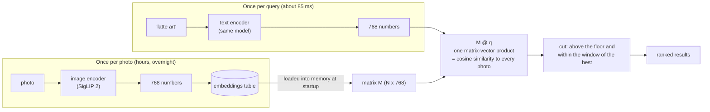
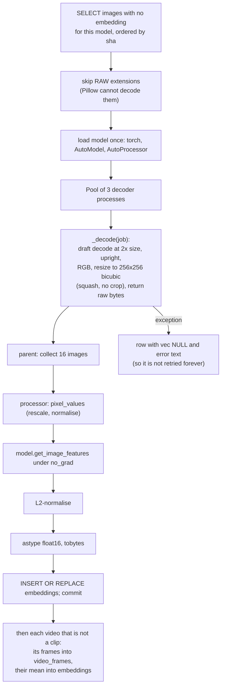

# 10. Image embeddings: searching by what a photo looks like

This is the chapter behind the headline feature: type "latte art" or "dog in the snow" and find
those photos, with no tags and nothing sent to the cloud. It explains what an embedding is, how
every photo gets one, how a sentence becomes comparable to a photo, and, just as importantly, how
the system decides *where to stop* so that a search for something you never photographed says
"Nothing found" instead of showing the least-bad guesses.

## The idea: one space for pictures and words

An **embedding** is a list of numbers that represents the *meaning* of an input. A **joint**
image-text model is trained on hundreds of millions of (image, caption) pairs so that a photo and
a caption that describes it land at nearby points in the same space. After training:

- A photo of a lighthouse and the sentence "a red and white lighthouse" are close.
- That photo and the sentence "birthday cake" are far apart.

So search reduces to geometry: **embed the query's words, then rank photos by how close their
vectors are**.



A two-dimensional cartoon of what that space looks like (the real one has 768 dimensions):

```
                    ▲ dimension 2
                    │        ● lighthouse photos
                    │      ● ●  ◆ "red lighthouse"
                    │       ●
                    │
   ■ "birthday cake"│                                    ○ latte photos
   ■ ■ cake photos  │                                  ○ ○  ◇ "latte art"
                    │                                   ○
                    └──────────────────────────────────────▶ dimension 1
        ● ◆  photo and caption close together    ■ far from ●, ○
```

## The model: SigLIP 2

The system uses **SigLIP 2** (Google), specifically `google/siglip2-base-patch16-256`:

| Property | Value |
|---|---|
| Family | A vision-language "dual encoder": an image tower and a text tower, no cross-attention between them |
| Input size | 256 × 256 pixels, cut into 16 × 16-pixel patches (256 patches) |
| Output | **768 numbers** per image or sentence (recorded in `embeddings.dim`) |
| Training signal | A sigmoid loss: each image-text pair is scored independently as "match or not", rather than CLIP's softmax over a batch |
| Text length | Padded to 64 tokens |
| Licence | Apache-2.0 |
| Run on | The Mac's GPU (MPS) when there is one, else the CPU; PyTorch float32 either way (`--device`) |

Because the two encoders are separate, an image's vector can be **computed once and stored**, and
any later text query needs only the (small) text tower. That is the property that makes a
whole-library search take milliseconds.

The choice of the *base* model is a measured trade-off. On the author's CPU (8 threads) the three
candidates were:

| Variant | Images/s | For ~96.5k photos |
|---|---:|---|
| `siglip2-base-patch16-256` (used) | 6.8 | about 6 hours |
| `siglip2-so400m-patch16-256` | 1.7 | about 18 hours |
| `siglip2-so400m-patch14-384` | 0.6 | about 46 hours |

(Measured in [TAGGING-RESEARCH.md](../notes/TAGGING-RESEARCH.md): PyTorch on CPU, 96
benchmark photos.) Two further findings from that measurement are encoded in the code: **8 threads
was fastest** (12 was no faster) and **bfloat16 was slower than float32** on that CPU, which is why
`load_model` uses `dtype=torch.float32` and `--threads` defaults to 8. A bigger model is item 3 on
the roadmap and would mean re-embedding the whole library, which is why vectors are stored per model.

### CPU or GPU: `--device`

`--device auto` (the default) runs the model on the Mac's GPU through PyTorch's MPS backend when there
is one, and on the CPU otherwise; `--device cpu` or `--device mps` picks one. Only the model moves: the
photos' vectors stay in NumPy in ordinary memory (on a Mac the GPU shares it anyway), and each query
vector is copied back, 3 KB, before it is compared with them. Measured on 2026-11-20, model work only
(decoding excluded), PyTorch float32:

| | M1 Mac mini, CPU | M1 Mac mini, GPU | M2 Max, CPU | M2 Max, GPU |
|---|---:|---:|---:|---:|
| Base, photos/s (batches of 32) | 12.5 | 26.7 | 23.7 | 163 |
| Large 384 px, photos/s | 1.3 | 3.5 | 3.3 | 23 |
| Base, one query's text pass | 47 ms | 18 ms | | |
| Large 384 px, one query's text pass | 159 ms | 57 ms | | |

(The mini was running the app and deep in swap, so its numbers are lower bounds.) A search encodes two
phrasings of the query (`Encoder.text`), so it takes about twice the text pass. The vectors agree: on
the demo's 104 photos, image vectors made on the GPU and the CPU have a cosine of at least 0.9997 (as
close as two CPU runs months apart), and 15 queries gave identical scores to five decimals and identical
rankings, with no photo crossing `MATCH_FLOOR` differently. So a library embedded on one can be
searched from the other.

**What the GPU costs in memory.** On a Mac the GPU's memory is the machine's own memory, and it does not
show in a process's RSS: look at `footprint <pid>` ("IOAccelerator"), not `ps`. With both models whole
and in float32 on the GPU, the app on the 16 GB Mac mini had 0.5 GB of RSS and a 7.8 GB footprint, 5.6 GB
of it GPU memory. Two things keep that down ([encoder.py](../../photo-estate/encoder.py)):

- A model that is only asked about words has its image half dropped before it goes to the device
  (`drop_image_side`). The base model is 375M parameters, 282M of them the text side (its vocabulary of
  256,000 pieces is most of that): 1,464 MB of GPU memory whole, 1,112 MB without the image half, and
  the query vectors are identical, bit for bit. The app's own model keeps its image half when it takes
  uploads from the phone, which it embeds as they arrive.
- A model with an idle time is loaded when it is first asked for (`Encoder.ensure`) and let go when
  nothing has used it for that long (`Encoder.let_go`: the GPU memory goes back, measured to the last
  megabyte). `/compare`'s second model is held this way, below.

On the mini, after the deploy on 2026-11-20, these two changes brought the app's footprint from 7.8 GB
to 3.3 GB and its GPU memory from 5.6 GB to 1.5 GB (4.6 GB while `/compare`'s model is loaded). 15
minutes after `/compare` was last used, GPU memory was back to 1,465 MB. The measurements are in
[PERFORMANCE.md](../notes/PERFORMANCE.md#people-the-catalogs-disk-and-gpu-memory-2026-11-20).

## Embedding every photo: `embed.py run`

```bash
uv run embed.py --db estate.db run --store STORE            # resumable
uv run embed.py --db estate.db run --store STORE --limit 50 --workers 3 --batch 16
```



The design choices, one by one:

- **Decoding and the model run in parallel.** JPEG and especially HEIC decoding is CPU work that
  would otherwise leave the model idle. Three worker *processes* (Python threads would fight over
  the GIL) decode and shrink images while the parent runs the model on the previous batch.
- **Squash, do not crop.** `resize((side, side))` stretches the image to a square. SigLIP was
  trained on squashed images, so squashing matches training and ensures that the whole photo, not just
  its centre, influences the vector.
- **`im.draft("RGB", (2*side, 2*side))`** asks the JPEG decoder to decode at the smallest scale that is
  still at least twice the target, which is several times faster than a full decode.
- **Batch of 16** amortises per-call overhead in PyTorch without exhausting memory.
- **L2-normalise, then float16.** After normalisation every vector has length 1, so *cosine
  similarity is just a dot product*, and float16 halves storage (1,536 bytes per photo) with an error
  far below anything that changes a ranking.
- **`_features`.** Different `transformers` versions return either a tensor or an object whose
  `pooler_output` holds it; this one-line helper accepts both.
- **Errors are data.** An undecodable file gets a row with `vec NULL` and the error text, so the
  work list (`NOT EXISTS ... embeddings`) does not retry it on every run, and `embed.py stats` can
  say how many were undecodable.
- **Progress.** Every 60 s it prints images per second, the undecodable count and an ETA in hours.
- **RAW files are skipped** (`.dng`, `.cr2`, `.nef`, ...). They stay in the store and catalog but
  are not searchable by content yet; the README lists this as a limitation.
- **Videos come after the photos**, in the same run (below); `--no-videos` leaves them for a later one.

A property of the `Pool.imap` the script uses: decoded images can pile up in memory if decoding
outpaces the model. That is acceptable at 256×256×3 bytes per image, but `faces.py` decodes at 1280
pixels and needed an explicit bound (chapter 14).

### Videos

A video is searched by stills taken from it, through the same model. After the photos, `cmd_run`
takes every video with no embedding for the model that is not a Live Photo's clip (a clip's still is
already searchable; `live_pairs`, [chapter 6](06-linking.md#step-2-live-photos-and-motion-photos)).

- **Which frames.** [video.py](../../photo-estate/video.py) reads them with PyAV, which carries its
  own FFmpeg, so there is nothing to install. `times()` gives one frame per three seconds (`EVERY`),
  at least one and at most 30 a video (`CAP`), each at the middle of its stretch: a longer video is
  sampled more thinly. `frames()` seeks to the key frame at or before each time and decodes that
  one, so a 14-minute 8 GB 4K video costs 30 decoded frames (6 s on the Mac mini's USB disk), not
  25,000; two times that land on the same key frame give one frame. Frames come out upright (a
  phone stores its video as the sensor saw it, with a rotation beside it), and the stream is the
  one FFmpeg calls best, not the first (an old `.wmv` carries its thumbnail as a second "video").
- **The same path as a photo.** A worker (`_decode_video`) squashes each frame to 256×256 as
  `_decode` does a photo; the parent embeds them in batches. It also records the video's upright
  size in `assets.width` and `height`, which ingest cannot read.
- **Which frames are kept.** `video.distinct` keeps the first frame, then each whose cosine with the
  last one kept is under 0.96 (`ALIKE`): a talking head or a still scene comes down to one frame.
  The kept frames go into `video_frames`, one row each with its time `t`; their mean, made unit
  length again, is the video's own row in `embeddings` (`video_rows`).
- **Committed whole.** Each video's frames and its mean are written together and committed, so a
  stopped run redoes at most one video. A video that will not decode gets an `embeddings` row with
  `vec NULL` and the error, as a photo does.

Why every frame is kept, and not only the mean: measured on 220 of the author's videos longer than
4.5 seconds (2,352 frames), against twenty plain searches ("a dog", "a birthday cake with
candles", "snow", ...), a (video, search) pair counted as found when it scored at the app's floor of
0.085 or above ([VIDEO-PLAN.md](../notes/VIDEO-PLAN.md)):

| What stands for the video | Pairs found |
|---|---|
| Its best frame | 196 |
| The mean of its frames | 98 |

A video of a party is cake for ten seconds and faces for the rest, and the average is neither. The
mean still earns its place: it puts the video in the same matrix as the photos, so the grid, albums,
"Best first", "More like this" from the video and the phones' feed need no second path. On the same
220 videos, keeping only frames under 0.96 of the last kept kept 63% of them and still found 190 of
the 196 pairs; 0.92 kept 37% and found 165.

| | |
|---|---|
| Measured | `embed.py run --limit 150` on a copy of the author's catalog on the Mac mini: 150 videos in 78 seconds, half a second a video with its three decoding workers beside the model, none undecodable; 859 of 1,399 frames kept (61%, 5.7 a video) |
| For the author's 3,427 videos | about 30 minutes, once; about 20,000 frames, 60 MB in the app as float32 (30 MB on disk as float16), beside the photos' 330 MB |
| One video at a time | 1.4 s a video in the first experiment, with no workers (0.9 reading frames, 0.5 in the model on the mini's GPU) |

## Turning a query into a vector

The server's query encoder (`Encoder.text` in encoder.py; shown here as a function):

```python
def text_vec(q):
    prompts = [q.lower(), f"a photo of {q.lower()}"]
    ti = tok(prompts, padding="max_length", max_length=64, return_tensors="pt")
    v = normalize(model.get_text_features(**ti), dim=-1).mean(0)
    return v / np.linalg.norm(v)
```

Three details that each matter for quality:

1. **Lower-case.** SigLIP's tokenizer was trained on lower-cased text.
2. **`padding="max_length", max_length=64`.** The text tower was trained with every caption padded to
   64 tokens, and its output degrades if you feed it shorter, unpadded sequences. This is a known
   quirk of the SigLIP family and is easy to get wrong.
3. **A two-prompt average.** The raw query ("latte art") and a captioned form ("a photo of latte
   art") are both embedded, normalised and averaged, then renormalised. SigLIP was trained on
   *captions*, so a bare noun phrase sits slightly off the region where captions live; averaging with
   the framed form moves the query toward it and makes scores more stable. The thresholds below were
   *measured with this averaging*, so changing the prompts means re-measuring them.

In the app the model loads in a background thread (`Encoder.start`). A query that arrives first waits
for it, at most 90 s (`encoder.WAIT`), then gets a 503; if the load raised (no model in the cache, no
PyTorch, out of memory), every query gets a 500 that says why at once, rather than waiting forever
(issue #82, [chapter 11](11-server.md)).

The command-line `embed.py search` uses a single prompt (the lower-cased query), so its scores are
close to, but not identical to, the app's.

## Ranking, and knowing where to stop

With `M` the (N × 768) matrix of photo vectors (float32 in memory) and `q` the query vector:

```python
sims = M @ q                                   # cosine similarity to every photo, in milliseconds
sims = np.where(mask, sims, -np.inf)           # photos excluded by filters can never appear
sims[sims < max(MATCH_FLOOR, sims.max() - MATCH_WINDOW)] = -np.inf
order = np.argsort(-sims)[: number_finite]
```

For a video, `M @ q` is not the whole answer: the app asks `Catalog.sims(q)`, which is `M @ q` and
then, with `np.maximum.at`, each video's best frame (`F @ q`, one row per kept frame) where it is
higher than the mean. A video is found by one moment in it, and the cut below applies to that score.
`Catalog.moment` says where that moment is, in seconds (`at` on the result row, [chapter 11](11-server.md)).

The last line is the **match cut**, and it is what separates a search engine from a sorted list. Two
constants, measured empirically:

| Constant | Value | Meaning |
|---|---|---|
| `MATCH_FLOOR` | 0.085 | A photo must score at least this to count as a match at all |
| `MATCH_WINDOW` | 0.04 | ...and be within this of the *best* match |

How they were found (comments in [embed.py](../../photo-estate/embed.py), measured on the demo and
on a 100k-photo library):

- A photo of the thing asked for scores **0.085 to 0.16**. Unrelated photos stay under about
  **0.07**. So the floor sits in the gap, and a search for something that is not there ("kangaroo" in
  the demo library: best score 0.069) finds **nothing**, instead of showing the nearest
  look-alikes.
- In a big library there is no clean gap between "this" and "something nearby": scores fall
  smoothly. About **0.04 below the best match** is where results drift from *the thing* to *its
  surroundings* ("latte art" → plain coffee; "unicorn" → horses). A narrower window drops real
  matches from a small library.

```
 cosine
 similarity
  0.16 ┤ ●
       │  ●●
  0.13 ┤    ●●●          ← the best match defines the window's top
       │       ●●
  0.09 ┤─ ─ ─ ─ ─●●─ ─ ─ ← best − 0.04: cut here (window)
 0.085 ┤╌╌╌╌╌╌╌╌╌╌╌╌●╌╌╌ ← floor: nothing below this is ever shown
       │              ●● ·  ·  ·  ·   (the rest of the library: unrelated)
  0.07 ┤
       └───────────────────────────────▶ rank
         shown ◀────────┤├────▶ hidden
```

The effective cutoff is `max(floor, best − window)`: in a library with great matches the window
dominates; in one with only weak matches the floor does. Both are command-line options
(`--match-floor`, `--match-window`; `-1` and `2` respectively mean "no cut, show everything,
ranked"). When *no* photo clears the cut, the server returns zero results and the page says
"Nothing found: No photo looks like “kangaroo”".

### More like this

The "More like this" button uses the same machinery with **a photo's own vector as the query**:

```python
vec = M[index[sha]]
sims = np.where(mask, c.sims(vec), -np.inf)   # a video: its best frame or its mean
sims[index[sha]] = -np.inf          # not itself
```

No floor and no window: the user asked for neighbours of a specific photo, so *every* photo is ranked
by closeness (filters still apply), with the photo itself excluded. From a lighthouse you get other
lighthouses first, then the sea and sunsets around them.

### Hiding near-identical shots

While paging through ranked results, the server checks each candidate against the last 8 photos it
kept; if the cosine similarity to any is above **0.97** it skips the candidate and counts it as hidden.
A video is never skipped, even when its frames look like the photos beside it.
That is why Google's and iCloud's copies of one photo, or a burst of five frames, do not fill a
screenful. It is purely a view-time filter (chapter 11).

## Why it works with no tagging

The README's claim "no tags and nothing sent to the cloud" is literal:

- No label was ever assigned to any photo. The only per-photo data is 1,536 bytes of numbers.
- The model weights are downloaded once (a few GB with PyTorch) and run on the local CPU.
- The demo library makes the point: its 104 photos come in groups of eight that look alike
  (lighthouses, coffee, kittens, snowy peaks, ...), and *nothing in the catalog says which group a
  photo is in*. Search finds them from the pixels alone.

## Trying a bigger model: `/compare`

Whether a bigger model finds a family's photos better is a question only that family's photos can
answer: public benchmarks are other people's pictures, and the demo's 104 photos are too easy to tell
two good models apart. So the app can run an experiment beside the real thing, without switching
anything over:

1. `tools/export_squares.py` writes every photo the Library shows as a 512 px square JPEG (decoded as
   `_decode` does), in tar shards of 2,000. It runs on the library's computer, gently (nice, in
   store order), and the shards can be copied to a faster machine.
2. `tools/embed_squares.py` embeds the shards with the second model (by default SigLIP 2 large at
   384 px, 1,024 numbers a photo where the app's base model has 768) and writes one `.npy` per shard.
   On an M2 Max's GPU that is about 21 photos a second, about 65 minutes for 83,000 photos.
3. `embed.py serve --compare-vectors DIR` loads those vectors, and
   [compare.py](../../photo-estate/compare.py), wired in by `PhotoApp` ([photo_app.py](../../photo-estate/photo_app.py)), serves `/compare`
   (**Compare models** in the Library's "..." menu, there only when the app has the vectors).

**A run.** The comparison is an experiment with a fixed procedure, so that the next candidate model can be
put through the same one:

1. It asks a fixed list of searches, [compare-terms.txt](../../photo-estate/compare-terms.txt) (24 of them:
   people and occasions, places and weather, things, animals, food, and a few hard ones), or `terms.txt`
   in the vectors folder if there is one. A run keeps the list it began with.
2. Starting a run loads the second model's text side (the page waits for it). Each search is read as the
   app reads it and ranked by each model over the same photos, the top 24 of each. The two columns come in
   random order with no names; you say Left, Same, Right or Skip. Which model was which is not said
   during the run: knowing would colour the next answer.
3. A run is a file, `runs/run-<id>.json` beside the votes, written at every answer, so it can be left and
   carried on, also after a restart. **Finish now** ends it with searches unanswered.
4. Finishing writes the report (in the run, and as `runs/<id>.md` to keep): how many searches each model
   was better on, a sentence saying so, a sign test over the searches with a winner (how often a split
   that uneven comes up between equal models; the ties are left out, as that test does), how many photos
   the two columns shared on average, how long each model took to read a search's words, and every
   search's result. Then the second model is let go (`Encoder.let_go`): it is in memory only while a run
   is under way, and after 15 minutes unused if a run is left (`--compare-idle`).

Twenty-four searches is a small sample: 17 to 7 is p = 0.06, and it takes 18 to 6 to pass 0.05. The
report says which of the two it is in words. For a finer answer, give the run a longer `terms.txt`.

Votes also go to a file beside the vectors (`votes.jsonl`), never to the catalog.

The checklist for putting the next candidate through the same procedure (export, embed, point the app at
it, run, read the report) is [guides/COMPARE-A-MODEL.md](../guides/COMPARE-A-MODEL.md).

The second model's scores sit on another scale, so the columns are each model's top k with no floor
or window: those would have to be measured again before the app switched. Searching costs a little
more (a third more numbers to multiply, a few milliseconds over a whole library); reading the words
costs more (the large model's text side is about 2 GB, and a few times slower per query), which is
why it loads after the app's own.

## Honest limits

- **It cannot read text, dates, or names.** An image model cannot know that "2019" is a year or that
  "Ben" is your son. Chapter 12 describes how the app reads those out of the query *before* the image
  model sees it.
- **It cannot place a photo.** It can guess a location from how a scene looks, not from where it was
  taken (a sunny Florida street can pass for San Diego), which is why places in a query are filters
  from GPS data.
- **Switching models re-embeds everything.** Vectors from different models are not comparable, so
  the app serves exactly one model at a time (`--model`), and the floor and window are
  *per-model* constants that must be re-measured. `/compare` (above) puts a second model beside it, as an experiment.
- **RAW files are not embedded yet.**
- **A video is seen as stills.** Its frames are one every three seconds, at most 30, so a moment
  shorter than that can be missed, and nothing it says or plays is heard. A paired Live Photo clip is
  not embedded at all: its still is.

## Where to look in the code

All in [embed.py](../../photo-estate/embed.py):

| Topic | Code |
|---|---|
| Model and constants | `DEFAULT_MODEL`, `MATCH_FLOOR`, `MATCH_WINDOW` (with the measurement notes) |
| Decode worker | `_decode`, `_decode_video` |
| A video's frames, and which are kept | `times`, `frames`, `distinct` in [video.py](../../photo-estate/video.py); `video_rows` |
| A video's score: best frame or mean | `Catalog.sims`, `Catalog.moment` in [catalog.py](../../photo-estate/catalog.py) |
| Model loading | `load_model`, `_features` |
| The batch job | `cmd_run` |
| Command-line search | `cmd_search` |
| Query encoding | `Encoder.text` in [encoder.py](../../photo-estate/encoder.py) |
| Cut, similar, dedupe | `ranked()` in `Browse.search` ([browse.py](../../photo-estate/browse.py)) and `Catalog.take` |
| Comparing a second model | [compare.py](../../photo-estate/compare.py), [tools/export_squares.py](../../photo-estate/tools/export_squares.py), [tools/embed_squares.py](../../photo-estate/tools/embed_squares.py) |
| Benchmarks | [tools/sigbench.py](../../photo-estate/tools/sigbench.py), [TAGGING-RESEARCH.md](../notes/TAGGING-RESEARCH.md) |
