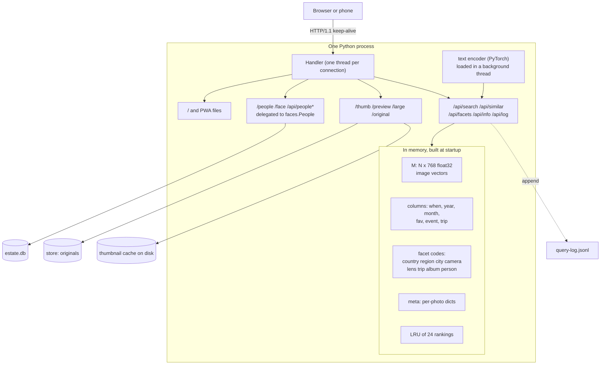
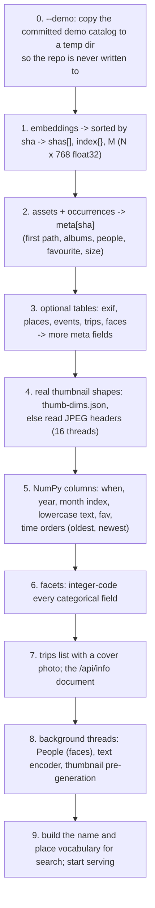
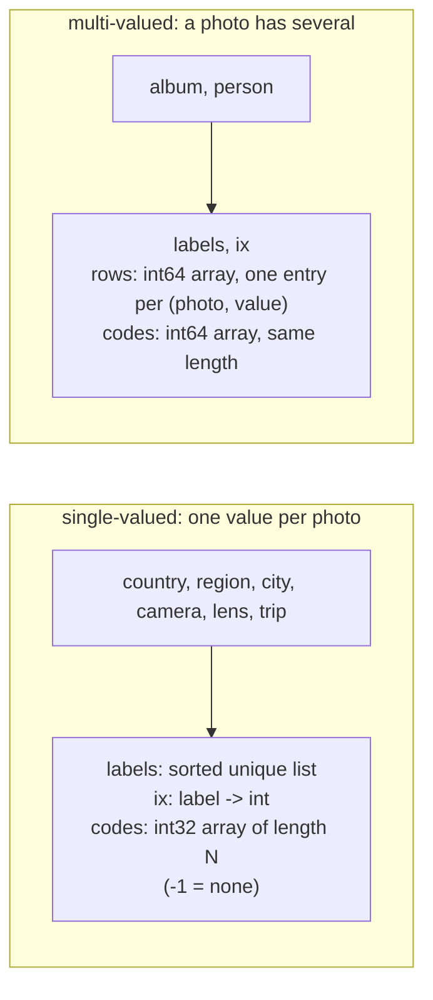
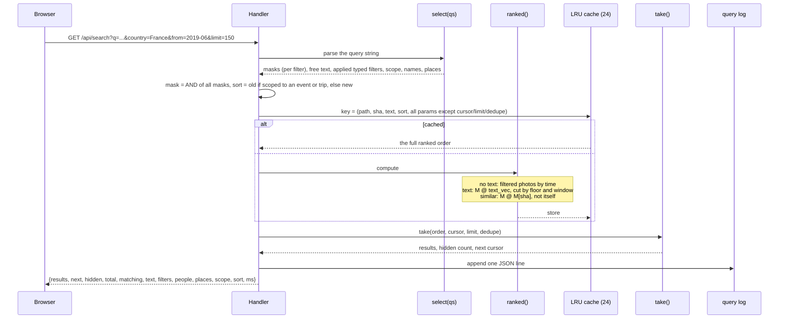
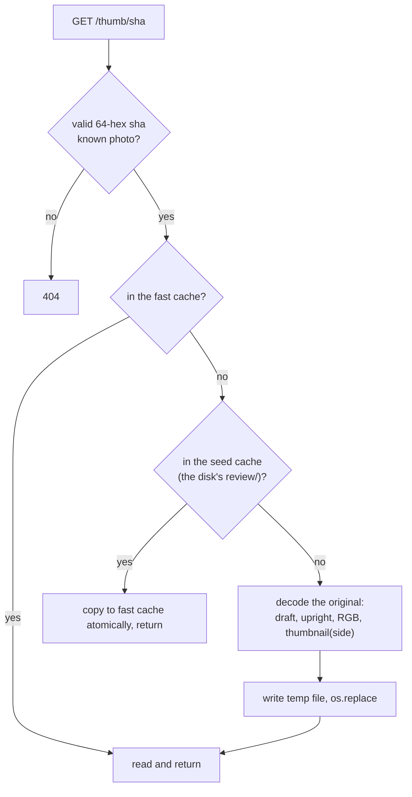

# 11. The photo server

`embed.py serve` is the product: a local web server that holds your whole library in memory and
answers every search, filter and thumbnail request in milliseconds. It is one function,
`cmd_serve`, about 660 lines, built from closures over a handful of NumPy arrays. This chapter takes
it apart: what it loads, how it is laid out in memory, how a request becomes a response, and the
engineering that makes it feel instant even when the photos live on a USB hard disk.

```bash
uv run embed.py --db estate.db serve --store STORE      # http://127.0.0.1:8766/
uv run embed.py serve --demo                            # http://127.0.0.1:8767/
```

## The shape of it



There is no framework. The handler is a `BaseHTTPRequestHandler` subclass with `do_GET` and
`do_POST`, the server a `ThreadingHTTPServer`. A library for one household does not need more, and a
standard-library server is one less dependency. (PERFORMANCE.md records the one place this costs:
about 80-110 ms of a warm 150-thumbnail burst is the Python server itself; a faster static server for
`/thumb/` is an open task.)

## Startup, step by step

Startup does all the expensive work once, so that requests can be cheap. The steps, in order:



### 1. The vectors

```python
rows = sorted(con.execute("SELECT sha256, vec FROM embeddings WHERE model=? AND vec IS NOT NULL", ...))
shas  = [r[0] for r in rows]
index = {s: i for i, s in enumerate(shas)}
M = np.frombuffer(b"".join(r[1] for r in rows), dtype=np.float16).reshape(N, -1).astype(np.float32)
```

Every photo gets a row number `i` in this order. **That row number is its identity for the lifetime
of the process**: every array below is indexed by it, and `index` maps a sha back to it. The float16
blobs are concatenated into one buffer and converted to float32 once, so that `M @ q` runs in float32
(NumPy has no fast float16 matmul). For 100,000 photos `M` is about 300 MB.

The query is `SELECT` without an `ORDER BY`, and the sort happens in Python. The comment in the code
explains why: on a spinning disk, walking an index to produce sorted output turns each row into a
seek. Reading the table in storage order and sorting in memory was 2.7 s → 0.15 s.

### 2-3. The metadata

`meta[sha]` is a dictionary per photo, filled from several tables:

| Source | Fields added |
|---|---|
| `assets` (images only) | `ext`, `taken`, `lat`, `lon`, `desc`, `people` (split), `fav`, `w`, `h` |
| `occurrences`, in id order | `path` (the first path seen), `albums` (de-duplicated) |
| `exif` (via covering index) | `camera`, `lens`, `focal`, `focal35`, `fnumber`, `exposure`, `iso` |
| `places` + `events` + `trips` | `local`, `tz`, `place`, `country`, `region`, `city`, `county`, `place_inferred`, `event`, `event_title`, `trip`, `trip_title` |
| `faces` + `persons` | confirmed face names are **added to `people`**, next to Google's tags |

Three small decisions in there:

- The labels the facets use are built by joining the non-empty parts: `city` = "Paris, Île-de-France,
  France", `region` = "Île-de-France, France", `country` = "France". The UI shows the first part and
  greys the rest.
- `optional()` wraps reads of tables that may not exist yet, so the app starts after *just*
  ingest and embed.
- `CREATE INDEX IF NOT EXISTS exif_app ON exif(sha256, camera, lens, focal, ...)` is run on startup
  (once effective). It makes the 8 columns the app needs readable from a 19 MB index instead of the
  705 MB table.

### 4. Real thumbnail shapes

The grid needs each photo's true aspect ratio *as displayed*, but the catalog's `width`/`height` are
not always upright (a portrait phone photo may be stored as landscape with an EXIF rotation). The
thumbnails are always upright, so their real shape is read from the JPEG header by `_jpeg_size`,
which scans the first 8 KB for a start-of-frame marker (`FFC0`/`C1`/`C2`) without decoding. Results
are cached in `thumb-dims.json`, so only new photos are read next time. This is where the layout
engine's `ar` (aspect ratio) per photo comes from.

### 5. Columns

The photo metadata is then turned into **columns**: NumPy arrays indexed by photo number, so that a
filter is one vectorised operation over all photos instead of a Python loop.

| Array | Contents | Used for |
|---|---|---|
| `when` | local time, else `taken`, else `""` | Sorting, grouping |
| `year` | integer year | `year:` filter |
| `ym` | month number since the library's first month (`m0`) | Timeline histogram, date range |
| `cols["place" / "camera" / "album" / "person"]` | lower-cased text per photo | Typed `key:value` substring filters |
| `event_of`, `trip_of` | the id or `None` | Scoping to an event or trip |
| `fav` | boolean | Favourites |
| `oldest`, `newest` | photo numbers sorted by time, **undated last either way** | Unranked results |

### 6. Facets

A **facet** is a field you can filter by and count: Where (country, region, city), People, Albums,
Trips, Camera, Lens. Counting how many photos have each value, under the current filters, needs to
be fast, so values are turned into integers:



- **Single** facets are one `int32` code per photo. "Photos in France or Spain" is
  `np.isin(codes, [ix["France"], ix["Spain"]])`.
- **Multi** facets are stored as a **sparse list of pairs**: `rows[k]` is a photo number and
  `codes[k]` the value it has. "Photos in album X" sets `mask[rows[codes == ix["X"]]] = True`.
  Counting is `np.bincount(codes[base[rows]])`.

`select(qs)` turns a query string into **one boolean mask per kind of filter**: a dictionary like
`{"country": mask, "person": mask, "date": mask, "typed": mask, "names": mask, ...}`. Keeping them
*separate* rather than ANDing immediately is what makes live counts possible.

### Live counts: "each facet ignores its own selection"

When you choose Denmark in the Where filter, the list of countries should still show Sweden and
Norway with counts, so you can add them. So each facet's counts are computed under *every filter
except its own*:

```python
def facet_counts(masks):
    for k, f in single.items():
        base = combine(masks, skip=k)                       # everything else applies
        counts[k] = np.bincount(f["codes"][base & (f["codes"] >= 0)], minlength=len(f["labels"]))
    for k, f in multi.items():
        base = combine(masks, skip=None if k == "person" else k)
        counts[k] = np.bincount(f["codes"][base[f["rows"]]], minlength=len(f["labels"]))
    months = np.bincount(ym[combine(masks, skip="date") & (ym >= 0)], minlength=nmonths)
```

Semantics differ deliberately, and the difference is what you feel when using the filters:

| Facet | Choosing several means | Counts computed |
|---|---|---|
| Country, region, city, camera, lens, trip | **Any of them** (OR) | ignoring this facet's own selection |
| Albums | **Any of them** (OR) | ignoring this facet's own selection |
| **People** | **All of them** (AND): photos where they appear together | **including** this facet's selection, so as you add Ben, the list shrinks to the people who appear with Ben |

The timeline's month counts ignore the date selection (so the whole histogram stays visible while you
brush a range), and the Favourites count ignores the favourites toggle.

A whole `/api/facets` call is a few array operations: 4 ms on a laptop for the whole library, even for
a 100k-photo catalog.

### 7. Trips and `/api/info`

The trips list orders trips by start (newest first) and picks each a **cover**: the middle favourite
photo of the trip, or the middle photo if there are no favourites. `/api/info` is one JSON document:
total, model, the first month (`m0`, as `year*12 + month - 1`), trips, whether faces exist, whether this is
the demo, and the unfiltered facet counts including the per-month histogram (which also serve as the
page's first facet state; the number of months is the histogram's length).

### 8. Background threads

Three things start in threads *after* the arrays are built, so the page and filters answer first:

| Thread | Does | Why in the background |
|---|---|---|
| People | `from faces import People; People(...)` | Loading all faces and scoring them takes seconds; only `/people` needs it. Until it is ready, `/people` answers 503 "Faces are still loading" |
| Text encoder | `import torch`, load SigLIP, then one `"warm-up"` encode | Importing PyTorch is **most of startup time** and only typed queries need it. The warm-up takes the ~1 s first-forward-pass penalty away from the first real query |
| Thumbnail pre-generation | Make every missing 360 px thumbnail | So scrolling never waits for HEIC decoding |

A typed search that arrives before the encoder is ready simply blocks on `encoder_ready.wait()`.
Measured on the author's Mac mini with a 100k library: first answer in 9-17 s after restart (most of
it reading the catalog off a USB disk), typed search ready 14-22 s.

## How a request becomes a response

The core is `/api/search` (and `/api/similar`, which shares the code).



Points worth knowing:

- **Cursor pagination over a cached ranking.** The first request computes the *entire* ranked order
  (a NumPy array of photo numbers) and caches it, keyed by everything that affects it *except* the
  cursor and limit. Later pages (`&cursor=150`) are slices of the same array, so scrolling does no
  recomputation. The cache is an `OrderedDict` LRU capped at 24 entries and also memoises text
  encodings and place masks.
- **`next` is a position, not an id.** `take` returns `pos` when more remain, else `None`; the page
  stops requesting when it is null.
- **`take` implements "hide near-identical shots".** It walks the order from `start`, skipping any
  candidate whose similarity to one of the last 8 kept exceeds 0.97, until `limit` photos are kept,
  and reports how many it hid. It is turned off by `dedupe=0`.
- **The response carries how the query was read** (`people`, `places`, `filters`, `scope`, `text`),
  which the page uses to write the title ("Ben & Matthew", "in San Diego") and offer "Search the words
  instead".
- **`ms`** is the server's own time for the request; the page shows it in the subtitle.
- **Ordering when there is no text.** With nothing to rank by, the results are "what the filters
  select, by time": `by_time[mask[by_time]]`. Newest first by default, oldest first inside an
  event or trip (so a trip reads in order), or whatever `sort=` says.

### The response for one photo

Every result is the photo's `meta` plus its `sha`: `ext`, `taken`, `local`, `tz`, `lat`, `lon`,
`desc`, `people`, `albums`, `fav`, `w`, `h`, `ar`, `path`, `camera`, `lens`, `focal`, `focal35`,
`fnumber`, `exposure`, `iso`, `place`, `city`, `region`, `country`, `county`, `place_inferred`,
`event`, `event_title`, `trip`, `trip_title`. The page needs all of it for the details panel without
another round trip, and the JSON is gzipped (150 results: 120 KB → 14 KB on the wire).

## Serving images

Three renditions of every photo, plus the original, all named by the photo's hash:

| URL | Side | JPEG quality | Purpose |
|---|---:|---:|---|
| `/thumb/<sha>` | 360 px | 82 | The grid |
| `/preview/<sha>` | 1600 px | 82 | The viewer |
| `/large/<sha>` | 4096 px | 90 | The viewer when zoomed or on a big dense display |
| `/original/<sha>` | as stored | n/a | Save / share (the file itself, with its metadata) |



- **Two cache tiers.** `--cache` (default `<db dir>/review/`) is the *seed*: it lives next to the
  catalog. `--fast-cache` puts the working cache on a faster disk (the internal SSD) and fills it
  from the seed, falling back to decoding the original only when neither has the file. On a USB hard
  disk a cold thumbnail costs a ~9 ms seek, and seeks do not overlap, so 150 of them took about a
  second however many requests ran at once; with the SSD cache the same screenful takes 174-186 ms
  (PERFORMANCE.md).
- **Immutable URLs.** Names include the hash of the original, which never changes, so responses
  are `Cache-Control: public, max-age=2592000, immutable` (30 days). The browser never asks again.
- **Original files** are served only for browser-friendly types (`.jpg`, `.jpeg`, `.heic`, `.png`,
  `.gif`, `.webp`), with a `Content-Disposition` carrying the original file name, so "Save Image"
  yields the real name. Other types are shared as a large JPEG instead (chapter 13).
- **Hash validation.** Every image route first matches `^[0-9a-f]{64}$` and a known photo: there is
  no way to ask the server for an arbitrary path. The same applies to `/original/`.
- **Pre-generation.** At startup a background pool (`forkserver` start method, so it does not
  `fork()` a process that holds PyTorch threads, `cpu_count - 2` workers) renders every missing
  thumbnail, and first copies what the seed has, newest first. It says "making N thumbnails in the
  background". `--no-pregenerate` turns it off.

## HTTP engineering

All from measurements in [PERFORMANCE.md](../../photo-estate/PERFORMANCE.md):

| Setting | Why |
|---|---|
| `protocol_version = "HTTP/1.1"`, idle `timeout = 60` | `tailscale serve` forwards each request as HTTP/1.1; with HTTP/1.0, every request opened a new connection and thread |
| `disable_nagle_algorithm = True` | Headers and body go out as two writes; Nagle would hold the second |
| gzip for JSON and `text/*` over 1 KB, level 5 | JSON and the page shrink 4-6×; JPEGs do not |
| `ETag` and `no-cache` for `/` and PWA files | Browsers revalidate each load, so editing `search.html` shows at once; an unchanged page costs a 304 |
| `request_queue_size = 256`, `daemon_threads` | The default listen backlog is 5; behind an HTTP/2 proxy a screenful of thumbnails arrives as dozens of simultaneous connections and overflowed it (502s) |
| Listen on `127.0.0.1` only | The app has no authentication; put a proxy in front for remote access |

## Concurrency

The server is multi-threaded but not multi-process. The relevant locks are small:

- `model_lock` lets one thread at a time use the text encoder.
- `lru_lock` protects the ranking cache.
- `qlog_lock` serialises query-log appends.
- `People` has its own `RLock`.

NumPy releases the GIL during large array operations, so concurrent searches overlap usefully, and
for one household a handful of simultaneous requests is the realistic load.

## The query log

Every search, every page of results, and every photo opened or shared from a result list is appended
as one JSON object per line to `query-log.jsonl` next to the catalog:

```json
{"ts":"2026-11-13T18:20:04+00:00","ev":"search","params":{"q":"latte art"},
 "text":"latte art","filters":[],"people":[],"places":[],"cursor":0,"matching":8,"ms":91,
 "top":["ab12...","..."],"who":null,"ua":"Mozilla/5.0 ..."}
{"ts":"...","ev":"open","params":{...},"sha":"ab12...","pos":0}
```

- **Purpose:** raw material for choosing evaluation queries from *real* use (roadmap item 2). Each
  search keeps its top 20 results and how it was read; each opened photo keeps the search it came
  from and its position in the results. **Nothing in the app reads it back.**
- **Privacy:** it stays on your machine. The `Tailscale-User-Login` header, if a Tailscale proxy
  sets it, is recorded as `who`, so a household can see whose search it was. `--query-log` moves
  it; `--demo` sends it to `/dev/null`.
- **Robustness:** a write failure prints a warning and never fails the search.
- **What is not logged:** pagination and technical params (`cursor`, `limit`, `dedupe`, `ev`, `sha`,
  `pos`) are stripped from `params`.

The page's `logEvent` calls `/api/log?ev=open|share&sha=...&pos=...` when you open or share a photo
from a result list, which is how "opened" events reach the log.

## Demo mode

`--demo` serves the committed demo library without touching the repository:

1. Copies `demo/estate.db` into a fresh temp directory (deleted at exit via `atexit`).
2. Points `store` at `demo/store` (read-only use).
3. Lets thumbnails be generated into the temp directory.
4. Sends the query log to `/dev/null` and uses port 8767, so it can run beside a real library on 8766.

## Resource use

On the author's Mac mini, serving about 100k photos, the process uses about **1.7 GB** resident
(roughly 1 GB catalog and vectors, 0.5 GB PyTorch). The per-photo `meta` dictionaries (~30 keys ×
100k) are identified as the obvious thing to shrink (PERFORMANCE.md open task 4).

## Where to look in the code

All inside `cmd_serve` of [embed.py](../../photo-estate/embed.py), unless noted:

| Topic | Code |
|---|---|
| Startup load | the block from `rows = sorted(...)` to `info = {...}` |
| Facets and live counts | `coded`, `single`, `multi`, `combine`, `facet_counts` |
| Mask building | `select`, `parse`, `person_mask`, `place_mask` |
| Ranking and paging | `ranked`, `remember`, `take` |
| Images and caches | `image`, `pregenerate`, `_thumb`, `_jpeg_size` |
| HTTP | `Handler.send`, `do_GET`, `do_POST`, `Server` |
| Query log | `record`, `unlogged` |
| Benchmarks | [tools/bench_server.py](../../photo-estate/tools/bench_server.py), [tools/thumb_burst.py](../../photo-estate/tools/thumb_burst.py) |
