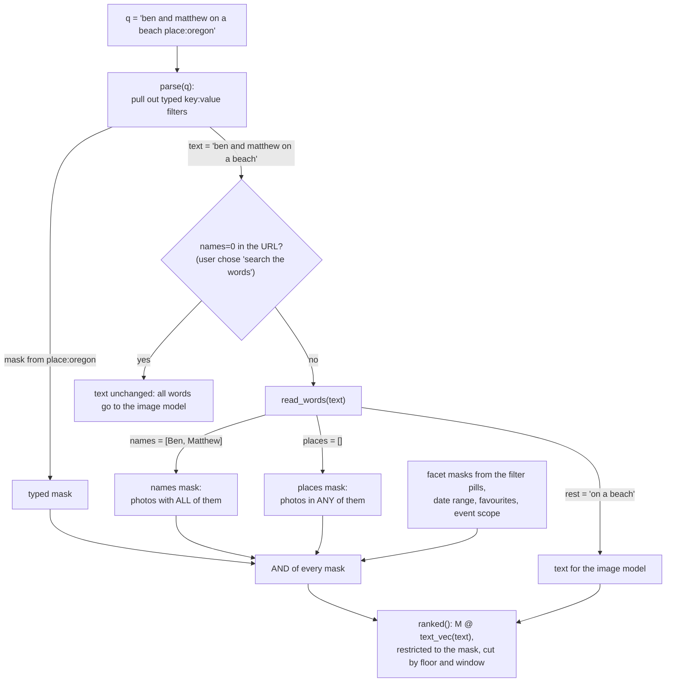

# 12. The search language

The search box accepts three kinds of input at once, and the server reads them in a fixed order
before anything is ranked. This is the design decision called "search is read before it is ranked"
in chapter 1, and this chapter is its full specification.

| You type | Read as | Mechanism |
|---|---|---|
| `sunset place:denmark year:2010-2012` | Typed filters, plus the words "sunset" | Exact keys, parsed first |
| `ben and matthew on a beach` | Two people (both must appear), plus "on a beach" | Names matched against *your library's* people |
| `ben san diego` | Ben's photos, taken in San Diego | A name and a place; nothing is left to rank |
| `latte art` | Nothing known; all of it goes to the image model | Falls through |

## Why not just give the whole string to the image model?

Because the image model is the wrong tool for names and places:

- **It does not know who anyone is.** "Ben" is a word in your library, not a concept the model was
  trained on. Left in the query it would be noise, or worse, match photos of any Ben-like word.
- **It can only guess a place from how it looks.** A sunny street in Florida passes for San Diego.
  Your photos have real GPS; a place filter from GPS is exactly right where a visual guess is
  plausible but wrong.

So names and places become **filters**, evaluated against catalog data, and only the *leftover words*
reach the image model ("on a beach"). The README example that motivated the design: "ben san diego"
no longer shows Florida.

## The reading pipeline



Every filter produces a boolean mask over all N photos; the masks are ANDed. The **text** only
chooses the order (and, via the match cut, how many of the masked photos qualify).

If after reading there is *no* text (the whole query was names and places, or only typed filters), the
results are "what the filters select, by time" (chapter 11).

## Layer 1: typed filters

Anything shaped like `key:value` or `key:"a value with spaces"`, with one of these keys, is taken out
of the query first:

```
\b(place|camera|album|person|people|year|date|event|trip|is):("([^"]*)"|(\S+))     (case-insensitive)
```

| Key | Matches | Example |
|---|---|---|
| `place:` | A *substring* of the lower-cased place text (city, region, country, plus locality and county) | `place:denmark`, `place:"san diego"` |
| `camera:` | A substring of camera and lens | `camera:d300`, `camera:"iphone 15"` |
| `album:` | A substring of any of the photo's albums | `album:"Summer 2019"` |
| `person:` / `people:` | A substring of any of the photo's people | `person:ben` |
| `year:` | A year or a range | `year:2010`, `year:2010-2012` |
| `date:` | A prefix of the local time | `date:2010-07`, `date:2010-07-14` |
| `event:` / `trip:` | A numeric event or trip id (also scopes the page, see below) | `trip:1594243200` |
| `is:` | `fav`, `favorite` or `favourite` | `is:fav` |

Rules:

- **Substring, not equality**, for text keys, so `camera:d300` finds "Nikon D300".
- Unknown keys are *not* filters: `foo:bar` stays in the text.
- Typed filters are echoed back in the response (`filters`) and shown in the page subtitle, so you can
  see what was understood.
- `event:`/`trip:` set the page's **scope**: the title becomes the event's or trip's own title, and the
  sort defaults to oldest-first so a trip reads in order.

These are for everything names and places don't cover. They are also the vocabulary behind the filter
pills: clicking Where → Denmark and typing `place:denmark` are two routes to the same mask.

## Layer 2: names and places

After typed filters are removed, the remaining text is scanned for **names of people the library has**
and **places it has photos from**.

### Building the vocabulary (at startup)

```python
people_ix = multi["person"]["ix"]            # every person name: Google's tags + faces you named
firsts = {}                                   # first name -> [full names]
who = {first: names[0] for first, names in firsts.items() if len(names) == 1}   # only if unique
who.update({full.lower(): full for full in people_ix})                          # full names always count

where = {}                                    # lower-cased place -> label
for k in ("city", "region", "country"):
    for label in single[k]["labels"]:
        name = label.split(",")[0].strip()   # "San Diego, California, United States" -> "San Diego"
        where.setdefault(name.lower(), name)
for k in [k for k in where if k in who]:      # a person's name beats a place of the same name
    del where[k]
```

- A **full name** always counts as a person. A **first name** counts only when *exactly one* person
  has it: if you have two Bens, plain "ben" is ambiguous and is left alone, while "Ben Lam" works.
- A **place** counts if the library has photos there: any city, region or country in the facets. A
  place in no photo is not recognised, which is correct: there is nothing to filter.

### The everyday-word problem

Many names are also ordinary words: Sunny, Lily, Rose, Grace, Mark, Will, Hope. Many places are too:
Georgia, Turkey, Jordan, Chad, Golden, Celebration. A query like "sunny day at the beach" must not
turn into photos of a person called Sunny.

The rule: **a name or place that is also an everyday word counts only when capitalised** (`Sunny`, or
possessive `Sunny's`).

| Set | Content |
|---|---|
| `COMMON_WORDS` | About 100 first names that are also words: sunny, lily, rose, ivy, grace, mark, will, hope, penny, sandy, ... |
| `COMMON_PLACES` | china, turkey, chad, jordan, georgia, guinea, japan, chile, cuba, wales, jersey |
| Cities that are lower-case dictionary words | Computed from `/usr/share/dict/words` (when present): a city whose one-word name appears there in lower case ("golden", "celebration") |

Capitalisation is read from the typed word itself (`word[0].isupper()`), or the possessive
`'s`/`’s`, which signals a name. The page tells you how the search was read, with a link to search
your exact words instead (below).

### Reading the words: `read_words`

A compiled regular expression finds, left to right, any known name (group `who`) or place (group
`where`), longest alternatives first (so "san diego" wins over "san"), with word boundaries that
treat apostrophes as part of words, and an optional possessive:

```
(?<![\w'’]) (?: (?P<who>ben lam|matthew|...) | (?P<where>san diego|florida|...) ) ('s)? (?![\w'’])
```

For each match, the name or place is recorded and replaced in the text by a **marker** (`\0` for a
person, `\1` for a place). Then the *joining words around the markers* are discarded:

| Next to a person marker | Next to a place marker |
|---|---|
| `and`, `&`, `+`, `with`, `,` | `in`, `at`, `from`, `near`, `around`, `to`, `and`, `or`, `,` |

Finally, if what remains is *only* filler (`photo`, `photos`, `picture(s)`, `pic(s)`, `of`, `the`,
`all`, `show`, `me`, `find`, `trip`, `trips`, `visit`) or joiners, it is dropped entirely, so
"photos of Ben" has no text and is a pure filter.

### Worked examples

**"ben and matthew on a beach"**

```
text:    ben and matthew on a beach
match:   Ben (person), Matthew (person)
marked:  \0 and \0 on a beach
tokens:  \0 | and | \0 | on | a | beach
drop:    "and" (between two person markers, a person-joiner)     "on" is not a person-joiner: kept
result:  names = [Ben Lam, Matthew Lam]   places = []   text = "on a beach"
filter:  photos containing BOTH Ben and Matthew;  ranked by "on a beach"
```

**"ben san diego"**

```
match:   Ben (person), San Diego (place; the regex prefers the longer alternative)
marked:  \0 \1
rest:    ""   (nothing left)
result:  names = [Ben],  places = [San Diego],  text = ""
filter:  Ben's photos taken in San Diego, newest first.  No image model involved.
```

**"seattle skyline"** → place Seattle, text "skyline": photos taken in Seattle, ranked by "skyline".

**"matthew's birthday"** → person Matthew (possessive), text "birthday".

**"trip to florida"** → place Florida; "trip" is filler and "to" a place-joiner → every photo taken in
Florida.

**"sunny day at the beach"** → "sunny" is in `COMMON_WORDS` and lower case, so it is *not* a person.
All five words go to the image model. "Sunny day" with a capital S would be read as the person.

### Semantics

- **People: all of them** (`np.logical_and.reduce` of one mask per person): "ben and matthew" means
  photos containing both.
- **Places: any of them** (`np.logical_or.reduce`): "paris london" means photos from either.
- A place mask matches the place text with whole-word boundaries (`(?<!\w)place(?!\w)`). The place
  text per photo is `"<city, region, country> <locality> <county>"`, which is why "San Diego" also
  matches a photo whose *locality* is La Jolla and whose county is "San Diego County": the README's
  "La Jolla and Carlsbad too". Place masks are memoised in the LRU.
- **Where the people come from:** Google's tags *and* faces you named on the People page (chapter 15)
  are both folded into each photo's `people` list at startup, so naming faces immediately makes those
  people searchable by name.

## Layer 3: the image model

Whatever text is left is embedded and ranked (chapter 10), restricted to the photos all the masks
allow, and cut at the match floor and window.

## "Search the words instead": opting out

The reading is a guess, and sometimes it is wrong ("Rose" the flower). The page therefore explains
what it did, in the title and subtitle, and offers the escape hatch:

| The page shows | Click | Effect |
|---|---|---|
| Title "Ben & Matthew", subtitle "with Ben & Matthew · … · Not them?" | **Not them?** | Reruns with `names=0`: the whole string goes to the image model; names are words |
| A name and a place read | **Search the words instead** | The same |
| (when reading is switched off) "Search for Ben in San Diego instead" | the link | Turns reading back on |

`names=0` is a URL parameter (`S.plain` in the page), so the choice survives reload and is shareable.
When nothing matches, the empty state says exactly what was understood: "No photo of Ben & Matthew
in San Diego looks like “kayak” with these filters."

## The scope of an event or trip

`?event=<id>` or `?trip=<id>` (or the typed forms) set a **scope**. A scope changes presentation
rather than meaning: the page title becomes the event or trip name with its date span; results are
grouped by *day*; and the default sort flips to oldest-first. `event` also acts as a filter; `trip`
as a facet (the Trips list).

## Where this lives

| Piece | Code |
|---|---|
| Typed filters | `filter_re`, `parse` inside `cmd_serve` of [embed.py](../../photo-estate/embed.py) |
| Vocabulary | the block after `people_ix = multi["person"]["ix"]` |
| Everyday-word lists | `COMMON_WORDS`, `COMMON_PLACES` at the top of embed.py |
| The reader | `word_re`, `joiners`, `filler`, `read_words` |
| Masks | `person_mask`, `place_mask`, `select` |
| How the page explains it | `renderHead` in [search.html](../../photo-estate/search.html) (`namesBtn`) |
| The README's description | "Search by who and where" in [README.md](../../README.md) |
