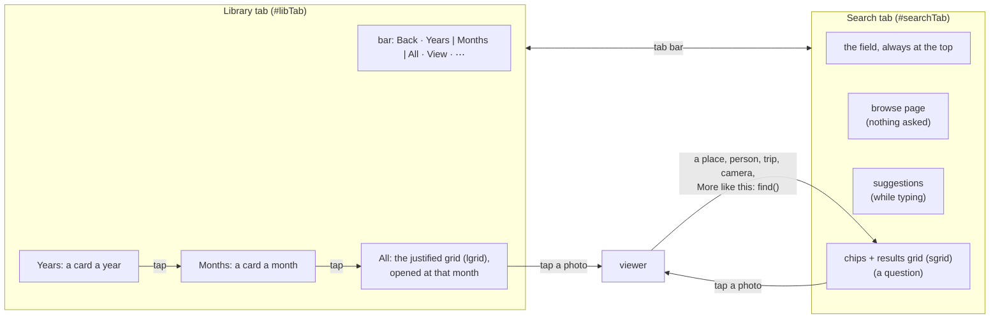
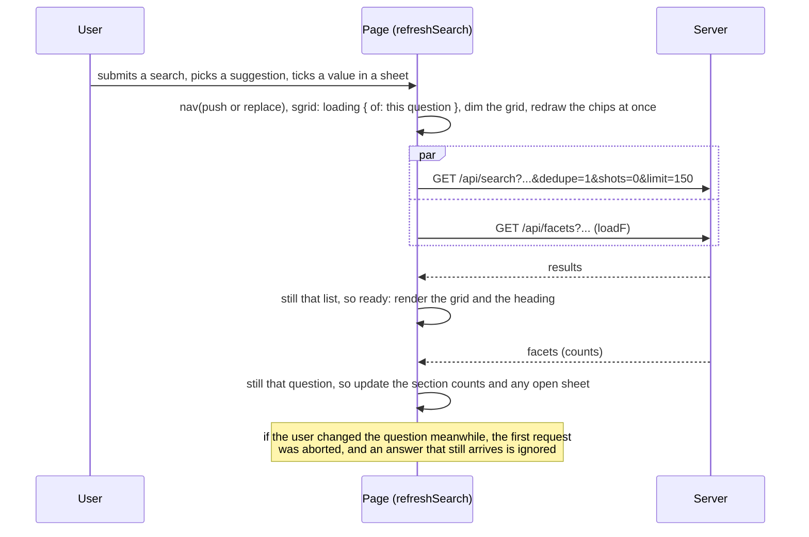
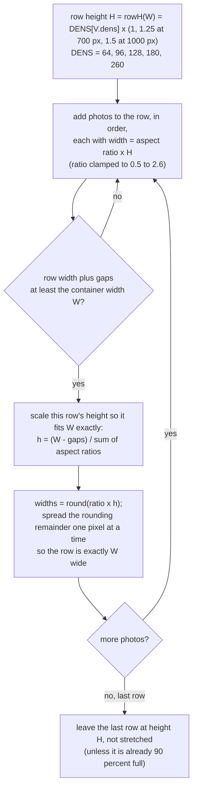
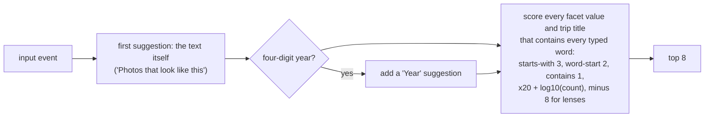
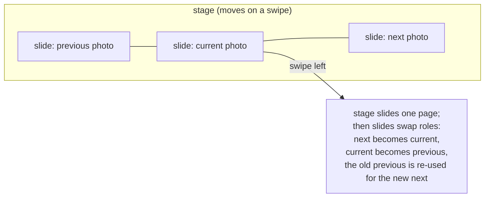
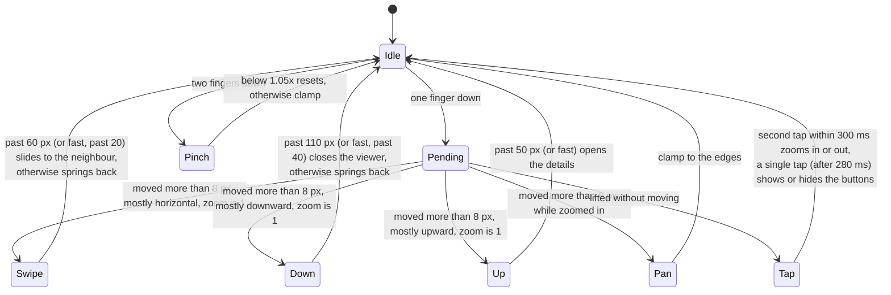

# 13. The photo app

[search.html](../../photo-estate/search.html) is the face of the system: about 2,100 lines of code containing the
page, all of its CSS (about 350 lines) and all of its JavaScript (about 1,600 lines). It is served
as-is by `embed.py serve`. There is no build step, no framework and no package: it is plain
ES2020 in one file, which is why a change shows after a browser reload.

The page is laid out the way the native iPhone app is ([chapter 23](23-native-interface.md)): three places,
the **Library** (every photo in time order, which you can zoom out to a card a year or a card a month),
**Albums** (sets of photos made by a person or an agent; [chapter 26](26-albums-and-agents.md)) and
**Search** (finding some of them), a tab bar between them, and the same viewer. Where the two differ, it is
because a browser is not iOS; where they agree, the iPhone's design came first and this page follows it.

This chapter covers how the page is organised, then each part: the grid, the Library, Search, the view
options, the history, the viewer, touch gestures, sharing, and how it becomes an installable phone app.

## Principles

1. **The server does the thinking; the page draws.** Every search, filter, count and Years/Months card is
   computed by the server (chapter 11). The page holds the *state of the question* and renders the answer.
2. **History holds the state.** Every step (a card you opened, a search you made, the other tab) is a
   history entry holding the *whole* state, so Back goes back the way you came. The search's question is
   also in the address bar, so a search can be bookmarked, shared and reloaded.
3. **Draw only what is visible.** Rows use `content-visibility: auto`; images use `loading="lazy"`; a grid
   loads a page at a time in either direction; the viewer keeps just three slides alive.
4. **Images are the interface.** Colour, chrome and text recede; thumbnails fade in; transitions
   are physical (a photo grows from its tile into the viewer and shrinks back).

## The two tabs



The **tab bar** floats at the bottom in glass: a Library capsule with its label on the left, a round
Search button on the right, the chosen one in the sun's colour. `setTab` switches by hiding one tab's
`<div>` and showing the other's; each tab keeps its own grid, so switching never reloads anything, and the
scroll position of each tab (and of each Library scale) is remembered in `L.y` and put back. Tapping the tab
you are already on scrolls it to the top. The bar is hidden while the viewer is open.

## State, history and the URL

Search's question is one object, `S`:

```js
S = { q: "", plain: false, sha: "", event: "", fav: false, from: "", to: "", sort: "", video: false,
      f: { country: [], region: [], city: [], person: [], album: [], camera: [], lens: [], trip: [] } }
```

`toParams(S)` serialises it to a query string and `fromParams` parses it back (both in
[app/query.js](../../photo-estate/app/query.js), with unit tests of the round trip):

| `S` field | URL parameter | Meaning |
|---|---|---|
| `q` | `q=` | The text typed in the search box |
| `plain` | `names=0` | Do not read names and places in `q` (chapter 12) |
| `sha` | `sha=` | "More like this" for this photo |
| `f.country` ... `f.trip` | repeated `country=France&country=Spain` | Facet filters, trips among them |
| `event` | `event=` | Scope to an event |
| `from`, `to` | `from=2019-06&to=2019-08` | A range of months, from the When chip |
| `fav` | `fav=1` | Favourites only |
| `video` | `kind=video` | Videos only (the Videos chip) |
| `sort` | `sort=old` | Oldest first |

The Library's position is a second, smaller thing: its `scale` (`years`, `months`, `all`, or `month` for
one month's photos), the `anchor` (the year or month you came to), and the `trail` of cards you opened to
get there. The scale is the state of a machine that owns the other two
([The machines](#the-machines)); the script reads all three through `L`.

`snap()` takes both, with the tab, as one history state: `{ tab, s: toParams(S), lib: { scale, anchor, trail } }`.
`nav(mode)` writes it:

- **`push`** for a new step to go back through: a new search (`go`), a card opened, a tab switched.
- **`replace`** for the same step, refined: adding a filter value (`refine`), choosing Years/Months/All from the
  bar, or recording on the current entry which card you are about to leave by, so Back returns to it.

Each entry also carries `prev` (the tab and scale of the entry before it) and `d` (its depth in the app). The
URL is the bare path in the Library and `?` plus the question in Search (`?search` when nothing is asked), so
a reload lands on the same tab and the same search. `restore(st)` turns an entry back into a screen: it sets
`L` and `S` from it and calls `setTab(tab, "init")`, which shows the tab without writing history.

`history.scrollRestoration = "manual"`: the browser's own scroll restoration would land on a pixel offset
in a page that is laid out again from scratch, so the page puts you back itself, at the card you opened or
at the month you were looking at.

Opening a photo pushes one more entry (`{...history.state, v: 1}`), so Back closes the viewer. The
viewer and its entry are one machine (`closed`, `open`, `leaving`: [The machines](#the-machines)), and the
`popstate` handler asks it what the event means (`VW.popped`): the viewer closed itself and its entry has
now been taken back (`left`), Back was pressed while a photo is open (`close`: close it), or this is an
entry left by a photo that is no longer open (`over`: step over it). Anything else is
`restore(history.state)`.

## The machines

Whatever in the page is in one of several states says so in one place: a machine with a name, the state it
is in, and a table of every step it may take. All of them are **strict**
([app/fsm.js](../../photo-estate/app/fsm.js), [issue #81](https://github.com/jflam/photo-estate/issues/81)):
a step the table does not have throws a `TransitionError` before anything has changed. The rule that
follows from it:

- A step the code asks for that its table refuses is a bug, not a case to handle. Where an event can
  arrive in more than one state (a second finger, Back, a press on a tile while the last photo is still
  leaving) the code asks first, with `is()` or `can()`, and does nothing when the answer is no.
- An answer from the server that arrives late is not such an event. It is dropped before it reaches a
  machine: its request was aborted when the state that asked for it was left, and if it arrives all the
  same it finds that the state object it was asked for is no longer the one the machine holds.
- What a state needs to know is **owned by the state**: handed over at the step into it
  (`flow.to(next, data)`) and gone at the step out. There is no photo of a closed viewer and no retry
  timer of a list that has been replaced, because there is nowhere for one to be kept.
- A `TransitionError` that is thrown all the same shows where any bug does, as an uncaught error in the
  console naming the machine and the two states, and the page carries on from the state it was in.
  There is no handler of last resort: there is nothing honest for one to do.

The machines, their tables and the requests they make are modules in `app/`, with no page in them, so
each rule is a unit test ([chapter 17](17-testing-and-demo.md#the-pages-script-modules)). The page hands
them its `fetch`es and is told what to draw.

| Machine (in `search.html`) | Module | States | What a state owns |
|---|---|---|---|
| The viewer and its history entry (`VW`) | [viewer-flow.js](../../photo-estate/app/viewer-flow.js) | `closed` → `open` → `leaving` → `closed`; `open` → `closed` | `open`: the grid it was opened from and its photos, the photo showing, its stack and the shot picked from it, whether the details are up (phone), the file fetched to share, the note under the caption, what finishes a swipe. `leaving`: the history steps asked for meanwhile, and the 1 s timer for a browser that never reports the entry gone. `closed`: nothing |
| A touch on the open photo (`GS`) | viewer-flow.js (`GESTURE_STEPS`) | `none`, `press`, `pan`, `swipe`, `down`, `up`, `pinch` | Where the gesture started and the zoom it started from |
| A list of photos (`Grid.list`, one each for All, a month, an album, Search) | [grid-flow.js](../../photo-estate/app/grid-flow.js) | `empty`, `loading`, `ready`, `failed`; each end of a `ready` list is `idle`, `asking` or `retrying` | What the list is a list **of** (a month and its place in the library, a question, an album's id), fixed when it is asked for and handed to every fetch of it; its `AbortController`; `ready`: its cursors, the server's first answer, the two ends and their retry timers; `failed`: the error and what **Try again** does |
| Where the Library is (`LIB.place`) | [library-flow.js](../../photo-estate/app/library-flow.js) | `years`, `months`, `all`, `month` (any to any) | `anchor` and `trail` |
| What is known of the library (`LIB.known`) | library-flow.js | `unknown`, `asking`, `known`, `failed` | `known`: the months and years, the count in each month, every photo's shape, and the query they were asked with. `asking`: what was known before (it stays up meanwhile) and the `AbortController` of its two requests. `failed`: the error and what **Try again** does |
| Where Albums is (`ALB.where`) | [albums-flow.js](../../photo-estate/app/albums-flow.js) | `list`, `album` | `album`: its id. (Its title, note and sections came with its photos: the album grid's `ready` state owns them) |
| The list of albums (`ALB.listing`) | albums-flow.js | `idle`, `loading`, `ready`, `failed` | The server's answer, or the error |
| An album from a search (`MAKER.job`) | albums-flow.js | `idle` → `collecting` → `creating` → `idle`; `collecting` → `idle` | The question, the title and the note, as they were when it was asked for |
| The search field (`FIELD`) | [query.js](../../photo-estate/app/query.js) (`FIELD_STEPS`) | `resting`, `typing` | — |
| What plays in the viewer (`VIDEO`) | [video-flow.js](../../photo-estate/app/video-flow.js) (`VIDEO_STEPS`) | `still` → `video` → `failed` → `still`; `video` → `still`; `still` → `live` → `still` | `video`: the sha and the `<video>` playing it. `failed`: the sha. `live`: the clip's sha and the `<video>` playing it. `still`: nothing |

A favourite is not a machine but a record per photo with a save under way
([favourite.js](../../photo-estate/app/favourite.js)): what the server was last known to hold, and what
was last asked for. An album's **Make all favourites** and **Take all out of favourites** are one request
for every photo of the album, and go through the same module (`FAV.all`): it is shown at once on the
photos the page has, it waits for a heart's save that is under way, a heart pressed while it is being
sent is sent after it and is what stands, two of them go one after the other, and one that fails puts
back only the photos it changed. Its answer is drawn only on the album it was asked for, never on the
one the page has gone to since.

Not in a machine, and why: the tab showing (`TAB`), the question as it stands and as it was asked (`S`,
`Q`), the answer and its counts (`D`, `F`), the view options (`V`) and the open menu or sheet are plain
values replaced whole, with no steps to refuse; the viewer's three slides and its zoom are drawing state
that exists whether or not a photo is open.

### What is cancelled, and when

| Work | Belongs to | Ends when |
|---|---|---|
| A page of a list (the first, or more at either end) | That list (`loading` or `ready`) | Another list is asked for in that grid, or the grid is cleared: the request is aborted, and an answer that still comes is dropped. Another *tab* does not end it: a list that is not showing finishes loading and is there when you come back |
| The retry of an end whose page did not come (2 s) | The `ready` list | With the list: the timer is cleared, and does nothing if it fires all the same |
| A month's photos | The month's list; the month (`{ key, at, n, q }`) is what the list is of | Another month, or another order or view option, is asked for. The cards being asked for again after a favourite (`libCovers`) no longer touch it |
| `/api/periods` and `/api/layout` | The `asking` state of the library | The library is asked for again (another order, a view option) |
| The list of albums | `ALB.listing` | It is asked for again |
| The pages an album from a search is collected from | `MAKER.job` in `collecting` | Any step in history (`nav`), Back, another question, or the menu put away. No further page is asked for and no album is made. Once the one request that makes the album has been sent it is left to finish, and if the person has moved on by then a toast says the album was made, with **Open**, instead of taking them to it |
| A video's stream, or a Live Photo clip's | `VIDEO`'s `video` or `live` state | Any step out of it: the next photo, the one before, the viewer closed, LIVE let go, the clip's end. The element is paused, its `src` taken away and `load()` called, which is what makes a browser close the connection (pausing alone keeps it) |
| The stack of the photo showing, the file fetched to share | The viewer's `open` state | Not aborted, but dropped if the viewer has closed or shows another photo when they arrive |
| A favourite's save | Its record | Never cancelled: one request at a time for a photo, and the next carries what was asked for last |

### Lists, and the one concurrency rule

Each grid is a `Grid` (the drawing: rows, sections, thumbnails) over a list from
[grid-flow.js](../../photo-estate/app/grid-flow.js) (the asking). Every `load` steps the list to `loading`
with a new state object, which aborts the requests of the state before it; every answer is **dropped unless
the state it was asked for is still the list's** (`if (phase.data !== mine) return`), so a slow response to
an old question can never overwrite a newer answer, and a page of "more" asked for one question can never
be added to the photos of another.



A search refined while you are on the Library is not run at all until Search shows again (`Q` is the
question the page last asked; `setTab` sees that it is not what `S` now says).

## The justified grid

Photos are laid out like a Google Photos or Flickr stream: rows of equal height, each as wide as the
screen, with every photo at its own aspect ratio and no cropping beyond a little at the edges. The same
`Grid` class draws both tabs.



Details that make it feel right:

- **Aspect ratio is clamped** to 0.5-2.6, so a panorama does not make a row one tile wide and a
  tall screenshot does not stretch a row to the moon.
- **Rows are stable from the left.** When more photos arrive, `draw` lays out again only the *unfinished
  last row* of the section. Finished rows never move, so there is no jumping while scrolling.
- **The arithmetic is a pure function**, `packRows` in [app/layout.js](../../photo-estate/app/layout.js): how
  many photos, each one's shape, the width, the row height and the gap in; rows of pixel widths out. `Grid.draw`
  writes the tiles. Its unit tests check what the picture above promises: every full row exactly as wide as
  the screen, a short last row left ragged, the same rows again when the list grows.
- **On a phone the photos run to the edges** (`--gpad: 0` under 760 px), as on the iPhone.
- **Resize** (a `ResizeObserver` on the page) calls `relayout` only if the *width* changed.
- **Sections** group the rows by the grid's `grain`: the Library is always by **month**; Search chooses:

| Situation | Grouping |
|---|---|
| Results ranked by meaning (a described search, or "More like this") | None: one flat section, best match first; hovering a tile shows its date and city |
| Scoped to an event or trip, or a range of two months or less | By **day** ("Saturday 14 July 2019") |
| Otherwise | By **month** ("July 2019") |

A section header shows the title, the **top three places** of that section (`Paris · Versailles`) and
the month's total count (from `/api/periods` in the Library, `/api/facets` in Search), not just what has
loaded so far. Favourites show a small filled heart on the tile. A video's tile says how long it is in
a dark pill at its bottom right, with a play mark (`0:12`; `duration()` in
[app/format.js](../../photo-estate/app/format.js) writes it, never `0:00` for a video with any length);
a Live Photo's still says LIVE in the same place, in small white letters. In Search, with the Videos
chip on, a section's count is in videos. A favourite set in the app (`POST /api/favorite`) shows at once in every
view and count: the server changes the catalog it serves with no request reading it, and a reload under way
keeps it ([chapter 11](11-server.md#concurrency)).

### Items by absolute position

A grid's `items` is indexed by **position in the whole list**, not by what has loaded. `load(start)` sets
`items = new Array(start)` and `lo = start`, so a grid can open part-way down the library (at a month you
tapped) with nothing above it yet. Each tile carries its absolute index (`data-i`), which is also the
viewer's index and the server's `cursor`.

- **Down:** a sentinel below the grid and an `IntersectionObserver` with a `1400px` margin call `more()`,
  which asks for the next 200 from `next` (the cursor the server returned) and chains itself while the
  bottom is still within 1,200 px of the screen. The first page is 150.
- **Up:** the Library's grid has a second sentinel *above* it; `less()` fetches the 200 before `lo` and
  `add(list, at)` puts them in above, merging into the first section if it is the same month. Adding
  content above what you are looking at would push it down, so `add` measures the page height before and
  after and scrolls by the difference: **what was on screen stays where it was**. (`overflow-anchor: none`
  on the page stops the browser from trying to do the same thing at the same time.) A short page from the
  server would leave a gap, so `less` only adds a page that came back whole.
- `poke()` fills in either end that is already on screen, since an observer only reports changes.
- Each end of the list is `idle`, `asking` or `retrying`, which prevents overlapping loads, and a page asked for a list that has since been replaced is discarded ([The machines](#the-machines)).

## The Library

The Library is every photo, newest first. Its bar floats over the photos (with a fade of the page colour
behind it so it stays readable): a Back button, the **Years · Months · All** switch, then a View button and
a ⋯ menu of the rest of your library (Name people, Add photos, Library info).

The heading says how many photos there are, rounded (`about()`), and what the view options hide, so it adds
up to the whole library: *81K of 83K photos · 2.1K hidden*.

### Years and Months

`libLoad` asks `/api/periods` (with the same view options as the grid) for a card a year and a card a
month. Each card has its `key` (`"2019"`, `"2019-07"`), how many photos, `at` (where its photos start in
the Library's list, which is a `cursor`), a cover chosen by the server (a favourite if there is one, a
landscape photo if not, nearest the middle) and its top places. `renderPeriods` draws them as a grid of
large cards: the cover's thumbnail at once, its 1600 px preview over it once loaded, the title and places
over a gradient. Years cards are taller than month cards. In Months, each year's cards start a new row
under a heading with the year, so a row never holds months of two years.

- **Tap a year** and you see Months, scrolled to that year's heading.
- **Tap a month** and you see All, at that month: `libJump` scrolls there if it has loaded, and otherwise
  empties the grid (`lgrid.clear()`, so the photos of wherever it was are not what shows while the month's
  are on their way, and their thumbnails stop loading) and calls `lgrid.load(m.at)`, opening the grid at
  that month's position and letting it fill in above and below.

Each card opened is pushed onto `L.trail` as `{key, back}` (the card, and the scale it was opened from) and
becomes a history step. **Back** (the bar's button, the browser's, or a swipe in from the left edge) walks
back along the trail to the card you came in by: `libBack` uses `history.back()` when the entry before is
the Library's, and otherwise pops the trail itself. Choosing Years, Months or All from the bar is a fresh
start, so it clears the trail and replaces the entry rather than pushing one. On a touch screen the Back
button is hidden, because the edge swipe does it.

### The scrubber

In All, a glass handle appears at the right edge while you scroll and fades 1.4 seconds after you stop. It
shows the month now under the bar, and its height on the screen is how far through the *whole* library that
is (`scrubShow`: the top section's position plus how far into it you are, over `matching`), not how far
through what has loaded.

Drag it to go anywhere. `monthAt(frac)` finds, by binary search over the months' `at`, the month that
holds the photo that far down the library; its name shows on the handle as you drag, and if that month has
already loaded the page goes there at once. Letting go calls `libJump`, which loads the grid at that month
if it had not.

## Search

Search's field is always at the top, in a sticky blurred bar. What is under it depends on the state
(`searchShow`):

| State | Shows |
|---|---|
| Nothing asked | The **browse page** |
| Typing (focused, and the text differs from the question) | **Suggestions** |
| A question | The **chips**, a heading, the results grid |

Around the field: a Back button when something is asked (`sBack`: back to the question before this one, or
to nothing), a clear (×) button inside it, Cancel while typing, and the View button once there are results.
`/` focuses the field from anywhere, switching to Search first.

### The browse page

With nothing asked, `drawBrowse` lays out the ways into the library, built from `/api/info`:

- A strip of ideas to describe ("sunset over water", "dog on the beach"; in the demo, searches known to find
  a group).
- **Trips**: tall cards with a cover, title and dates, and "See all" when there are more than six.
- **Through the years**: the library's whole life as one line of bars, a year each, as tall as it was busy
  (`sqrt`, so a few busy years do not flatten the rest); tap one for that year.
- **Favourites**, with its count.
- **Videos**, with its count, when `/api/info` says the library has any (`videos`).
- **Places, People, Albums, Cameras**: the twelve biggest of each with counts, and "See all", which opens the
  same sheet as the chip.

Every item is a new search (`go`), so Back from it returns to the browse page.

### Suggestions while typing



- The vocabulary is built *client-side* by `buildVocab` from the facet lists in `/api/info`: every country,
  region, city, person, album, camera and lens, plus trip titles.
- **Choosing a suggestion** (`pickSug`) adds a *filter*, not words: picking "Denmark · Country" adds
  `country=Denmark` and clears the field. Choosing the first row, or pressing Enter, runs a description
  search (`submit`).
- Arrow keys move through suggestions; Enter takes the highlighted one; Esc puts the field back as it was.
  The suggestion list keeps the field focused while you tap (`pointerdown` is prevented), so a pick is never
  lost to a blur.

### The heading

`searchHead` says what the answer is, in words. A search that read names and places ("anna in paris") is
titled with what it read; a described search is the words in quotes, "N photos, best match first"; More
like this is "Closest in look and subject"; a trip is its title and dates; filters alone are their values
joined; the Videos chip alone is "Videos", and its count is "N videos". When names or places were read from the words, a line under the field offers the other reading:
"Search for the words instead" (or back again), as a new search.

An empty answer explains itself ("No photo looks like “kangaroo” with these filters") with a Start again
button.

### Chips and the sheets behind them

Under the field, with a question showing, is a row of chips (`PILLS`): **Where · People · Albums · Trips ·
When · Camera · Favourites · Videos**. It scrolls sideways on a narrow screen. The ones with a value come first, in
the sun's colour, showing the first value and "+N" with an × to clear (`pillValue`, `clearPill`).
Favourites and Videos are plain toggles, with no sheet behind them (`aria-pressed`); Videos sends
`kind=video` and is there only in a library that has videos (`/api/info`'s `videos`), or while it is on.

Tapping a chip opens its sheet (`openSheet`): **a sheet from below on a phone** (over a scrim, taller for
When and Trips), **a popover under the chip on a wide screen**. Both have Clear, the title and Done at the top.

| Chip | Sheet |
|---|---|
| Where | Tabs: Countries, Regions, Places (cities), each with live counts |
| People | One list of people |
| Albums | One list of albums |
| Trips | Rows with a cover photo, title, dates and "N of M" |
| When | Years, newest first, with totals; a year's chevron opens its months; tap a year or a month to choose it, again to clear |
| Camera | Tabs: Cameras, Lenses |

Behaviours worth noting:

- Choosing a value is a **refinement** (`refine`: the history entry is replaced, not pushed), and the sheet
  stays open, so you can pick several values in a row while the results update behind it.
- Counts come from `/api/facets` and **each facet ignores its own selection** (chapter 11), which is
  why you can keep adding values within a facet. Values with zero results are dimmed, not hidden, so you can
  see why a combination is empty; a value you have chosen stays listed even when the other filters make its
  count zero.
- Every list but When has a Filter field (focused at once where there is a keyboard); lists are capped at
  400 rows.

## View options

The View button (in the Library's bar, and in Search's once there are results) opens one menu (`viewMenu`),
the iPhone's:

| Option | Effect |
|---|---|
| Order: Newest first / Oldest first | `sort=old` (not shown for results ranked by meaning) |
| Photo size: Smallest, Small, Medium, Large, Largest | Row heights of 64, 96, 128, 180, 260 px (`DENS`), a quarter bigger from 700 px wide and half again from 1000 px |
| Hide near-identical shots | `dedupe=1` (on by default) |
| Hide screenshots | `shots=0` (on by default) |

The options live in `localStorage` under `estate.view` (with the details panel's state and the Library's
last scale), wrapped in `try/catch` because storage can be blocked; the old S/M/L size is read as Small,
Medium or Large. `viewParams` adds the two switches to every grid, facet and periods request.

The two hiding options are applied by the server's `view_masks` **only when browsing and filtering**: a
described search or More like this still finds screenshots. When browsing, near-identical shots are taken
out by the same library-wide flag the iPhone uses, as a mask, so a count is the count of what shows and a
cursor is a position in that list. (A ranked search instead skips, page by page, a photo nearly the same as
one just shown.) Screenshots are told from what the catalog already holds, as on the iPhone: no camera, and
exactly a phone or tablet screen's size, or a name that says so. The rule is written twice, in `catalog.py`
(`SCREEN_SIZES`, `is_screenshot`) and in `Screenshots.swift`; `tests/fixtures/screenshot_rules.json` holds
cases both should pass. `tests/test_core.py` runs them against `catalog.py` and checks that the Swift size
list is the same; an iOS unit test reading the same file is still to be written.

Changing a switch reloads both lists (`viewChanged`), with the Library staying at the month it was showing.
Changing the size lays out both grids again (`setDens`) and keeps the first photo on screen where it was.
**Pinch a grid** to change the size a step at a time: past 1.3× apart (or 0.77× together) is one step.

## The viewer

Click a photo (or focus it and press Enter) and the viewer opens: always the dark room, whatever the page's
colours. Its photos are the grid's `items`, so it reaches as far as the grid does; when you come within
twelve photos of either end it asks the grid for more (`more` or `less`), and the grid's `onGrow` re-arranges
the slides.

Over the photo:

- At the top, a **caption**: the date in full, and under it the time and the city (`vChrome`); a Close button
  on the left; a heart on the right if it is a favourite.
- At the bottom, a glass **bar** of three buttons: Share, Details (i) and **More like this**; on a Live
  Photo, a fourth, **LIVE** (below).
- On a desktop, ‹ › buttons at the sides (hidden on touch screens, where you swipe).
- A note above the bar when something needs saying ("Tap share again", "The full-size image didn’t load").

### Three slides on a stage

The viewer does not keep one big ``. It keeps **three slides side by side on a stage**: the
current photo and its two neighbours, one page apart.



When a swipe finishes, no image is reloaded: the slide objects change roles (`arrange()` matches
existing slides to wanted photos before recycling free ones), so a neighbour that already loaded is
shown instantly.

### Progressive sharpness

Each slide has two `` layers:

| Layer | Source | When |
|---|---|---|
| `lo` | `/thumb/<sha>` (360 px; already in the browser's cache from the grid) | Immediately |
| `hi` | `/preview/<sha>` (1600 px) | As soon as the slide is filled |
| `hi`, replaced | `/large/<sha>` (4096 px) | `sharpen()`: when the on-screen size times the device pixel ratio exceeds 1,700 px, or the user zooms past 1.6×, and the photo is bigger than 1,700 px. Never for a video: its pictures are its poster, and there is no larger one |

The photo therefore appears at once (from the thumbnail), becomes sharp in a moment, and is
razor-sharp on a 4K screen or at 6× zoom, with no flash: the preview fades in over the thumbnail once
`img.decode()` has finished.

### Videos and Live Photos

A video's slide is laid out as a photo's is (`ar` is its upright shape) and its two pictures are its
poster frame ([chapter 11](11-server.md)), so it grows out of its tile, slides in as a neighbour and goes
home as any photo does. When it is the photo showing, `vMedia` puts the viewer's one `<video>` into its
slide, over the poster, and `VIDEO.play` starts it:

- **From `/video/<sha>`, where the search found it.** `videoSrc` adds the result row's `at` as a media
  fragment (`/video/<sha>#t=8.5`), so the browser starts at the moment the words matched without the page
  waiting for it to load. A browser that will not play it with sound plays it muted.
- **With the browser's own controls**, `preload="metadata"` and `playsinline`. Space plays and pauses it
  (`VIDEO.toggle`), where for a photo it is the next photo; the arrow keys still step. On a touch screen a
  press on the controls' strip at the video's bottom edge (56 px) is the video's, not a swipe.
- **The file's own shape.** When the metadata comes, a shape that differs from the catalog's by more than
  2% is taken, and the slide is laid out again. A file with sound and no picture is treated as one this
  browser cannot play.
- **What a video does not do:** it does not zoom (a pinch or a double tap does nothing), and it has no
  `/large/`.
- **Leaving lets the stream go.** The next photo, the one before, another shot of a stack, or the viewer
  closed: `vMediaOff` says `VIDEO.still()`, and every step out of `video` releases the element. The video
  goes home as its poster.

**A video the browser cannot play** (an `.avi`, `.wmv` or `.3gp`; HEVC in a browser without it): the
element's `error` event steps `VIDEO` to `failed`, which lets the stream go; the poster stays, and a line
over it says "This browser can’t play this video." with a **Download it** link to `/video/<sha>` under the
file's own name.

**A Live Photo** is its still, with a **LIVE** control in the viewer's bar and a "Live Photo" card in its
details. The clip is a second `<video>`, muted, with `preload="none"` and no `src` until LIVE is first
pressed, so nothing of it is asked for before. It plays over the still, covering it exactly, for as long
as LIVE is held: pressed with a finger (held on to wherever the finger goes) or the mouse, pointed at
with a mouse, or Enter or Space while LIVE has the focus. It fades in only once it has a picture. Let go,
at its end, or when it fails, the still is back (`VIDEO`'s `live` back to `still`). A long press is the
press, not a menu.

### Fly in, fly out

Opening animates the photo from its grid tile's rectangle to its fitted place (a "FLIP" animation
using the Web Animations API: compute the transform that maps the destination back onto the source,
then animate it to `none`), over 380 ms with an ease-out curve. Closing reverses it toward the tile,
**scrolling the tile into view first**, so the photo lands where it came from even if you
swiped across forty photos. A photo zoomed or dragged goes home from where it is.

### Details, like the iPhone's

Press `i` or the (i) button. On a desktop it is a 360 px panel on the right (and the photo refits
into the remaining space with an animation; whether it is open is remembered); on a phone it is a sheet
from below, the photo refitting into the top 45 percent. `drawInfo` lays it out as the iPhone's InfoView
does ([chapter 23](23-native-interface.md)), like the back of a print:

| Part | Shows | Tap it for |
|---|---|---|
| Heading | The full date; under it the time and the time zone; the photo's description, if it has one | |
| Video or Live Photo card | "Video" and its length; or "Live Photo", "Press and hold LIVE to play it" | |
| Place card | The place; under it the county, "from photos taken around then" if the place was inferred, and a Map link to OpenStreetMap | Photos in that city |
| Event and trip card | The event ("Everything taken around then") and the trip ("The whole trip") | That event, that trip |
| With | A tag for each person | Photos of that person |
| In | A tag for each album | That album |
| Camera plate | The camera, the lens under it, then four cells: focal length (35 mm equivalent when known), aperture (`ƒ/2.8`), shutter (`1/250`), ISO | Photos from that camera |
| Footer | The file's name and its dimensions | |

**Everything that names a set of photos is a way into it.** A tap calls `find(s)`, which closes the viewer
and shows that set in Search; the new search takes the open photo's place in history, so Back from it goes to
where the photo was opened from. The bar's More like this does the same with `sha=`.

### Keys and mouse (desktop)

| Key | Action |
|---|---|
| ← / → or Space | Previous / next; on a video, Space plays and pauses it |
| `i` | Toggle details |
| Esc | Close |
| Click the dark background | Close |
| On-screen ‹ › | Previous / next |

Opening a photo **pushes a history entry**, so Back closes the viewer. Closing by Esc or the Close button
also takes the entry back, so the history does not accumulate photos.

## Touch: the phone viewer

On a phone (narrow screen *or* coarse pointer) the photo takes the whole screen, and the caption and bar sit
on translucent gradients that hide with a tap. One pointer-event state machine handles every gesture (`GS`,
strict like the others, each state owning its gesture's numbers; in the code `Idle` is `none` and `Pending` is `press`):



| Gesture | Effect |
|---|---|
| Swipe left / right | The stage follows the finger; releasing past the threshold slides to the neighbour; past either end of the list it only stretches (a third of the finger's travel) |
| Swipe down | The photo follows the finger and shrinks about its centre while the background fades; releasing far enough flies it back to its tile and closes |
| Swipe up | Brings up the details sheet |
| Swipe down, or tap the photo, with the sheet up | Puts it away (pulling the sheet itself down from its top does too) |
| Pinch | Zooms between 1× and 6× about the fingers' midpoint; the pan follows the fingers' movement too. Not on a video |
| Double-tap | Zooms to 2.5× at the tap point; double-tap again to reset. Not on a video |
| Single tap | Hides or shows the caption and bar |

**Zoom that stays sharp.** Zoom is a scale and a pan on top of the fitted size, and has two states:

- *While fingers move*: a CSS `transform` on the slide (`applyZoom`). Cheap, but it only *stretches
  pixels already drawn*.
- *When they stop*: the slide is **baked** (`bake`): laid out at its zoomed size, with the transform
  removed. The browser then re-draws it from the large (4096 px) image, so the zoomed photo is as sharp
  as the file permits. `clampZoom` keeps the photo covering the screen where it can, and `animateTo`
  glides from the gesture's end position to the baked layout so there is no jump.

**Back by swiping.** A home-screen app has no browser around it to swipe back in, so in the installed app a
swipe in from the left edge (starting within 20 px, travelling over 30 percent of the width) goes back, as
on the iPhone: along the Library's trail, or to the previous search.

## Sharing and saving: the original file

A phone's "Save to Photos" should keep the photo's real date and place, not a re-encoded copy. The
share button (`share()`):

1. On a desktop browser without the Web Share API: downloads `/original/<sha>` with the original name.
2. On a phone: fetches `/original/<sha>` as a `File` and calls `navigator.share({files})`. If the
   original type cannot be shared (RAW, or a type the phone refuses), it falls back to the
   `/large/<sha>` JPEG, renamed `.jpg`.
3. Safari only opens the share sheet straight from a tap. If the download took long enough that the
   gesture expired, the button turns amber and the note says "Tap share again"; the fetched file
   is kept so the second tap shares instantly (`doShare`).

A video has no `/original/`: its file is its stream, `/video/<sha>`, so that is what is downloaded or
fetched to share, under its own name. A video the phone will not share is downloaded as a file instead,
never replaced by a JPEG. A Live Photo is shared as its still alone.

The share and open events are recorded in the query log (chapter 11) by `logEvent`, with the question that
found the photo and its position.

## An installable app

> There is also a native iPhone app that keeps its own copy of the library and works offline. It is not
> this page in a wrapper: it is a separate app with its own grid, viewer and search ([chapter 19](19-iphone-app.md)).
> This page now follows its layout ([chapter 23](23-native-interface.md)), and the ideas in both (the justified
> grid, the three-slide viewer, progressive sharpness, every detail a link) are the same. What follows is the
> web page as an installed app.

The page is a [Progressive Web App](https://web.dev/progressive-web-apps/) with four small pieces:

| File | Purpose |
|---|---|
| [app/manifest.webmanifest](../../photo-estate/app/manifest.webmanifest) | Name, `display: standalone`, theme and background `#09090a` (ink), icons |
| `icon-180/192/512.png`, `icon-maskable-512.png` (made by [tools/make_icons.py](../../photo-estate/tools/make_icons.py)) | Home-screen icons, one maskable for Android's adaptive shapes |
| [app/sw.js](../../photo-estate/app/sw.js) (38 lines) | A service worker that does *one thing* |
| The `<meta>` tags in search.html | `apple-mobile-web-app-capable`, status-bar style, theme colour for light and dark |

The service worker's single job: if a **navigation** fails (on a phone, usually because Tailscale is
off), show a built-in page "Can't reach your photos: the library is only reachable on your tailnet.
Check that Tailscale is connected, then try again." instead of the browser's error. It precaches that
page at install and otherwise goes straight to the network: the API is live data and
images are already in the HTTP cache (immutable, named by hash), so caching either in the worker would
only add staleness. The server serves these files from the site root because a service worker only
controls pages at or below its own path.

Phone polish found throughout the CSS:

- `env(safe-area-inset-*)` padding so the notch and home bar never cover the bars, the tab bar or the
  viewer's buttons.
- Inputs are 16 px, because iOS zooms the page in when you focus a smaller field.
- `touch-action: pan-x pan-y` on the page, so nothing pinch-zooms the *page* (a pinch on a grid changes the
  photo size; photos zoom in the viewer); and `-webkit-text-size-adjust: 100%` so landscape does not inflate text.
- Under 760 px the grid runs to the screen's edges, the chip sheets come up from below and the viewer's
  details become a sheet; hover effects are off for coarse pointers.
- `prefers-reduced-motion` turns all animation off.

## Look and feel

- **One stylesheet, [app/estate.css](../../photo-estate/app/estate.css), is shared by every page** (the photo
  app, People, Library info, duplicate review). [pages.py](../../photo-estate/pages.py) puts it into each page as it
  is sent, so the pages cannot drift apart. What their scripts share (escaping, the API call, the toast, the
  state machines) is shared the same way, as modules in `app/` that each page imports
  ([chapter 2](02-code-tour.md#the-web-pages)).
- **The look is the iPhone app's** ([chapter 23](23-native-interface.md)), and comes from the icon: ink, paper and a
  low sun. Surfaces are quiet (warm paper in the light, near-black in the dark, switched by
  `prefers-color-scheme`); one colour, the sun, marks what is chosen, alive or waiting for you: a chip that is
  on, the Library's scale, the tab you are on, the primary button. Controls floating over photos (the Library's
  bar, the tab bar, the scrubber, the viewer's buttons) are glass: translucent and blurred. Controls are capsules
  and circles; things that hold content are wells and cards with generous corners. Where there is nothing to
  show, the icon's hills and sun are drawn.
- **Type** is the system's face (San Francisco on Apple devices), with tabular numerals for counts and dates.
  Words that name a time or a place (a heading, a month, a year card) are set heavier than the controls around them.
- **Nothing is shown for the person running the server unless asked for.** How long a search took, the catalog's
  tables, the caches and what the catalogue step printed are on the Library info page under "Under the hood" and
  "Show what it did", closed until opened.
- **Motion** is a single easing curve, `cubic-bezier(.2,.7,.2,1)`, used by every animation, so
  everything feels like one system.

## Where to look in the code

All in [search.html](../../photo-estate/search.html), except the server side and what is shared or pure,
which is in the script modules in [app/](../../photo-estate/app/) ([chapter 2](02-code-tour.md#the-web-pages)):

| Topic | Code |
|---|---|
| Shared with the other pages | [app/dom.js](../../photo-estate/app/dom.js) (`$`, `$$`, `esc`, `MARK`), [app/api.js](../../photo-estate/app/api.js) (`api`), [app/fsm.js](../../photo-estate/app/fsm.js) (`machine`, `flow`, `STALE`), [app/toast.js](../../photo-estate/app/toast.js), [app/format.js](../../photo-estate/app/format.js) (`fmt`, `plural`, `dateParts`, `duration`) |
| State, history and URL | `blank`, `copy`, `toParams`, `fromParams` in [app/query.js](../../photo-estate/app/query.js); `snap`, `url`, `nav`, `restore`, the `popstate` handler, `init` |
| The machines | [app/viewer-flow.js](../../photo-estate/app/viewer-flow.js) (`VW`, `GS`), [app/video-flow.js](../../photo-estate/app/video-flow.js) (`VIDEO`), [app/grid-flow.js](../../photo-estate/app/grid-flow.js) (`Grid.list`), [app/library-flow.js](../../photo-estate/app/library-flow.js) (`LIB`, read through `L`), [app/albums-flow.js](../../photo-estate/app/albums-flow.js) (`ALB`, `MAKER`), [app/favourite.js](../../photo-estate/app/favourite.js) (`FAV`), `FIELD` |
| Tabs | `setTab`, the `#tabbar` click handler, `titleDoc` |
| Grid | `Grid` (`load`, `poke`, `more`, `less`, `add`, `draw`, `relayout`, `top`), `rowH`; the rows themselves are `packRows` in [app/layout.js](../../photo-estate/app/layout.js) |
| Library | `lgrid`, `mgrid`, `libLoad`, `libKnown`, `libRetry`, `monthShow`, `libShow`, `renderPeriods`, `libBack`, `libJump`, `toSection` |
| Scrubber | `scrubShow`, `scrubPlace`, `monthAt`, `scrubEnd` |
| View options | `V`, `DENS`, `saveView`, `viewParams`, `viewMenu`, `viewChanged`, `setDens`, the pinch handlers |
| Search | `sgrid`, `go`, `refine`, `refreshSearch`, `loadF`, `searchShow`, `searchHead`, `drawNotice`, `sBack` |
| Browse page | `drawBrowse` |
| Suggestions | `buildVocab`, `drawSug`, `submit`, `pickSug` |
| Chips and sheets | `PILLS`, `pillValue`, `clearPill`, `drawChips`, `openSheet`, `drawTools`, `drawSheet`, `sheetClick` |
| Viewer | `mkSlide`, `fit`, `fill`, `preview`, `sharpen`, `arrange`, `show`, `vChrome`, `openViewer`, `closeViewer`, `toggleInfo`, `drawInfo`, `find` |
| Touch | `Z`, `Zb`, `applyZoom`, `bake`, `clampZoom`, `zoomAt`, `slideTo`, `endGesture`, `animateTo`, the edge-swipe handlers |
| Videos and Live Photos | `VIDEO` ([app/video-flow.js](../../photo-estate/app/video-flow.js): `videoFlow`, `videoSrc`, `release`), `vMedia`, `vMediaOff`, `vCant`, `liveOn`, `liveOff`, `liveShow`, `badge`, `duration` in app/format.js |
| Share | `share`, `doShare`, `logEvent`, `fileName` |
| PWA | [app/](../../photo-estate/app/), `serviceWorker.register` at the bottom |
| Server: view options and cards | `view_masks`, `periods` and the `/api/periods` handler in [embed.py](../../photo-estate/embed.py) |
