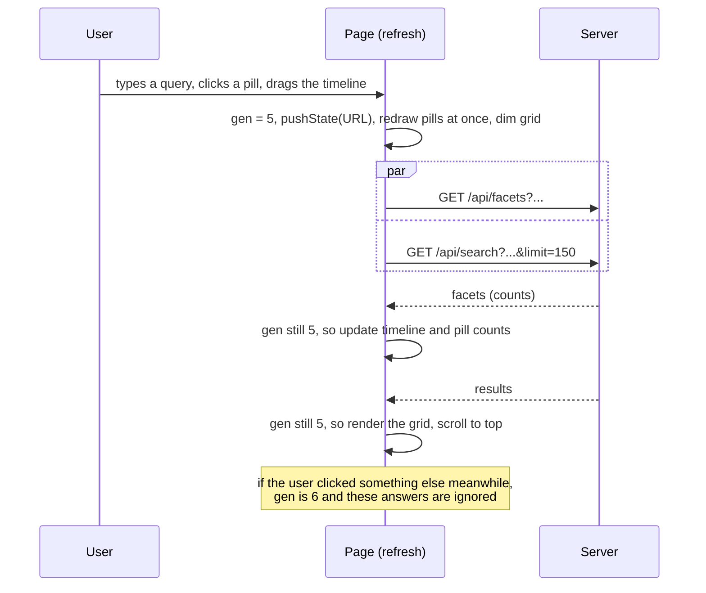
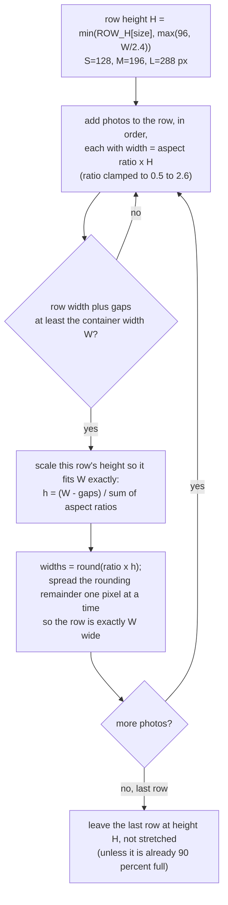
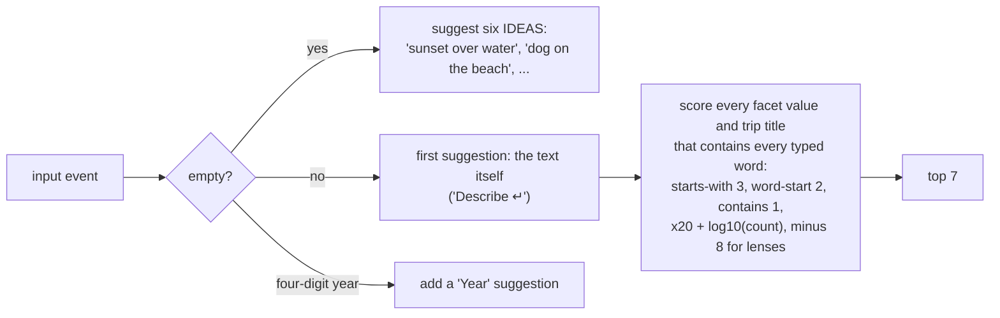
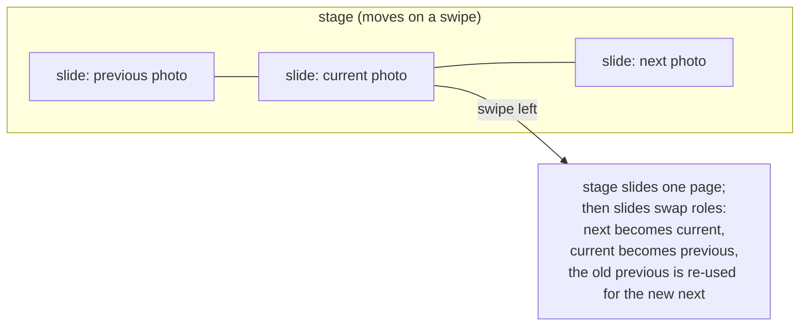
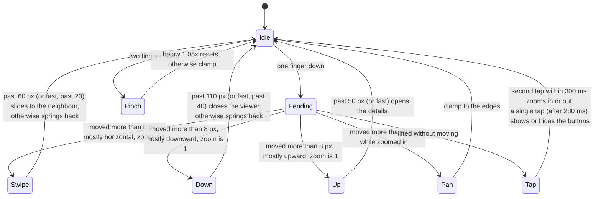

# 13. The photo app

[search.html](../../photo-estate/search.html) is the face of the system: 1,414 lines containing the
page, all of its CSS (323 lines of code) and all of its JavaScript (971 lines of code). It is served
as-is by `embed.py serve`. There is no build step, no framework and no package: it is plain
ES2020 in one file, which is why a change shows after a browser reload.

This chapter covers how it is organised, then each feature: the grid, search box, filters, timeline,
viewer, touch gestures, sharing, and how it becomes an installable phone app.

## Principles

1. **The server does the thinking; the page draws.** Every search, filter and count is computed by the
   server (chapter 11). The page holds the *state of the question* and renders the answer.
2. **The URL is the state.** Every filter, query and selection is in the address bar, so every view
   can be bookmarked, shared and reloaded, and the back button works.
3. **Draw only what is visible.** Rows use `content-visibility: auto`; images use `loading="lazy"`;
   the viewer keeps just three slides alive; the scrubber keeps only nearby thumbnails.
4. **Images are the interface.** Colour, chrome and text recede; thumbnails fade in; transitions
   are physical (a photo grows from its tile into the viewer and shrinks back).

## State, URL and history

The whole question is one object, `S`:

```js
S = { q: "", plain: false, sha: "", trip: "", event: "", fav: false, from: "", to: "", sort: "",
      f: { country: [], region: [], city: [], person: [], album: [], camera: [], lens: [] } }
```

`toParams(S)` serialises it to a query string and `fromParams` parses it back:

| `S` field | URL parameter | Meaning |
|---|---|---|
| `q` | `q=` | The text typed in the search box |
| `plain` | `names=0` | Do not read names and places in `q` (chapter 12) |
| `sha` | `sha=` | "More like this" for this photo |
| `f.country` ... `f.lens` | repeated `country=France&country=Spain` | Facet filters |
| `trip`, `event` | `trip=`, `event=` | Scope to a trip or event |
| `from`, `to` | `from=2019-06&to=2019-08` | Timeline date range (months) |
| `fav` | `fav=1` | Favourites only |
| `sort` | `sort=old` | Oldest first |

`refresh()` is the one function that turns state into a screen. It:

1. Increments a generation counter `gen`.
2. Pushes a history entry (or replaces, or skips) with the new URL.
3. Redraws the pills and the "similar" chip immediately (from state alone: no waiting).
4. Dims the grid (`.stale`) and fires **two requests in parallel**: `/api/facets` (counts for the
   pills and timeline) and `/api/search` or `/api/similar` (the photos).
5. When each returns, **drops the response if `gen` moved on** (`if (g !== gen) return`), so a slow
   response to an old question can never overwrite a newer answer. This is the whole concurrency
   story of the page.



`depth()` counts history entries within the app; once there is somewhere to go back to, the page
adds a Back button to the header (visible only in the installed home-screen app, which has no
browser chrome).

View preferences (photo size, hide near-identical shots, whether the details panel is open on a
desktop) live in `localStorage` under `estate.view`, wrapped in `try/catch` because storage can be
blocked.

## Loading and infinite scroll

The first request asks for 150 results (`limit=150`). A 1-pixel `#more` element sits below the grid
and an `IntersectionObserver` with a `1400px` root margin fires `loadMore()` while the user is still a
couple of screens away from the bottom. `loadMore` requests the next 200 using the `cursor` the server
returned and **chains itself** while the bottom is still within 1,200 px of the viewport, so a tall
window fills without scrolling. A `busy` flag prevents overlapping loads, and `gen` discards loads
for stale questions.

## The justified grid

Photos are laid out like a Google Photos or Flickr stream: rows of equal height, each as wide as the
screen, with every photo at its own aspect ratio and no cropping beyond a little at the edges.



Details that make it feel right:

- **Aspect ratio is clamped** to 0.5-2.6, so a panorama does not make a row one tile wide and a
  tall screenshot does not stretch a row to the moon.
- **Rows are stable from the left.** When more photos arrive (infinite scroll), only the *unfinished
  last row* of the section is laid out again. Finished rows never move, so there is no jumping
  while scrolling.
- **Resize** (a `ResizeObserver` on the grid) re-lays-out everything only if the *width* changed.
- **Sections** group the rows. The grouping is chosen by `grain()`:

| Situation | Grouping |
|---|---|
| Results ranked by meaning (a text search, or "More like this") | None: one flat section, best match first; hovering a tile shows its date and city |
| Scoped to an event or trip, or a date range of two months or less | By **day** ("Saturday 14 July 2019") |
| Otherwise | By **month** ("July 2019") |

A section header shows the title, the **top three places** of that section (`Paris · Versailles`) and
the month's total count from the facets (not just what has loaded so far).
- **Favourites** show a small filled heart on the tile.
- **Empty states** explain themselves ("Nothing found: No photo looks like “kangaroo”" with how
  names and places were read, or "Nothing matches" with a Clear filters button).

## The search box



- The suggestion vocabulary is built *client-side* from the facet lists in `/api/info`: every country,
  region, city, person, album, camera and lens, plus trip titles.
- **Choosing a suggestion** adds a *filter*, not words: picking "Denmark · Country" adds
  `country=Denmark`. Picking the first item, the literal text, runs a description search.
- Keys: `/` focuses the box from anywhere; arrows move through suggestions; Enter runs; Esc resets;
  **Backspace on an empty box removes the "More like this" chip**.
- The "Similar photos" chip shows the thumbnail of the photo being used as the query.
- The placeholder tells you what is possible; in the demo it lists searches known to hit a group.

## Filter pills

`Where · People · Albums · Trips · Camera · ♡ Favourites`, each a button that opens a popover.

| Pill | Popover |
|---|---|
| Where | Tabs: Countries, Regions, Places (cities), each with live counts |
| People | One list of people |
| Albums | One list of albums |
| Trips | Rows with a cover photo, title and date span |
| Camera | Tabs: Cameras, Lenses |
| Favourites | A plain toggle |

Behaviours worth noting:

- A pill with a selection turns solid and shows the first value plus "+N", with an × to clear.
- Choosing a value does a **soft refresh**: the page updates behind the open popover so you can pick
  several values in a row. Values with zero results are dimmed, not hidden, so you can see why a
  combination is empty; a value you have chosen stays visible even if the other filters make its
  count zero.
- A filter box appears in a popover once the list has more than 8 entries; lists are capped at 250
  rows.
- Counts come from `/api/facets` and **each facet ignores its own selection** (chapter 11), which is
  why you can keep adding values within a facet.
- The date range and any active event appear as removable pills of their own.
- The **View options** popover sets photo size (S / M / L) and the "Hide near-identical shots" switch.

## The timeline

Above the grid is a bar chart: one bar per month from the library's first photo to its last.

- **Bar height** is `sqrt(count / max)` (with a minimum so a month with any photos is visible), so a
  few very busy months do not flatten everything else. The heights **animate** when counts change.
- **Counts follow the filters**: the histogram you see is the histogram *of the current results,
  ignoring the date range itself*. Filter to "Denmark" and the bars show when you were in Denmark.
- **Drag** to select a range of months (the selected bars are bright and a translucent box follows).
  **Click a year label** to select that year. **Click inside an existing selection** to clear it.
- **Hover** shows a tooltip with the month and its count.
- **A dot under the bar follows your scroll position**, marking which month is now at the top of
  the page.
- Year labels thin out (every year, every 2, every 5) so they never overlap, and a label that would
  poke past the right edge is dropped.
- The range is the same `from`/`to` pair as the URL, so drag-selecting is just editing `S`.

## The viewer

Click a photo (or focus it and press Enter) and the viewer opens.

### Three slides on a stage

The viewer does not keep one big ``. It keeps **three slides side by side on a stage**: the
current photo and its two neighbours, one page apart.



When a swipe finishes, no image is reloaded: the slide objects change roles (`arrange()` matches
existing slides to wanted photos before recycling free ones), so a neighbour that already loaded is
shown instantly.

### Progressive sharpness

Each slide has two `` layers:

| Layer | Source | When |
|---|---|---|
| `lo` | `/thumb/<sha>` (360 px; already in the browser's cache from the grid) | Immediately |
| `hi` | `/preview/<sha>` (1600 px) | As soon as the slide is filled (not while scrubbing) |
| `hi`, replaced | `/large/<sha>` (4096 px) | `sharpen()`: when the on-screen size times the device pixel ratio exceeds 1,700 px, or the user zooms past 1.6×, and the photo is bigger than 1,700 px |

The photo therefore appears at once (from the thumbnail), becomes sharp in a moment, and is
razor-sharp on a 4K screen or at 6× zoom, with no flash: each upgrade fades in over the previous one
(`img.decode()` is awaited before the fade).

### Fly in, fly out

Opening animates the photo from its grid tile's rectangle to its fitted place (a "FLIP" animation
using the Web Animations API: compute the transform that maps the destination back onto the source,
then animate it to `none`), over 380 ms with an ease-out curve. Closing reverses it toward the tile,
**scrolling the tile into view first**, so the photo lands where it came from even if you
swiped across forty photos.

### The details panel

Press `i` or the (i) button. On a desktop it is a 360 px panel on the right (and the photo refits
into the remaining space with an animation); on a phone it is a sheet from below. Contents, from
`drawInfo`:

| Section | Shows | Links to |
|---|---|---|
| Header | Full date and time, with the time zone | |
| Place | City, region, country (each a link); county or "Inferred from the photos around it"; GPS coordinates linking to OpenStreetMap | A search for that place |
| Part of | The **event**, the **trip**, and the month | Each opens that scope |
| Camera | The camera (link), the lens (link, with the camera's name trimmed from the front), and four cells: shutter (`1/250`), aperture (`ƒ/2.8`), ISO, focal length (35 mm equivalent when known) | A search for that camera or lens |
| Details | Dimensions, megapixels, file type, and the original path | |
| **More like this** | A button | A similar-photos search |

Every link sets `S` to a *new* search and closes the viewer, so exploring from a photo's details is
the main way to browse by place, event or camera.

### Keys and mouse (desktop)

| Key | Action |
|---|---|
| ← / → or Space | Previous / next |
| `i` | Toggle details |
| Esc | Close |
| Click the dark background | Close |
| On-screen ‹ › | Previous / next (hidden on touch screens, where you swipe) |

Opening a photo **pushes a history entry**, so Back closes the viewer (and a swipe from the screen's
edge does on a phone). Closing by Esc also removes the entry, so the history does not accumulate
photos.

## Touch: the phone viewer

On a phone (narrow screen *or* coarse pointer) the photo takes the whole screen. The date, a
thumbnail strip, the share and details buttons sit on translucent gradients that hide with a tap.
One pointer-event state machine handles every gesture:



| Gesture | Effect |
|---|---|
| Swipe left / right | The stage follows the finger; releasing past the threshold slides to the neighbour; past either end of the list it only stretches (a third of the finger's travel) |
| Swipe down | The photo follows the finger and shrinks about its centre while the background fades; releasing far enough flies it back to its tile and closes |
| Swipe up | Brings up the details sheet |
| Swipe down on the sheet | Puts it away (when scrolled to its top) |
| Pinch | Zooms between 1× and 6× about the fingers' midpoint; the pan follows the fingers' movement too |
| Double-tap | Zooms to fill the screen at the tap point (or 2.5× if that is barely more); double-tap again to reset |
| Single tap | Hides or shows the buttons |
| Drag the thumbnail strip | Scrub through the photos; flicks coast with friction |
| Tap a strip thumbnail | Go to that photo |

**Zoom that stays sharp.** Zoom is a scale and a pan on top of the fitted size, and has two states:

- *While fingers move*: a CSS `transform` on the slide (`applyZoom`). Cheap, but it only *stretches
  pixels already drawn*.
- *When they stop*: the slide is **baked** (`bake`): laid out at its zoomed size, with the transform
  removed. The browser then re-draws it from the large (4096 px) image, so the zoomed photo is as sharp
  as the file permits. `clampZoom` keeps the photo covering the screen where it can, and `animateTo`
  glides from the gesture's end position to the baked layout so there is no jump.

**The scrubber** keeps only about `ceil(W/32/2)+3` thumbnails on each side of the current photo in the
DOM at any time. While dragging, previews are skipped (the thumbnail "is all there is time for") and
a 180 ms timer loads the preview once movement pauses.

## Sharing and saving: the original file

A phone's "Save to Photos" should keep the photo's real date and place, not a re-encoded copy. The
share button (`share()`):

1. On a desktop browser without the Web Share API: downloads `/original/<sha>` with the original name.
2. On a phone: fetches `/original/<sha>` as a `File` and calls `navigator.share({files})`. If the
   original type cannot be shared (RAW, or a type the phone refuses), it falls back to the
   `/large/<sha>` JPEG, renamed `.jpg`.
3. Safari only opens the share sheet straight from a tap. If the download took long enough that the
   gesture expired, the button turns white ("ready") and asks for **one more tap**; the fetched file
   is kept so the second tap shares instantly.

The share and open events are recorded in the query log (chapter 11).

## An installable app

The page is a [Progressive Web App](https://web.dev/progressive-web-apps/) with four small pieces:

| File | Purpose |
|---|---|
| [app/manifest.webmanifest](../../photo-estate/app/manifest.webmanifest) | Name, `display: standalone`, theme and background `#0c0c0d`, icons |
| `icon-180/192/512.png`, `icon-maskable-512.png` (made by [tools/make_icons.py](../../photo-estate/tools/make_icons.py)) | Home-screen icons, one maskable for Android's adaptive shapes |
| [app/sw.js](../../photo-estate/app/sw.js) (41 lines) | A service worker that does *one thing* |
| The `<meta>` tags in search.html | `apple-mobile-web-app-capable`, status-bar style, theme colour for light and dark |

The service worker's single job: if a **navigation** fails (on a phone, usually because Tailscale is
off), show a built-in page "Can't reach your photos: the library is only reachable on your tailnet.
Check that Tailscale is connected, then try again." instead of the browser's error. It precaches that
page and the icon at install and otherwise goes straight to the network: the API is live data and
images are already in the HTTP cache (immutable, named by hash), so caching either in the worker would
only add staleness. The server serves these files from the site root because a service worker only
controls pages at or below its own path.

Phone polish found throughout the CSS:

- `env(safe-area-inset-*)` padding so the notch and home bar never cover controls.
- Inputs are 16 px on touch devices, because iOS zooms the page in when you focus a smaller field.
- `touch-action: pan-x pan-y` on the page, so nothing pinch-zooms the *page* (photos zoom in the
  viewer); and `-webkit-text-size-adjust: 100%` so landscape does not inflate text.
- The header's pill row scrolls horizontally under 1100 px; the viewer's details become a sheet under
  760 px; hover effects are off for coarse pointers.
- `prefers-reduced-motion` turns all animation off.

## Look and feel

- **One set of CSS variables** drives light and dark themes (`prefers-color-scheme`): background,
  surface, ink in three strengths, line, faint, the inverted chip colours, and the favourite red.
- **Type** is a system stack leading with Inter, with tabular numerals for counts and dates and
  slightly negative letter-spacing; the monospace stack is used only for file paths.
- **Motion** is a single easing curve, `cubic-bezier(.2,.7,.2,1)`, used by every animation, so
  everything feels like one system.
- **The header** is sticky with a translucent, blurred background; a hairline appears under it only
  once the page has scrolled.

## Where to look in the code

All in [search.html](../../photo-estate/search.html):

| Topic | Code |
|---|---|
| State and URL | `blank`, `toParams`, `fromParams`, `refresh`, `popstate` handler |
| Loading | `loadMore`, the `IntersectionObserver` |
| Grid | `grain`, `append`, `drawSection`, `relayout` |
| Titles and the "how this was read" line | `renderHead` |
| Pills and popovers | `PILLS`, `renderPills`, `openPop`, `facetPop`, `tripsPop` |
| Search box | `buildVocab`, `suggest`, `pick` |
| Timeline | `buildTimeline`, `renderTimeline`, the `pointer*` handlers on `#tl` |
| Viewer | `mkSlide`, `fit`, `fill`, `preview`, `sharpen`, `arrange`, `show`, `openViewer`, `closeViewer`, `drawInfo` |
| Touch | `Z`, `Zb`, `bake`, `zoomAt`, `slideTo`, `endGesture`, `drawStrip`, `scrubTo` |
| Share | `share`, `doShare` |
| PWA | [app/](../../photo-estate/app/), `serviceWorker.register` at the bottom |
