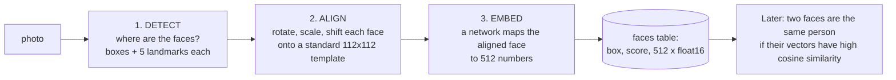
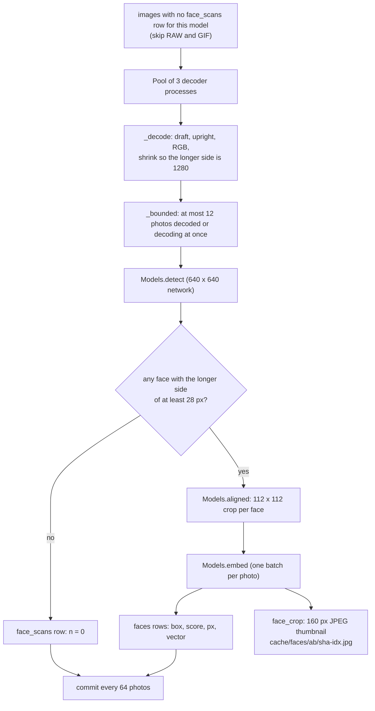

# 14. Finding faces

`faces.py run` is the batch job that finds every face in every photo and turns each into a 512-number
fingerprint. It is the foundation for the People page; *who* each face is, and how your corrections
change that, is the next chapter. This chapter is about the machine-learning half: detection,
alignment and embedding, built directly on two ONNX models with about 150 lines of NumPy and no
face-recognition library.

```bash
uv run faces.py --db estate.db run --store STORE        # resumable; about as fast as the SigLIP pass
uv run faces.py --db estate.db stats                    # how many faces, named, waiting
```

## The three-step recipe

Every modern face-recognition system does the same three things, and this one is no different:



The models are the **InsightFace `buffalo_l`** pack: the detector `det_10g.onnx` (SCRFD-10G) and the
recogniser `w600k_r50.onnx` (an ArcFace ResNet-50 trained on WebFace600K). They run on the CPU with
`onnxruntime`, which is much lighter than PyTorch, so `faces.py` and `embed.py` have different
dependencies on purpose.

### Getting the models

On first use `model_dir()` downloads `buffalo_l.zip` (about 280 MB) from the InsightFace GitHub
release into `~/.cache/photo-estate/buffalo_l/` (honouring `XDG_CACHE_HOME`), extracts just the two
files it needs, and **verifies each against a SHA-256 hash pinned in the source** (`MODEL_FILES`). If a
digest does not match, the program exits rather than run unexpected weights. The model weights are
**for non-commercial use only**, which the README and the module docstring state; the code is MIT.

## The batch job



Design points:

- **The scan record is separate from the faces.** `face_scans` has a row for *every image looked at*,
  including those with no faces and those that failed to decode (with an `error`). The work list is
  "images with no scan row", so a photo of a landscape is not rescanned on every run. `faces` only has
  rows for faces actually found.
- **Resolution: 1280 px.** Photos are read with the longer side at most 1280 (`SIDE`): "enough for
  faces a few percent of the frame". The detector then works at 640.
- **A minimum face size.** Faces smaller than **28 px** (`MIN_PX`) at that scale are dropped: "smaller
  faces than this give embeddings that match anyone". A tiny face does not contain enough detail to
  tell people apart; it would only produce false matches.
- **Memory is bounded explicitly.** `Pool.imap` queues every job up front and decoders outrun the
  models, so finished 1280 px images pile up until the OS kills the process (this happened on macOS).
  `_bounded(pool, jobs, ahead=4*workers)` keeps a sliding window: it submits `ahead` jobs, and each time
  one result is consumed it submits one more. Memory stays flat. (`embed.py` can use plain `imap` since
  its images are 256 px.)
- **Progress** prints every minute: photos per second, faces found, undecodable count, ETA.
- Videos and RAW are not scanned (`kind='image'` and `SKIP_EXT`).

## Step 1: detection with SCRFD

SCRFD is a single-shot detector: one pass over the image produces candidate faces at three scales.

### Preparing the image

```python
scale = self.size / max(im.size)                        # 640 / longer side
small = im.resize((round(w*scale), round(h*scale)), BILINEAR)
canvas = np.zeros((640, 640, 3), np.float32)
canvas[:small.height, :small.width] = np.asarray(small) # the image sits at the top-left
blob = ((canvas - 127.5) / 128.0).transpose(2, 0, 1)[None]   # NCHW, centred and scaled
```

The aspect ratio is preserved and the remainder is zero padding (a "letterbox" at the bottom and right),
because the network takes a fixed 640×640 input.

### Reading the outputs

The network emits **nine tensors**: for each of three *strides* (8, 16, 32 pixels) it gives scores,
box offsets and landmark offsets. Each stride is a grid whose cells are `stride` pixels apart in
the 640 image; every cell has **two anchors** (candidate positions) at its top-left.

```
  stride 8   80 x 80 grid x 2 anchors = 12,800 candidates   (small faces)
  stride 16  40 x 40 grid x 2 anchors =  3,200 candidates   (medium)
  stride 32  20 x 20 grid x 2 anchors =    800 candidates   (large)
```

The anchor centres are precomputed once in `Models.__init__` (`np.mgrid`, multiplied by stride,
`np.repeat`ed twice). For each stride, anchors scoring at least **0.5** are decoded:

| Output | Meaning | Decoding |
|---|---|---|
| `outs[0..2]` | Face probability per anchor | Keep `score ≥ 0.5` |
| `outs[3..5]` | Distances `(left, top, right, bottom)` from the anchor to the box edges, in units of stride | `x1 = cx - l·stride`, `y1 = cy - t·stride`, `x2 = cx + r·stride`, `y2 = cy + b·stride` |
| `outs[6..8]` | Five landmarks (both eyes, nose, both mouth corners) as offsets from the anchor, in units of stride | `anchor + k·stride` |

All coordinates are divided by `scale` to return to the image's pixel space.

### Non-maximum suppression

One real face lights up many neighbouring anchors, which produces many overlapping boxes. **NMS** keeps
the best and discards the rest:

```python
order = scores.argsort()[::-1]
while len(order):
    i, rest = order[0], order[1:]
    keep.append(i)                                   # the best remaining box
    iou = intersection / (area[i] + area[rest] - intersection)
    order = rest[iou <= 0.4]                         # drop those overlapping it by more than 40 percent
```

What is returned is a list of boxes, their scores and the five landmark points each.

## Step 2: alignment

Recognition works far better if every face is presented in the same pose. ArcFace was trained on faces
warped so that eyes, nose and mouth corners sit at fixed positions in a 112 × 112 square:

```
 ARC_TEMPLATE (x, y) in the 112 x 112 crop:

     left eye   (38.3, 51.7)        right eye  (73.5, 51.5)

                  nose  (56.0, 71.7)

     left mouth (41.5, 92.4)        right mouth (70.7, 92.2)
```

`Models.aligned` estimates the **similarity transform** (rotation + uniform scale + translation, no
shear) that best maps the face's five detected landmarks onto the template, using the closed-form
**Umeyama** method with a singular value decomposition:

1. Centre both point sets on their means.
2. `U, S, Vt = svd(dstᵀ · src / n)`; fix the reflection case via the sign of the determinant.
3. Scale = `trace(S·D) / var(src)`; rotation = `U·D·Vt`; translation from the means.
4. PIL's `Image.transform(..., AFFINE, ...)` wants the **inverse** map (for each output pixel, where to
   read in the input), so the matrix is inverted before use, and bilinear sampling produces the
   112×112 crop.

No OpenCV is involved, only NumPy and Pillow.

## Step 3: the embedding

```python
blob = ((np.stack([np.asarray(c, np.float32) for c in crops]) - 127.5) / 127.5).transpose(0, 3, 1, 2)
v = self.rec.run(None, {self.rec_in: blob})[0]
return v / np.linalg.norm(v, axis=1, keepdims=True)
```

The ArcFace network maps each aligned crop to a **512-dimensional vector**, which is L2-normalised.
ArcFace is trained with an angular-margin loss that pulls images of the same person together on the
unit sphere and pushes different people apart, so *cosine similarity* (just the dot product of two
normalised vectors) measures "same person". Two photos of one face typically have a clearly higher
similarity than two different people, which is the only fact the rest of the system uses.

The release's recogniser declares batch size 1 in its metadata even though it accepts any batch;
`rec_batch` detects this at load time and, when the declared batch is fixed, runs faces one at a time
instead of as one batch. ONNX Runtime's log level is raised so it does not warn on every call.

## What gets stored

For each kept face, one row in `faces`:

| Column | Value | Notes |
|---|---|---|
| `sha256`, `idx` | The photo and the face's number within it | `idx` also names the crop file |
| `model` | `buffalo_l` | So a better model can be run alongside |
| `x, y, w, h` | The box as **fractions of the upright image** | Resolution-independent; used to draw the highlight on the full photo |
| `score` | Detector confidence, 0-1 | Used to prefer clear faces |
| `px` | The box's longer side in pixels, at the 1280 scale | Used to ignore tiny faces |
| `vec` | 512 × float16, L2-normalised | 1,024 bytes |
| `person_id`, `source`, `labeled_at` | Filled in later (chapter 15) | |

Alongside, a **160 × 160 JPEG crop** of each face is written to `review/faces/<ab>/<sha>-<idx>.jpg`
by `face_crop`: the box enlarged to **1.7×** its longer side, so there is room for hair, hats and
chins, resized with Lanczos. The People page shows these. They are a cache: `People.crop()`
regenerates a missing one from the original.

## How good is it, and what does it cost?

- **Speed:** the README says a face pass is about as fast as the embedding pass (CPU,
  onnxruntime, 6 threads by default and 3 decoders).
- **Quality:** detection threshold 0.5 and NMS 0.4 are the usual SCRFD settings. The size limits are
  stricter downstream: seeding from Google's tags requires `score ≥ 0.6` and `px ≥ 40`; automatic
  naming requires `px ≥ 40`; grouping unknown people requires `score ≥ 0.65` and `px ≥ 56`.
- **Honest limits:** no faces in RAW, GIF or video yet; faces turned away or masked produce weak
  vectors; and very young children change appearance quickly, which is why the next chapter's scoring
  is built around *time*.

## Where to look in the code

All in [faces.py](../../photo-estate/faces.py):

| Topic | Code |
|---|---|
| Constants | `MODEL`, `MODEL_FILES`, `SIDE`, `MIN_PX`, `CROP`, `ARC_TEMPLATE` |
| Model download and check | `model_dir` |
| Detection, alignment, embedding | `Models.detect`, `Models.aligned`, `Models.embed` |
| Bounded decoding | `_decode`, `_bounded` |
| The batch job | `cmd_run` |
| Face thumbnails | `face_crop`, `crop_path` |
| Summary | `cmd_stats` |
