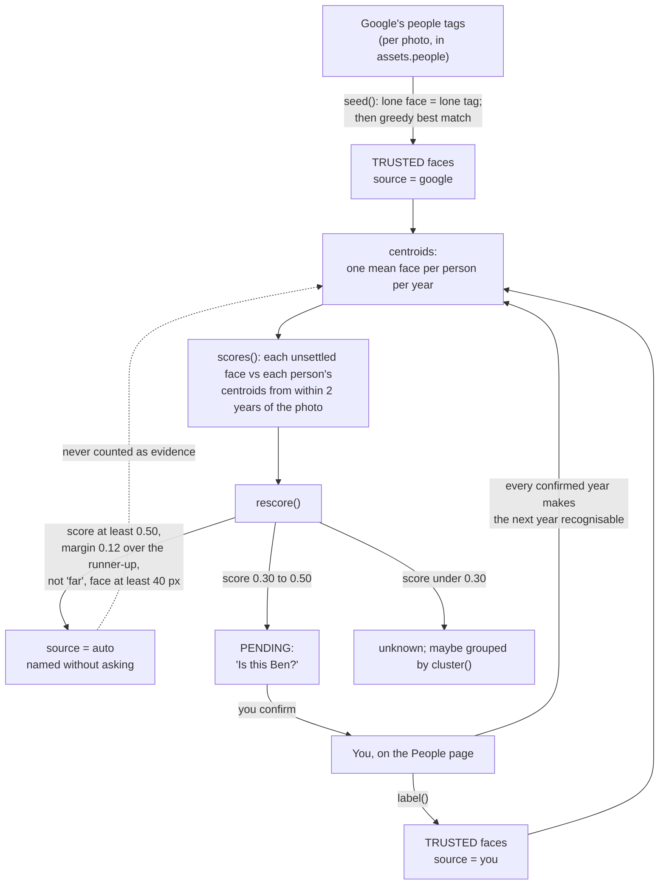
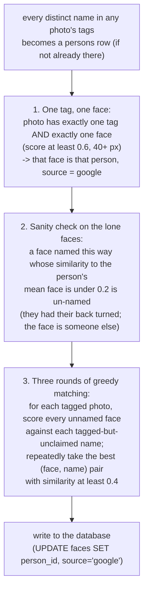
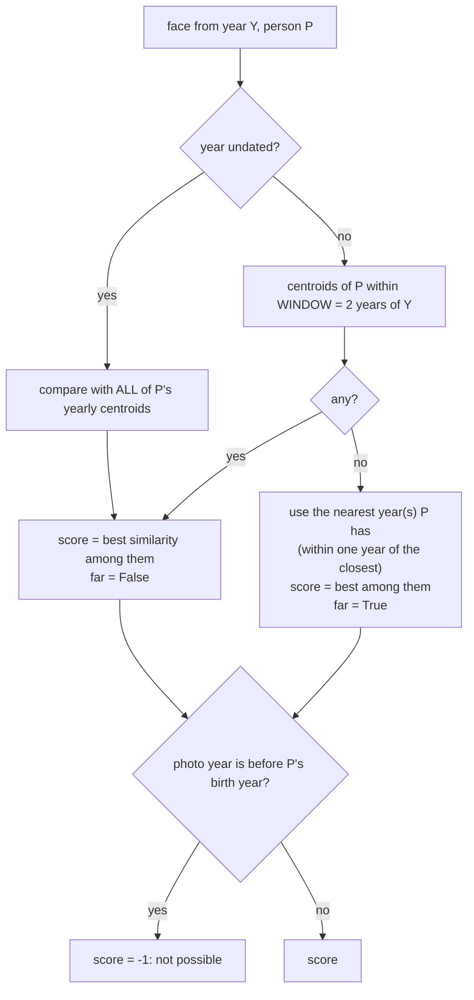
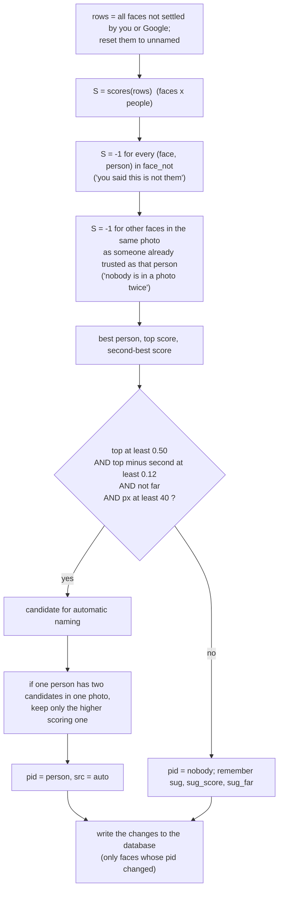
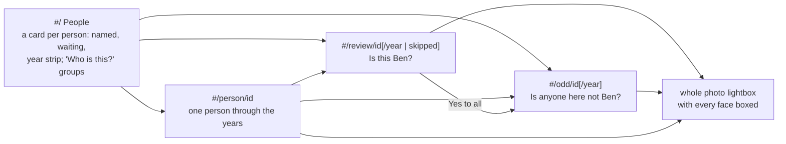

# 15. Naming people: how human corrections work

A face vector says *what a face looks like*, never *whose face it is*. Turning vectors into names
takes ground truth, and the only ground truth available is Google's people tags and **you**. This
chapter is about the system built to get the most out of both while asking you for as little as
possible: [faces.py](../../photo-estate/faces.py)'s `People` class (about 560 lines) and the page
[people.html](../../photo-estate/people.html) (784 lines).

The README's three-sentence version: *start from Google's people tags, find the same faces everywhere
else, follow children from baby to adult a couple of years at a time, and let you confirm in bulk and
fix the exceptions.* This chapter shows how each clause works.

## Why this is hard

Two properties of family photos make "just cluster the faces" fail:

1. **Faces change.** A child at 2 and at 12 are different faces to a recognition model. A single
   "Ben" fingerprint would match neither well.
2. **Siblings look alike**, especially *at the same age*. A model comparing Ben at 6 to Matthew at 6
   will often rank them closer than Ben at 6 and Ben at 12.

And Google's tags are **per photo, not per face**: a photo says "Ben" and "Matthew" are in it, not which
face is which.

## The design in one picture



Three ideas carry it:

- **Trust is tiered.** `google` and `you` are *evidence*; `auto` is *inference*. Only evidence builds the
  reference faces. Inferences are recomputed from evidence each time and never feed back, so one
  wrong automatic guess cannot teach the system to make more of them.
- **Compare with the same period.** A face is scored only against a person's mean face **from about
  the same time**, never their whole history.
- **Ask in bulk, correct exceptions.** The interface is built so confirming 500 correct faces costs a
  few clicks, and finding the ones that are wrong is a separate, ranked task.

## The data in memory

`People.__init__` loads every face once, as parallel NumPy arrays indexed by a face's row number `k`:

| Array | Meaning |
|---|---|
| `ids`, `sha`, `idx`, `box`, `score`, `px` | Identity, photo, box, detector score and size |
| `V` | The vectors, float16 → float32, shape (n, 512) |
| `pid` | The person: `> 0` a person id, `0` stranger (you chose not to name), `-1` nobody has said |
| `src` | Who says so: `NONE=0`, `AUTO=1`, `GOOGLE=2`, `YOU=3` (ordered by trust) |
| `year`, `date` | From the photo's `taken_at`; year 0 if undated |
| `tags` | Google's names on the photo |
| `sug`, `sug_score`, `sug_far` | The best-matching person for each face, how well, and whether judged from distant years |
| `nots`, `later` | Per person, the set of faces ruled out / put aside |
| `by_sha` | The faces in each photo |
| `clusters` | Groups of unnamed faces |

The `src >= GOOGLE` test appears throughout as "is this face's name trusted?".

## Step 1: seeding from Google's tags (`seed`)

Google tells us which people are in a photo, not which face. `seed()` solves that in layers, most
certain first:



Step by step:

1. **Lone tag, lone face.** The photos where the answer is unambiguous give each person a first set of
   reference faces. A photo with one face and one tag is, almost always, that person's face.
2. **Check the lone faces.** The trick has a failure mode: a photo tagged "Ben" with one detected face
   that is actually someone *else* (Ben has his back turned and a stranger's face is visible). Once
   there are mean faces from the other lone faces, any lone face that is **less than 0.2** similar to
   its named person is un-named again.
3. **Multi-face photos.** For a photo tagged with two names and showing three faces, the system builds
   the score matrix (every unnamed face × every unclaimed tagged name), sorts all pairs by similarity,
   and takes them best first, skipping a face or name already used, until similarities drop below
   **0.4**. Each person in a photo gets at most one face; each face at most one name. This repeats for up
   to three rounds, since each round adds reference faces that sharpen the next.

Seeding runs every time `People` loads. It never overrides a face already settled by Google or you
(`free(k, p)`) and never assigns a name you have said "not them" about.

## Step 2: scoring faces against people, in time

### Mean faces per person per year

```python
def centroids(self):
    trusted = (self.pid > 0) & (self.src >= GOOGLE)
    for p in persons:
        for y in unique years of p's trusted faces:
            v = V[trusted & pid==p & year==y].sum(0)
            C.append(v / norm(v))
```

For every person, and every year in which they have trusted faces, the **centroid** is the normalised
sum of those faces' vectors: a mean face for "Ben, 2014".

### The window

`scores(rows)` returns the similarity of each face to each person:



The consequences, in terms of the two problems above:

- **Children are followed through time.** Ben at 2 is compared only with Ben-centroids from about 2013-2017,
  never with his adult face. As soon as you confirm some faces from 2016, the 2018 faces become
  recognisable, then 2020, and so on: *each year you confirm makes the next year recognisable*.
- **Siblings are not confused.** Ben at 6 is never compared with Matthew's faces from other years, and
  Matthew's faces from the same age (typically a different calendar year) fall outside Ben's window.
- **Gaps are honest.** Where a person has no named faces near a photo's date (the years before Google's
  tags start, say), the nearest years that exist are used and the result is marked `far`. A `far`
  match is *never named automatically*, only suggested.
- **Birth dates prune the impossible.** If you set a person's birth month on their page, any photo dated
  before their birth year scores -1 for them. The page also shows their age at each photo.

(The README notes that the thresholds below were measured on a sample of 1,700 photos across
2005-2026, with Google's tags as ground truth.)

## Step 3: what to do with a score (`rescore`)

`rescore()` recomputes **every suggestion and every automatic name** from the faces that are
currently trusted. Faces with `src < GOOGLE` are reset to "nobody" and recomputed:



The same picture as a number line of similarity to the best-matching person:

```
 similarity to the best person
 0 ────────────── 0.30 ───────────────────── 0.50 ───────────────▶ 1
   unknown          │ pending: "Is this Ben?"  │  auto-named, if:
   (cluster()       │ goes to the Check page   │   - 0.12 clear of the runner-up
    may group it)   │ for you to decide        │   - judged from within 2 years (not "far")
                    │                          │   - face at least 40 px
                    │                          │   - one per person per photo
```

Constants (all at the top of the file):

| Constant | Value | Role |
|---|---:|---|
| `WINDOW` | 2 years | How far either side of the photo a person's mean face is used |
| `SUGGEST` | 0.30 | At or above this, the face is put to you as "is this ...?" |
| `AUTO` | 0.50 | At or above this (and the other conditions), named without asking |
| `AUTO_MARGIN` | 0.12 | The best must beat the runner-up by this much, so two similar people are never auto-split |
| `MIN_PX` | 28 | Faces smaller than this are not recorded at all (chapter 14) |

Two details give the system its manners:

- **A person is in a photo at most once.** After trusted names are applied, every *other* face in the
  same photo has its score for that person set to -1. A photo cannot contain two Bens, so a second
  face is never suggested as him. (A trusted name can be wrong; the *Find mistakes* page catches those:
  see below.)
- **Auto-names are disposable.** Because `rescore()` resets and recomputes everything not trusted, a new
  confirmation can *change* automatic names (even remove one that a better reference now rejects).
  Only changes are written back to the database, so a rescore is cheap on disk.

## Step 4: groups of unknown people (`cluster`)

Some people who turn up often have no tag and have not been named. `cluster()` finds them, in a
background thread so it never delays the page:

1. **Candidates:** faces with `pid == -1`, `sug_score < 0.30`, detector score ≥ 0.65, `px ≥ 56`; the 60,000
   clearest (`px × score`), to keep the work under a minute.
2. **Density:** for each candidate, count the candidates within cosine similarity ≥ 0.5 (a blocked
   matrix product, 4,096 rows at a time).
3. **Greedy groups:** take the densest unassigned candidate as a seed; the group is *the seed plus
   everything within 0.5 of it*. Mark them used. A group needs at least 4 faces; at most 400 groups.

"Each group is one face and everything close to it, so a group never chains from one person into
another": the same star-not-chain rule as the near-duplicate finder (chapter 8). On the home page these
appear under **Who is this?** with a guess ("Matthew?") if the group's first 12 faces average ≥ 0.25 against
a known person.

## The corrections you can make

Every interaction on the People page boils down to a handful of operations on faces, and one
endpoint, `POST /api/people/label`, implements them all.

| What you do | Request | Effect in memory and in the database |
|---|---|---|
| **Name a face** (or many) | `{faces: [ids], person: id or "name"}` | `pid = person`, `src = YOU`, `labeled_at`; a new name creates a person (case-insensitive match against existing names) |
| **Stranger** ("not someone I know") | `{faces, person: 0}` | `pid = 0`, `src = YOU`: settled, never asked about again |
| **"That's not them"** | `{faces, person: null}` | The face's previous person gets a `face_not` row; `pid = -1`; it will never be suggested as them again |
| **Not sure** | `{later: [ids], later_person: id}` | A `face_later` row: still unnamed, but moved to the Skipped list for that person |
| **Rule out only** | `{not: [ids], not_person: id}` | `face_not` rows without renaming |
| **Name a whole group** | `{cluster: n, person: ...}` | Applies to every still-unsettled face in the group, not only the ones shown |
| **Yes to everything waiting** | `{pending: {person, year}, person, not: [...]}` | Every pending face for that person (in that year), less the excluded ones |
| **Take it back** | `{undo: [ids], undo_person?}` | Removes the name, and the `not` / `later` rows (for that person, or all if omitted) |
| **Rename or merge a person** | `POST /api/people/person {id, name}` | A new name renames; an existing person's name merges the two (faces, `face_not` rows) |
| **Set a birth month** | `POST /api/people/person {id, born}` | Enables age labels and the "not before birth" rule |
| **A page of decisions** | `POST /api/people/label-many {items: [...]}` | Applies each in order with *one* rescore at the end |

Every change does three things, in this order, under one lock: updates the in-memory arrays; writes
SQLite (`faces`, `persons`, `face_not`, `face_later`) and commits; and **rescores**, so the suggestions
and automatic names reflect it immediately. `label-many` exists so saving a page of 60 decisions costs
one rescore, not sixty.

### The journal

Every change is also appended to `face-labels.jsonl` next to the catalog, keyed by **photo hash and the
face's box**, not by the face's database id:

```json
{"ts":"2026-11-13T19:02:11+00:00","op":"name","person":"Ben Lam",
 "faces":[["ab12…","0.4121","0.2210","0.0832","0.1109"]]}
```

The intent (README: "Everything you decide is also written to a plain log file") is that your work
should survive a re-scan with a better face model, where database ids would change but a photo's hash
and a face's position would still identify it. The operations logged are `name`, `forget`, `undo`,
`later` and `not`. **At present nothing reads the journal back**: it is a durable record, with replay
tooling still to be written.

## The People page, workflow by workflow

[people.html](../../photo-estate/people.html) is a single-page app with hash routes. It talks only to
the `/api/people/*` endpoints.



### Home

A card per person: cover face, how many are named and waiting, buttons **Check N**, **Skipped N**,
**Through the years**, **Find mistakes**, and a **year strip**: one cell per year, coloured *named*,
*waiting for you* (amber), or *no faces found that year*. The amber cells are the next thing to do:
confirm those and the cells beside them open up. Below, **Who is this?** shows the unknown groups,
each with a text box (autocompleting existing names), the guess button, and **Not someone I know**.

### Is this Ben? (the Check page)

Shows up to 60 faces that resemble Ben but are not yet named: those whose best suggestion is Ben and whose
score is 0.30 or more, **highest score first** (the code's own docstring: "most likely first"). You can
filter by year with chips. (The README describes this page as showing faces "least certain first";
the code orders by descending score, and that is what this book describes.)

The key design rule: **every face shows what it will be saved as**: its name, "Not sure", or "Stranger".
Nothing is saved until you press **Save**. Faces you do not touch take the *default for the page*,
which you choose with the **Unmarked faces** switch (Ben / Not sure / Stranger). So the common case
(everything on the page is Ben) is one click, and exceptions are one click each:

| Action | How |
|---|---|
| Change a face | Click it: a menu offers Ben, someone else (search your people, recent names first, or type a new one), Stranger, Not sure |
| Keyboard | Point at a face: `B` Ben, `S` stranger, `N` not sure, Backspace resets it, Space opens it in its photo; Enter saves |
| See it in its photo | Space, or the corner button: the whole photo with the face highlighted; arrow keys step through the page |
| Two faces in one photo | The page will not let two faces both be Ben: a clash blocks Save and shows which |
| Save | Sends one `label-many`: name groups, strangers (`person: 0`), and "not sure" (`later`); then a toast with **Undo** |
| Leave with unsaved choices | The browser asks first (`beforeunload`) |
| Skipped | Faces marked "Not sure" wait under **Skipped**; they are asked about again later, or for someone else |

**Yes to all.** For a person whose pending list is long, **Yes to all** saves the page, then names
*every other face waiting* (in the current year filter) as that person in one request, and sends you
straight to *Find mistakes*. The philosophy: it is faster to say yes to 500 mostly right faces and then
review the least likely ones for errors than to review 500 one at a time.

### Is anyone here not Ben? (Find mistakes)

This is the quality-control pass. `odd()` ranks a person's *named* faces from **least like their other
faces first**. For each face it computes the cosine similarity between the face and the **sum of the
person's other faces within the window** ("leave-one-out"), using a neat identity so that no loop over
other faces is needed:

```python
dot  = v @ W               # W = sum of all faces in the window (including this one)
vv   = (v * v).sum(1)      # |v|^2
rest = sqrt(W@W - 2*dot + vv)               # |W - v|: the length of the others' sum
fit  = (dot - vv) / (sqrt(vv) * rest)       # cosine of v with (W - v)
```

Faces with *no* others nearby in time come first; a face named twice in one photo is forced to the very
top (`fit = -2`), because one of the two must be wrong. You click the ones that are *not* them
(optionally naming who they are); everything else is left. The button says "Take 3 off Ben and show
more". Wrong matches concentrate at the top, so by the time faces "all look right", you are past the
mistakes.

### One person, through the years

A page per person: editable name (typing an existing person's name offers to **merge**), a birth-month
field, counts by source (*by you / from Google's tags / matched to those*), and a **row per year**
with a strip of that year's best faces, "age 7", and **Check N** or **All N** buttons. It is the
timeline view of the "follow a child from baby to adult" idea.

### The ⋯ menu and the lightbox

The menu on a face offers your people (the current person first, then recent names, up to 7 matches as
you type) and **Stranger**. The lightbox shows the full photo with every face boxed (named in the
label, unnamed as "?"), a text field "This is…", **Name**, **Not Ben**, **Yes, Ben** (confirm an automatic
name) and **Stranger**. Changes made here call `/api/people/label` immediately.

## How names reach search

At the end of `embed.py serve`'s startup, confirmed faces are joined in:

```python
for sha, name in optional("SELECT DISTINCT f.sha256, p.name FROM faces f JOIN persons p ON p.id=f.person_id"):
    meta[sha]["people"].append(name)      # if not already there
```

So a person named on the People page becomes a **filter in the People pill**, a **name the search box
understands** ("ben and matthew on a beach", chapter 12), and a value for `person:`. The catch: the app
reads this at *startup*, so a restart is needed to see newly named people in search. (The People page
itself updates immediately.)

## A worked example: Ben from baby to adult

The numbers below are illustrative; the mechanics are the real ones.

| Step | What happens |
|---|---|
| 0 | Google tags 2018-2026 photos "Ben". `seed()` names about 3,000 lone faces of Ben from 2018-2026. Centroids exist for 2018 ... 2026 |
| 1 | A 2016 photo has a baby with Ben-like features. The nearest centroid is 2018, two years away: inside the window. Score 0.41: **pending** |
| 2 | A 2012 photo scores 0.38 against the 2018 centroid but that is *6 years away*: outside the window, so it is judged from "the nearest years" and marked **far**: suggested, never auto-named |
| 3 | You open **Check Ben**, filter to 2016, see 120 faces, switch off two strangers, mark one "Not sure", and Save. 117 faces are now `you`-trusted for 2016 |
| 4 | `rescore()` runs: Ben now has a 2016 centroid. The 2014 and 2015 photos are now within 2 years of a centroid: many cross 0.50 and are **auto-named**; the rest are pending |
| 5 | You repeat for 2014. Then 2012, 2010... each pass is faster because more of the page is already right |
| 6 | **Yes to all** for 2012, then **Find mistakes**: the 20 faces least like Ben's 2010-2014 faces are shown first, and you take 3 off |

## Other places a human is in the loop

The People page is the largest, but not the only, place your judgement is recorded:

| Where | What you decide | Stored |
|---|---|---|
| Duplicate review (chapter 8) | Which near-duplicates to keep | `review/decisions.json` |
| "Not them?" / "Search the words instead" (chapter 12) | That a name in your query is a word, not a person | The URL (`names=0`) |
| Timeline, filters | What to look at | The URL |
| `estate.py tag` | Which local model's captions to trust | `tags` rows per model |

## Where to look in the code

| Topic | Code in [faces.py](../../photo-estate/faces.py) |
|---|---|
| Constants | `WINDOW`, `SUGGEST`, `AUTO`, `AUTO_MARGIN`, source codes |
| Loading | `People.__init__` |
| Seeding from Google | `People.seed` |
| Reference faces and scoring | `centroids`, `scores` |
| Suggestions and auto-naming | `rescore`, `pending`, `skipped` |
| Unknown groups | `cluster`, `unknown` |
| Mistake ranking | `odd` |
| The corrections | `label`, `label_many`, `edit_person`, `person_id`, `log` |
| Page API | `overview`, `review`, `person_faces`, `photo`, `crop`, `handle` |
| The page | [people.html](../../photo-estate/people.html): `home`, `review`, `odd`, `personView`, `faceMenu`, `openPhoto`, `peek` |
