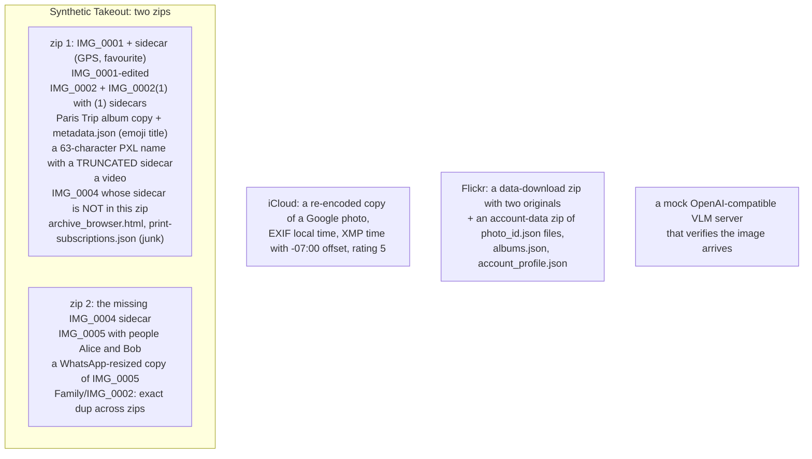
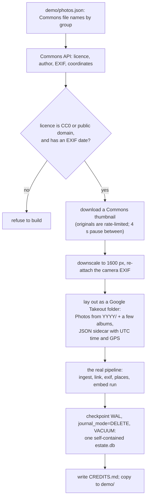

# 17. Tests and the demo library

Two things let anyone work on this project without a personal photo library: an end-to-end test that
builds a *synthetic* Google, iCloud and Flickr export on the fly, and a checked-in demo library of 104
public-domain photos that runs through the real pipeline. This chapter covers both, then the other
tools in `tools/`.

## The tests

| Test | Covers |
|---|---|
| `tests/test_poc.py` | The whole catalog pipeline on a synthetic Takeout, iCloud and Flickr export (below) |
| `tests/test_sync.py` | The change feed ([chapter 20](20-sync.md)): a device that pages through ends with the catalog's rows; deltas; deletions; resuming mid-way; restart; a lost feed file |
| `tests/test_upload.py` | Phone uploads ([chapter 24](24-uploading.md)): the inbox rules, then a photo and its sidecar through the real ingest and link; a second run adds nothing |
| `tests/test_intake.py` | The setup page's engine ([chapter 16](16-operations.md)): every practice source through the real pipeline, each way of signing in, wrong passwords and codes, cancel and retry |
| `tests/test_layout.py` | `/api/layout`: every photo's shape, in the order `/api/search` pages through them, for every order and view option |
| `tests/test_favorite.py` | Favourites set in the app: the row, the month's cover, the counts, the phone's feed, a reload, and taking it back |
| `tests/test_scores.py`, `tests/test_stacks.py` | Best first and stacks ([chapter 25](25-best-photos.md)) |
| `tests/test_aesthetics_judge.py`, `tests/test_aesthetics_taste.py` | The tools that made the scorers: the pairwise judge's queue and log, and the taste scorer's fit |
| `tests/test_albums.py`, `tests/test_changes.py` | Albums and change sets ([chapter 26](26-albums-and-agents.md)): sections, live albums, review, apply, revert; a hidden photo is in no view |
| `tests/test_mcp.py` | The MCP endpoint as an agent uses it: an agent can propose but not apply, and no answer carries a photo |
| `tests/test_connections.py` | Connections with the real app: `Connection: close` after an upload is honoured, a refused upload closes, a client's reset is not an error, and many uploads print no traceback |
| `tests/test_compare.py`, `tests/test_compare_app.py` | Comparing two models (`/compare`, [chapter 10](10-embeddings.md)): with the app's own model as the "second" one, both columns agree exactly and leave out photos with no second vector; filters narrow both sides; votes are recorded. In process (fast tier): no routes without vectors, a vote takes a member, 400 for bad numbers, 503 while the second model loads; a run from its first search to its report (an answer given again counts once, finishing needs every answer or `early`, the report is written into the run and as Markdown, the second model is let go), a run carried on after a restart or given up, the list of searches, the sign test and the verdict's words. `app/tests/compare-flow.test.js` holds the page's run to its steps, and `tests/test_pages_browser.py` goes through a whole run on the real page with the real model |
| `tests/test_pregenerate.py` | The image cache ([chapter 11](11-server.md)), on a few generated photos, no app: thumbnails are WebP and previews JPEG; an old JPEG thumbnail is served until its WebP exists, with no decode on the request; a photo needing both is decoded once; a full disk stops the previews; a call during a run makes it run again, and the run gives way between batches |
| `tests/test_tasks.py` | The agent on the library's computer, with a stand-in for Claude Code: it is started with every built-in tool off |
| `tests/test_photo_app.py` | The photo app in process (`PhotoApp` on the demo library, no subprocess, no model; [chapter 11](11-server.md)): who may do what (a login nobody has let in is refused every page, read and write, `/mcp` and the streamed download and video, and is shown the request-access page; it can ask, wait, be let in and turned off; a member may not open `/members`, intake or restart; this computer is the sysadmin; the demo's members by header and cookie, the Tailscale header ignored with `--demo`; a copy of the demo catalog served without `--demo` takes its members from `--upload-user` and `--sysadmin` on the first start only, and reads only the Tailscale header; a task records who asked for it), 400 for `limit=abc`, `cursor=x` and `/api/sync?limit=abc`, 400 for a body that isn't JSON or a `Content-Length` that isn't a number, 413 over the size limit, and the headers (ETag and 304, gzip) through a real server on a free port |
| `tests/test_lifecycle.py` | The background loaders (issue #82), with fakes and `threading.Event`s, no model: `Lifecycle`'s moves (an illegal one raises), a search model whose load raises answers at once (`ModelFailed`, 500) and one still loading answers after a bounded wait (`ModelLoading`, 503), also as an MCP tool error; a People loader that raises makes `/people` and `/api/people` say failed, not loading, and a failed reload keeps the loaded one; `/api/stats` never shows half of a measurement, the job reads the catalog inside the gate and drops numbers from a catalog replaced meanwhile; grouping unnamed faces swaps its result and state under the lock, and a failure is reported as `failed` |
| `tests/test_live_races.py` | The catalog being served, raced on purpose (issue #83), on the demo library with `threading.Event`s, no model: a value `Browse.remember` made while the catalog changed is not cached, and nothing cached is found once a new catalog is installed (`Live.generation`); a favourite set while a reload reads the catalog, and one that reaches the table after the reload and the swap, both end up in the new catalog's view and never in the replaced one, and one set while the looks are read again (`relook`) is not lost; `View.show_favorites` runs only on the gate's write side (`/api/favorite`, an album's favourite, a reload) and waits for a request that is reading; `Gate.swap` from inside the gate raises; `/api/albums/<id>/download?dl=1` holds no gate while other requests do |
| `tests/test_faces_consistency.py` | `faces.People` keeping memory, SQLite and the face journal in agreement (issue #87), on a five-face synthetic faces DB with the real schema, no model: a merge moves `face_later` and `face_not` rows to the kept person, deduped, in the database and in memory, and a fresh load reads what memory holds; a write SQLite refuses (a trigger that raises "disk is full") in a name, a forget, an undo, a page of `label-many`, a rename, a birth month or a merge leaves memory, the tables and the journal as they were and closes every connection; rename, merge and born records are journalled and folding the journal by name gives the names in the database; a request for a person that a merge deletes while the request waits for the lock (`threading.Event`) is a 404, not a `KeyError` |
| `tests/test_job_lifecycles.py` | The background jobs' lifecycles (issue #86), with hooks, `threading.Event`s and small child processes, no model and no app: an `IngestJob` step not in `MOVES` raises, `start()` is refused while a run is being followed and cancels an armed quiet timer, and `status()` copying the log while a line is appended is safe; a task cancelled between the worker's `SELECT` and its claim, or between the claim and the agent's start, never runs, and one cancelled as it completes (or while running) stays cancelled; a failed task's error has the whole of stderr (the reader is joined); the timeout kills an agent that ignores SIGTERM, as `core.procs.stop` does; `Tasks.update` refuses unknown columns; an intake job cancelled while queued is never claimed, `Store.move` refuses moves `JOB_MOVES` does not list, and a cancel kills a stage that ignores SIGTERM; the sync feed sends a current device no deletions, each deletion once over a many-page sync, and every missed one to a device that is behind |
| `tests/test_events.py` | The steps' event lines (issue #84, [chapter 16](16-operations.md)), no model: `core.events` round-trips progress and events with the version, reads a newer `1.x`, and returns `None` (without raising) for another major version, an unknown type and malformed lines; `IngestJob._follow` on a fake child reloads the catalog at `catalog_ready` before the run ends, also when the human lines are reworded, and does nothing for the old wording without the events, keeping event lines out of the page's log; the intake engine's bar follows a stage's `progress` events (through `Store.set`) and not its human lines, which go in the job's log; and the emitters on a tiny catalog in `tmp_path`: `estate.py` ingest/link (and exif with exiftool), `places.py`, `embed.py` and `faces.py` with nothing to do, and `ingest-iphone.sh` with faked `uv` and `sqlite3`, both alone and run by a real `IngestJob`; none of them prints a `@@pe` line unless asked |
| `tests/test_video.py` | Videos and Live Photos with no app and no model (fast tier), on small videos it makes with PyAV: which frames are read and that they come out upright, posters, which frames are kept, a video's rows, the Live Photo pairing rule (what marks a clip, which still it takes, what must not pair, running it again), and videos in a loaded catalog (best-frame scoring, no stacks, an incremental load) |
| `tests/test_video_app.py` | Videos in the running app over real HTTP (slow tier, needs the search model), on the library `tools/video_demo.py` builds: `/api/info`'s count and `kind`, a search finding a video at the right scene and saying when (`at`), Live Photos (the still's `live`, the clip in no list and playable at `/video/`), posters, `/video` with and without `Range`, "more like this" from a video, `kind` for an agent, `embed.py stats` |
| `tests/test_video_browser.py` | Videos and Live Photos on the page, in a real browser (slow tier; below) |
| `tests/test_members.py` | `members.py` on a scratch catalog: looking a login up (lower-case), the first start from `--upload-user` and `--sysadmin` (only while there are no members), asking to be let in (once), approving, revoking, a role, a policy, a name and a person, each with its journal entry in the same transaction; a refused change (an unknown value or person, or no active sysadmin left) changes and journals nothing; the demo's three members |
| `tests/test_lenses.py` | `lenses.py` on a scratch catalog, with no app: which filters are on for whom (own, a published one subscribed to live, estate defaults unless opted out or taken as a snapshot, a series never), what they hide (a set from before lenses hides for everyone; "show it anyway"), whose favourite a source's word is (a photo's sharers; with no sharer, the first sysadmin; the old `favorites` table, the sysadmin's), every write and what it refuses (someone else's lens, an unpublished one, your own, a bad mode, unpublishing an estate default, deciding as a member or deciding nothing), a snapshot that does not follow and a live subscription that does, an album published as a series, one journal entry per write and none for one that changes nothing, and `why` |
| `tests/test_multiplayer.py` | What each member sees, on the demo in process as Ada (sysadmin), Ben and Cleo: Ben's filter hides for Ben only, in search, `hidden=1`, facets, Years and Months (counts and covers), trips (count and cover), `/api/info`, his sync feed (made on his first ask) and the MCP tools, while Ada and Cleo see it; a change set is its owner's; an estate default hides for all until Cleo opts out (and People is built without it); a proposed filter becomes an estate default only when a sysadmin accepts; a snapshot does not follow the lens and a live subscription does, and an unpublished lens hides nothing for its subscribers; an album is its owner's, a published series of Ada's or Cleo's shows Ben only what his filters let through (search, the album's photos, its download, `get_album`), a series' snapshot copies what Ben sees; favourites per member (rows, `is:fav`, `/api/info`, the feed, the MCP tools; `favorites` no longer written); a stack whose top shot Ben hid shows him the next while Ada sees all three; a task acts for the member who submitted it (it searches as Ben, its album is Ben's, its writes are journaled acting for him); "show it anyway" and `why`; People's lists through a member's filters; a catalog from before `estate.py migrate` and the migration (twice). And `test_no_route_reads_a_mask_but_through_visible_for`, which reads the route modules' code: no `cat.visible` (or the other arrays a View holds), no View made but by `Catalog.view` for `Live.visible_for`, no favourite read from a photo's facts, no reading of the `hidden` table outside changes.py, lenses.py and faces.py; since phase 5 it also refuses reading the `private` table outside private.py, faces.py, member_inbox.py and stats.py, and checks that every route of `Images.handle`, `video_file` and a face crop ask whether the member may be shown the photo |
| `tests/test_tombstones.py` | The phone gate's tombstones (phase 6), on the demo in process as Ada, Ben and Cleo: `GET` and `POST /api/tombstones` are each member's own (a lift by anyone else changes nothing), journaled once a call, lifted and opted out again; an upload with no hash is read, hashed and dropped from staging (nothing in the inbox, nothing prepared from it) while Cleo's copy of the same bytes is stored; with `X-Content-SHA256` the body is never read (a body that fails if read, and over a real socket a request that sends no body at all is answered); a purge refuses everyone both ways and is never lifted, nor by lifting an opt-out of the same bytes; an old phone's upload with no new header is as before; `X-Screenshot` reaches the sidecar and ingest, and `private.py check` holds that photo though its vector looks like a landscape, letting the same kind of photo without the mark go |
| `tests/test_private_states.py` | One `private` row on a scratch catalog: the seven ways `specs/PrivatePhoto.tla` found it could end up against its sharer's word, replayed on the real code. A release day set, or `private: true`, on a photo not checked yet (it is withdrawn, and `check` neither lets it go nor holds it); a photo released while `check` scores it (not held, and its row kept when let go); a photo withdrawn while `library` scores it; a day cleared as the timer fires. The sharer's request lands on a connection of its own, where `judge()` would be scoring |
| `tests/test_lens_states.py` | A lens, a subscription to it and an album's series rows on a scratch catalog: the eleven ways `specs/Lens.tla` found them going where nobody asked, replayed on the real code, and the normal path as a control. A proposal taken back, or declined by another sysadmin, as a sysadmin accepts it (accepted all the same); taken back as one declines it (an entry for nothing); an estate default unpublished as it is accepted; a filter proposed twice at once with the acceptance between (an estate default waiting to be decided); a filter taken back as it is proposed (the sysadmins' items left open); published twice at once, or subscribed to twice at once (two entries each); an album published twice at once (two series rows, one of them out of its owner's reach once it is taken back); a member leaving a filter as it becomes an estate default while another of her requests takes it back (she is left in, and still told). Each request runs on a connection whose other request lands just before its first write, or its taking the write lock |
| `tests/test_change_set_states.py` | An album or change set, its photos, its series row and its inbox items on a scratch catalog: the seven ways `specs/ChangeSet.tla` found them going where nobody asked, replayed on the real code, and the normal path as a control. A series with new photos waiting put up for hiding, applied and committed, then given the new photo from the inbox (a set stored as done with a photo not as marked); a series with new photos waiting put up for hiding, or away (its item left open, for no series); a published series put up for hiding, or away (published, and out of its owner's reach); the series of an album up for hiding or put away published by the lens's own route; the series listener opening an item for an album made no series while its search ran; a hide or discard going by what it read while a publish, or the listener, lands. Changes.write runs on a connection (a `GapChanges`) whose other request lands just before its first write, or its taking the write lock; so does the listener |
| `tests/test_inbox_states.py` | The inbox items about one thing, on a scratch catalog: the six ways `specs/InboxItem.tla` found an item open about nothing, done with a question still waiting in it, or put away once decided, replayed on the real code, and the normal path as a control. A sysadmin made a member, or revoked, keeping the member_request and lens_proposed items nobody lets them decide; a filter or a series taken back (by `publish` or `publish_album`) leaving its subscribers' lens_changed items open, about a lens they can no longer see or leave; two reads of one inbox at once each opening an item for one group of questions (the second empty, never shown, never done); a question joined to an item answered and done meanwhile; an item opened for a question dealt and answered meanwhile; a dismiss writing over an item decided as it was asked. Each racing request runs on a connection whose other request lands just before its first write (by `execute` or `executemany`), or its taking the write lock |
| `tests/test_question_states.py` | A question and whom it was dealt to, on a scratch catalog: the way `specs/Question.tla` found a question put away could stay waiting (a question item dismissed from the inbox page, its questions neither answered nor put away, shown nowhere, never dealt again, and one to her alone never closed), replayed for a question to her, one to the family and both in one item; and, as controls, a question's normal life (dealt, answered, put away, answered after all), an answer told while another tab says "I don't know" in its gap, one follow-up run per story however often its journal entries are handled, and `QUESTION_MOVES` against the model's moves |
| `tests/test_member_states.py` | Who is let in, on a scratch catalog and through the real app: the seven ways `specs/Member.tla` found a member or their agent's binding left other than as last said, or a request let through on what the catalog no longer says, six of them races, replayed on the real code, and the normal path as controls (a member's life on `/members`; a revoke refused at once on the next request, a page and `/mcp` too). Two changes of one member at once, each writing every field from what it read (a revoke undone by a rename, a role change by an approval, an approval by a rename: pending again, with no `joined_at`); the roster read again by two requests at once (a newcomer asking in while Ben is revoked: Ben let through; Ada made a member in one tab while she renames Cleo in another: still a sysadmin to the app), replayed with `load_members` held between its read and its assignment while the other request runs on a thread of its own; two requests to be let in from one login through the app's HTTP server (the first answered with a dropped connection); an allow and two turn-offs of one binding at once (allowed, with the last answer revoked). With no bad timing, through the app as a real one (Tailscale's headers, a whois the test gives): an agent refused when it allows itself from its own laptop, named by whois when it connected and not when it allows, the other way round, or by neither and from its IPv4 and then its IPv6 address; and, as controls, one allowed from the kid's phone, a second entry when the laptop is named after connecting unnamed (the first never allowed, and turned off from anywhere), a request naming no device refused an allow, and the demo's devices allowing each other. And, as they are, what the model shows is the owner's to decide: a revoked member's approved agent refused while they are and back with them, a run of the estate's agent going on for a member revoked meanwhile, and any status after any other |
| `tests/test_reload_states.py` | What the running app holds in memory from the catalog and how it is replaced, on the demo in process as Ada, Ben and Cleo, with real requests: the five ways `specs/Reload.tla` found memory left other than as the catalog says, each a race placed with `threading.Event`s (a relook held between its read and its install while Ben's phone upload is ingested, checked and reloaded: held, it is shown to Ada and Cleo in search and their feeds; let go, to Ben alone; a `/api/stats` between a relook's swap and its letting go of the numbers; two calls of `reload_catalog`, the second failing, leaving `fresh` false; `settling` left at one when the thread cannot start), and the normal path as a control. Then what is, for the owner: a relook that raises after its commit leaves the photo shown, a reload that raises is not tried again, and, with real threads, a request waiting on the ingest's write lock inside the gate holds up every request (`specs/ReloadLocks.tla`); and a favourite, a relook and a reload at once all finish |
| `tests/test_people_states.py` | Who each face is, in the catalog and in the People page's memory, on the demo in process as Ada, Ben and Cleo, with made-up faces (vectors, no face model) written onto the demo's photos in the scratch catalog: each way `specs/People.tla` found the two parting while People loads again, a step held with `threading.Event`s (the load held after its read while Ada names a face: the load's rescore or Google's tag writing over her word, or her "not Quinn"; the new People swapped in without her name; her request held between taking the People and its lock while a load swaps the next in, for a name, a page of names and a rename; a person she makes with a tag's name failing the load), a group named from a page the People before showed (the new one still grouping, or grouping six new faces first), a photo made private or released while a reload takes it in, and that nobody else is shown a face of a photo made private before People loads again; the normal path as a control. Then what is, for the owner: a load or a grouping that fails is not tried again, and a face id a purge freed is the next scan's |
| `tests/test_phone_replica_states.py` | A member's change feed and their phone's copy of the catalog, on the demo in process as Ada, Ben and Cleo, with a phone that pages and applies as `SyncEngine.run` and `Catalog.apply` do: each way `specs/PhoneReplica.tla` found the phone sent or left other than what its member sees, a step held with `threading.Event`s (a photo made private, the feed not yet told, sent in a page; the thread that tells the feed held between its read and its write while the photo is let go again, so it is taken off the phone for good; a reload of a catalog without a photo, its feed not yet told, and a cursor past its row; a favourite waiting for `fav_write` while the member's first phone makes their feed; one set while a feed is read after a start; one whose answer is held while the member's laptop takes it back); the normal path, and a member's first two phones at once, as controls |
| `tests/test_specs.py` | TLC on every TLA+ model in `specs/`: `<Name>.cfg` (the code as it is) keeps every invariant, and each `<Name>.before.<invariant>.cfg` (the code before a fix) still breaks its own. Skipped without Java or `tla2tools.jar` (`~/.local/share/tlaplus/`, or `TLA2TOOLS`); CI fetches the jar and fails if the models were skipped |
| `tests/test_machines.py` | `specs/machines.toml`, the register of every state machine, held to the code: every status-like column of the schema and every state enum of `core/` is claimed by an entry; the modules whose SQL writes a machine's tables are the ones registered (a new writer fails); the functions a model stands for have the fingerprint its entry is stamped with (a change fails, and says which model to read); a table of moves has one writer; and the list of machines with no model only gets shorter |
| `tests/test_private.py` | Private photos (phase 5), on the demo in process as Ada, Ben and Cleo: every rule of who may be shown a photo with one, two and three sharers (and acting for nobody); a photo shared by Ben and Cleo and withdrawn by Ben is shown to all, by both to those two; for a held and a withdrawn photo, every way out as its sharer and as anyone else (search, `is:private`, facets, `/api/info`, trips, Years and Months, `hidden=1`, `why`, similar as a subject and as a neighbour, `stack`, an event or trip only it is in, a person's name and a place only it carries, every pixel route, show anyway, favourites, albums, a series, their zip, a hiding set's review page and check, the sync feed, the MCP tools); over a real HTTP server, Cleo asking every pixel and metadata route of Ben's private photo, its Live Photo clip and a face crop gets exactly what a sha (or a face) that does not exist gets; People built without private photos and following a release; release now, on a day (the timer on a fake clock) and from the held view, and the held item closing; an agent acting for Cleo and for nobody, and a task's record kept to its member; ingest (two members sending the same bytes: one photo, two sharers; the old inbox layout as the sysadmin's; a member folder no album; a reload, and a restart, before the check shows no one else a new upload; the check holding the receipt for both its sharers); the hold's prompts and the demo, which it holds nothing of; the one-off run's dry run (nothing changed, no file names) and its second run; the review of held photos (`/held`): every held photo listed whatever the view options, stacks or hides, in its sections and order, "reviewed up to here" releasing only what was marked and never a photo held since, the held inbox item's life (one item, how many wait, done when none does), a photo kept still private, and every private route answering a stranger, another member and the agents alike; and, slow, the model's own vectors of the prompts and made receipts, screenshots and documents held, and a review of 8,000 held photos (measured: under a second to list, in order, and to look over in three stretches) |
| `tests/test_journal.py` | `journal.py` and the entry each write appends: an entry goes with its caller's transaction (or not at all), `since` reads in order, the table refuses `UPDATE` and `DELETE`; on the demo in process, a change set's whole life as Ben (made, marked, applied as one entry for ten photos, committed, reopened, reverted, a photo taken out, renamed, a plain album again, made favourites, discarded) is one entry per step that changed something, each naming him, and an MCP tool writes as the member that called; discarding marks the set (its rows kept, in no listing, 404 at every address, its id never reused); tasks journal who asked and how each ended (cancelled by whom, done, failed at a restart); People's names, forgets, laters, renames and merges are one entry each beside `face-labels.jsonl`, and a write SQLite refuses journals nothing |
| `tests/test_append_only.py` | Append-only, on scratch catalogs and stores with `estate.py` run as a command: every protected table refuses a `DELETE` and a change of key and lets the columns ingest, link, embed and members.py correct be written; a scratch copy of the demo catalog with the triggers added links and loads as the original does (the original unchanged); a Takeout zip, an iCloud folder, the OneDrive mirror and the phone's inbox that each lose a file change nothing in the catalog or the store; ingest sets the immutable flag only in a store marked `.immutable`, never in the demo store, and keeps a file already in the store (macOS: skipped where there are no file flags); `purge` needs a reason, backs up, journals, tombstones, removes the rows, the file and its cached copies and puts its triggers back, and no source brings the photo back; `migrate` gives every photo without a sharer the sysadmin, once |
| `tests/test_http_util.py` | `http_util.py`: `Response` can't be changed, `int_param`, `byte_range` (what a `Range` header asks for, and when it is a 416), bounded bodies, the auth rules for each kind of caller; months outside 1-12; intake's `job` and `after`; the setup server's 400 and 413 |
| `tests/test_core.py` | `core/` (issue #85): every module's file types are what they were, from one list; `GET /original/<sha>` answers 200 with the right `Content-Type` for `.heif`, `.tif`, `.tiff` and `.avif`; fresh databases from every open path match `tests/fixtures/schema_baseline.json` (captured from the code before), an old `change_sets`/`change_items` gains its columns with its rows kept, a copy of the demo catalog only gains tables, and `favorites` exists once the app opens (the baseline also holds what has been added since: the members area and `agent_tasks.acting_for`, then `sharers`, `tombstones` and the protected tables' triggers); the default ports are distinct and the task agent's MCP URL follows the app's port; the screenshot cases in `tests/fixtures/screenshot_rules.json`, and that `Screenshots.swift` lists the same screen sizes |

Every test is a script that runs on its own (`uv run tests/<file>` from `photo-estate/`), needs no
network, account or model download, and works on a scratch copy, so the checked-in demo library never
changes. All sixteen take about a minute together.

## Models: every order of events, not only the ones tested

A test checks the cases someone thought of. For state that several things write at once (a request, a
background job, a script in another process) the bugs are in the orders nobody thought of, so that state also
has a small model in `photo-estate/specs/`, written in TLA+, with the rules that must always hold for it. TLC,
a model checker, visits every state the model can reach and prints the shortest sequence of steps that breaks
a rule. Each such sequence is then replayed on the real code as a test that fails, the code is fixed, and the
model of the fix is checked again. The first, `PrivatePhoto.tla` (one row of the `private` table and its four
writers), found seven ways a photo could end up against its sharer's word; `tests/test_private_states.py` is
those seven. The second, `Lens.tla` (a filter lens, a subscription to it and an album's series rows, with the
owner, two sysadmins and a member writing at once), found eleven, every one a race between two requests;
`tests/test_lens_states.py` is those eleven. The third, `ChangeSet.tla` (an album or change set, its photos, its
series row and the inbox items about it, written by its owner through `changes.py`, by `lenses.py` and by the
series listener), found seven, six of them with no bad timing at all (five in an order the page itself offers);
`tests/test_change_set_states.py` is those seven, and the races the fix had to close. The fourth, `InboxItem.tla`
(the inbox items about one thing, of five shapes: a request to be let in, a lens proposed and followed, questions,
held photos and an agent's binding, with each writer of them), found six: two with no bad timing (a sysadmin who
stops being one, a lens taken back) and four races (`stories.deal` and `member_inbox.dismiss` read before they
take the lock); `tests/test_inbox_states.py` is those six. The fifth, `Question.tla` (two questions, one to a
member and one to the family, the asked rows that deal them, the members' items within their allowance, and the
run an answer starts), found one, with no bad timing: a question item put away from the inbox left its questions
waiting in it, shown nowhere and never closed; `tests/test_question_states.py` is that one, beside the orders
that must keep working. The sixth, `Member.tla` (a member, a newcomer's login and a member's own agent's binding,
with where each is read to let a request through: the roster the app keeps in memory, the route's gate on it, the
binding read on every call, whois's name for a device and a run's token), found seven: six races (two changes
of one member undoing each other, two loads of the roster leaving the older one in place, so that a member revoked,
or a sysadmin made a member, was let through as before until the next change; two requests to be let in from one
login; an allow and a turn-off at once) and one with no bad timing (an agent allowing itself from its own device,
named by whois for one of the two requests and not the other, or for neither, from its two addresses);
`tests/test_member_states.py` is those seven, and shows three things the code does that are the owner's to decide.
The seventh, `Reload.tla` (everything the app holds in memory from the catalog, and every thread that replaces it
while requests are served: an ingest run in its own process, the reload's loop, a relook after a member's commit, a
change set's thread, a favourite), found five, four of them races: a relook that read the looks before an ingest's
commit and installed them after its reload, so a held phone upload was shown to everyone (or one let go shown to
its sharer alone); Admin's `/stats` numbers let go only after a relook's swap; one reload clearing `fresh` as
another began that then failed; and `settling` left at one for ever when a thread could not start.
`tests/test_reload_states.py` is those five, and shows what the owner has to decide (a relook or a reload that
raises is not tried again). With it, `ReloadLocks.tla` (the catalog gate, `fav_write` and SQLite's write lock
among the same threads) finds no deadlock, before the fix or after, and shows the whole app waiting while a request
inside the gate waits on the ingest's write lock. The eighth, `People.tla` (who each face is, in the catalog and in
the People page's memory, while a new People loads beside the one answering; a member's change, a group named from
the page, and what People is built without against the looks), found five: a load writing its own name over one a
member gave while it loaded, the People swapped in without that name, a name written to the People just replaced (so
a named face was shown among the unnamed), a page's group named in the next People (another group, or none) with no
bad timing at all, and a private change taken in by a reload so that People was not loaded again.
`tests/test_people_states.py` is those five and three more found replaying them, and shows what the owner has to
decide (a load of People that fails is not tried again). The ninth, `PhoneReplica.tla` (a member's change feed and
their phone's copy of the catalog: the threads that tell the feed after a relook, a reload or a start, a favourite's
touch and answer, the route and its pages, the phone's sync and its kept favourite, a restart that keeps or loses the
feed's file), found six: a photo made private sent to a phone before its feed was told (the route asked only whether
the catalog had it); an older view written over a newer one, so a photo its member sees never reached the phone; a
cursor past a row the phone was never sent; a favourite set as the member's first phone made their feed, or before a
feed was ready after a start, never reaching the phone; an answer that said what was asked rather than what the photo
was, which the phone kept; and, on the phone, a page asked before a favourite it kept applied over it.
`tests/test_phone_replica_states.py` is the server's five, with a phone that pages as `SyncEngine` does, and
`ios/Tests/run-replica.sh` the phone's. [specs/README.md](../../photo-estate/specs/README.md) says when a change needs a model, how to
read one, how to run TLC, and what a model does not tell you.

## One command: pytest, ruff and CI

The scripts also run under [pytest](https://pytest.org), with one command and one summary, and the
fast ones run in CI on every pull request. Nothing about the scripts changed for this:
[`tests/conftest.py`](../../photo-estate/tests/conftest.py) collects each script in its `LEGACY` list
as a single test that runs the whole script in a subprocess and passes when it exits 0; a failure shows
the exit code and the script's last lines. Any other `test_*.py` is an ordinary pytest file, like
[`tests/test_harness.py`](../../photo-estate/tests/test_harness.py), which checks the runner itself (a
script that fails is reported as failed, a slow one is left out of the fast tier, no script is missing
from the list) and that the modules the light entry points import load no torch, transformers or
onnxruntime. `tests/test_photo_app.py`, `tests/test_http_util.py`, `tests/test_core.py`, `tests/test_compare_app.py`, `tests/test_lifecycle.py`, `tests/test_live_races.py`, `tests/test_faces_consistency.py`, `tests/test_job_lifecycles.py`, `tests/test_events.py`, `tests/test_pages.py` and `tests/test_video.py` are native too, and in the fast
tier: they build the app in process instead of starting it. So is `tests/test_types.py`, which checks the
typed contracts below: `Catalog`'s fields, a demo catalog's types with and without scorers, the state
enums against the strings already on disk and on the wire, and pyright itself.

```bash
cd photo-estate
uv run pytest -m "not slow"        # the fast tier, what CI runs: 8 scripts + the native tests, about 40 s
uv run pytest                      # everything (HF_HUB_OFFLINE=1 is set for each script)
uv run pytest -m "server and not model"   # the app tests that work without the search model
uv run pytest --legacy-runner=uv   # each script with `uv run`, in its own PEP 723 environment
uv run ruff check .                # lint: syntax errors and pyflakes (unused imports, undefined names)
uv run pyright                     # type check: every module of the app, basic mode, no errors
uv run tests/test_poc.py           # one script on its own still works exactly as before
cd app && npm ci                   # once: TypeScript, for the web pages' script modules (Node 22)
npm run typecheck                  # their JSDoc types: tsc --noEmit --allowJs --checkJs
npm test                           # their unit tests: node --test, under a second, no browser
```

Each script is marked with what it needs (`pyproject.toml` declares the markers):

| Marker | Scripts | Why |
|---|---|---|
| (none: the fast tier) | `test_poc`, `test_upload`, `test_intake`, `test_sync`, `test_scores`, `test_stacks`, `test_aesthetics_judge`, `test_aesthetics_taste` | Need numpy, Pillow and pillow-heif (the dev group) and `uv` |
| `slow`, `server` | `test_changes`, `test_favorite`, `test_layout`, `test_tasks`, `test_mcp` | Start the real app (`uv run embed.py serve --demo`), whose environment has torch and transformers: gigabytes on a fresh Linux machine. `test_mcp` waits two minutes for a search without the model |
| `slow`, `server`, `model` | `test_albums`, `test_connections` | Also need the SigLIP 2 model in the Hugging Face cache: a text search, and uploads embedded as they arrive |

`tests/test_pages_browser.py` is `slow` and `server` too, but an ordinary pytest file, not a script: it
needs a browser as well, and skips without one (see "The pages' script modules" below).
`tests/test_video_app.py` and `tests/test_video_browser.py` are ordinary pytest files marked `slow`,
`server` and `model`: each builds `tools/video_demo.py`'s library in a scratch folder (about 30 s, with
the search model) and starts the app on it, never on `demo/`.

By default pytest runs each script with its own Python, the environment `uv sync` builds from
[`pyproject.toml`](../../photo-estate/pyproject.toml) and its lockfile
[`uv.lock`](../../photo-estate/uv.lock), so the fast tier uses exactly the pinned versions. The
manifest is not a package (`package = false`) and adds nothing to running the app: a script with a
`# /// script` header still builds its own environment from that header. Its dependency groups follow
the headers:

| Group | For | Packages |
|---|---|---|
| `core` | `estate.py`, `scores.py`, the fast tests | numpy, Pillow, pillow-heif |
| `ml` | `embed.py` and the search model | core, torch, transformers, sentencepiece, protobuf, av (PyAV: a video's frames) |
| `faces` | `faces.py` | core, onnxruntime |
| `places` | `places.py` | core, reverse_geocode, timezonefinder, pycountry |
| `tools` | `tools/` (the book, benchmarks, screenshots, the aesthetics experiments) | markdown-it-py, mdit-py-plugins, Pygments, httpx, requests, Playwright, SciPy, scikit-learn |
| `dev` (installed by default) | pytest, ruff and pyright | core, av (`tests/test_video.py` makes its own small videos), pytest, ruff, pyright |

`uv sync --group ml --group faces --group places` installs everything the server can use. After
changing a group, run `uv lock` and commit `uv.lock`; `uv lock --check` says whether it is current.
The manifest's `requires-python = ">=3.11,<3.14"` is the narrower of the two bounds the headers use,
since torch and onnxruntime need the upper one.

[`.github/workflows/ci.yml`](../../.github/workflows/ci.yml) runs on every pull request and every push
to `main`, on Ubuntu with Python 3.12: `uv lock --check`, `uv sync --locked --group dev`,
`ruff check .`, `pyright` and `pytest -m "not slow"` (with exiftool installed, so `test_poc` checks EXIF
too), then, with Node 22 in `photo-estate/app`, `npm ci`, `npm run typecheck` and `npm test`
([below](#the-pages-script-modules)). It never downloads the model and never reaches the Mac mini or a real library. The slow tests are
left out on purpose: they need the ML stack (run `uv run pytest` on a machine that has it). Ruff's rules
are kept to syntax errors and pyflakes, and `ruff format` is not enforced: the code has its own compact
style.

### Type checks

[pyright](https://github.com/microsoft/pyright) checks every module of the app (the folder's scripts,
`core/` and `intake/`; not `tests/`, `tools/` or `demo/`) in basic mode, configured in `pyproject.toml`'s
`[tool.pyright]`, and CI fails on any error ([issue #90](https://github.com/jflam/photo-estate/issues/90)).
What makes that worth having is that the contracts between the modules are typed:

- `catalog.Catalog` is a slotted dataclass with every field and its type, `None` included where a
  field can be missing: `best`, `rank` and `score` are `None` in a catalog with no scorers, and
  `Catalog.scored()` hands out all three or raises. A route that reads a field that isn't there, or
  uses `rank` without checking, is a type error, not a crash in production ([chapter 5](05-catalog.md)).
- A photo's dict is `catalog.PhotoMeta`, a TypedDict: still a plain dict on the wire, but its keys and
  which of them may be absent are written down.
- The finite string domains (a change set's op, status and state, a reviewer's decision, a task's status,
  the ingest's state, an intake job's state, the People page's clustering) are `StrEnum`s in
  [`core/states.py`](../../photo-estate/core/states.py), each value the string already in the catalog,
  intake.db and the JSON API, so nothing stored or sent changed.
- The MCP endpoint's `app` is a Protocol (`estate_mcp.App`), which PhotoApp fills with an `AppFacade`;
  a request's headers are `http_util.Headers` (a dict, or the handler's `Message`).

The optional groups' packages (torch, transformers, onnxruntime, reverse_geocode, timezonefinder,
pycountry) are not in the dev environment, so their imports carry a narrow
`# pyright: ignore[reportMissingImports]`. The `pyright` package fetches its own Node.js the first
time it runs.

### The pages' script modules

The script the web pages share is a set of native ES modules in
[`photo-estate/app/`](../../photo-estate/app/) ([chapter 2](02-code-tour.md#the-web-pages),
[issue #89](https://github.com/jflam/photo-estate/issues/89)). They are checked in two ways, neither of
which needs a browser or builds anything:

- **Types.** The modules are JavaScript with JSDoc annotations; `npm run typecheck` is
  `tsc --noEmit --allowJs --checkJs` with `strict` on, configured in
  [`app/tsconfig.json`](../../photo-estate/app/tsconfig.json). The pages' own inline scripts, the tests and
  the service worker are left out. TypeScript is the only package
  ([`app/package.json`](../../photo-estate/app/package.json), pinned, with its lockfile); it checks, it
  compiles nothing, and no part of it reaches the browser.
- **Unit tests.** [`app/tests/*.test.js`](../../photo-estate/app/tests/) (215 tests, under a second) run
  under Node's built-in runner (`npm test`, which is `node --test`): `esc` against text that would break out of an attribute; `api`
  against a stub `fetch` for every way a request ends (JSON, an error with a JSON body, an error
  without, no answer, a timeout, a cancellation); the state machine's legal and refused steps;
  `latest()` dropping the answer to a question that was replaced; `poll()` stopping at its bounds, when
  cancelled, and riding out as many failures as it is told to; the toast against a stand-in element; the
  search question to its address and back; and the grid's rows. The modules behind the secondary pages
  ([issue #80](https://github.com/jflam/photo-estate/issues/80)) are tested the same way, with requests
  the test settles and timers it fires by hand (`tests/helpers.js`): a newer review choice survives a
  failed save and is what the retry sends, and saves never overlap or reorder (`save-queue.test.js`); a
  busy flag is cleared by a failed save, and a batch that fails midway says what was applied
  (`work.test.js`); the wait for the unnamed faces stops on `failed`, at its bound and when cancelled
  (`people-flow.test.js`); `settle` stops at its bound and on abort, and a failed mark is put right from
  the server (`changes-flow.test.js`); the stats loop never has two requests in flight and shows a 500
  as an error (`stats-watch.test.js`); `loop()` under every interleaving of start, stop, pause and now
  (`loop.test.js`); the setup machines take every step in their tables and refuse every other
  (`setup-flow.test.js`); and the `/members` page takes one change at a time, puts the server's answer
  in place of the one member it changed, goes back to the members as they were when a change is refused,
  and offers each member what its status allows (`members-flow.test.js`); the `/inbox` page puts one item
  away at a time, goes back to the items as they were when that is refused, and says what each kind's
  button does (`inbox-flow.test.js`). The photo app's machines
  ([issue #81](https://github.com/jflam/photo-estate/issues/81), [chapter 13](13-photo-app.md#the-machines))
  are tested the same way. `machines.test.js` tries every pair of states of every table: the steps in
  the table are taken, every other pair throws a `TransitionError` and leaves the machine and its data
  as they were. `grid-flow.test.js`: a question edited while its answer is on its way shows only the
  new question's photos and aborts the old request; a month's answer that arrives after the month
  changed is dropped; the retry timer of a list that was replaced or cleared is cleared, and does
  nothing if it fires. `library-flow.test.js`: the library asked twice shows the second answer; a
  failure with the months known keeps them; and every view switched faster than the server answers
  (library, month, album, search and back) ends with only the last of each drawn, everything
  superseded aborted, and no machine throwing. `albums-flow.test.js`: an album from a search that is
  cancelled by moving on asks for no further page and makes no album, and one left to finish has the
  name and note given at the start. `favourite.test.js`: a double toggle, a toggle during a save,
  answers out of order and a failed save all end on what was last asked for, or put back; an album's
  "make all favourites" waits for a heart's save, is followed by a heart pressed meanwhile, and puts
  back only what it changed when it fails.
  `viewer-flow.test.js`, on a model of the browser's history: open, next and previous, close; close
  while still opening; the close button against the Back button; the one-second fallback when the
  browser never reports the entry gone; and that nothing the viewer knew survives `closed`.
  `video-flow.test.js`, on a stand-in for a `<video>` element: a video plays from `/video/<sha>` with the
  search's `at` as `#t=`; every way out of `video` or `live` (the next photo, closing, LIVE let go, the
  clip's end) releases the element (no `src`, `load()` called), so two videos never hold a stream at
  once; an `error` from the playing video is `failed`, one from a Live Photo's clip goes back to the
  still, and one from an element already let go changes nothing; LIVE pressed on a video does nothing,
  and a video's end leaves it where it ended; a browser that refuses sound plays it muted; and Space plays and pauses only a video.

On the Python side, `tests/test_pages.py` (fast tier) holds the two together: every page imports only
modules that are served and names they export, no page has grown its own copy of `esc` or `api` again,
and the photo app and the setup server send the modules as `text/javascript`.

`tests/test_pages.py` also refuses a `fetch()` or a `setInterval()` in the secondary pages: they ask
the server through `api.js`, `loop()` and `poll()`. And it holds `search.html` to issue #81: every
`machine()` in it is strict, nothing branches on the result of a step, and the variables that used to
sit beside the machines have not come back.

**In a browser.** [`tests/test_pages_browser.py`](../../photo-estate/tests/test_pages_browser.py)
(slow tier) drives the secondary pages with Playwright and makes their requests fail or never end with
request interception (`page.route`), moving the page's own clock forward (`page.clock`) where a bound is
minutes away: on `review.html` a choice made while a save is failing is the one saved; on `people.html`
Save works again after a 500, a batch that fails midway leaves the page in step with the server, and
the wait for the unnamed faces ends on `failed`, on a change of view and after ten minutes; on
`changes.html` a library that never settles is given up on after two minutes with a way to check again,
and a refused mark is put back from the server; on `stats.html` a 500 is an error and the page never has
two polls in flight. On `search.html` (issue #81) requests are held back and let go after the person has
moved on: a question edited while its answer is on its way shows only the new question's photos; an
album being made from a search is not made (no `POST`, no further page of the search) after a change of
tab or of question, and left to finish takes its note from the moment it was asked for; a double click
on the heart ends off, with `fav: true` then `fav: false` sent, and a save that fails is put back and
said; an album's "Make all favourites" shows at once, a heart pressed while it is held is sent after it
and stands, and one the server refuses is put back; the viewer opened and closed quickly with Escape, Back and Forward leaves the address right and
the page usable; and a hundred actions across every view, each answered a few actions late, throw
nothing. The page under test has no service worker (`service_workers="block"`): a request that passes
through one is not seen by `page.route`. Each test starts a real server (`embed.py serve --demo`, `estate.py review`,
`faces.py serve`) on the demo library or a scratch copy of its catalog (the People page's copy is given
synthetic faces, since the demo has none), and fails on any uncaught error or console error in the page.
Playwright is in the dev group; the tests use its own Chromium if it has one
(`uv run playwright install chromium-headless-shell`), else any Chromium already in Playwright's cache,
and are skipped when there is none. CI does not run them (they are slow, and it has no browser).

```bash
uv run pytest tests/test_pages_browser.py     # about 45 s once the servers' environments exist
```

**Lenses in a browser.** [`tests/test_lenses_browser.py`](../../photo-estate/tests/test_lenses_browser.py)
(slow tier) uses them as the demo's three members, each a browser of its own (`X-Demo-Member`), on one
demo app: Ben hides two photos on the review page (told they are hidden from him, and through which lens)
and they leave his library only, while Ada is told his set is not there; Ben's **See them** lists them, the
viewer says why one is hidden, **Show it anyway** shows it and **Hide it again** takes that back; Ben
publishes his filter and Cleo subscribes, keeps a copy instead (a later hide of Ben's does not reach her),
subscribes again and unsubscribes; Ada publishes an album and Ben opens the series (without the photo he
hid) and subscribes; Ada hides a photo from everyone with the review page's choice; Ben proposes his
filter, Ada makes it an estate default, Cleo opts out; and the Library's menu names the member and offers
Members to a sysadmin only.

**The inbox in a browser.** [`tests/test_inbox_browser.py`](../../photo-estate/tests/test_inbox_browser.py)
(slow tier) does the same for the inbox, with a stand-in for Claude Code (`--agent-cmd`, as
`test_tasks.py` has): a stranger asks to be let in and is told Ada has been told; Ada's Library menu shows a
count, her inbox the request, which opens `/members`, and letting them in closes it; Cleo subscribes to
Ben's published filter, Ben hides more twice and Cleo's inbox says so once, opening it puts it away, and the
next one she dismisses; Ben proposes his filter and Ada decides it from her inbox; a task Ben submits ends
with a change set that is in Ben's inbox only and closes when he applies it; and a hiding set's photos in
Albums say whom they are hidden from. The server's half, kind by kind, is `tests/test_member_inbox.py` on a
scratch catalog and the inbox tests of `tests/test_multiplayer.py` in process.

**Private photos in a browser.** [`tests/test_private_browser.py`](../../photo-estate/tests/test_private_browser.py)
(slow tier), as Ben and Cleo: Ben withdraws a photo he shared from the viewer's details, the private line says
so and Cleo's library (and its thumbnail) loses it; he sets the day it is released on from the menu over the
viewer, then releases it, and Cleo sees it again; his held view (Search for `is:held`) marks the two photos
held for him, says how many are held and leads to `/held`, has no "Release all", and he chooses one and releases
it, then the other, and the inbox item closes; Cleo's held view holds nothing of his. The demo has no member's
photos, so the test writes Ben's into the app's scratch catalog as ingest and the check would. Light and dark
screenshots go to `PHOTO_ESTATE_SHOTS`.

**Looking held photos over in a browser.** [`tests/test_held_browser.py`](../../photo-estate/tests/test_held_browser.py)
(slow tier) builds the demo app in process, holds twelve photos for Ben across every section of the review (a
named person, scores just over the line, clearly over and very high, made with vectors aimed at the prompts; a
phone's screenshot by its size; one he hides), and serves it: his inbox item says how many wait and opens `/held`;
the page lists every one in its sections, the hidden one last; he marks two (a click, and R), zooms one, and presses
U: the two are released and the three before them kept, and the rest still waits; a mark survives a reload; the
search's held view says it shows 8 of the 10 held and leads back; Done keeps the rest, and the inbox item is done.
Cleo has nothing to look over. Screenshots, light and dark, go to `PHOTO_ESTATE_SHOTS`.

**Questions and stories in a browser.** [`tests/test_stories_browser.py`](../../photo-estate/tests/test_stories_browser.py)
(slow tier), as Ada, Ben and Cleo, on the demo app in process with a stand-in agent and no background threads: a
question to Ben is in his inbox only and he answers it typed (the microphone never asked for on load); Cleo answers
a family question spoken, recording, redoing and sending, and the page shows the transcript once the test writes
it, as transcribe.py would; the story is in the viewer's details for Ada and refused to Ben once Ada withdraws the
photo; Cleo tells a story from the viewer and Ben says "I don't know"; Ben makes a series from a search, new photos
arrive for another series of his (ingested and given vectors, as `test_listeners.py` does) and he adds one of two
from the inbox; Ben asks the agent for the family, and `/members` shows the agent with nothing to change. Headless
Chromium here gets no microphone, not even its fake one, so the test replaces `getUserMedia` with a WebAudio
stream playing a WAV: the browser's own MediaRecorder records it, and everything after it is the page's own path.

**Videos in a browser.** [`tests/test_video_browser.py`](../../photo-estate/tests/test_video_browser.py)
(slow tier) plays them on `search.html`, on `tools/video_demo.py`'s library: the scope control's Videos shows only
the videos, each tile with its length and a Live Photo's with LIVE; a video opens playing, Space pauses
and plays it, the next video takes its place with no second stream, and closing leaves nothing playing;
a typed search ("waterfall") opens "Coast to mountains" at the moment the words match, 8 to 12 seconds
in; a video the browser cannot play shows its poster, says so and offers the file; and LIVE, held, plays
the clip over the still (nothing of it was asked for before), and let go, the still is back. All with
nothing said in the console. Playwright's own Chromium has no H.264 decoder, so these tests use
installed Google Chrome (Playwright's `channel="chrome"`), else Playwright's WebKit, and are skipped when
neither is there. A file the browser cannot decode is simulated, by the `error` event of the video
element, not tried with a real HEVC or `.avi` file.

Those tests cover the regressions; they do not look at the pages. For a change to a page, still drive
the real page on the demo library with Playwright, in light and dark, and read the console: a module
that fails to load, or a name a page's script no longer has, shows there and nowhere else.

The iPhone app has two sets of unit tests, each compiled for the Mac and run (no Xcode test target, no Simulator).
The phone gate's (multiplayer phase 6): `ios/Tests/run.sh` compiles `Shared/PhoneGate.swift` and
`Shared/UploadRequest.swift` with `ios/Tests/main.swift` ([chapter 24](24-uploading.md#building-and-running-it)).
The replica's: `ios/Tests/run-replica.sh` compiles `PhotoEstate/Catalog/Catalog.swift` and `SQLite.swift` with
`ios/Tests/Replica/main.swift`, a sync's pages and a kept favourite on a scratch file ([chapter
20](20-sync.md#testing-it)). CI runs neither yet. The rest of the app was checked in the iOS Simulator against the demo
library (104 photos), with the server up and then stopped, and its videos and Live Photos against
`tools/video_demo.py`'s library in the Simulator on iOS 27.0 (iPhone 18 Pro), not yet on a real iPhone; `ios/project-sim.yml` builds it for a
Simulator older than the upload extension needs. The demo is what makes that cheap: `embed.py serve
--demo --port 8791` and the app's `SERVER_BASE` pointed at it. Screenshots in the README and chapter 23
are taken that way.

## The end-to-end test: `tests/test_poc.py`

```bash
cd photo-estate
uv run tests/test_poc.py          # no accounts, no models; about 23 seconds when last run for this book
```

It is a single script (304 lines) that builds an imaginary photo library with *every real-world
quirk from chapters 3-8*, runs the actual command-line tools against it as subprocesses, and asserts
on the resulting database. It ends with `ALL CHECKS PASSED`. No network, no model downloads: the
catalog stages need only Pillow, and `places` and `exif` run if their tools are present (`exiftool` is
optional; the test says `SKIPPED exif checks` without it).

### What it builds



Each photo is generated procedurally (a seeded random colour field with random circles), so the
images are deterministic, distinct, and tiny, and no real photo is needed.

### What it asserts, in order

| Stage | Assertions (each is a behaviour from an earlier chapter) |
|---|---|
| **Ingest zip 1, then link** | `IMG_0004` is *unmatched* (its sidecar is in zip 2) |
| **Ingest zip 2 with `--delete-after`** | The zip is gone; re-ingesting zip 1 prints `skip`; `link` now reports **`linked 11/11`** |
| **De-duplication** | 11 occurrences collapse to 9 assets; exactly 9 files in the store (chapter 4) |
| **Metadata merge** | GPS, favourite and time from the sidecar; people "Alice, Bob" from a cross-zip sidecar; the album title with its emoji; the truncated-name sidecar matched; one video (chapter 6) |
| **Near-duplicates** | Exactly two groups, categories `edit` and `copies`, with exactly the expected members (chapter 8) |
| **Tagging** | A mock VLM server returns fenced JSON; 3 images tagged, then the rest (8 images, the video skipped); the model *saw* an image of at most 768 px (chapter 9) |
| **Full-text search** | `Alice`, `paris`, `circles` (all 8), `garden` each return the right count |
| **iCloud** | The XMP-time copy lands on the *same UTC instant* as its Google original, with favourite from rating 5 and no album from the date folders, and is grouped as `copies` not `sameday` (chapters 3, 6, 8) |
| **Flickr** | Two originals matched to JSONs by id; `date_taken`, geo converted from micro-degrees, description cleaned of HTML (`Low tide &amp; <a>sea stacks</a>` → `Low tide & sea stacks`), albums, tags; a filename-like title dropped; EXIF date beats Flickr's; `link` is idempotent (still exactly 2 flickr tag rows) |
| **exif** | Every asset read; `Nikon D300` normalised from `NIKON CORPORATION / NIKON D300`, f/2.8, ISO 400, 1/250 s; searchable by "D300"; a re-run reads "0 assets" (resumable) |
| **places** | Paris from GPS, zone `Europe/Paris`, **10:22:33 UTC → 12:22:33 local**; an EXIF-only photo's wall-clock time kept; at least 5 events; every place row has an event; "Forks" (a town geocoded from Flickr's coordinates) is searchable; re-running is idempotent and `places` has one row per timed asset |

### Why it is built this way

- **Subprocesses, not imports.** `run()` invokes `uv run --script estate.py ...` exactly as a user
  would, so the test also verifies the inline dependency blocks and the command-line interface.
- **It exercises resumption deliberately**: the missing sidecar, the skipped re-ingest, the idempotent
  `link`/`places`/`exif` re-runs.
- **It is the specification.** When a rule in chapter 6 or 8 seems arbitrary, find the line in
  `build_takeout` that creates the failing case.

### What it does not cover

Honest limits: nothing in the fast tier runs the search model, so `embed.py`'s embedding is tested only
in pieces (a video's frames and rows in `tests/test_video.py`) and by the slow tier; `faces.py` (a
multi-GB model too), the web pages, and `serve`'s query reading are not covered here either. Those are validated through the demo library and by eye: the README's
"searches that work" list and `tools/screenshots.py`. A small page to *score search on real queries*
(from the query log) is item 2 of the roadmap, precisely because there is no automated relevance test.

## The demo library

```bash
uv run embed.py serve --demo           # http://127.0.0.1:8767/
```

The repository contains a complete, ready-to-use library in `photo-estate/demo/`:

| File | What |
|---|---|
| `demo/store/` | 104 JPEGs in the real content-addressed layout (about 30 MB) |
| `demo/estate.db` | The catalog after the full pipeline (about 1 MB): assets, occurrences, sidecars, exif, places, events, trips, embeddings |
| `demo/photos.json` | The list of photos, grouped by what they show |
| `demo/CREDITS.md` | Author, source page and licence of every photo |

The demo has no videos. It is checked in and must not change, so videos and Live Photos are tried on
a copy of it instead (`tools/video_demo.py`, below). It has no members either: `serve --demo` makes
three in its scratch copy at start (Ada, the sysadmin; Ben and Cleo), and a request says which it is
with `X-Demo-Member: ben` or a `demo_member` cookie ([chapter 11](11-server.md#demo-mode)).

### The design of the demo

The 104 photos are grouped in **eights that look alike**: lighthouses, sunsets over the sea, snowy
mountains, coffee, kittens, hot air balloons, sand dunes, and so on. **Nothing in the catalog says
which group a photo is in.** That is what makes the demo a test of the embeddings: "red lighthouse"
should return the lighthouses, "More like this" from one lighthouse should list the other seven first,
and "kangaroo" should return "Nothing found". The groups also give each search a visible success
condition.

### How it is built: `tools/make_demo.py`

```bash
uv run tools/make_demo.py             # downloads (cached), downscales, runs the pipeline
```



Points of craft:

- **The demo is produced by the same code as a real library**: it is laid out as a Takeout folder
  with sidecars and run through `ingest → link → exif → places → embed`. If a pipeline stage broke, the
  demo build would break.
- **Licences are enforced in code.** Photos come from Unsplash images copied to Wikimedia Commons
  while Unsplash was CC0 (before mid-2017), and the script *exits* if any photo's licence is not
  CC0/public domain or lacks an EXIF date.
- **The albums exercise de-duplication**: a few photos are placed in album folders as well, giving
  occurrences > assets (the demo catalog has 123 occurrences for 104 assets).
- **Times are made realistic.** The EXIF wall-clock time is converted to UTC using the timezone at the
  photo's coordinates, so the sidecar says what a real Takeout would, and `places` reconstructs the
  local time from it.
- **The catalog is self-contained**: WAL checkpointed, journal mode back to DELETE and `VACUUM`ed, so
  the committed file has no `-wal` file beside it.
- **Photos with no coordinates** get `0.0, 0.0` in their sidecar, exactly as Google writes "none".

### Running it safely

`serve --demo` copies the catalog to a fresh temp directory, serves thumbnails generated there, does
not log queries, and cleans up on exit. The repository is never written to, so the demo can run on a
read-only checkout and beside a real library (port 8767 vs 8766). The first typed search waits for a
one-time download of PyTorch and the SigLIP 2 weights; browsing works immediately.

## The other tools

| Tool | Purpose |
|---|---|
| [tools/screenshots.py](../../photo-estate/tools/screenshots.py) (82 lines) | Retakes the README's five screenshots from the running demo with Playwright: search "latte art"; "More like this" from the lighthouse; the viewer's details panel on a balloon; the Where filter; and a phone-sized kitten search with touch and 3× pixel ratio. Uses the system Chromium or Chrome if present |
| [tools/make_icons.py](../../photo-estate/tools/make_icons.py) (37 lines) | Draws the home-screen icons into `app/` with Pillow: a photo print with hills and a low sun, plus a maskable version with extra inset for Android's adaptive icon shapes |
| [tools/sigbench.py](../../photo-estate/tools/sigbench.py) (42 lines) | Times SigLIP 2 image embedding on CPU over a folder of photos (`T=8` threads, any model id, `DT` for the data type). The source of the numbers in TAGGING-RESEARCH.md |
| [tools/bench_server.py](../../photo-estate/tools/bench_server.py) (152 lines) | Latency of every endpoint of the running server, optionally over HTTP/2 through a proxy (`--h2`) |
| [tools/thumb_burst.py](../../photo-estate/tools/thumb_burst.py) (28 lines) | Cold thumbnail bursts, the cost that dominated on a USB hard disk |
| [tools/video_demo.py](../../photo-estate/tools/video_demo.py) (148 lines) | A copy of the demo library with videos in it, to try the app on: `demo/estate.db` and `demo/store` copied, then a small "phone" folder made from the demo's own photos (a three-scene `.mp4` of the sea, snow and a waterfall, a portrait `.mov`, two Live Photos) and run through ingest, link, the pairing `exif` ends with and `embed.py run`. It writes the duration and the content identifier exiftool would have, so exiftool is not needed. About a minute; needs the search model. `uv run tools/video_demo.py /tmp/video-demo`, then `uv run embed.py --db /tmp/video-demo/estate.db serve --store /tmp/video-demo/store --port 8767`. The slow video tests build the same library |
| [tools/thumb_formats.py](../../photo-estate/tools/thumb_formats.py) (152 lines) | What a thumbnail or preview costs in each image format on a sample of the library: bytes, time to make and to decode, SSIM against the uncompressed image. How WebP 78 was chosen (chapter 11). Opens the catalog read-only |

## Contributing

From the README: the demo library means you can work on the app without any photos of your own; there
is no environment to set up (each script declares its dependencies). The roadmap's items, the open
performance tasks, RAW and video support, new sources (Amazon Photos, OneDrive, Dropbox, a phone's
camera roll: "each a new set of sidecar rules in `estate.py link`"), and better demo photos are
all invited. The one rule to keep: **files are only added, never modified or deleted, and the catalog
stays readable without this code.**
