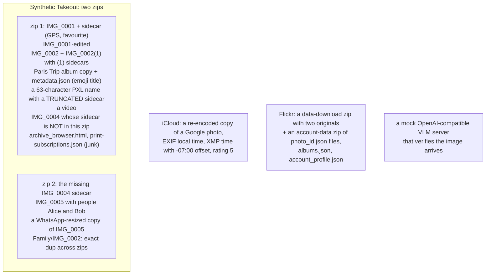
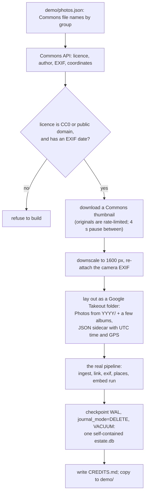

# 17. Tests and the demo library

Two things let anyone work on this project without a personal photo library: an end-to-end test that
builds a *synthetic* Google, iCloud and Flickr export on the fly, and a checked-in demo library of 104
public-domain photos that runs through the real pipeline. This chapter covers both, then the other
tools in `tools/`.

## The end-to-end test: `tests/test_poc.py`

```bash
cd photo-estate
uv run tests/test_poc.py          # no accounts, no models; about 23 seconds when last run for this book
```

It is a single script (290 lines) that builds an imaginary photo library with *every real-world
quirk from chapters 3-8*, runs the actual command-line tools against it as subprocesses, and asserts
on the resulting database. It ends with `ALL CHECKS PASSED`. No network, no model downloads: the
catalog stages need only Pillow, and `places` and `exif` run if their tools are present (`exiftool` is
optional; the test says `SKIPPED exif checks` without it).

### What it builds



Each photo is generated procedurally (a seeded random colour field with random circles), so the
images are deterministic, distinct, and tiny, and no real photo is needed.

### What it asserts, in order

| Stage | Assertions (each is a behaviour from an earlier chapter) |
|---|---|
| **Ingest zip 1, then link** | `IMG_0004` is *unmatched* (its sidecar is in zip 2) |
| **Ingest zip 2 with `--delete-after`** | The zip is gone; re-ingesting zip 1 prints `skip`; `link` now reports **`linked 11/11`** |
| **De-duplication** | 11 occurrences collapse to 9 assets; exactly 9 files in the store (chapter 4) |
| **Metadata merge** | GPS, favourite and time from the sidecar; people "Alice, Bob" from a cross-zip sidecar; the album title with its emoji; the truncated-name sidecar matched; one video (chapter 6) |
| **Near-duplicates** | Exactly two groups, categories `edit` and `copies`, with exactly the expected members (chapter 8) |
| **Tagging** | A mock VLM server returns fenced JSON; 3 images tagged, then the rest (8 images, the video skipped); the model *saw* an image of at most 768 px (chapter 9) |
| **Full-text search** | `Alice`, `paris`, `circles` (all 8), `garden` each return the right count |
| **iCloud** | The XMP-time copy lands on the *same UTC instant* as its Google original, with favourite from rating 5 and no album from the date folders, and is grouped as `copies` not `sameday` (chapters 3, 6, 8) |
| **Flickr** | Two originals matched to JSONs by id; `date_taken`, geo converted from micro-degrees, description cleaned of HTML (`Low tide &amp; <a>sea stacks</a>` → `Low tide & sea stacks`), albums, tags; a filename-like title dropped; EXIF date beats Flickr's; `link` is idempotent (still exactly 2 flickr tag rows) |
| **exif** | Every asset read; `Nikon D300` normalised from `NIKON CORPORATION / NIKON D300`, f/2.8, ISO 400, 1/250 s; searchable by "D300"; a re-run reads "0 assets" (resumable) |
| **places** | Paris from GPS, zone `Europe/Paris`, **10:22:33 UTC → 12:22:33 local**; an EXIF-only photo's wall-clock time kept; at least 5 events; every place row has an event; "Forks" (a town geocoded from Flickr's coordinates) is searchable; re-running is idempotent and `places` has one row per timed asset |

### Why it is built this way

- **Subprocesses, not imports.** `run()` invokes `uv run --script estate.py ...` exactly as a user
  would, so the test also verifies the inline dependency blocks and the command-line interface.
- **It exercises resumption deliberately**: the missing sidecar, the skipped re-ingest, the idempotent
  `link`/`places`/`exif` re-runs.
- **It is the specification.** When a rule in chapter 6 or 8 seems arbitrary, find the line in
  `build_takeout` that creates the failing case.

### What it does not cover

Honest limits: nothing here tests `embed.py` (needs a multi-GB model), `faces.py` (ditto), the web pages,
or `serve`'s query reading. Those are validated through the demo library and by eye: the README's
"searches that work" list and `tools/screenshots.py`. A small page to *score search on real queries*
(from the query log) is item 2 of the roadmap, precisely because there is no automated relevance test.

## The demo library

```bash
uv run embed.py serve --demo           # http://127.0.0.1:8767/
```

The repository contains a complete, ready-to-use library in `photo-estate/demo/`:

| File | What |
|---|---|
| `demo/store/` | 104 JPEGs in the real content-addressed layout (about 30 MB) |
| `demo/estate.db` | The catalog after the full pipeline (about 1 MB): assets, occurrences, sidecars, exif, places, events, trips, embeddings |
| `demo/photos.json` | The list of photos, grouped by what they show |
| `demo/CREDITS.md` | Author, source page and licence of every photo |

### The design of the demo

The 104 photos are grouped in **eights that look alike**: lighthouses, sunsets over the sea, snowy
mountains, coffee, kittens, hot air balloons, sand dunes, and so on. **Nothing in the catalog says
which group a photo is in.** That is what makes the demo a test of the embeddings: "red lighthouse"
should return the lighthouses, "More like this" from one lighthouse should list the other seven first,
and "kangaroo" should return "Nothing found". The groups also give each search a visible success
condition.

### How it is built: `tools/make_demo.py`

```bash
uv run tools/make_demo.py             # downloads (cached), downscales, runs the pipeline
```



Points of craft:

- **The demo is produced by the same code as a real library**: it is laid out as a Takeout folder
  with sidecars and run through `ingest → link → exif → places → embed`. If a pipeline stage broke, the
  demo build would break.
- **Licences are enforced in code.** Photos come from Unsplash images copied to Wikimedia Commons
  while Unsplash was CC0 (before mid-2017), and the script *exits* if any photo's licence is not
  CC0/public domain or lacks an EXIF date.
- **The albums exercise de-duplication**: a few photos are placed in album folders as well, giving
  occurrences > assets (the demo catalog has 123 occurrences for 104 assets).
- **Times are made realistic.** The EXIF wall-clock time is converted to UTC using the timezone at the
  photo's coordinates, so the sidecar says what a real Takeout would, and `places` reconstructs the
  local time from it.
- **The catalog is self-contained**: WAL checkpointed, journal mode back to DELETE and `VACUUM`ed, so
  the committed file has no `-wal` file beside it.
- **Photos with no coordinates** get `0.0, 0.0` in their sidecar, exactly as Google writes "none".

### Running it safely

`serve --demo` copies the catalog to a fresh temp directory, serves thumbnails generated there, does
not log queries, and cleans up on exit. The repository is never written to, so the demo can run on a
read-only checkout and beside a real library (port 8767 vs 8766). The first typed search waits for a
one-time download of PyTorch and the SigLIP 2 weights; browsing works immediately.

## The other tools

| Tool | Purpose |
|---|---|
| [tools/screenshots.py](../../photo-estate/tools/screenshots.py) (82 lines) | Retakes the README's five screenshots from the running demo with Playwright: search "latte art"; "More like this" from the lighthouse; the viewer's details panel on a balloon; the Where filter; and a phone-sized kitten search with touch and 3× pixel ratio. Uses the system Chromium or Chrome if present |
| [tools/make_icons.py](../../photo-estate/tools/make_icons.py) (37 lines) | Draws the home-screen icons into `app/` with Pillow: a photo print with hills and a low sun, plus a maskable version with extra inset for Android's adaptive icon shapes |
| [tools/sigbench.py](../../photo-estate/tools/sigbench.py) (42 lines) | Times SigLIP 2 image embedding on CPU over a folder of photos (`T=8` threads, any model id, `DT` for the data type). The source of the numbers in TAGGING-RESEARCH.md |
| [tools/bench_server.py](../../photo-estate/tools/bench_server.py) (152 lines) | Latency of every endpoint of the running server, optionally over HTTP/2 through a proxy (`--h2`) |
| [tools/thumb_burst.py](../../photo-estate/tools/thumb_burst.py) (28 lines) | Cold thumbnail bursts, the cost that dominated on a USB hard disk |

## Contributing

From the README: the demo library means you can work on the app without any photos of your own; there
is no environment to set up (each script declares its dependencies). The roadmap's items, the open
performance tasks, RAW and video support, new sources (Amazon Photos, OneDrive, Dropbox, a phone's
camera roll: "each a new set of sidecar rules in `estate.py link`"), and better demo photos are
all invited. The one rule to keep: **files are only added, never modified or deleted, and the catalog
stays readable without this code.**
