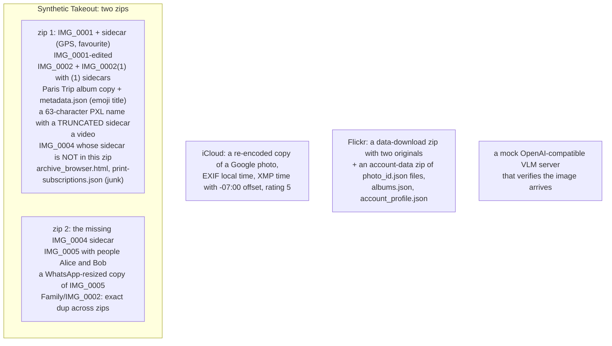
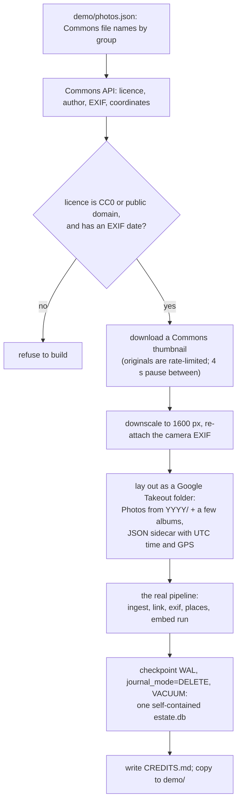

# 17. Tests and the demo library

Two things let anyone work on this project without a personal photo library: an end-to-end test that
builds a *synthetic* Google, iCloud and Flickr export on the fly, and a checked-in demo library of 104
public-domain photos that runs through the real pipeline. This chapter covers both, then the other
tools in `tools/`.

## The tests

| Test | Covers |
|---|---|
| `tests/test_poc.py` | The whole catalog pipeline on a synthetic Takeout, iCloud and Flickr export (below) |
| `tests/test_sync.py` | The change feed ([chapter 20](20-sync.md)): a device that pages through ends with the catalog's rows; deltas; deletions; resuming mid-way; restart; a lost feed file |
| `tests/test_upload.py` | Phone uploads ([chapter 24](24-uploading.md)): the inbox rules, then a photo and its sidecar through the real ingest and link; a second run adds nothing |
| `tests/test_intake.py` | The setup page's engine ([chapter 16](16-operations.md)): every practice source through the real pipeline, each way of signing in, wrong passwords and codes, cancel and retry |
| `tests/test_layout.py` | `/api/layout`: every photo's shape, in the order `/api/search` pages through them, for every order and view option |
| `tests/test_favorite.py` | Favourites set in the app: the row, the month's cover, the counts, the phone's feed, a reload, and taking it back |
| `tests/test_scores.py`, `tests/test_stacks.py` | Best first and stacks ([chapter 25](25-best-photos.md)) |
| `tests/test_aesthetics_judge.py`, `tests/test_aesthetics_taste.py` | The tools that made the scorers: the pairwise judge's queue and log, and the taste scorer's fit |
| `tests/test_albums.py`, `tests/test_changes.py` | Albums and change sets ([chapter 26](26-albums-and-agents.md)): sections, live albums, review, apply, revert; a hidden photo is in no view |
| `tests/test_mcp.py` | The MCP endpoint as an agent uses it: an agent can propose but not apply, and no answer carries a photo |
| `tests/test_connections.py` | Connections with the real app: `Connection: close` after an upload is honoured, a refused upload closes, a client's reset is not an error, and many uploads print no traceback |
| `tests/test_compare.py`, `tests/test_compare_app.py` | Comparing two models (`/compare`, [chapter 10](10-embeddings.md)): with the app's own model as the "second" one, both columns agree exactly and leave out photos with no second vector; filters narrow both sides; votes are recorded. In process (fast tier): no routes without vectors, a vote takes the write rule, 400 for bad numbers, 503 while the second model loads |
| `tests/test_tasks.py` | The agent on the library's computer, with a stand-in for Claude Code: it is started with every built-in tool off |
| `tests/test_photo_app.py` | The photo app in process (`PhotoApp` on the demo library, no subprocess, no model; [chapter 11](11-server.md)): who may write (a viewer is refused every People write, favourites, albums, tasks, intake, the ingest and uploads; a `--upload-user` login and this computer are let in), 400 for `limit=abc`, `cursor=x` and `/api/sync?limit=abc`, 400 for a body that isn't JSON or a `Content-Length` that isn't a number, 413 over the size limit, and the headers (ETag and 304, gzip) through a real server on a free port |
| `tests/test_lifecycle.py` | The background loaders (issue #82), with fakes and `threading.Event`s, no model: `Lifecycle`'s moves (an illegal one raises), a search model whose load raises answers at once (`ModelFailed`, 500) and one still loading answers after a bounded wait (`ModelLoading`, 503), also as an MCP tool error; a People loader that raises makes `/people` and `/api/people` say failed, not loading, and a failed reload keeps the loaded one; `/api/stats` never shows half of a measurement, the job reads the catalog inside the gate and drops numbers from a catalog replaced meanwhile; grouping unnamed faces swaps its result and state under the lock, and a failure is reported as `failed` |
| `tests/test_live_races.py` | The catalog being served, raced on purpose (issue #83), on the demo library with `threading.Event`s, no model: a value `Browse.remember` made while the catalog changed is not cached, and nothing cached is found once a new catalog is installed (`Live.generation`); a favourite set while a reload reads the catalog, and one that reaches the table after the reload read it and the swap, both end up in the new catalog and never in the replaced one, with `fav_log` empty afterwards; `show_favorites` runs only on the gate's write side (`/api/favorite`, an album's favourite, a reload) and waits for a request that is reading; `Gate.swap` from inside the gate raises; `/api/albums/<id>/download?dl=1` holds no gate while other requests do |
| `tests/test_faces_consistency.py` | `faces.People` keeping memory, SQLite and the face journal in agreement (issue #87), on a five-face synthetic faces DB with the real schema, no model: a merge moves `face_later` and `face_not` rows to the kept person, deduped, in the database and in memory, and a fresh load reads what memory holds; a write SQLite refuses (a trigger that raises "disk is full") in a name, a forget, an undo, a page of `label-many`, a rename, a birth month or a merge leaves memory, the tables and the journal as they were and closes every connection; rename, merge and born records are journalled and folding the journal by name gives the names in the database; a request for a person that a merge deletes while the request waits for the lock (`threading.Event`) is a 404, not a `KeyError` |
| `tests/test_job_lifecycles.py` | The background jobs' lifecycles (issue #86), with hooks, `threading.Event`s and small child processes, no model and no app: an `IngestJob` step not in `MOVES` raises, `start()` is refused while a run is being followed and cancels an armed quiet timer, and `status()` copying the log while a line is appended is safe; a task cancelled between the worker's `SELECT` and its claim, or between the claim and the agent's start, never runs, and one cancelled as it completes (or while running) stays cancelled; a failed task's error has the whole of stderr (the reader is joined); the timeout kills an agent that ignores SIGTERM, as `core.procs.stop` does; `Tasks.update` refuses unknown columns; an intake job cancelled while queued is never claimed, `Store.move` refuses moves `JOB_MOVES` does not list, and a cancel kills a stage that ignores SIGTERM; the sync feed sends a current device no deletions, each deletion once over a many-page sync, and every missed one to a device that is behind |
| `tests/test_events.py` | The steps' event lines (issue #84, [chapter 16](16-operations.md)), no model: `core.events` round-trips progress and events with the version, reads a newer `1.x`, and returns `None` (without raising) for another major version, an unknown type and malformed lines; `IngestJob._follow` on a fake child reloads the catalog at `catalog_ready` before the run ends, also when the human lines are reworded, and does nothing for the old wording without the events, keeping event lines out of the page's log; the intake engine's bar follows a stage's `progress` events (through `Store.set`) and not its human lines, which go in the job's log; and the emitters on a tiny catalog in `tmp_path`: `estate.py` ingest/link (and exif with exiftool), `places.py`, `embed.py` and `faces.py` with nothing to do, and `ingest-iphone.sh` with faked `uv` and `sqlite3`, both alone and run by a real `IngestJob`; none of them prints a `@@pe` line unless asked |
| `tests/test_http_util.py` | `http_util.py`: `Response` can't be changed, `int_param`, bounded bodies, the auth rule; months outside 1-12; intake's `job` and `after`; the setup server's 400 and 413 |
| `tests/test_core.py` | `core/` (issue #85): every module's file types are what they were, from one list; `GET /original/<sha>` answers 200 with the right `Content-Type` for `.heif`, `.tif`, `.tiff` and `.avif`; fresh databases from every open path match `tests/fixtures/schema_baseline.json` (captured from the code before), an old `change_sets`/`change_items` gains its columns with its rows kept, a copy of the demo catalog only gains tables, and `favorites` exists once the app opens; the default ports are distinct and the task agent's MCP URL follows the app's port; the screenshot cases in `tests/fixtures/screenshot_rules.json`, and that `Screenshots.swift` lists the same screen sizes |

Every test is a script that runs on its own (`uv run tests/<file>` from `photo-estate/`), needs no
network, account or model download, and works on a scratch copy, so the checked-in demo library never
changes. All sixteen take about a minute together.

## One command: pytest, ruff and CI

The scripts also run under [pytest](https://pytest.org), with one command and one summary, and the
fast ones run in CI on every pull request. Nothing about the scripts changed for this:
[`tests/conftest.py`](../../photo-estate/tests/conftest.py) collects each script in its `LEGACY` list
as a single test that runs the whole script in a subprocess and passes when it exits 0; a failure shows
the exit code and the script's last lines. Any other `test_*.py` is an ordinary pytest file, like
[`tests/test_harness.py`](../../photo-estate/tests/test_harness.py), which checks the runner itself (a
script that fails is reported as failed, a slow one is left out of the fast tier, no script is missing
from the list) and that the modules the light entry points import load no torch, transformers or
onnxruntime. `tests/test_photo_app.py`, `tests/test_http_util.py`, `tests/test_core.py`, `tests/test_compare_app.py`, `tests/test_lifecycle.py`, `tests/test_live_races.py`, `tests/test_faces_consistency.py`, `tests/test_job_lifecycles.py` and `tests/test_events.py` are native too, and in the fast
tier: they build the app in process instead of starting it. So is `tests/test_types.py`, which checks the
typed contracts below: `Catalog`'s fields, a demo catalog's types with and without scorers, the state
enums against the strings already on disk and on the wire, and pyright itself.

```bash
cd photo-estate
uv run pytest -m "not slow"        # the fast tier, what CI runs: 8 scripts + the native tests, about 40 s
uv run pytest                      # everything (HF_HUB_OFFLINE=1 is set for each script)
uv run pytest -m "server and not model"   # the app tests that work without the search model
uv run pytest --legacy-runner=uv   # each script with `uv run`, in its own PEP 723 environment
uv run ruff check .                # lint: syntax errors and pyflakes (unused imports, undefined names)
uv run pyright                     # type check: every module of the app, basic mode, no errors
uv run tests/test_poc.py           # one script on its own still works exactly as before
```

Each script is marked with what it needs (`pyproject.toml` declares the markers):

| Marker | Scripts | Why |
|---|---|---|
| (none: the fast tier) | `test_poc`, `test_upload`, `test_intake`, `test_sync`, `test_scores`, `test_stacks`, `test_aesthetics_judge`, `test_aesthetics_taste` | Need numpy, Pillow and pillow-heif (the dev group) and `uv` |
| `slow`, `server` | `test_changes`, `test_favorite`, `test_layout`, `test_tasks`, `test_mcp` | Start the real app (`uv run embed.py serve --demo`), whose environment has torch and transformers: gigabytes on a fresh Linux machine. `test_mcp` waits two minutes for a search without the model |
| `slow`, `server`, `model` | `test_albums`, `test_connections` | Also need the SigLIP 2 model in the Hugging Face cache: a text search, and uploads embedded as they arrive |

By default pytest runs each script with its own Python, the environment `uv sync` builds from
[`pyproject.toml`](../../photo-estate/pyproject.toml) and its lockfile
[`uv.lock`](../../photo-estate/uv.lock), so the fast tier uses exactly the pinned versions. The
manifest is not a package (`package = false`) and adds nothing to running the app: a script with a
`# /// script` header still builds its own environment from that header. Its dependency groups follow
the headers:

| Group | For | Packages |
|---|---|---|
| `core` | `estate.py`, `scores.py`, the fast tests | numpy, Pillow, pillow-heif |
| `ml` | `embed.py` and the search model | core, torch, transformers, sentencepiece, protobuf |
| `faces` | `faces.py` | core, onnxruntime |
| `places` | `places.py` | core, reverse_geocode, timezonefinder, pycountry |
| `tools` | `tools/` (the book, benchmarks, screenshots, the aesthetics experiments) | markdown-it-py, mdit-py-plugins, Pygments, httpx, requests, Playwright, SciPy, scikit-learn |
| `dev` (installed by default) | pytest, ruff and pyright | core, pytest, ruff, pyright |

`uv sync --group ml --group faces --group places` installs everything the server can use. After
changing a group, run `uv lock` and commit `uv.lock`; `uv lock --check` says whether it is current.
The manifest's `requires-python = ">=3.11,<3.14"` is the narrower of the two bounds the headers use,
since torch and onnxruntime need the upper one.

[`.github/workflows/ci.yml`](../../.github/workflows/ci.yml) runs on every pull request and every push
to `main`, on Ubuntu with Python 3.12: `uv lock --check`, `uv sync --locked --group dev`,
`ruff check .`, `pyright` and `pytest -m "not slow"` (with exiftool installed, so `test_poc` checks EXIF
too). It never downloads the model and never reaches the Mac mini or a real library. The slow tests are
left out on purpose: they need the ML stack (run `uv run pytest` on a machine that has it). Ruff's rules
are kept to syntax errors and pyflakes, and `ruff format` is not enforced: the code has its own compact
style.

### Type checks

[pyright](https://github.com/microsoft/pyright) checks every module of the app (the folder's scripts,
`core/` and `intake/`; not `tests/`, `tools/` or `demo/`) in basic mode, configured in `pyproject.toml`'s
`[tool.pyright]`, and CI fails on any error ([issue #90](https://github.com/jflam/photo-estate/issues/90)).
What makes that worth having is that the contracts between the modules are typed:

- `catalog.Catalog` is a slotted dataclass with every field and its type, `None` included where a
  field can be missing: `best`, `rank` and `score` are `None` in a catalog with no scorers, and
  `Catalog.scored()` hands out all three or raises. A route that reads a field that isn't there, or
  uses `rank` without checking, is a type error, not a crash in production ([chapter 5](05-catalog.md)).
- A photo's dict is `catalog.PhotoMeta`, a TypedDict: still a plain dict on the wire, but its keys and
  which of them may be absent are written down.
- The finite string domains (a change set's op, status and state, a reviewer's decision, a task's status,
  the ingest's state, an intake job's state, the People page's clustering) are `StrEnum`s in
  [`core/states.py`](../../photo-estate/core/states.py), each value the string already in the catalog,
  intake.db and the JSON API, so nothing stored or sent changed.
- The MCP endpoint's `app` is a Protocol (`estate_mcp.App`), which PhotoApp fills with an `AppFacade`;
  a request's headers are `http_util.Headers` (a dict, or the handler's `Message`).

The optional groups' packages (torch, transformers, onnxruntime, reverse_geocode, timezonefinder,
pycountry) are not in the dev environment, so their imports carry a narrow
`# pyright: ignore[reportMissingImports]`. The `pyright` package fetches its own Node.js the first
time it runs.

The iPhone app has no unit tests of its own. It was checked in the iOS Simulator against the demo
library (104 photos), with the server up and then stopped; `ios/project-sim.yml` builds it for a
Simulator older than the upload extension needs. The demo is what makes that cheap: `embed.py serve
--demo --port 8791` and the app's `SERVER_BASE` pointed at it. Screenshots in the README and chapter 23
are taken that way.

## The end-to-end test: `tests/test_poc.py`

```bash
cd photo-estate
uv run tests/test_poc.py          # no accounts, no models; about 23 seconds when last run for this book
```

It is a single script (304 lines) that builds an imaginary photo library with *every real-world
quirk from chapters 3-8*, runs the actual command-line tools against it as subprocesses, and asserts
on the resulting database. It ends with `ALL CHECKS PASSED`. No network, no model downloads: the
catalog stages need only Pillow, and `places` and `exif` run if their tools are present (`exiftool` is
optional; the test says `SKIPPED exif checks` without it).

### What it builds



Each photo is generated procedurally (a seeded random colour field with random circles), so the
images are deterministic, distinct, and tiny, and no real photo is needed.

### What it asserts, in order

| Stage | Assertions (each is a behaviour from an earlier chapter) |
|---|---|
| **Ingest zip 1, then link** | `IMG_0004` is *unmatched* (its sidecar is in zip 2) |
| **Ingest zip 2 with `--delete-after`** | The zip is gone; re-ingesting zip 1 prints `skip`; `link` now reports **`linked 11/11`** |
| **De-duplication** | 11 occurrences collapse to 9 assets; exactly 9 files in the store (chapter 4) |
| **Metadata merge** | GPS, favourite and time from the sidecar; people "Alice, Bob" from a cross-zip sidecar; the album title with its emoji; the truncated-name sidecar matched; one video (chapter 6) |
| **Near-duplicates** | Exactly two groups, categories `edit` and `copies`, with exactly the expected members (chapter 8) |
| **Tagging** | A mock VLM server returns fenced JSON; 3 images tagged, then the rest (8 images, the video skipped); the model *saw* an image of at most 768 px (chapter 9) |
| **Full-text search** | `Alice`, `paris`, `circles` (all 8), `garden` each return the right count |
| **iCloud** | The XMP-time copy lands on the *same UTC instant* as its Google original, with favourite from rating 5 and no album from the date folders, and is grouped as `copies` not `sameday` (chapters 3, 6, 8) |
| **Flickr** | Two originals matched to JSONs by id; `date_taken`, geo converted from micro-degrees, description cleaned of HTML (`Low tide &amp; <a>sea stacks</a>` → `Low tide & sea stacks`), albums, tags; a filename-like title dropped; EXIF date beats Flickr's; `link` is idempotent (still exactly 2 flickr tag rows) |
| **exif** | Every asset read; `Nikon D300` normalised from `NIKON CORPORATION / NIKON D300`, f/2.8, ISO 400, 1/250 s; searchable by "D300"; a re-run reads "0 assets" (resumable) |
| **places** | Paris from GPS, zone `Europe/Paris`, **10:22:33 UTC → 12:22:33 local**; an EXIF-only photo's wall-clock time kept; at least 5 events; every place row has an event; "Forks" (a town geocoded from Flickr's coordinates) is searchable; re-running is idempotent and `places` has one row per timed asset |

### Why it is built this way

- **Subprocesses, not imports.** `run()` invokes `uv run --script estate.py ...` exactly as a user
  would, so the test also verifies the inline dependency blocks and the command-line interface.
- **It exercises resumption deliberately**: the missing sidecar, the skipped re-ingest, the idempotent
  `link`/`places`/`exif` re-runs.
- **It is the specification.** When a rule in chapter 6 or 8 seems arbitrary, find the line in
  `build_takeout` that creates the failing case.

### What it does not cover

Honest limits: nothing here tests `embed.py` (needs a multi-GB model), `faces.py` (ditto), the web pages,
or `serve`'s query reading. Those are validated through the demo library and by eye: the README's
"searches that work" list and `tools/screenshots.py`. A small page to *score search on real queries*
(from the query log) is item 2 of the roadmap, precisely because there is no automated relevance test.

## The demo library

```bash
uv run embed.py serve --demo           # http://127.0.0.1:8767/
```

The repository contains a complete, ready-to-use library in `photo-estate/demo/`:

| File | What |
|---|---|
| `demo/store/` | 104 JPEGs in the real content-addressed layout (about 30 MB) |
| `demo/estate.db` | The catalog after the full pipeline (about 1 MB): assets, occurrences, sidecars, exif, places, events, trips, embeddings |
| `demo/photos.json` | The list of photos, grouped by what they show |
| `demo/CREDITS.md` | Author, source page and licence of every photo |

### The design of the demo

The 104 photos are grouped in **eights that look alike**: lighthouses, sunsets over the sea, snowy
mountains, coffee, kittens, hot air balloons, sand dunes, and so on. **Nothing in the catalog says
which group a photo is in.** That is what makes the demo a test of the embeddings: "red lighthouse"
should return the lighthouses, "More like this" from one lighthouse should list the other seven first,
and "kangaroo" should return "Nothing found". The groups also give each search a visible success
condition.

### How it is built: `tools/make_demo.py`

```bash
uv run tools/make_demo.py             # downloads (cached), downscales, runs the pipeline
```



Points of craft:

- **The demo is produced by the same code as a real library**: it is laid out as a Takeout folder
  with sidecars and run through `ingest → link → exif → places → embed`. If a pipeline stage broke, the
  demo build would break.
- **Licences are enforced in code.** Photos come from Unsplash images copied to Wikimedia Commons
  while Unsplash was CC0 (before mid-2017), and the script *exits* if any photo's licence is not
  CC0/public domain or lacks an EXIF date.
- **The albums exercise de-duplication**: a few photos are placed in album folders as well, giving
  occurrences > assets (the demo catalog has 123 occurrences for 104 assets).
- **Times are made realistic.** The EXIF wall-clock time is converted to UTC using the timezone at the
  photo's coordinates, so the sidecar says what a real Takeout would, and `places` reconstructs the
  local time from it.
- **The catalog is self-contained**: WAL checkpointed, journal mode back to DELETE and `VACUUM`ed, so
  the committed file has no `-wal` file beside it.
- **Photos with no coordinates** get `0.0, 0.0` in their sidecar, exactly as Google writes "none".

### Running it safely

`serve --demo` copies the catalog to a fresh temp directory, serves thumbnails generated there, does
not log queries, and cleans up on exit. The repository is never written to, so the demo can run on a
read-only checkout and beside a real library (port 8767 vs 8766). The first typed search waits for a
one-time download of PyTorch and the SigLIP 2 weights; browsing works immediately.

## The other tools

| Tool | Purpose |
|---|---|
| [tools/screenshots.py](../../photo-estate/tools/screenshots.py) (82 lines) | Retakes the README's five screenshots from the running demo with Playwright: search "latte art"; "More like this" from the lighthouse; the viewer's details panel on a balloon; the Where filter; and a phone-sized kitten search with touch and 3× pixel ratio. Uses the system Chromium or Chrome if present |
| [tools/make_icons.py](../../photo-estate/tools/make_icons.py) (37 lines) | Draws the home-screen icons into `app/` with Pillow: a photo print with hills and a low sun, plus a maskable version with extra inset for Android's adaptive icon shapes |
| [tools/sigbench.py](../../photo-estate/tools/sigbench.py) (42 lines) | Times SigLIP 2 image embedding on CPU over a folder of photos (`T=8` threads, any model id, `DT` for the data type). The source of the numbers in TAGGING-RESEARCH.md |
| [tools/bench_server.py](../../photo-estate/tools/bench_server.py) (152 lines) | Latency of every endpoint of the running server, optionally over HTTP/2 through a proxy (`--h2`) |
| [tools/thumb_burst.py](../../photo-estate/tools/thumb_burst.py) (28 lines) | Cold thumbnail bursts, the cost that dominated on a USB hard disk |

## Contributing

From the README: the demo library means you can work on the app without any photos of your own; there
is no environment to set up (each script declares its dependencies). The roadmap's items, the open
performance tasks, RAW and video support, new sources (Amazon Photos, OneDrive, Dropbox, a phone's
camera roll: "each a new set of sidecar rules in `estate.py link`"), and better demo photos are
all invited. The one rule to keep: **files are only added, never modified or deleted, and the catalog
stays readable without this code.**
