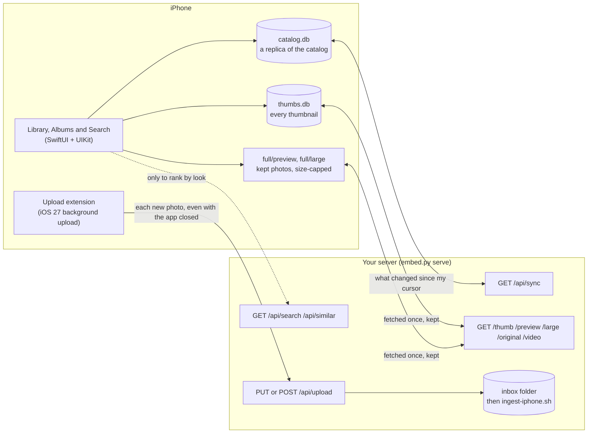

# 19. The iPhone app

Chapters 1-18 describe a server and a web page. The web page works on a phone (chapter 13), but it is
a window onto the server: with no network there is nothing in it. The iPhone app in
[`ios/`](../../ios/) is the other half of the idea. It keeps **its own copy of the catalog**, a
thumbnail of every photo and the full-screen photos you ask for, so the library scrolls, filters and
searches on a plane, and it sends the photos you take back to the server. This chapter is the map;
chapters 20-24 take it apart.

## Two jobs, one server



The phone talks to the server over exactly the same HTTP API as the web page (appendix B), reached the
same way (Tailscale; chapter 16). It adds one endpoint, `/api/sync`, and uses the upload endpoint that
chapter 16 describes.

| Job | What the phone does | Chapter |
|---|---|---|
| **Look** | Keeps a read-only replica of the catalog, current to the last sync | [20](20-sync.md) |
| **Find** | Reads a typed search the way the server does and answers it from the replica | [21](21-offline-search.md) |
| **Show** | Keeps thumbnails and chosen full-screen photos on the phone | [22](22-photos-on-the-phone.md) |
| **Draw** | A native grid, viewer and search page | [23](23-native-interface.md) |
| **Send** | Uploads new photos, in the background | [24](24-uploading.md) |

## Why native, and why a copy

The web app's [service worker](13-photo-app.md) can show a friendly "Can't reach your photos" page, but
it cannot show photos: a library of 100,000 thumbnails does not fit what a browser promises to keep.
A native app can hold gigabytes in its own folder and decide what to evict. Two further things only a
native app can do: **upload from the camera roll in the background**, with the app closed (the whole
of chapter 24), and run a UIKit collection view whose layout is arithmetic, so a 100,000-photo library
scrolls at the screen's frame rate.

The cost of a copy is that it can be wrong. The design makes that cheap:

> **The server is the only writer. The phone is a read-only replica.** There is nothing to merge, so
> there are no conflicts to resolve, and the replica can always be thrown away and fetched again.

This is the same stance as the archive itself (chapter 1: files are only added, never modified). The
phone never writes its copy. When you make a photo a favourite or an album from a search on the phone,
the phone asks the server to do it ([API.swift](../../ios/PhotoEstate/Catalog/API.swift); chapter 26),
and learns the result on its next sync, like anything decided on the Mac. With no network those
buttons say so and do nothing. Everything in the app's folder is marked **excluded from iCloud backup**, because the
server has all of it.

## The pieces

```
ios/
  project.yml            the real project: the app and the upload extension (xcodegen)
  project-sim.yml        the app alone, for a Simulator older than the extension needs (iOS 27)
  Shared/                Server.swift (the address), UploadRequest.swift, ExtensionStatus.swift
  UploadExtension/       the background upload extension: queues a job per new photo
  PhotoEstate/
    PhotoEstateApp, ContentView        three tabs: Library, Albums and Search
    Design.swift                       ink, paper, a low sun: the look
    Catalog/   SyncEngine, Catalog, SQLite, Query     the replica, and reading a search
               Screenshots, API                       which photos are screenshots; asking the server
    Images/    ImageStore, Downloader                 thumbnails and kept photos
    Library/   LibraryModel, Grid, Viewer, LibraryView, SearchView, FilterSheet
               Movie                                  a video, and a Live Photo's clip, in the viewer
               Albums                                 the Albums tab (chapter 26)
               LocalPhotos, OnPhone                   the phone's own photos, in the Library and the viewer
    ThisPhoneView, UploadsView, ForegroundUploader    what the phone keeps, and sending
    WebView                                           a server page inside the app (an album's review)
```

| Area | Files | Swift lines (code) |
|---|---|---:|
| Catalog (replica, SQL wrapper, query reading, screenshots, server API) | 6 | 959 |
| Images (thumbnail store, downloader) | 2 | 306 |
| Library (grid, viewer, videos, Library and Search tabs, albums, filters, the phone's own photos) | 10 | 3,887 |
| Uploads (extension, request, foreground uploader, status, view) | 5 | 355 |
| App shell, design, This iPhone, web view, server address | 6 | 227 |
| **Total** | **29** | **5,734** (6,813 with comments and blanks) |

Measured with `tokei` on 2026-11-21. When this chapter was first written (2026-11-14) the app was 23 files
and 3,481 lines; the Albums tab, the phone's own photos in the Library, best first, stacks,
favourites, and videos and Live Photos came after.

Its server-side counterparts are small: [sync.py](../../photo-estate/sync.py) (98 lines of code),
[upload.py](../../photo-estate/upload.py) (340), and a few dozen lines in `embed.py` and `photo_app.py`.

Two decisions about the code itself:

- **No third-party packages.** SQLite is the system library (`import SQLite3`), the network is
  `URLSession`, the JSON is `JSONSerialization`. A small wrapper, `SQLite.swift` (146 lines), gives
  prepared statements (up to 64 kept for reuse) and a `Store` that pairs one writing and one reading
  connection, each on its own queue (WAL lets them overlap), so nothing touches the database on the
  main thread. The app has nothing to update but itself.
- **SwiftUI for screens, UIKit for the two things that must be fast.** The grid is a
  `UICollectionView` and the viewer's pager and zoom are a `UIPageViewController` with `UIScrollView`s
  (chapter 23). Everything else (filters, settings, the search page) is SwiftUI.

## Where the server's address comes from

There is no login and no server-picker screen. The address is a build setting,
`SERVER_BASE` in `project.yml`, copied into the app's `Info.plist` as `BackgroundUploadURLBase` and read
back by `Server.baseURL`. The upload extension reads the same key, which is why it lives in `Shared/`.
For the Simulator against a local server:

```bash
cd photo-estate && uv run embed.py serve --demo --port 8791          # the 104-photo demo library
cd ios && xcodegen -s project-sim.yml && xcodebuild -project PhotoEstateSim.xcodeproj \
    -scheme PhotoEstate -sdk iphonesimulator -derivedDataPath build SERVER_BASE=http://127.0.0.1:8791 build
```

Because the web app has no authentication of its own (chapter 16), the app inherits the same rule:
**the network is the access control.** The phone reaches the server only over the tailnet, and
`NSAllowsLocalNetworking` permits plain HTTP only to local addresses for the Simulator.

## Starting up

`ContentView` is three tabs (Library, Albums, Search). Every time the app becomes active it does three things in order:

1. `ImageStore.retryNetwork()`: forget that the server was unreachable a moment ago.
2. `SyncEngine.sync()`: ask the server what changed (chapter 20).
3. `Downloader.restart()`: fetch whatever the phone should hold but doesn't yet (chapter 22).

Until the first sync has returned anything, the Library shows a welcome screen. After that it never
waits for the network again: every screen reads the phone's own files, and anything the server adds
arrives as a revision counter going up, which the visible screens notice and redraw on.

## What works with no network

| | Online | Offline |
|---|---|---|
| Browse the library, scroll, the date scrubber | yes | yes |
| Filters (Where, People, Albums, Trips, When, Camera, Favourites, Videos) and their live counts | yes | yes |
| Names and places in a search ("ben san diego"), typed filters (`place:denmark`) | yes | yes |
| A thumbnail of any photo | yes | yes (every one is kept) |
| A full-screen photo | yes | if kept (favourites, recent, or anything you opened) |
| Details: date, place, camera, event, trip, albums, people | yes | yes |
| Describe a photo ("dog in the snow"), **More like this** | yes | **no**: falls back to matching words, and says so |
| Share the original file | yes | shares the best copy it has; a video, nothing (it says so) |
| Play a video, or a Live Photo's clip | yes, streamed from `/video/<sha>` | **no**: its poster, and a line saying the server isn't reachable. A video still on the phone plays from Photos |
| Upload new photos | yes | queued by iOS, sent when the server is reachable |

The one thing that cannot move to the phone is ranking by what a photo *looks like*. That needs the
image model and a vector for every photo (about 3 KB each: 300 MB at 100,000 photos), and a text
encoder model. It is the natural next step (chapter 18) and, for now, the
single reason the app still asks the server a question. Chapter 21 says exactly how the fallback
behaves.

## Where to look in the code

| Topic | File |
|---|---|
| The app's three tabs and what happens on launch | [ContentView.swift](../../ios/PhotoEstate/ContentView.swift) |
| The server address | [Shared/Server.swift](../../ios/Shared/Server.swift) |
| The project definitions | [project.yml](../../ios/project.yml), [project-sim.yml](../../ios/project-sim.yml) |
| The SQLite wrapper | [Catalog/SQLite.swift](../../ios/PhotoEstate/Catalog/SQLite.swift) |
| Videos and Live Photos in the viewer | [Library/Movie.swift](../../ios/PhotoEstate/Library/Movie.swift), [Library/Viewer.swift](../../ios/PhotoEstate/Library/Viewer.swift) |
| The server's side | [sync.py](../../photo-estate/sync.py), [upload.py](../../photo-estate/upload.py) |
