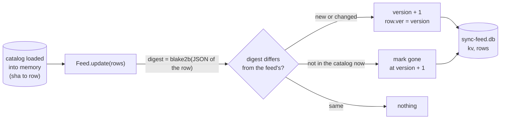
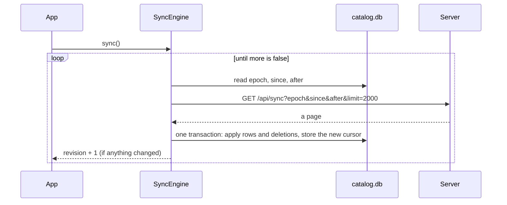

# 20. Sync: the catalog on the phone

The phone's copy of the catalog has to answer one question honestly: *what changed on the server since
I last asked?* Everything else in the offline design (chapters 21-22) leans on the answer. This chapter
covers both ends: the **change feed** the server publishes ([sync.py](../../photo-estate/sync.py), 100
lines) and the **sync engine** the phone runs
([SyncEngine.swift](../../ios/PhotoEstate/Catalog/SyncEngine.swift), 142 lines), and the replica they
fill.

## The problem

A library of 100,000 photos is tens of megabytes of JSON as `/api/search` returns it. A phone cannot fetch
that on every launch, and cannot rely on `ORDER BY rowid` either: the catalog is not append-only. A
photo's place can change when `places.py` reruns, a face you name changes `people`, an ingest adds
photos with dates in the middle of the timeline, and a re-link can remove one. What the phone needs is
a **change feed**: an ordered log it can read from any point, so a sync after a day away fetches a
dozen rows, and one after a year fetches a year's changes in a few pages.

The server has no history to replay. `estate.db` holds the current state, not a log of edits, and the
rows the app serves are *derived* (the search result row mixes tables: exif, places, tags, people).
So the feed is built the other way round, by **comparing what the catalog holds now with what the feed
last saw**.

## The feed: versions, digests and a cursor

`Feed` keeps, for every photo, a *digest* of its row and the *version* it last changed at. A **version**
is one counter for the whole library, and it goes up by one each time a load of the catalog finds
anything new, different or gone:



- **The digest** is an 8-byte BLAKE2b of the row serialized with sorted keys and compact separators.
  Any change to any field the phone sees makes a new digest, and a change to a field it doesn't see
  (a face embedding) does not, so the phone is never told about nothing.
- **The version** is one integer for the whole library, so `ver` on each row says "this row last changed
  in load number N". If a load changes 3 rows, those three get version 2 and the rest keep 1.
- **The feed lives in its own file**, `sync-feed.db`, next to the catalog but *never inside it*. The
  catalog stays plain files plus one SQLite file (chapter 1) and stays valid if the feed is deleted.
  It is a SQLite file in WAL mode with two tables: `kv` (the `epoch` and the current `version`) and
  `rows(sha, digest, ver, gone)`.

`feed_update()` in `embed.py` runs in a background thread at startup and again after every hot reload
that followed an ingest (chapter 16). It also works out one thing the phone cannot: which photos the
Library hides as **near-identical shots** (`dup`). That needs the image vectors and is a greedy pass
newest-first, comparing each photo against the last 8 kept (cosine above 0.97), so the feed sends it as
a flag on the row, and the phone's "Hide near-identical shots" is a `WHERE dup = 0`.

The rows are the catalog's, so they include its videos: a video's row has `kind: "video"` and `dur`
(seconds), and a Live Photo's still has `live`, the sha of its clip, served at `/video/<sha>`
([chapter 11](11-server.md)). A clip has no row of its own. A photo's row has none of
these keys, so the first load after videos came in changed only the rows of the videos (all new) and
of the stills that gained `live`: on the author's library, 16,095 stills and 3,427 videos.

### The endpoint

```
GET /api/sync?epoch=E&since=V[&after=SHA][&limit=N]

{"epoch": "9f3c...", "photos": [ ...rows as /api/search returns them, plus dup... ],
 "deleted": ["sha", ...], "since": 12, "after": "ab34...", "more": false,
 "total": 104, "trips": [ ... ]}
```

Rows come in `(version, sha)` order. The device's **cursor** is the pair it hands back, `since` and
`after`: "I have every row up to this version and sha". A page is the next `limit` rows after it
(2,000 from the app; the server accepts 1 to 10,000). When `more` is true there is another page; when
it is false the device is current, and the cursor the server returns is `(version, "~")`, where `~`
sorts after every hex string, so the next ask starts after everything.

Two properties make this robust:

- **Any page is a safe place to stop.** The cursor names an exact position in a total order. A phone
  that loses its connection halfway through a first sync of 100,000 photos resumes at the next page,
  not from the start, and never sees a row twice that it would have to reconcile.
- **Deletions are part of the log.** A removed photo is remembered as `gone` at the version it was
  removed, and takes its place in the same `(version, sha)` order as the rows. A page's `deleted` lists
  the deletions after the cursor the device sent and up to the cursor the page returns, so the cursor
  means "I have every row *and every deletion* up to here": each deletion arrives exactly once, on the
  page whose window it falls in; a device that is up to date and polls again is sent none; and one that
  is behind gets every deletion after its cursor. A device applies `deleted` from every page, as it does
  `photos` (the iPhone app does, in the same transaction as the cursor). `limit` counts rows only.

  Before issue #86 every page listed every deletion at or after `since`, so a current phone was handed
  the latest version's deletions on every poll (and bumped its revision for nothing), and a many-page
  sync got them on every page. The change is backward compatible: a cursor saved under the old rule
  was always sent at least the deletions the new rule sends, and applying a deletion twice, or one the
  device never had, does nothing.

`trips` is sent only on the last page, because it is small and always whole: the phone replaces its list.

### One feed per member

A phone keeps the photos its member sees, so each member has a feed of their own (multiplayer phase 3,
[chapter 11](11-server.md#what-each-member-sees-lenses)): a photo one member's filters hide leaves only
that member's phones, and a row's `fav` is that member's favourite. The first sysadmin's feed is
`sync-feed.db`, as it was before members, so the owner's phone does not fetch the library again; anyone
else's is `sync-feed-<member id>.db` beside it, made the first time one of their phones asks (the answer
waits for it: about a second for 100,000 photos) and found again at the next start. `feed_update()`
brings every member's feed up to date after a reload or a change to what anyone hides, and only those:
a member with no phone costs nothing. Each `update()` digests every row the member sees, a little over a
second for 100,000 photos on the author's laptop (tools/bench_views.py), in a background thread.

### The epoch

Versions live in a file, and a file can be lost. If `sync-feed.db` is deleted, a new one starts again at
version 1 with a new random **epoch**, and a phone holding "version 12 of the old file" would otherwise
skip every row below 12 that it never had. So every response names its epoch, and a device sends the one
it knows. If they differ the server treats the cursor as zero, and the phone, knowing the epoch changed,
marks every row it holds as *stale* and fetches everything under the new epoch; when the last page
arrives, whatever is still stale (rows the server no longer has) is deleted. A lost file costs one full
sync and loses nothing.

### While the server is starting

The feed describes the catalog of the *last* run until the first `update()` completes, and a phone
asking now would otherwise be told "nothing changed". So until then `/api/sync` answers **503 with
`Retry-After: 5`**, and the phone waits three seconds and asks again.

## The phone's side

`SyncEngine` is a `@MainActor` object with one `sync()` method. It is called when the app comes to the
front, from pull-to-refresh on the grid, and from "Sync now" in the settings. If a sync is already
running, a second call just waits for it.



The step that matters is the transaction: **the page and the new cursor commit together**. If the
phone is killed between pages, either both are in the file or neither is, so the cursor never claims
rows the replica lacks. A request that fails leaves the cursor where it was, and the engine records
the error and `online = false` for a `URLError`. The app does not retry in a loop: a failed sync just
means the replica stays as it was, and the next launch or refresh tries again. Each state is published:

| Published value | Used for |
|---|---|
| `state` (`idle`, `syncing`, `failed(message)`) | The settings sheet, pull-to-refresh |
| `photos`, `serverTotal`, `lastSynced` | "104 of 104 photos", "Last synced 3 min ago" |
| `online` | The toolbar icon: an iPhone, a down arrow while working, a crossed Wi-Fi when the server is unreachable |
| `revision` | **Goes up when the contents changed.** Every screen that shows photos watches it and reloads |

A `404` from `/api/sync` means the server is too old to have the endpoint, and the app says so ("update
it") rather than showing an empty library.

## The replica

The phone's `catalog.db` is a second, smaller catalog designed for *reading*, not for being the truth.
[Catalog.swift](../../ios/PhotoEstate/Catalog/Catalog.swift) defines it:

| Table | Holds | Why |
|---|---|---|
| `kv` | `epoch`, `since`, `after`, `trips` | The cursor and the list of trips, in one place |
| `photos` | One row per photo: every field of the server's row, plus derived columns | The grid, the details, every filter |
| `tags` | `(kind, name, id)` for `person` and `album` | A photo can have several; the facet counts and `IN (...)` filters read it |
| `fts` | An FTS5 index over each photo's words | The offline fallback for "describe a photo" (chapter 21) |

The extra columns on `photos` are computed once when a row arrives, so that no query does string work:

| Column | Computed as | Used by |
|---|---|---|
| `whenk` | `local` time, else `taken`, else `""` | Ordering, grouping into months, the scrubber |
| `ym` | `year * 12 + month - 1`, or -1 | Date ranges (`ym BETWEEN ? AND ?`), photos per month |
| `place_lc`, `place_words` | The place and county, lower-cased; and again as words padded with spaces | `place:` filters (`instr`) and whole-word place matching (`LIKE '% san diego %'`) |
| `camera_lc`, `albums_lc`, `people_lc` | Lower-cased text | Typed filters |
| `dup` | The feed's flag | Hiding near-identical shots |
| `epoch` | The feed's epoch when the row arrived | Dropping rows a new epoch no longer has |

Three columns hold what a row says of videos, as the server sent it: `kind` (`video`, or empty for a
still), `dur` (a video's length in seconds) and `live` (on a Live Photo's still, its clip's sha). The grid's
badges, the Videos filter and `is:video` read them, and the viewer plays `/video/<sha>` by them
([chapter 23](23-native-interface.md)). A search's `at` (where in a video the words match best) comes with
a search the server answers, and is never kept.

`apply()` upserts on `sha` (`INSERT ... ON CONFLICT(sha) DO UPDATE`), then rewrites that photo's `tags`
and `fts` rows, so a changed row can never leave a stale tag behind. For the web page, one photo's name
lives in two places; here it is in four, and one function keeps them in step.

The replica has one small migration: `Catalog.migrate` adds any of the columns a newer build reads that
a `catalog.db` made by an older build lacks (`stack` and `best` for stacks and "Best first"; `kind`, `dur`
and `live` for videos), with `ALTER TABLE ... ADD COLUMN`, when the file is opened. They fill in as the
server sends those rows again (a row changes when the server begins to send a new field of it); until
then every photo held is a still, as it always was. Nothing else is migrated. It is excluded from backup
and treated as disposable: if
`catalog.db` fails to open, `Catalog.init` deletes it and its `-wal` and `-shm` files and starts again,
and the next sync fills it from nothing.

## Testing it

[tests/test_sync.py](../../photo-estate/tests/test_sync.py) runs the feed against a fake device that
pages like the app does, with a deliberately small page size (7) so that every cursor boundary is
crossed. It checks that a device that pages through ends with exactly the catalog's rows; that a second
sync sends nothing; that a load of an unchanged catalog does not bump the version; that three changes
and a deletion arrive as exactly those four rows; that a device interrupted after one page and resumed
ends up identical; that versions survive restarting the feed; and that deleting the feed file gives a
new epoch and makes the device start again, pruning rows the new feed does not have. The Swift side has
no unit tests: it was exercised in the Simulator against the demo library, with the server up and then
stopped (chapter 17's demo is what makes that cheap).

## Where to look in the code

| Topic | Where |
|---|---|
| The feed: `digest`, `Feed.update`, `Feed.page` | [sync.py](../../photo-estate/sync.py) |
| `feed_update`, the `/api/sync` route | `PhotoApp` in [photo_app.py](../../photo-estate/photo_app.py); a row's extra fields in `Catalog.feed_extra` ([catalog.py](../../photo-estate/catalog.py)) |
| The sync loop and its published state | [SyncEngine.swift](../../ios/PhotoEstate/Catalog/SyncEngine.swift) |
| The replica's schema, `apply`, `dropOtherEpochs` | [Catalog.swift](../../ios/PhotoEstate/Catalog/Catalog.swift) |
| The request and response, in full | [Appendix B](appendix-b-http-api.md) |
