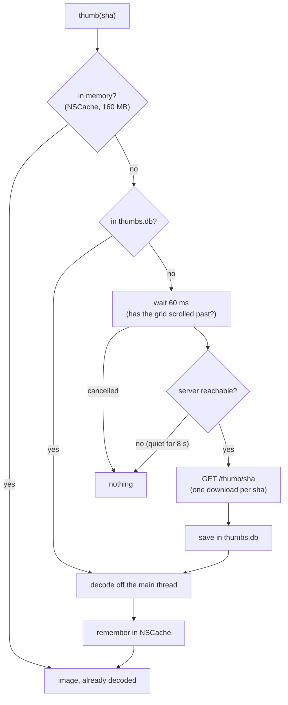

# 22. Photos on the phone

The replica of chapter 20 holds the *words* about every photo. This chapter is about the *pictures*:
which ones the phone keeps, where, how it decides what to fetch and what to throw away, and how a screen
asks for an image without caring whether it is on the phone or on the server. Two files do it:
[ImageStore.swift](../../ios/PhotoEstate/Images/ImageStore.swift) (226 lines) keeps and serves them, and
[Downloader.swift](../../ios/PhotoEstate/Images/Downloader.swift) (128 lines) decides what to bring
ahead of time.

## Three sizes

The server already makes three sizes of every photo for the web page (chapter 11, "Serving images"). The
phone asks for the same three, from the same routes, and keeps each differently:

| Kind | Size | Route | Used for | Kept as |
|---|---|---|---|---|
| `thumb` | 360 px | `/thumb/<sha>` | The grid, the search page, the viewer's first frame | One **row** in `thumbs.db`: `(sha, JPEG blob)` |
| `preview` | 1600 px | `/preview/<sha>` | The viewer, full screen | A **file**, `full/preview/<sha>.jpg` |
| `large` | 4096 px | `/large/<sha>` | When zoomed in past 1.6 times | A file, `full/large/<sha>.jpg` |

The original file is a fourth thing the phone never keeps: `/original/<sha>` is fetched only to be shared
(chapter 23), and goes in a temporary folder.

### Why thumbnails are rows and the rest are files

A thumbnail is a few tens of KB, and there are as many as photos. At 100,000 photos that is 100,000
small files, which is slow to create, slow to list and costly to open one at a time; the settings sheet
estimates about 2 GB for the lot. As rows in one SQLite file they are **one open file and a B-tree lookup per
read**, written in batches inside a transaction, and removed with a `DELETE`. A full-screen image is
much larger, there are far fewer of them, and they are best as ordinary files: they can be handed to
the share sheet or to `UIImage(contentsOfFile:)` by path, and the system can see how big they are.

All of it lives in the app's **Application Support** folder, not Caches. iOS clears Caches when it is
short of space, without asking; here the app decides what to evict. (The folder is excluded from iCloud
backup: the server has every photo.)

## Reading an image

Every screen asks `ImageStore`, never the network:

Three details keep scrolling smooth with a library this size:

1. **`ready(sha)` is synchronous.** The grid asks for an already-decoded image first and only starts an
   async load if there isn't one, so a cell that scrolls back into view shows its photo in the same frame.
2. **A 60 ms pause before going to the network.** If the thumbnail is neither in memory nor on disk, the
   request waits briefly; a fast scroll cancels the cell's task before the delay ends, and the server is
   never asked for a photo that was only on screen for a flick.
3. **One download per photo.** `Inflight` is a small actor that remembers requests in progress: ten
   cells asking for the same sha share one download.

Images are decoded with `preparingForDisplay()` on a background task, so the first draw on the main thread
is not a JPEG decode. The memory cache is bounded by decoded size (width times height times 4 bytes),
at 160 MB.

### When the server isn't there

A failed download (anything except a cancellation) sets a **quiet period** of 8 seconds during which
`ImageStore` doesn't try the network at all. Without it, a phone on a plane would spend every scrolled-into-
view cell waiting out a 20-second timeout, and the scrolling would feel stuck. Anything that has reason to
believe things changed calls `retryNetwork()` to clear it: the app coming to the front, pull to refresh,
and "Sync now".

The full-screen path (`fetch(kind, sha)`) is the same idea: **a file that exists is returned and its
modification date is touched** (that is the "last viewed" the eviction below uses), else it is downloaded
to a temporary name and renamed into place, so a half-written image is never mistaken for a kept one.
The viewer shows the thumbnail the moment it opens, then the preview when it arrives, then the large
version if you zoom in (chapter 23), and prefetches the previews of the neighbours either side.

## The Downloader: what to have ahead of time

Fetching on demand makes the app usable *with* a server. Being useful *without* one means having fetched
before leaving. `Downloader` does that while the app is open, newest photos first, quietly, and picking
up where it left off. What it fetches is set in the **On this iPhone** sheet (the phone icon in the
Library's bar):

| Setting | Choices | Default |
|---|---|---|
| **Every thumbnail** | on / off | on |
| **Full-screen copies** | Only what I've looked at; Favourites; Favourites and the last year; Every photo | Favourites |
| **Use mobile data** | on / off | off: wait for Wi-Fi |
| **Full-screen up to** | 1 to 200 GB | 5 GB |

A run (`Downloader.run`) goes like this:

1. Read every sha from the replica, newest first. Compare with the thumbnails held.
2. **Forget what the server has dropped.** A thumbnail or full-screen file whose photo is no longer in
   the replica is deleted (only when the replica is not empty: an empty one means a sync hasn't happened,
   not that the library is gone).
3. Work out the **wanted full-screen set** from the setting (`fav=1`; or `fav=1 OR whenk >=` a year ago;
   or everything), newest first, and **trim** the files on disk to the size cap, least recently viewed
   first, *never deleting a photo in the wanted set*. A photo you opened once is kept until space is
   needed; a photo you asked to keep is kept always.
4. Check the connection. No network: say so, and wait. On mobile data with the setting off: "Waiting
   for Wi-Fi". `NWPathMonitor` restarts the run whenever the path changes, so plugging into Wi-Fi starts it.
5. Fetch the missing thumbnails with **6 lanes** in parallel, then the missing full-screen copies with 3.
   Progress is published in batches of 25 so the screen isn't redrawn per photo.
6. **Give up after 12 failures in a row**: the server is away, and hammering it helps no one. The status
   reads "Can't reach the server: will carry on later", and the next trigger starts again from where it
   stopped (everything already on disk is skipped).

Everything is idempotent, so any interruption (the app backgrounded, a lost connection, a restart) is
only a pause. The status line the user sees is plain: "Downloading...", "Everything is on this iPhone.",
"Waiting for Wi-Fi.".

## What it costs

| | Size | Where it comes from |
|---|---|---|
| The replica (`catalog.db`) | Not measured at 100,000 photos | Rows, tags and an FTS index |
| Thumbnails | About 2 GB at 100k photos | The author's estimate shown in the settings sheet |
| Full-screen copies | Up to the cap (5 GB default) | Favourites, recent, and anything opened |
| Memory | 160 MB of decoded thumbnails | `NSCache` cost limit |

The settings sheet shows the actual numbers (thumbnails and full-screen copies, photos on the phone out
of the server's total), and has a button to remove the full-screen copies ("They stay on the server, and
are fetched again when needed").

## Where to look in the code

| Topic | Where |
|---|---|
| Thumbnail rows, files, quiet period, `Inflight` | [ImageStore.swift](../../ios/PhotoEstate/Images/ImageStore.swift) |
| What to fetch, eviction, Wi-Fi rule, lanes | [Downloader.swift](../../ios/PhotoEstate/Images/Downloader.swift) |
| The settings sheet | [ThisPhoneView.swift](../../ios/PhotoEstate/ThisPhoneView.swift) |
| The server's three sizes | "Serving images" in [chapter 11](11-server.md) |
