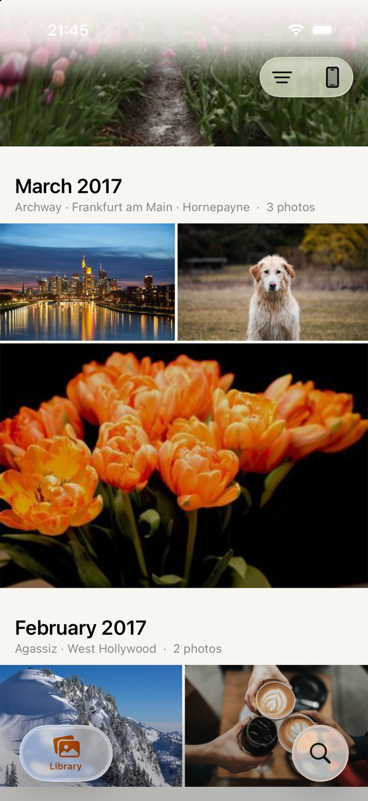
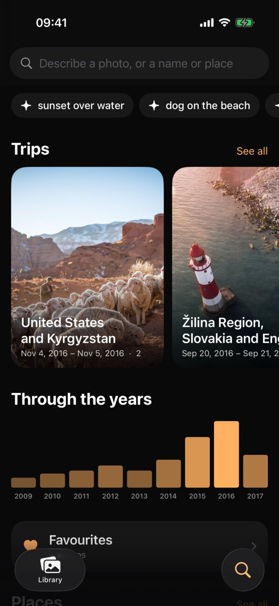
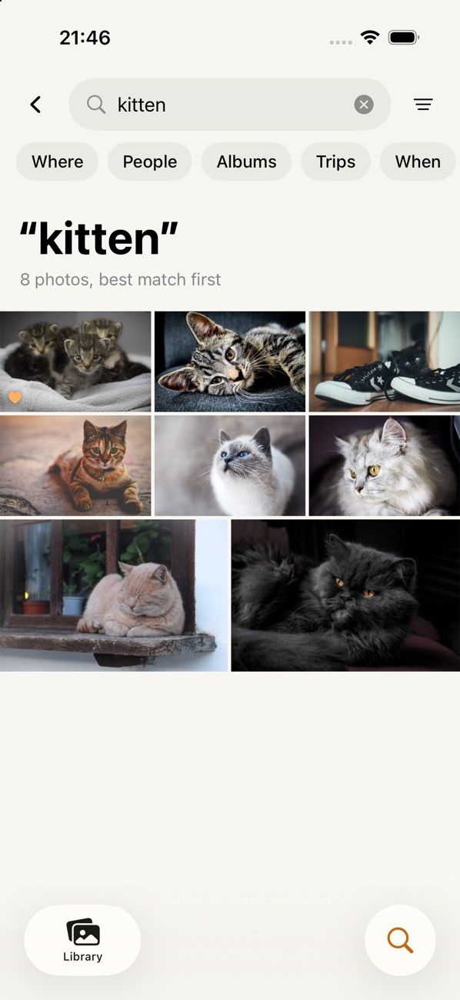
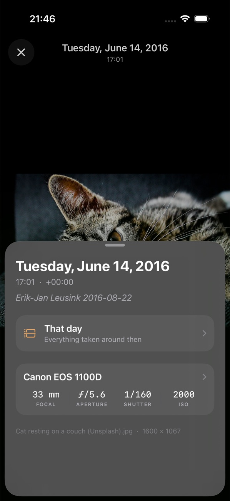
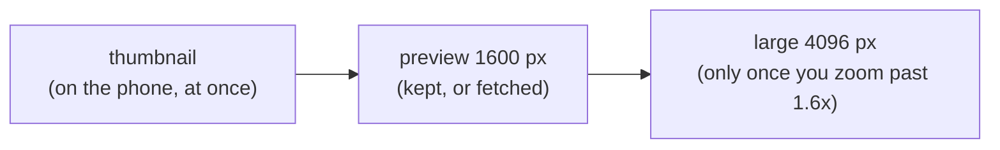

# 23. The native interface

The web page's interface took a whole chapter (13) and most of its lines. The phone's is the same
product drawn with native parts: a grid you can scroll through 100,000 photos without it noticing, a
viewer that grows out of the tile you touched, and a search page that starts from the library rather
than from a text field. This chapter walks through the Library and Search tabs and the choices behind them; the Albums tab is in [chapter 26](26-albums-and-agents.md).

<table>
<tr>
<td width="25%"></td>
<td width="25%"></td>
<td width="25%"></td>
<td width="25%"></td>
</tr>
</table>

*Library, Search, a search for "kitten", and a photo's details, in the iOS Simulator against the 104-photo
demo library.*

## Principles

Chapter 13 gave the web page four; the phone keeps them and adds two.

1. **The photos are the interface.** The Library runs to the edges of the screen and the heading leaves
   with the photos. Surfaces are quiet: warm paper in the light, near-black ink in the dark.
2. **One colour marks what is chosen or alive:** the *sun*, an amber that is burnt a little on paper so it
   still reads as text. Nothing else is coloured. The palette is taken from the app icon (a photographic
   print with hills under a low sun), which is `Estate` in [Design.swift](../../ios/PhotoEstate/Design.swift).
3. **One typeface, the system's.** Words that name a time or a place (a month, a trip, a date) are set
   heavier than the controls around them; nothing is decorated.
4. **The model answers; the view draws.** `LibraryModel` holds the question and its answer; the views
   hold nothing the model could.
5. **A shared screen, two instances.** The Library and Search tabs are the *same* grid, viewer and
   chips driven by two `LibraryModel`s (`Router.library` and `Router.search`). Anything that names a set
   of photos, whether a place in a photo's details, a trip card or "More like this", is `router.find(query)`:
   it loads that query into the Search model and switches tab.
6. **Respect the OS.** iOS 26's glass for controls floating over photos (the viewer's bar, the Library's
   buttons, the scrubber), system sheets for filters and details, and haptics on the steps that matter.

## The model: `LibraryModel`

Each of the two tabs owns a `LibraryModel`, which is to the phone what the state object `S` is to the web
page: the **question** (`query`, chapter 21) and its **answer** (`grid`, the tiles, a title and a
subtitle, whether it was ranked, a notice, whether it is loading). Changing `query` reloads the answer;
the model remembers the last 30 questions for **Back**, but *refining* (toggling a filter) isn't a step to
go back through, which is the browser's behaviour too (chapter 13's "the URL is the state").

`reload()` is where chapter 21 meets the screen. It reads the question with `Reader.plan`, and then:

- **No words left to describe:** answers from the replica (`tiles`). Instant, offline.
- **Words to describe, or More like this:** asks the server (`Remote.search`); on failure, falls back to
  matching words (with a notice) or shows the "needs your server" message.
- Each reload takes a **generation number**; if the question changed while an answer was in flight, the
  stale answer is dropped. The same guard protects the "load more" for a ranked list, whose pages come
  from the server 500 at a time as the grid nears its end.

It also writes the heading: "Library · 104 photos · 2009 - 2017", "Ben & Matthew in San Diego · 38
photos", "Trip to Denmark · 14 Jul - 21 Jul 2019 · 212 photos", and for a ranked search, `"kitten"` and
"8 photos, best match first". The title says **how the search was read**, as on the web page.

## The Library

### The grid

The justified grid of chapter 13 (every photo at its own shape, rows as wide as the screen) is a
`UICollectionView` with **one cell per row**. A library of 100,000 photos is about 30,000 cells of known
height, and the layout is arithmetic, done once for the whole list:

1. Photos are grouped into **sections** by time: the first 7 characters of the local time (`2019-07`)
   for the Library, 10 (`2019-07-14`) for a day, an event, or one month, and none (`grain 0`) for a ranked
   list, which is one flat run.
2. Within a section, photos are packed into rows left to right. Each photo's width is its **aspect ratio
   (clamped to 0.5-2.6) times the row height**. When the row would pass the screen's width, it
   closes, and its photos shrink *together* by the amount it overflowed so it fills the width exactly.
3. A section's **last row** is special: it grows to fill the width if that does not make it too tall, so
   a lone landscape photo becomes a full-width picture; if it can't, it grows as far as it may and sits
   in the middle.
4. Rounding is spread out: widths are whole pixels, and the one or two leftover pixels are given to
   photos in turn so rows end on the screen edge. The gap between photos is 3 pt.

The row height is the **density**, five steps (64, 96, 128, 180 and 260 pt) chosen from the View
menu or by pinching (a pinch past 1.3x or 0.77x moves one step, with a tick). A resize cross-fades
rather than jumping, and the grid **anchors on the first photo of the top row** across the change, so
changing size or receiving a sync keeps you looking at the same photos. A new *question* instead scrolls
to the top.

Each section has a caption: the month, then its three commonest places and a count ("March 2017
· Archway · Frankfurt am Main · Hornepayne · 3 photos"). The big title ("Library") sits inside the scroll
view above the first photo, so it scrolls away with them and the photos reach the top of the screen.

### The scrubber

At 100,000 photos a scroll bar is no use. The **scrubber** is a glass handle at the right edge that
appears while you scroll, labelled with the month you're in ("Jul 2019"), and which you can *drag* to jump
anywhere in the library. Its position is the scroll fraction; dragging sets the scroll offset directly,
and a haptic ticks each time the month changes. It appears only when the list is more than two screens
long, and hides 1.4 seconds after you stop.

### The bar

The Library's two buttons sit in a glass capsule: **View options** (order, the five sizes, "Hide
near-identical shots") and **On this iPhone**. The second is a status light: a phone icon when all is
well, a down arrow while syncing or downloading, a crossed Wi-Fi in the sun's colour when the server is
unreachable. It opens the sheet of chapter 22, which is also where you see sync state and last sync time.
Pull to refresh runs a sync.

## The viewer

Tap a tile and the photo **grows out of it**: a UIKit zoom transition whose source is the tile, with
`alignmentRectProvider` telling it the photo's aspect, so the picture lands exactly on its outline. Pull down
(or pinch it shut) and it shrinks back into whichever tile the viewer ended on, which may not be the
one it started from, because you can swipe between photos. A pull only closes when the photo isn't
zoomed and the motion is mostly vertical; sideways belongs to the pager.

- **Progressive sharpness**, as on the web page. Each page of the pager shows what it already has and
  upgrades in place: the thumbnail first, then the preview (`ImageStore.image(.preview, ...)`), then the
  large version when zoomed, and only if it hasn't been fetched already. The previews of the neighbouring
  photos are fetched in advance.
- **Gestures.** Swipe sideways to move (a tick of haptic feedback per photo), pinch or double-tap to
  zoom, tap to hide the bars (zooming in hides them too), and **flick up for details**.
- **The bars are small.** Two glass bars (a caption above: the date, the time and the city, a heart if
  it's a favourite; three buttons below: Share, Details, More like this) are separate hosting
  controllers, not a sheet over the photo, so that everything they don't cover still belongs to the photo's
  gestures.
- **Share sends the original.** The share action downloads `/original/<sha>` to a temporary file with
  the original name, so **Save Image** keeps its date and place (the same reason as the web page's share,
  chapter 13). If the server can't be reached, it falls back to the largest copy the phone has: the
  preview, then the thumbnail.

### Details, like the back of a print

The details sheet is a medium-height sheet over the photo (it grows to large). It lays out a
photo's metadata in the order you'd read the back of a print: **when** (the long date, the time and time
zone), a caption if there is one, **where** (the place name, and a small MapKit map with a marker when the photo has GPS; the map's tiles are the one thing here that need a network), the **event** ("Everything taken
around then") and **trip** ("The whole trip"), who is **With** it, which **Albums** it's In, and
last how it was taken as a plate on a camera: the body and lens, then four numbers (focal length,
aperture, shutter, ISO). Below that, the file name and pixel size.

Every one of those that names a set of photos is a link: tapping a person, a place, an album, the event or
the trip closes the viewer and shows that set in the **Search** tab. That's chapter 13's "every detail is
a link" with the navigation native.

## Search

The Search tab is not the system's search bar. It is the app's own field, **always at the top**, with the
filters under it when there is a question. (The system's search field moves between the navigation bar and
the tab bar from one iOS release to the next, and in one went missing; the app's can't.)

**Nothing asked yet.** The page under the field offers *ways in* drawn from the phone's own catalog, not
a blank screen:

- A row of **ideas**, tappable descriptions ("sunset over water", "dog on the beach", "a child laughing").
- **Trips** as a row of large cards (cover photo, a title, dates and a count).
- **Through the years**, a bar per year with the count; tapping one searches that year.
- **Favourites** and **Places**, each with a count.

**While typing.** The page is replaced by suggestions: first the literal search (`"kitten"`, "Photos that
look like this"), then the filters that *contain what you typed* (`Vocab.suggest`, chapter 21), each with
its kind and count. Tap a suggestion and it becomes a filter chip; press return and it becomes a search.

**A question.** The answer is the same grid, with the large heading ("kitten", "8 photos, best match
first"), the filter chips above it, and a line that says how it was read. If the words held names or places,
there is a button beside it that swaps between the two readings: **"Search for the words instead"** and
**"Read the names and places in it instead"** (the `plain` flag). Offline, the line reads "Offline: from
what is on this iPhone" in the sun's colour.

### Filters

The chips under the field are **Where, People, Albums, Trips, When, Camera, Favourites**. Each opens a
system sheet (`FilterSheet`) whose content comes from the replica: the values of the facet with live
counts (and a count of zero when a value would give nothing, rather than vanishing); a list of trips with
their dates; or a year-and-month picker with a bar of photos per month. A chosen filter's chip shows its
first value with a "+N" for the rest and a small cross to clear it; Favourites is a toggle.

## Where to look in the code

| Topic | Where |
|---|---|
| The question and the answer, `Router` | [LibraryModel.swift](../../ios/PhotoEstate/Library/LibraryModel.swift) |
| The grid layout, scrubber, headings, pinch | [Grid.swift](../../ios/PhotoEstate/Library/Grid.swift) |
| The viewer, pager, zoom, details, share | [Viewer.swift](../../ios/PhotoEstate/Library/Viewer.swift) |
| The Search tab and its landing page | [SearchView.swift](../../ios/PhotoEstate/Library/SearchView.swift) |
| Filter sheets | [FilterSheet.swift](../../ios/PhotoEstate/Library/FilterSheet.swift) |
| The Library tab and its bar | [LibraryView.swift](../../ios/PhotoEstate/Library/LibraryView.swift) |
| The look | [Design.swift](../../ios/PhotoEstate/Design.swift) |
| The same ideas for the web | [chapter 13](13-photo-app.md) |
