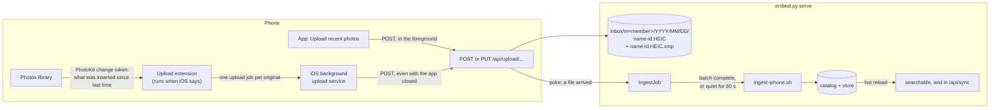
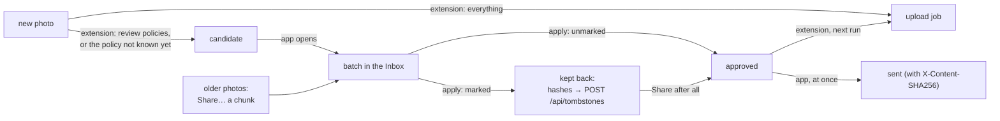
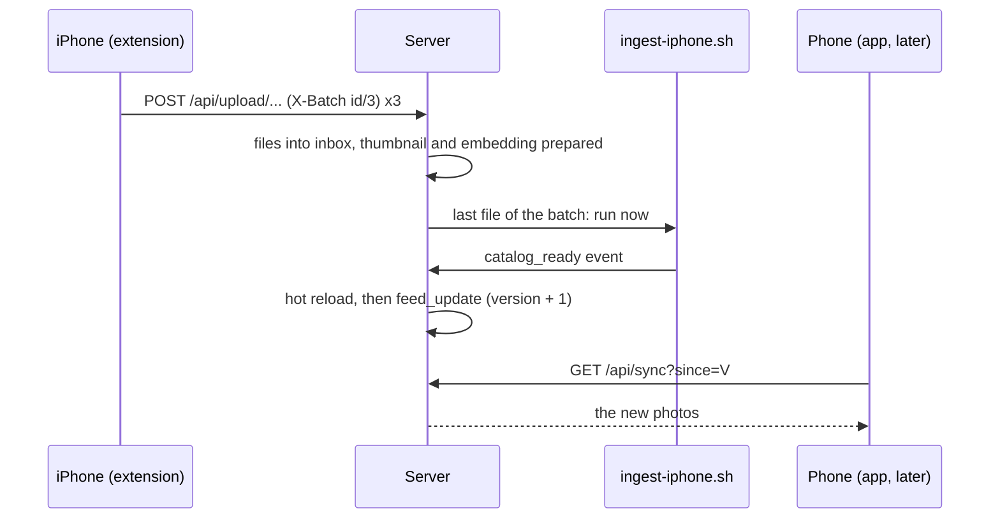

# 24. Uploading from the phone

The first half of this book brings photos *in* from other services. The iPhone app adds a source that
needs no export and no mirror: **the phone itself**, sending each new photo to your server as it is
taken. The result is that a photo is searchable on every device within about a minute, and iCloud
stops being the only place your camera roll lives.

The design problem is unusual. The sender is a phone: it sleeps, loses signal, is asked by iOS to stop,
and must be able to retry after any of that without ever creating a duplicate. The receiver is the
catalog, which has one rule above all others (chapter 1): **files are only ever added**. This chapter
covers both ends and the rule that joins them.



## Sending: the upload extension

iOS 27 added an extension point, `com.apple.photos.background-upload`: an app declares a
`PHBackgroundResourceUploadJobExtension`, and the system uploads photos for it **in the background,
with the app closed**, over whatever connection the phone has (here, Tailscale), with its own retries,
and wakes the extension when there is work to schedule. That is exactly the requirement: the app does not have to be running.

[UploadExtension.swift](../../ios/UploadExtension/UploadExtension.swift) (117 lines) is the whole
extension. When the system calls `processJobs()`:

1. **Settle finished jobs.** Jobs the system has completed are *acknowledged* (that frees room under its
   per-app job limit) and failed ones are retried once.
2. **Find what's new, with a change token.** PhotoKit keeps a persistent change history. The first time
   the extension runs it saves `library.currentChangeToken` and does *nothing else*: **only photos
   taken after you turn the feature on are uploaded automatically.** Every later run asks for the
   persistent changes since the saved token, collects the identifiers of *inserted* assets, and saves the
   newest token. A crash between reading and queuing is covered by a **pending list** of identifiers
   persisted until they are turned into jobs.
3. **Queue one job per original resource.** An asset has several resources (the photo, an edited
   rendering, a Live Photo's video); `UploadRequest.wanted` selects the **original photo, video, or a
   Live Photo's paired video** and nothing else, which is the faithful copy of a photo (the same reason
   chapter 3 gives for preferring originals over what a service re-encodes). Each becomes `PHAssetResourceUploadJobChangeRequest.creationRequestForJob(destination:, resource:)`
   with a ready-made `URLRequest`.
4. **Report.** It returns `.completed` when nothing is left over, `.processing` when the job limit was
   hit and some assets are still pending (iOS will call again), or `.failure`.

Nothing runs at a time of the app's choosing: **iOS decides when the extension wakes**, which is why the
Uploads screen has an *activity* list (below) so you can tell "hasn't run" from "ran and found nothing".

### The request

[UploadRequest.swift](../../ios/Shared/UploadRequest.swift) turns one resource into one `URLRequest`.
It lives in `Shared/` because the extension and the app's foreground uploader must build **identical**
requests for the same photo, and for the server to treat the second as a no-op.

```
POST /api/upload/2026/11/14/IMG_0042-3fa9c1b.HEIC
X-Filename: IMG_0042.HEIC
X-Taken: 2026-11-14T17:02:31Z
X-Latitude: 47.6062
X-Longitude: -122.3321
X-Favorite: true
X-Screenshot: 1
X-Batch: 5f1c0a9d2b3e/3
X-Content-SHA256: 9f2c…            (the in-app uploader only: it has the file)
```

- **The path** is `YYYY/MM/DD/<original name>-<id>.<EXT>`: the **capture day in UTC**, the original
  file name, and 7 hex digits of the SHA-256 of the asset's `localIdentifier`, so two photos both called
  `IMG_0042` never collide. The same asset always makes the same path.
- **The name is cleaned**: the server accepts letters, digits and ``_ ( ) . + , ' = -`` and the space;
  anything else becomes `_`.
- **The metadata travels in headers**, not in the file, because a background upload sends *one resource
  per request*: the date (an ISO 8601 UTC time), GPS, and whether it is a favourite. The server turns them into
  a sidecar next to the photo (below).
- **`X-Batch`** names the files queued together and says how many (`<id>/<count>`). It's how the server
  knows *when to start working*.
- **`X-Screenshot: 1`** when PhotoKit says the photo is a screenshot (`mediaSubtypes.photoScreenshot`). The
  server writes it into the sidecar as the keyword `screenshot`, and the hold at ingestion reads it beside its
  own `is_screenshot` (chapter 11).
- **`X-Content-SHA256`** is sent by the in-app uploader, which exports the file before it sends it and hashes
  it on the way (`FileHash`): the server checks the bytes against it, and refuses an opted-out photo before
  reading its body (below). The extension's jobs cannot send it: the extension never reads the file.

## Receiving: the inbox

[upload.py](../../photo-estate/upload.py) (312 lines of code, standard library only) takes the bytes. The
server does *not* write to the catalog: it drops files into an **inbox** that has the same shape as the
iCloud mirror (chapter 3), `<db dir>/iphone/YYYY/MM/DD/...`, and `estate.py ingest --force` picks it up like
any other folder source. The reasons, in the file's own words: it keeps `ingest` the single writer of what
the catalog holds, and **a half-finished upload can never be mistaken for a photo**.

**Whose it is** (multiplayer phase 5). The server puts each upload in the folder of the member the request is
for: `<db dir>/iphone/m<member id>/YYYY/MM/DD/...` (`PhotoApp.folder_of`). The phone's path is unchanged, so
an iPhone app that knows nothing of members goes on uploading as before; a member cannot write into another's
folder (the member folder is the server's, put in front of whatever the phone sends). Ingest reads the sharer
back from the folder (`estate.py ingest --uploads`; [chapter 11](11-server.md#private-photos)); what is in the
inbox with no member folder, sent before there were member folders, is the first sysadmin's, and a file of
his sent again is found where it was (`200 exists`). Staging stays beside the inbox, never in a member's
folder. A new upload is private to its sharer until it has been checked: see the hold at ingestion, below.

`save_upload(inbox, rel, fp, length, sha256, meta)`:

1. **Validate the path** (`clean_path`): relative, no `..`, the right shape, and a **media extension**
   (JPEG, PNG, HEIC, HEIF, GIF, WebP, TIFF, DNG, AVIF, MOV, MP4 and friends) or a sidecar named
   `X.<media ext>.xmp`.
2. **Idempotency.** If the destination exists with the same size, answer `200 exists`. With a different
   size, `409`: ingest keys on the path, which must never change underneath it. Same path and same
   size is a retry.
3. **Stream to a staging folder**, in 1 MB chunks, hashing as it goes, then `fsync`. A short body is a
   `400` ("connection ended after N of M bytes"); a supplied `X-Content-SHA256` that doesn't match is a
   `400`. The limit is 8 GB, for a long 4K video.
4. **Refuse a tombstone.** Before anything is read, if `X-Content-SHA256` names bytes the member opted out of
   (or the sysadmin purged), the answer is given and the body is never read; without the header, the hash
   worked out in step 3 is asked the same, and a refused file is removed from staging (below).
5. **Rename into the inbox**, an atomic operation. The file is either fully there or not there at all.
6. **Write the `.xmp` sidecar** *after* the file, from the headers: a `photoshop:DateCreated` with
   offset, `exif:GPSLatitude`/`GPSLongitude`, `xmp:Rating` 5 for a favourite, and the keyword `screenshot`
   (`dc:subject`) for a screenshot. These are the same flat tags icloudpd
   writes, so `link` (chapter 6) reads them with the code it already has: nothing about the phone needed a
   new rule for dates or places.

The status codes (appendix B): `201 stored`, `200 exists`, `200 refused` (with `X-Upload-Refused: opted_out` or
`purged`), `409`, `400`, `411` without a length, `403` if the caller is not an active member (chapter 11), `413`
if too large.

**Why a refusal is a 200.** The system uploader marks a job that got a `4xx` or `5xx` as failed, and the
extension retries a failed job, so the refused bytes would cross the tailnet again; and an app from before the
phone gate counts a `200` as "already there" and anything else as a failure it shows. A `200` is the one answer
both take as done, which matters more than the code being exact. The body (`{"status": "refused: opted_out"}`)
and the `X-Upload-Refused` header are how the new app tells the two apart. A catalog that cannot be read while
checking is a `500`, which a phone sends again later: never a yes.

### Uploads that are safe to repeat

The two ends are built so that doing too much is harmless:

- The extension and "Upload recent photos" both send the *same* path for a photo, so a photo sent by
  both is stored once (`200 exists`).
- A photo already in the store from another source (it came through iCloud, then through the phone) is
  recognised later by its SHA-256 at ingest, the same way every duplicate in this book is (chapter 4). The
  inbox copy becomes another *occurrence* of the same asset.
- Nothing is deleted from the phone, the inbox or the store.

## The phone gate: looking before sharing

*Multiplayer phase 6 (docs/notes/MULTIPLAYER-PLAN.md).* A member's **upload policy** (`/members`, read by the
app from `GET /api/me`) decides what happens to a new photo:

| Policy | What happens to a new photo |
|---|---|
| `everything` (the owner) | As before: the extension makes an upload job at once |
| `review` | Nothing is sent until the member has looked: it waits in the app's Inbox |
| `review_flagged` | Only what may be private is asked about; the rest is sent without asking |

The rules and the state are one file, [PhoneGate.swift](../../ios/Shared/PhoneGate.swift): plain functions of
a `GateState` (unit-tested on the Mac, below), kept as `gate.json` in the app group, which the app and the
extension both read and write under a file lock (`GateStore`).



- **Candidates, not jobs.** Under a review policy the extension records each new photo's identifier as a
  candidate and makes no job (the server does not learn the photo exists). It does the same while the app has not
  read the policy yet: a candidate is safe, a photo sent is for good. When the app learns the policy is
  `everything`, the candidates are approved and sent.
- **A batch is an Inbox item made on the phone.** When the app comes to the front, the candidates become one
  batch, *"5 new photos"*. Reviewing is a change set's review: everything is shared unless marked; a tap marks a
  photo *kept back*; **Share 4, keep 1 back** applies it. Under `review_flagged` only the flagged photos are in
  the batch and the rest are approved without asking, except the very first time, when the batch asks about
  everything so that nothing is shared before the member has read the line below.
- **What may be private** (`Flags`, in the app): PhotoKit's own word for a screenshot or a screen recording, then
  Apple's Vision text recognition (`VNRecognizeTextRequest`, fast) on a 900-pixel copy: six lines of text or more,
  or text over 12% of the picture, is flagged as a document, a receipt or a screenshot. Nothing leaves the phone
  to decide it. Under `review` the PhotoKit mark alone is shown as a hint.
- **The first share** shows, once, before anything is sent: *"Shared photos become part of the family estate.
  You can withdraw one from view later, but not erase it."*
- **Approved photos are sent at once** by the in-app uploader (it has the app open: the member just tapped);
  what it cannot send stays approved, and the extension makes jobs for it on its next run. The extension only
  creates jobs: iOS lets nothing else.
- **Kept back is a tombstone.** Applying a batch hashes each original file of every marked photo (SHA-256 of
  the bytes, as the store keys them; a Live Photo has two), keeps the hashes with the photo's identifier, and
  sends the hashes, and nothing else, to `POST /api/tombstones` (kept and sent later if the server cannot be
  reached). On this phone the identifier keeps the photo from ever becoming a job. On a **new phone** the
  identifiers are new and only the hashes match: the app reads the member's tombstones from `GET
  /api/tombstones` each time it comes to the front, before it sends anything, and the in-app uploader, which
  hashes every file it sends, keeps such a photo back without a request. If its list is stale (another phone of
  theirs opted out a moment ago), the server refuses the hash before the body, and the app keeps the photo back
  from then on. The system uploader's jobs cannot be checked on the phone: for those the server reads the bytes,
  hashes them and drops them from staging, so after a phone is replaced an opted-out photo can cross the tailnet
  once and be thrown away (the owner's choice, open question 5 in the plan).
- **An opt-out is the member's own.** It refuses their upload of those bytes and nobody else's, and it is no
  withdraw: a copy another member shares, or one already in the estate, is untouched. Only the member takes it
  back, on their phone: **Kept back on this iPhone** lists those photos with **Share after all**, which lifts the
  tombstone (`lift`) and sends the photo.
- **The Hidden album.** PhotoKit leaves hidden photos out of every fetch unless asked, and nothing here asks: a
  hidden photo is never a candidate, never in a chunk and never sent (the extension drops it from its pending
  list for good, as before). A photo unhidden later is offered with its year's chunk.
- **Joining, and older photos.** The extension starts from its own first run, after the member has joined.
  Everything before it is offered in the Inbox a chunk at a time: *Since you joined* (from `joined_at`), then each
  year, newest first. **Share…** makes the chunk a batch to look over (under `review_flagged`, only what is flagged
  is asked about); **Skip** leaves it on the phone and offers it no more. A photo the gate already has a place
  for (a candidate, in a batch, approved, sent or kept back) is in no chunk. For a gated member Uploads shows
  no "Upload recent photos": that would be a way round the review.

What iOS and the Simulator cannot show, and so has not been tried: the extension recording candidates (it never
runs in the Simulator), a real photo library, PhotoKit's own screenshot mark on a real screenshot, and the
system uploader meeting a refusal.

## Cataloguing without waiting

A photo is useful when it's *searchable*, not when it's stored. The server runs the ingest by itself
(chapter 16 has the full account, and appendix B the endpoints); the parts that matter here:

- **A batch is a unit of work.** `X-Batch: id/count` tells the server how many files belong together. When
  the last one lands there is nothing left to wait for, so the run starts **immediately**.
- **A quiet period is the fallback**: if a batch never completes (a failed upload, an older app), a run
  starts after `--ingest-quiet` (60 s) with no new uploads, and at the latest `--ingest-max-wait` (600 s)
  after the first of a burst, so a long upload is catalogued as it goes.
- **One state at a time.** `IngestJob` is idle, quiet (the timer is running), starting, running or in
  backoff after a failure; a step its `MOVES` table does not allow raises (issue #86). Starting a run,
  by hand or when the timer runs out, cancels any timer still armed, and the log the page shows is
  written and read under the same lock.
- **Incremental all the way down.** `ingest-iphone.sh` only touches what is new: `link` is limited to the
  inbox, `exif`, `embed` and `faces` skip finished photos, and `places` reuses names and zones it has
  already worked out. The app even prepares the arrival while it is still receiving: the grid thumbnail (a WebP, chapter 11) is
  made on upload, the embedding is computed in the server's own process using the model it already holds,
  and a HEIC's size, date and perceptual hash are left in a "facts" file so ingest need not decode it a
  second time.
- **The hold.** After the embeddings and before the catalog is reloaded, `private.py check` scores each new
  upload: one that looks like a receipt, a screenshot or a document stays private to the member who sent it,
  and their inbox says so; the rest are shared ([chapter 11](11-server.md#private-photos)). Until then, a new
  upload is private to its sharer from the moment ingest records it, whenever a reload comes.
- **Hot reload.** When the catalog is ready, the server re-reads what changed *in the background* and swaps
  it in without a restart; searches are answered from the old catalog until the new one is ready. It then
  calls `feed_update()`, which is what makes the new photos appear in `/api/sync` (chapter 20) and so on
  every phone, including the one that took them.

The Library info page (`/stats`) shows the inbox and the run. It asks `/api/ingest` every 2 s while a
run is going and every 15 s otherwise, in the same loop that asks for the page's figures, one request at
a time, and not while the tab is hidden ([app/stats-watch.js](../../photo-estate/app/stats-watch.js),
issue #80). A run or a restart that can not be started says why in the panel; after **Restart to show
them** the page waits for the app for at most five minutes and reloads when it answers.

A measured example from the project's performance notes (PERFORMANCE.md): from a phone upload to the
photo showing in the app, **about 9.7 seconds**, once ingest and the reload were made incremental.



## The app's half: Uploads from this iPhone

In the **On this iPhone** sheet, under Server, **Uploads from this iPhone** opens
[UploadsView.swift](../../ios/PhotoEstate/UploadsView.swift):

| Section | What it does |
|---|---|
| Server | Shows the address |
| New photos | Shows photo access and whether background upload is on; one button turns it on or off. The footer says that once on, iOS sends each new photo in the background *even with the app closed*, and that photos from before you turned it on are not sent |
| Older photos | A stepper for "Last N days" (1 to 3,650) and **Upload recent photos**: the foreground uploader, for the backlog and as a fallback if the extension does not run |
| Background upload activity | The last runs of the extension, newest first, with older ones folded away |

**The foreground uploader** ([ForegroundUploader.swift](../../ios/PhotoEstate/ForegroundUploader.swift), 76
lines) fetches the assets with a creation date in the window, newest first, and for each original
resource exports it to a temporary file (asking iCloud for it if it was optimised away; `isNetworkAccessAllowed`), hashes it,
uploads it with the same `UploadRequest` and its hash, deletes the temporary file, and counts `201` as sent, `200` as already
there, a refusal (`X-Upload-Refused`) or a hash the member opted out of as kept back, and anything else as failed. It
also sends the photos approved in the Inbox (`send(ids)`), by identifier. All the files of one run share one batch id, so the server starts when the
last one arrives. It needs the app open, and says so.

**The activity log** is the answer to "is it working?". The extension and the app are separate
processes, and iOS decides when the extension wakes, so there would otherwise be no way to tell *never ran*
from *ran and found nothing*. The extension writes each run to a small log in an **app group**
(`group.com.jflam.photoestate`): when it ran, whether it completed, how many jobs it queued, and a
note ("first run: watching for photos from now on", "job create failed: 5"). Back-to-back runs that did nothing
are merged into one row ("Nothing new x7") so that real events aren't pushed out of its 50 rows.

### What is on the phone and not yet on the server

The Library also shows the photos in the phone's own Photos library that the catalog has no row for,
each with a small up-arrow, so a photo just taken is there before it is uploaded
([LocalPhotos.swift](../../ios/PhotoEstate/Library/LocalPhotos.swift)). A phone photo counts as on the
server when the replica has a photo taken at the same second (UTC, give or take one), or at the same
wall-clock time for one whose time zone was never known, or a file of the same name taken within a day.

Videos are matched the same way, since the server dates them from the same sidecars, but only once the
replica holds at least one video. A server from before videos were catalogued would otherwise have every
video on the phone counted as not yet uploaded. A Live Photo is one asset here, its clip part of it, as it
is one row in the catalog. A phone video not yet on the server shows its length like any video, and its
page plays it from Photos (fetched from iCloud if the phone keeps only a small copy).

Uploading itself did not change for videos: the extension and the foreground uploader already sent the
original video, and a Live Photo's paired video beside its still. Both files of a Live Photo arrive with
the same stem (`UploadRequest.path`), and the server pairs them when `exif` finishes
([chapter 6](06-linking.md#step-2-live-photos-and-motion-photos)).

## Building and running it

The extension needs iOS 27, so `project.yml` builds the app and the extension together; it builds for the
iOS 27 Simulator as well as a device, and the extension simply never runs there. A Simulator older than that
can't install it, which is why `project-sim.yml` exists: it builds the app alone, without the extension or the
Uploads screen (it has the Inbox and the in-app uploader since phase 6), and is what the demo screenshots in
this book and the README were taken with. The background upload cannot be exercised in either.

```bash
cd ios && xcodegen && xcodegen -s project-sim.yml          # regenerate both projects after adding a file
xcodebuild -project PhotoEstate.xcodeproj -scheme PhotoEstate \
    -destination 'platform=iOS Simulator,name=iPhone 18 Pro' SERVER_BASE=http://127.0.0.1:8791 build
xcrun simctl launch booted com.jflam.photoestate -demoMember ben     # a debug build as a demo member (chapter 19)
ios/Tests/run.sh                                                     # the gate's unit tests, on the Mac
```

`Tests/run.sh` compiles `PhoneGate.swift` and `UploadRequest.swift` with `Tests/main.swift` for the Mac
(`swiftc`) and runs them: the routing of new photos under each policy, batches and marks, opt-outs and their
hashes, share after all, a new phone's tombstones, chunks, the state file (and one an older build wrote), and the
request's path and headers. There is no Xcode test target. To try uploads against a demo server, start it with
`--inbox <a scratch folder> --ingest-quiet 0`: uploads land in the folder and no ingest runs (an ingest in
`--demo` would write into the checked-in demo store).

## Where to look in the code

| Topic | Where |
|---|---|
| The extension: change token, jobs, pending list | [UploadExtension.swift](../../ios/UploadExtension/UploadExtension.swift) |
| The phone gate: policies, candidates, batches, opt-outs, chunks | [PhoneGate.swift](../../ios/Shared/PhoneGate.swift), [Gate/](../../ios/PhotoEstate/Gate/), tests in [ios/Tests](../../ios/Tests/main.swift) |
| Tombstones on the server, and a refused upload | `change_tombstones`, `refused_upload` in [private.py](../../photo-estate/private.py); `Admin.upload` in [admin.py](../../photo-estate/admin.py) |
| The path, the headers, batches | [UploadRequest.swift](../../ios/Shared/UploadRequest.swift) |
| The phone's photos and videos not yet on the server | [LocalPhotos.swift](../../ios/PhotoEstate/Library/LocalPhotos.swift) |
| The foreground uploader and the Uploads screen | [ForegroundUploader.swift](../../ios/PhotoEstate/ForegroundUploader.swift), [UploadsView.swift](../../ios/PhotoEstate/UploadsView.swift) |
| The activity log | [ExtensionStatus.swift](../../ios/Shared/ExtensionStatus.swift) |
| The inbox: validation, staging, sidecars | [upload.py](../../photo-estate/upload.py) `save_upload`, `xmp_for` |
| Running the ingest by itself, batches | `IngestJob` in [upload.py](../../photo-estate/upload.py); [ingest-iphone.sh](../../photo-estate/ingest-iphone.sh) |
| The endpoints and status codes | [Appendix B](appendix-b-http-api.md) |
| The timings | [PERFORMANCE.md](../notes/PERFORMANCE.md) |
