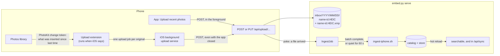
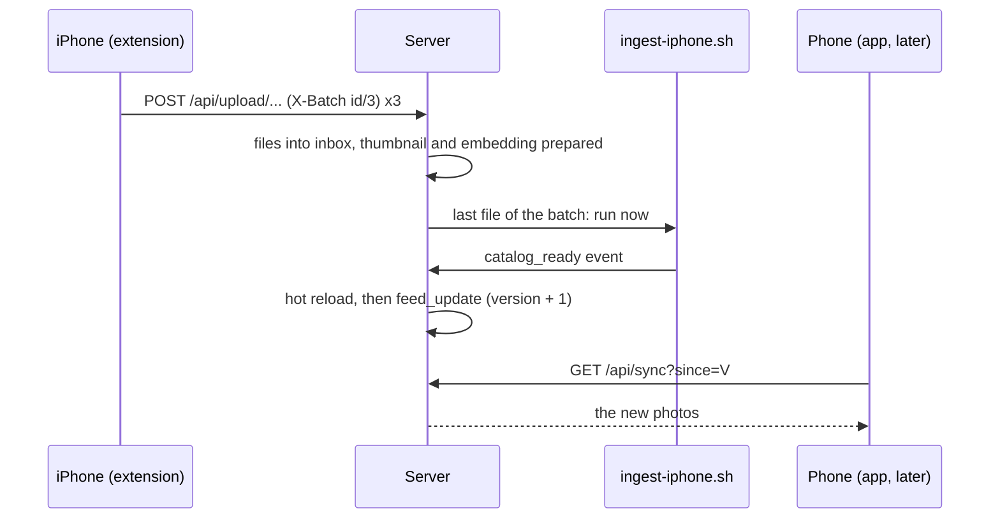

# 24. Uploading from the phone

The first half of this book brings photos *in* from other services. The iPhone app adds a source that
needs no export and no mirror: **the phone itself**, sending each new photo to your server as it is
taken. The result is that a photo is searchable on every device within about a minute, and iCloud
stops being the only place your camera roll lives.

The design problem is unusual. The sender is a phone: it sleeps, loses signal, is asked by iOS to stop,
and must be able to retry after any of that without ever creating a duplicate. The receiver is the
catalog, which has one rule above all others (chapter 1): **files are only ever added**. This chapter
covers both ends and the rule that joins them.



## Sending: the upload extension

iOS 27 added an extension point, `com.apple.photos.background-upload`: an app declares a
`PHBackgroundResourceUploadJobExtension`, and the system uploads photos for it **in the background,
with the app closed**, over whatever connection the phone has (here, Tailscale), with its own retries,
and wakes the extension when there is work to schedule. That is exactly the requirement: the app does not have to be running.

[UploadExtension.swift](../../ios/UploadExtension/UploadExtension.swift) (117 lines) is the whole
extension. When the system calls `processJobs()`:

1. **Settle finished jobs.** Jobs the system has completed are *acknowledged* (that frees room under its
   per-app job limit) and failed ones are retried once.
2. **Find what's new, with a change token.** PhotoKit keeps a persistent change history. The first time
   the extension runs it saves `library.currentChangeToken` and does *nothing else*: **only photos
   taken after you turn the feature on are uploaded automatically.** Every later run asks for the
   persistent changes since the saved token, collects the identifiers of *inserted* assets, and saves the
   newest token. A crash between reading and queuing is covered by a **pending list** of identifiers
   persisted until they are turned into jobs.
3. **Queue one job per original resource.** An asset has several resources (the photo, an edited
   rendering, a Live Photo's video); `UploadRequest.wanted` selects the **original photo, video, or a
   Live Photo's paired video** and nothing else, which is the faithful copy of a photo (the same reason
   chapter 3 gives for preferring originals over what a service re-encodes). Each becomes `PHAssetResourceUploadJobChangeRequest.creationRequestForJob(destination:, resource:)`
   with a ready-made `URLRequest`.
4. **Report.** It returns `.completed` when nothing is left over, `.processing` when the job limit was
   hit and some assets are still pending (iOS will call again), or `.failure`.

Nothing runs at a time of the app's choosing: **iOS decides when the extension wakes**, which is why the
Uploads screen has an *activity* list (below) so you can tell "hasn't run" from "ran and found nothing".

### The request

[UploadRequest.swift](../../ios/Shared/UploadRequest.swift) turns one resource into one `URLRequest`.
It lives in `Shared/` because the extension and the app's foreground uploader must build **identical**
requests for the same photo, and for the server to treat the second as a no-op.

```
POST /api/upload/2026/11/14/IMG_0042-3fa9c1b.HEIC
X-Filename: IMG_0042.HEIC
X-Taken: 2026-11-14T17:02:31Z
X-Latitude: 47.6062
X-Longitude: -122.3321
X-Favorite: true
X-Batch: 5f1c0a9d2b3e/3
```

- **The path** is `YYYY/MM/DD/<original name>-<id>.<EXT>`: the **capture day in UTC**, the original
  file name, and 7 hex digits of the SHA-256 of the asset's `localIdentifier`, so two photos both called
  `IMG_0042` never collide. The same asset always makes the same path.
- **The name is cleaned**: the server accepts letters, digits and ``_ ( ) . + , ' = -`` and the space;
  anything else becomes `_`.
- **The metadata travels in headers**, not in the file, because a background upload sends *one resource
  per request*: the date (an ISO 8601 UTC time), GPS, and whether it is a favourite. The server turns them into
  a sidecar next to the photo (below).
- **`X-Batch`** names the files queued together and says how many (`<id>/<count>`). It's how the server
  knows *when to start working*.

## Receiving: the inbox

[upload.py](../../photo-estate/upload.py) (312 lines of code, standard library only) takes the bytes. The
server does *not* write to the catalog: it drops files into an **inbox** that has the same shape as the
iCloud mirror (chapter 3), `<db dir>/iphone/YYYY/MM/DD/...`, and `estate.py ingest --force` picks it up like
any other folder source. The reasons, in the file's own words: it keeps `ingest` the single writer of what
the catalog holds, and **a half-finished upload can never be mistaken for a photo**.

`save_upload(inbox, rel, fp, length, sha256, meta)`:

1. **Validate the path** (`clean_path`): relative, no `..`, the right shape, and a **media extension**
   (JPEG, PNG, HEIC, HEIF, GIF, WebP, TIFF, DNG, AVIF, MOV, MP4 and friends) or a sidecar named
   `X.<media ext>.xmp`.
2. **Idempotency.** If the destination exists with the same size, answer `200 exists`. With a different
   size, `409`: ingest keys on the path, which must never change underneath it. Same path and same
   size is a retry.
3. **Stream to a staging folder**, in 1 MB chunks, hashing as it goes, then `fsync`. A short body is a
   `400` ("connection ended after N of M bytes"); a supplied `X-Content-SHA256` that doesn't match is a
   `400`. The limit is 8 GB, for a long 4K video.
4. **Rename into the inbox**, an atomic operation. The file is either fully there or not there at all.
5. **Write the `.xmp` sidecar** *after* the file, from the headers: a `photoshop:DateCreated` with
   offset, `exif:GPSLatitude`/`GPSLongitude`, and `xmp:Rating` 5 for a favourite. These are the same flat tags icloudpd
   writes, so `link` (chapter 6) reads them with the code it already has: nothing about the phone needed a
   new rule for dates or places.

The status codes (appendix B): `201 stored`, `200 exists`, `409`, `400`, `411` without a length, `403`
if `--upload-user` restricts who may upload, `413` if too large.

### Uploads that are safe to repeat

The two ends are built so that doing too much is harmless:

- The extension and "Upload recent photos" both send the *same* path for a photo, so a photo sent by
  both is stored once (`200 exists`).
- A photo already in the store from another source (it came through iCloud, then through the phone) is
  recognised later by its SHA-256 at ingest, the same way every duplicate in this book is (chapter 4). The
  inbox copy becomes another *occurrence* of the same asset.
- Nothing is deleted from the phone, the inbox or the store.

## Cataloguing without waiting

A photo is useful when it's *searchable*, not when it's stored. The server runs the ingest by itself
(chapter 16 has the full account, and appendix B the endpoints); the parts that matter here:

- **A batch is a unit of work.** `X-Batch: id/count` tells the server how many files belong together. When
  the last one lands there is nothing left to wait for, so the run starts **immediately**.
- **A quiet period is the fallback**: if a batch never completes (a failed upload, an older app), a run
  starts after `--ingest-quiet` (60 s) with no new uploads, and at the latest `--ingest-max-wait` (600 s)
  after the first of a burst, so a long upload is catalogued as it goes.
- **One state at a time.** `IngestJob` is idle, quiet (the timer is running), starting, running or in
  backoff after a failure; a step its `MOVES` table does not allow raises (issue #86). Starting a run,
  by hand or when the timer runs out, cancels any timer still armed, and the log the page shows is
  written and read under the same lock.
- **Incremental all the way down.** `ingest-iphone.sh` only touches what is new: `link` is limited to the
  inbox, `exif`, `embed` and `faces` skip finished photos, and `places` reuses names and zones it has
  already worked out. The app even prepares the arrival while it is still receiving: the grid thumbnail (a WebP, chapter 11) is
  made on upload, the embedding is computed in the server's own process using the model it already holds,
  and a HEIC's size, date and perceptual hash are left in a "facts" file so ingest need not decode it a
  second time.
- **Hot reload.** When the catalog is ready, the server re-reads what changed *in the background* and swaps
  it in without a restart; searches are answered from the old catalog until the new one is ready. It then
  calls `feed_update()`, which is what makes the new photos appear in `/api/sync` (chapter 20) and so on
  every phone, including the one that took them.

The Library info page (`/stats`) shows the inbox and the run. It asks `/api/ingest` every 2 s while a
run is going and every 15 s otherwise, in the same loop that asks for the page's figures, one request at
a time, and not while the tab is hidden ([app/stats-watch.js](../../photo-estate/app/stats-watch.js),
issue #80). A run or a restart that can not be started says why in the panel; after **Restart to show
them** the page waits for the app for at most five minutes and reloads when it answers.

A measured example from the project's performance notes (PERFORMANCE.md): from a phone upload to the
photo showing in the app, **about 9.7 seconds**, once ingest and the reload were made incremental.



## The app's half: Uploads from this iPhone

In the **On this iPhone** sheet, under Server, **Uploads from this iPhone** opens
[UploadsView.swift](../../ios/PhotoEstate/UploadsView.swift):

| Section | What it does |
|---|---|
| Server | Shows the address |
| New photos | Shows photo access and whether background upload is on; one button turns it on or off. The footer says that once on, iOS sends each new photo in the background *even with the app closed*, and that photos from before you turned it on are not sent |
| Older photos | A stepper for "Last N days" (1 to 3,650) and **Upload recent photos**: the foreground uploader, for the backlog and as a fallback if the extension does not run |
| Background upload activity | The last runs of the extension, newest first, with older ones folded away |

**The foreground uploader** ([ForegroundUploader.swift](../../ios/PhotoEstate/ForegroundUploader.swift), 76
lines) fetches the assets with a creation date in the window, newest first, and for each original
resource exports it to a temporary file (asking iCloud for it if it was optimised away; `isNetworkAccessAllowed`), uploads it
with the same `UploadRequest`, deletes the temporary file, and counts `201` as sent, `200` as already
there and anything else as failed. All the files of one run share one batch id, so the server starts when the
last one arrives. It needs the app open, and says so.

**The activity log** is the answer to "is it working?". The extension and the app are separate
processes, and iOS decides when the extension wakes, so there would otherwise be no way to tell *never ran*
from *ran and found nothing*. The extension writes each run to a small log in an **app group**
(`group.com.jflam.photoestate`): when it ran, whether it completed, how many jobs it queued, and a
note ("first run: watching for photos from now on", "job create failed: 5"). Back-to-back runs that did nothing
are merged into one row ("Nothing new x7") so that real events aren't pushed out of its 50 rows.

### What is on the phone and not yet on the server

The Library also shows the photos in the phone's own Photos library that the catalog has no row for,
each with a small up-arrow, so a photo just taken is there before it is uploaded
([LocalPhotos.swift](../../ios/PhotoEstate/Library/LocalPhotos.swift)). A phone photo counts as on the
server when the replica has a photo taken at the same second (UTC, give or take one), or at the same
wall-clock time for one whose time zone was never known, or a file of the same name taken within a day.

Videos are matched the same way, since the server dates them from the same sidecars, but only once the
replica holds at least one video. A server from before videos were catalogued would otherwise have every
video on the phone counted as not yet uploaded. A Live Photo is one asset here, its clip part of it, as it
is one row in the catalog. A phone video not yet on the server shows its length like any video, and its
page plays it from Photos (fetched from iCloud if the phone keeps only a small copy).

Uploading itself did not change for videos: the extension and the foreground uploader already sent the
original video, and a Live Photo's paired video beside its still. Both files of a Live Photo arrive with
the same stem (`UploadRequest.path`), and the server pairs them when `exif` finishes
([chapter 6](06-linking.md#step-2-live-photos-and-motion-photos)).

## Building and running it

The extension needs iOS 27, so `project.yml` builds the app and the extension together, for a device. A
Simulator older than that can't install it, which is why `project-sim.yml` exists: it builds the app
alone, without the extension, the foreground uploader or the Uploads screen, and is what the demo screenshots in this book and the README were taken
with. Everything in chapters 20-23 works in it; the background upload cannot be exercised there.

## Where to look in the code

| Topic | Where |
|---|---|
| The extension: change token, jobs, pending list | [UploadExtension.swift](../../ios/UploadExtension/UploadExtension.swift) |
| The path, the headers, batches | [UploadRequest.swift](../../ios/Shared/UploadRequest.swift) |
| The phone's photos and videos not yet on the server | [LocalPhotos.swift](../../ios/PhotoEstate/Library/LocalPhotos.swift) |
| The foreground uploader and the Uploads screen | [ForegroundUploader.swift](../../ios/PhotoEstate/ForegroundUploader.swift), [UploadsView.swift](../../ios/PhotoEstate/UploadsView.swift) |
| The activity log | [ExtensionStatus.swift](../../ios/Shared/ExtensionStatus.swift) |
| The inbox: validation, staging, sidecars | [upload.py](../../photo-estate/upload.py) `save_upload`, `xmp_for` |
| Running the ingest by itself, batches | `IngestJob` in [upload.py](../../photo-estate/upload.py); [ingest-iphone.sh](../../photo-estate/ingest-iphone.sh) |
| The endpoints and status codes | [Appendix B](appendix-b-http-api.md) |
| The timings | [PERFORMANCE.md](../notes/PERFORMANCE.md) |
