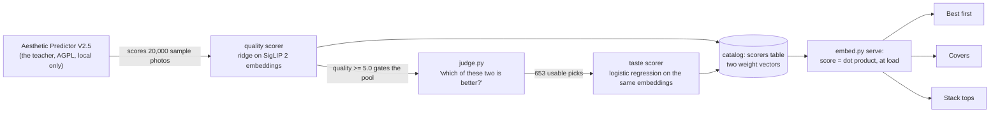
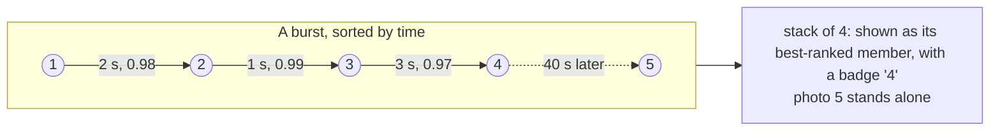

# 25. Choosing the best photos

A library of 100,000 photos has a few thousand that matter, and the rest of the app was blind to the
difference. A month's card showed whichever photo sat in the middle of the month. A trip opened on
its first photo. A burst of twelve frames showed as twelve tiles. This chapter is about teaching the
app which photos are *good*, and then using that everywhere a photo is chosen on your behalf: the
order of a month, the cover of a year or a trip, and the frame that sits on top of a burst.

It is also the chapter with the most experiment behind it. The first plan was wrong, and the
measurements are what showed it. So the chapter follows the work in the order it happened: a borrowed
scorer, a judging app, the discovery that the borrowed scorer does not share the author's taste,
clearing junk out of the way, and a small scorer trained on the author's own choices. The shipped
code is small (about 200 lines in [scores.py](../../photo-estate/scores.py) and
[stacks.py](../../photo-estate/stacks.py)); most of the work lives in the tools that decided what that
code should be.



## What "best" means here

The tracking issue ([jflam/photo-estate#44](https://github.com/jflam/photo-estate/issues/44)) split
the problem in two, and the split held up:

| Problem | Example | Tool |
|---|---|---|
| **Which photos are good, across the library** | The cover of 2019; the first screenful of a trip | A scorer on the stored image embeddings |
| **Which frame of a burst is best** | Twelve near-identical shots of a birthday cake | Sharpness, eyes open, face size: technical measures |

An aesthetic model gives near-identical frames near-identical scores, so it cannot pick within a burst.
This chapter builds the first and uses it, imperfectly, for the second; the technical measures are
still to come.

Two constraints shaped every choice:

- **Photos never leave your hardware.** The library lives on a Mac mini at home. Every experiment
  either ran there, or copied small resized images to the author's laptop and nowhere else. A
  cloud GPU would have been faster and was rejected for that reason.
- **Nothing that ships may carry a restrictive licence.** The obvious off-the-shelf scorer is AGPL. It
  could be used as a local tool to make labels; its code and weights could not ship.

## Step 1: a teacher, and a student on embeddings we already have

### The idea

[Aesthetic Predictor V2.5](https://github.com/discus0434/aesthetic-predictor-v2-5) is a small scoring
head on a SigLIP image model that rates photos from about 1 to 10. It needs pixels (384 × 384) and a
3.5 GB backbone. Running it over the whole library on the mini's M1 would take about 17 hours, and
shipping it is ruled out by its licence.

But every photo already has a **SigLIP 2 embedding**: 768 numbers, stored in the catalog for search
(chapter 10). If a single weight per dimension can reproduce the teacher's score from those numbers,
then scoring the whole library is one matrix multiply, no pixels needed, and what ships is a weight
vector learnt from the teacher's opinions, not the teacher.

So the pilot asked: **how well does a head on the stored embeddings track the teacher?**

### The pilot: 2,000 photos

[sample_resize.py](../../photo-estate/tools/aesthetics/sample_resize.py) picked 2,000 random
embedded photos on the mini (seed 44) and wrote 384 px JPEGs there, at low priority so the running
app stayed responsive. [teacher_score.py](../../photo-estate/tools/aesthetics/teacher_score.py) scored
them on the mini. (The plan had been to score on the laptop's faster GPU, but the author was on hotel
wifi measured at 6.9 Mbps, and the 3.5 GB model would have taken over an hour to arrive. The mini
downloaded it over the home connection in seconds.)
[train_head.py](../../photo-estate/tools/aesthetics/train_head.py) then cross-validated two heads
against the teacher's scores:

| Head | Spearman vs teacher | Same order as the teacher, all pairs | Same order, pairs more than 0.5 apart |
|---|---|---|---|
| **Ridge regression** | **0.862** | **84%** | **95%** |
| Small MLP | 0.849 | 83% | 94% |

The simpler head won, so the student is one weight vector and an offset. The learning curve was
still rising at 1,600 training photos (0.79 at 250, 0.86 at 1,600), so a second run on the mini scored
**20,000** more photos overnight (1.93 photos a second, about three hours, the app answering in
under 30 ms throughout). The ridge fitted on those reproduces the teacher on 4,000 held-out photos
with a mean error of 0.26 points and a rank correlation of 0.88.

The pilot's measured rates, for the record:

| Step, on the mini (M1, 16 GB) | Rate |
|---|---|
| Decode and resize to 384 px | 13.9 photos/s (3 workers, `nice -n 10`) |
| Teacher (MPS, float32, batch 8) | 1.93 photos/s |
| Student over the whole library | a few seconds for 113,580 photos |
| Teacher re-scored 50 photos | identical to the first pass (max difference 0) |

### What the teacher likes

Contact sheets of the teacher's top, bottom and biggest disagreements told the rest of the story:

- **Top:** slot canyons, sunsets, mountain trails. One photo of people in the top 30.
- **Bottom:** conference slides, documents, screenshots, motion blur. As a junk detector it is
  excellent.
- **Where the student and teacher disagree:** the student pulls extremes toward the middle (harmless
  for ranking) and overrates blurry photos. A 256 px embedding carries little sharpness information.

A perfectly good portrait of a child on a picnic blanket scored 3.3 out of 10. For a family library that
was the warning sign, and the next step was to measure it.

## Step 2: asking the owner

### The judging app

[judge.py](../../photo-estate/tools/aesthetics/judge.py) is a one-file local web app: two photos
side by side, "which is better?". It runs on the laptop, binds `127.0.0.1`, and reads only the
resized copies in the cache folder.

| Key | Action |
|---|---|
| ← / → (or click) | That one is better |
| ↓ | About the same |
| ↑ | Can't tell, skip |
| Shift + ← / → (or "× Reject") | This photo should not be judged at all (added in round three) |
| `u` / Backspace | Undo |

Its design follows from what it is measuring:

- **No hints.** The page never shows a score, a filename or which kind of pair this is, so neither
  model can lean on the judge.
- **An append-only log.** Every answer is a line in `judgments.jsonl`; undo appends an undo record.
  A session resumes exactly where it stopped, and nothing is ever rewritten.
- **Balanced at every stopping point.** Pairs come from several *strata* interleaved round-robin, so
  stopping after 150 or 300 still gives a fair mix.
- **A report** at `/report`: agreement of each scorer with the judge per stratum, with Wilson
  confidence intervals, and a warning on any row with fewer than 30 decided pairs.

### Round one: 600 pairs, and a coin flip

Round one drew 600 pairs from the pilot's 2,000 photos in four strata: random, similar subject
(cosine 0.60 to 0.95), pairs where teacher and student disagree, and "two decent photographs".
The author judged all 600 at a median of 2.5 seconds a pair, picking left 49.8% of the time.

| Kind of pair | Pairs | Teacher agrees | Student agrees |
|---|---|---|---|
| Random | 150 | 61% | 68% |
| Similar subject | 150 | 65% | 66% |
| Teacher and student disagree | 150 | 43% | 57% |
| Two decent photographs | 150 | 59% | 54% |
| **Overall** | **600** | **57%** (53–61%) | **61%** (57–65%) |

**The teacher agreed with the author 57% of the time; a coin flip agrees 50%.** The 18 pairs where
the teacher was most confidently wrong nearly all had the same shape: the author picked the photo with
people in it (kids on a climbing frame, a graduation, a family with the dog), the teacher picked the
empty scenery (a sunset, a snowy forest, a coastline). The teacher scores how *pretty* a picture is.
The author was scoring how much it *matters*, and in a family library that mostly means who is in it.

Two follow-up experiments on the same 600 answers:

| Head trained on the author's picks | Agrees on held-out pairs |
|---|---|
| People features only (face count, size, named or not, detector confidence) | 59% |
| Teacher score + people features | 64% |
| **Embedding only** | **70.3%** |
| Embedding + people features | 69.3% |
| Embedding + people + teacher score | 69.8% |

People matter (in the 264 pairs where exactly one photo had a face, the author picked it 66% of the
time) but the embedding already knows when people are present; explicit face features add nothing on
top. And the learning curve flattened at about 70% from 300 pairs on.

### The real problem was the pairs

The author's diagnosis, looking back at what they had been judging: too many pairs were *junk against
junk*. A screenshot against a blurry photo of a countertop says nothing about taste, and the pick is
close to arbitrary. The numbers agreed:

- 142 of the 600 pairs had at least one likely-junk photo (low teacher score, or no camera make, which
  usually means a screenshot or a download); in 37, both were.
- Only 68 pairs had two photos the teacher scores 5.0 or higher.
- The "decent photographs" stratum had a bar of 4.0, *below* the library's median of 4.64.

That reframed the whole problem as **two stages**:

1. **Is this a real photo?** The teacher is good at this, and it needs no human labels.
2. **Among real photos, which would the owner pick?** This needs human labels, and only labels about
   good photos are worth collecting.

## Step 3: clearing the ground

Two kinds of photo did not belong in either stage.

**Other people's children.** The library holds a few thousand photos taken for work at a school:
classrooms and outdoor sessions full of children who are not family. They are good photographs by any
scorer's measure and exactly the ones that should never become a cover. They were removed with the
**change sets** feature built in the same week: a request in words ("hide the school photos")
given to an agent on the mini, which used only the library's own tools (text search, dates, places,
named faces; never pixels) to propose a set of photos to hide. The author reviewed the proposal as a
dense grid where *hide* is the default and *keep* is the only action:

| What the agent proposed | Photos | Kept on review |
|---|---|---|
| Classroom, by place and years | 3,185 | 0 |
| Montessori materials at a low table | 523 | 0 |
| Children playing in a forest, by place | 1,827 | 5 |
| A teacher with small children | 38 | 4 |
| Similar, elsewhere | 129 | 3 |
| **Total** | **5,702** | **12 (0.2%)** |

5,690 photos were hidden, non-destructively (a `hidden` table; the files and catalog rows are
untouched, and a set can be reverted as one unit). Hidden photos leave every view, the sync feed and,
from then on, every round of judging.

**Photos rejected while judging.** Some school photos had slipped through, so round three added a
*reject* control: a rejected photo ends its pair with no pick, never appears in a later pair, and is
listed in `rejected.txt`. The 13 rejected in round three became their own change set for review.

## Step 4: judging only good photos

[round2_pairs.py](../../photo-estate/tools/aesthetics/round2_pairs.py) builds the later rounds from
the 20,000 teacher-scored photos (never the pilot's 2,000, which stay a clean test set):

- **Pool:** teacher score at least **5.0** and a real camera make. That is about the top quarter:
  5,503 photos for round two.
- **500 pairs, no photo used twice:**

  | Stratum | Pairs | Rule |
  |---|---|---|
  | `same_day` | 200 | Same calendar date, cosine below 0.92 (not near-identical frames), at most 3 pairs per date |
  | `similar` | 150 | Different dates, cosine 0.60 to 0.92 |
  | `good_random` | 150 | Any two pool photos from different dates |

  Same-day pairs get the largest share because that is the real job: choosing the cover of a day,
  an event, a trip.
- **50 hidden repeats:** pairs shown a second time, sides swapped, at least 100 positions later, to
  measure the judge's own consistency, the ceiling no model can beat.

Round three ([fetch_round3.sh](../../photo-estate/tools/aesthetics/fetch_round3.sh)) used the same
rules with `--exclude`: everything the library had hidden since round two, every photo round two
showed, and every rejected photo. That left 4,264 photos, still enough for a full set.

### The result

| | Agrees with the author's pick |
|---|---|
| The teacher, among good photos | **56%** |
| A scorer trained on the author's picks, on pairs it never saw | **about 69%** |
| The author, shown the same pair again with sides swapped | **80%** (39 of 49) |

The last row is the most useful number in the chapter. The author agrees with themself four times in
five, so 80% is roughly the most any model could reach on these pairs. The trained scorer gets most of
the way there; the general-purpose aesthetic model, among photos that are all decent, barely beats
chance. Accuracy rose from 62% at 130 training pairs to 69% at 260 and then stayed flat to 520, so
another round of the same kind would not move it much.

The 653 usable picks exclude ties and skips, repeats, rejected pairs, and 33 round-two pairs that
contained a photo hidden after they were judged.

## Step 5: the taste scorer

[train_taste.py](../../photo-estate/tools/aesthetics/train_taste.py) turns the picks into a scorer,
in about 200 lines of numpy.

The model is a **Bradley–Terry** model on the embeddings: each photo has a taste score `w · v`
(`v` its unit-length embedding), and the chance that A is picked over B is
`sigmoid(score(A) − score(B))`. Because the scores only ever appear as a difference, fitting it is an
ordinary L2-regularised logistic regression on the *differences* of the two embeddings, solved with
Newton's method. One pick is one training row:

```
x = v_A - v_B        y = 1 if A was picked, 0 if B was
```

It reports accuracy over 10 folds × 5 shuffles beside the teacher's on the same held-out pairs
(69.3% against 56.4%), then fits on every pick and writes `model.npz`: the 768 weights and the name
of the embedding model they belong to.

The check that mattered was by eye. `train_taste.py` writes a local page of the top 60 and bottom 60
photos by taste, drawn from the 3,829 good photos the author never judged:

- **Top:** people, mostly. Selfies, couples, family groups, portraits; then striking subjects:
  statues, landmarks, animals.
- **Bottom:** empty landscapes. Fields, hazy hillsides, sky with nothing in the foreground.

It is close to the teacher turned inside out, which is what the judging had predicted.

> **The taste scorer only knows how to rank good photos.** Every pick was between two photos the
> teacher rated 5.0 or more. Its score for a screenshot or a blurred frame is a guess, so it must run
> *after* the quality gate, never instead of it.

### Scoring the library

[score_library.py](../../photo-estate/tools/aesthetics/score_library.py) runs on the mini, opens the
catalog read-only, and scores all 113,580 embedded photos in a few seconds:

| | Photos |
|---|---|
| Scored | 113,580 |
| Quality at least 5.0 | 28,863 (25%) |
| ...of which already hidden (school) | 1,355 |
| **Good, visible photos for taste to rank** | **27,510** |

## Step 6: in the app

### The catalog keeps scorers, not scores

The issue planned a score per photo, stored by a pipeline step. What shipped is simpler: the catalog
holds the two **scorers** (a `scorers` table: name, embedding model, a float32 weight vector and an
offset), and the app computes every photo's score when it loads the catalog, as one matrix product
with the embeddings it already holds in memory.

```sql
CREATE TABLE scorers(
  name TEXT, model TEXT,   -- quality | taste; the embedding model the weights are for
  w BLOB, b REAL,          -- float32 weights; score = w . vec + b
  info TEXT, updated_at TEXT, PRIMARY KEY(name, model));
```

- **A photo that arrives tomorrow is scored with no pipeline step.**
- **A retrained scorer takes effect on the next load.** `uv run scores.py --db DB install --quality
  quality.npz --taste model.npz` writes the table; nothing else changes.
- **A catalog with no scorers** (the demo) has no "Best first" option, and every cover falls back to
  the old rule.

### One order: good photos by taste, then the rest by quality

`best()` in [scores.py](../../photo-estate/scores.py) is the whole policy:

```python
quality = M @ qw + qb
taste   = M @ tw + tb
key = np.where(quality >= GOOD, 1000.0 + taste, quality)   # GOOD = 5.0
```

The offset of 1000 puts every good photo above every other photo; within the good ones taste decides,
and within the rest quality does. `best_first()` sorts by that key, and the app keeps each photo's
`rank` in that order, which is what everything below uses.

### Where it shows

| View | What "best" does |
|---|---|
| **Search** with filters (a person, place, trip, album, a year) | "Best first" in View options ranks the whole set; newest first stays the default |
| **Library, All** | "Best first in each month": months stay newest first with their headings and scrubber; inside each month, best first |
| **Year and month cards** | The cover is a favourite if there is one, then a landscape-shaped photo (it fits the card), and among those, the best ranked |
| **Trips** | The cover is the best-ranked favourite, or the best-ranked photo if the trip has none |
| **Text search, More like this** | Unchanged: they keep their own ranking by match |

The Library stays a timeline on purpose. Sorting 100,000 photos by score would throw away the months
and the scrubber; ranking *within* each month keeps both. Favourites still beat the score for covers,
because a favourite is a choice the owner made.

### Stacks: the best frame on top

Once there is an order, near-identical shots can be stacked rather than hidden.
[stacks.py](../../photo-estate/stacks.py) ([jflam/photo-estate#45](https://github.com/jflam/photo-estate/issues/45),
first part) joins two photos when they were taken **within 10 seconds** of each other *and* their
embeddings have cosine similarity of at least **0.97** (the bar "Hide near-identical shots" always
used). Joining is a union–find over each photo and the 8 taken just before it, so a long burst
chains into one stack and the cost follows the library, not its square.



On the author's library that makes about **13,200 stacks holding 34,600 photos**, so 21,430 photos
sit behind another; the Library went from 107,875 tiles to 86,445. The top of each stack is its
best-ranked member (or the earliest, with no scorers). A tile shows the top photo with a count;
the count, or a "Stack of N" row in the photo's details, opens the whole stack, best first. "Hide
near-identical shots" became **Stack near-identical shots**, and the sync feed's `dup` flag now marks
the photos behind each top, so the iPhone shows the same top photo.

One bug found while testing is worth recording: grouping first compared a mix of local and UTC times,
so two shots a second apart, one with a place (and so a time zone) and one without, could come out
hours apart. Stacks now group by the true instant a photo was taken (`seconds()` reads a time without
a zone as UTC; only differences between neighbours matter).

Like scores, stacks are computed at load (well under a second), not stored: a new photo joins its
stack with no extra step.

## What it cannot do yet

- **Pick the sharpest frame of a burst.** The scorers rate near-identical frames almost alike, so the
  top of a stack is not reliably the sharpest or the one with eyes open. Part B of issue 44
  (Laplacian sharpness inside the face box, eyes open from the face landmarks) is the fix.
- **Score photos without an embedding.** About 2,800 images (RAW files, mostly) and all videos have
  no score and sort last.
- **Know anyone's taste but one person's.** The taste scorer is the author's. "People matter more
  than scenery" is probably a fair prior for family libraries, but this data does not show it.
- **Let you set a stack's cover, or split one.** That needs a stacks table, which does not exist yet.
- **Show a stack that a filter only half-matches.** If a filter matches only a photo that sits behind
  the top one (the same shot saved in two albums, say), that view does not show it.

## How the work was done

A note on method, because it is the part most worth copying. Every step produced a number before
the next step was built, and two of those numbers changed the plan:

| Measured | Expected | Changed |
|---|---|---|
| Student tracks teacher at 0.86 Spearman | Some loss from 256 px embeddings | Nothing: confirmed the cheap route |
| Teacher agrees with the owner 57% | Something like 70–80% | The teacher stopped being the target |
| 142 of 600 pairs had junk in them | A few | Judging moved to good photos only; junk became a separate gate |
| Owner agrees with themself 80% | Unknown | Gave the ceiling, and said when to stop judging |
| Face features add nothing | A large gain | Kept the scorer to embeddings alone |

The privacy line held throughout: pixels stayed on the mini and in the laptop's cache folder; the
agent that proposed hiding photos never saw an image; the judging pages bound to localhost.

## Where to look in the code

| Topic | Code |
|---|---|
| The two scorers in the catalog; the "best first" key | [scores.py](../../photo-estate/scores.py) `save`, `load`, `best`, `best_first` |
| Stacks | [stacks.py](../../photo-estate/stacks.py) `group`, `tops` |
| Scores, ranks and stacks at load; trip covers | `load_state` in [embed.py](../../photo-estate/embed.py) |
| Year and month covers | `periods` in [embed.py](../../photo-estate/embed.py) |
| "Best first" and "Best first in each month" | the `sort` handling in `cmd_serve` of [embed.py](../../photo-estate/embed.py); View options in [search.html](../../photo-estate/search.html) |
| Sample and resize; the teacher | [sample_resize.py](../../photo-estate/tools/aesthetics/sample_resize.py), [teacher_score.py](../../photo-estate/tools/aesthetics/teacher_score.py) |
| Student vs teacher experiments | [train_head.py](../../photo-estate/tools/aesthetics/train_head.py) |
| The judging app and its report | [judge.py](../../photo-estate/tools/aesthetics/judge.py) |
| Pairs from good photos; exclusions | [round2_pairs.py](../../photo-estate/tools/aesthetics/round2_pairs.py), [fetch_round2.sh](../../photo-estate/tools/aesthetics/fetch_round2.sh), [fetch_round3.sh](../../photo-estate/tools/aesthetics/fetch_round3.sh) |
| The taste scorer | [train_taste.py](../../photo-estate/tools/aesthetics/train_taste.py), [fetch_taste.sh](../../photo-estate/tools/aesthetics/fetch_taste.sh) |
| Scoring the whole library | [score_library.py](../../photo-estate/tools/aesthetics/score_library.py) |
| Tests | [test_scores.py](../../photo-estate/tests/test_scores.py), [test_stacks.py](../../photo-estate/tests/test_stacks.py), [test_aesthetics_judge.py](../../photo-estate/tests/test_aesthetics_judge.py), [test_aesthetics_taste.py](../../photo-estate/tests/test_aesthetics_taste.py) |
