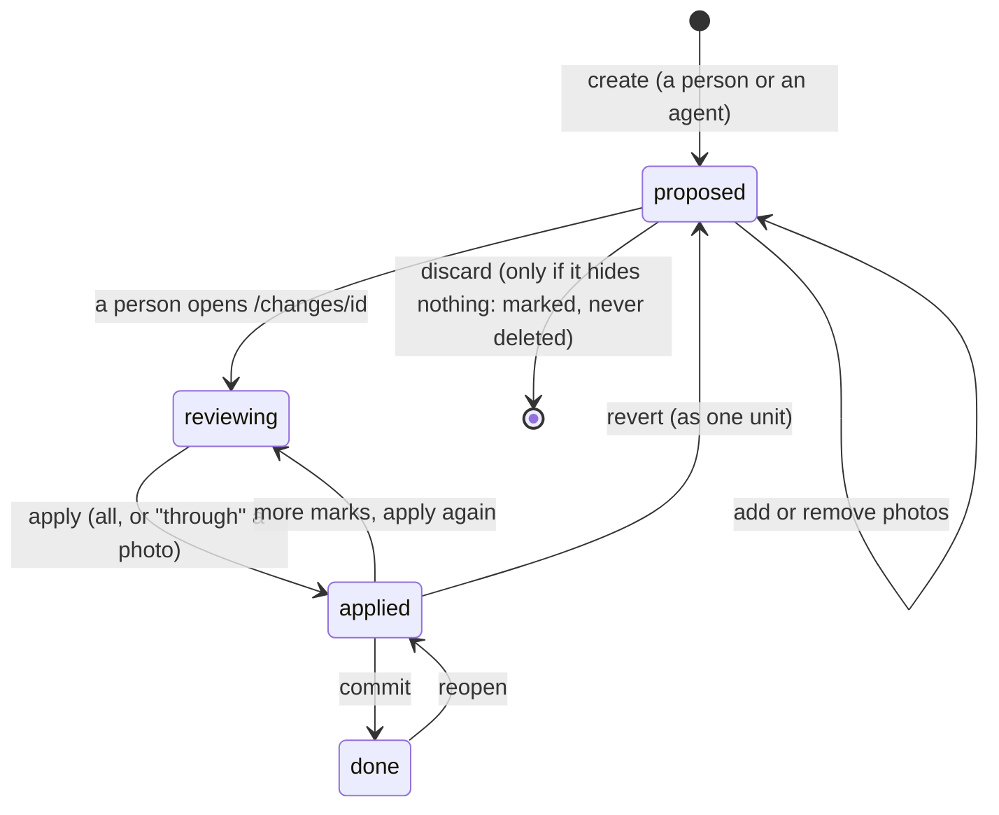
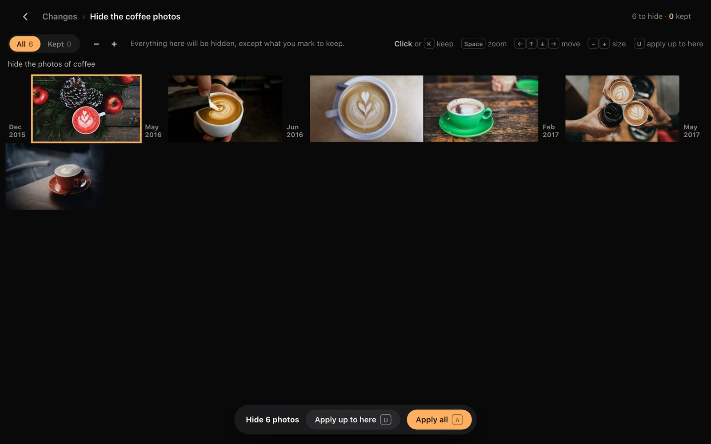

# 26. Albums, change sets and agents

A library of 100,000 photos needs two things the first chapters did not give it: a way to keep a set
of photos together (an album), and a way to change many photos at once without the risk of changing the
wrong ones. This chapter is both, and how the same two ideas let an agent work on the library without
being trusted with it.

The code is [changes.py](../../photo-estate/changes.py) (albums and change sets),
[changes.html](../../photo-estate/changes.html) (the review page),
[estate_mcp.py](../../photo-estate/estate_mcp.py) (the library as tools for an agent) and
[tasks.py](../../photo-estate/tasks.py) (an agent that runs on the library's computer). On the phone it is
[Albums.swift](../../ios/PhotoEstate/Library/Albums.swift) and
[API.swift](../../ios/PhotoEstate/Catalog/API.swift).

## One idea: an album

An album is a title, a note on what was asked for (its `prompt`), and its photos. There are two kinds:

| Kind | Holds | Example |
|---|---|---|
| **list** | the photos it was given, in that order, each optionally under a *section* ("2014", "Ben") and with a *reason* a person can read | "The best five of every year" |
| **live** | a search, and is whatever that search finds now and later | "matthew on a beach" |

What an album is *for* is its `op`. Most albums are `view`: something to look at, which changes nothing
else about the library. An album that has been put up for hiding is `op = hide`, and that is what a
**change set** is: a bulk edit, proposed first and applied only once a person has looked. One table
(`change_sets`, with its photos in `change_items`) holds both, which is why every `/api/changes` address
also answers under `/api/albums` (appendix B).

Albums are made in three places:

- **The web app and the iPhone app.** A search can be made into an album with one button: a list of
  the photos it finds now, in its order. Albums have their own tab in both apps, where an album can be made
  favourites as a whole or put up for hiding; on the web it can also be renamed and downloaded as one zip
  of originals.
- **An agent, over MCP** (below). "The best five of every year" becomes a list album with a section per
  year, made by an agent that searched each year with `order: best`.
- **The HTTP API** directly, for a script. A live album is made by giving `POST /api/albums` a `query`
  (an agent's `create_album` with a `search` does the same).

An album's cover is a favourite from it, if it has one, as a month's is ([chapter 25](25-best-photos.md)).

**Whose it is.** Every album and change set is its owner's (`change_sets.owner`; those from before members
are the first sysadmin's). A member lists and opens their own, and the albums others have **published**
as a **series** (`POST /api/albums/<id>/publish`, which gives it a row in `lenses`); only the owner changes
one. Inside any album or series, whoever made it, a member sees only the photos their own filters let
through: someone else's series never shows them what they hid ([chapter 11](11-server.md#what-each-member-sees-lenses)).
Subscribing to a series puts it in the member's Albums, live, or as a snapshot copied into an album of
their own.

## Change sets: proposed, looked at, applied



The rules that make this safe:

1. **Nothing changes until a person applies it.** Making a set, and adding ten thousand photos to it,
   changes nothing anyone sees.
2. **The review is a last look, not a decision per photo.** The page shows the set as a wall of photos;
   you mark the exceptions (the photos to *keep*), and every photo not marked is done to as proposed.
   Each mark is saved as it is made, so a review of ten thousand photos can stop and carry on later.
3. **Applying can be partial and repeated.** `apply` makes the library match the marks made so far, for
   the whole set or `through` the last photo you have looked at. Apply as you go.
4. **A set is undone as one unit.** `revert` takes back everything it did, and keeps your marks.
   `commit` says it is finished; nothing about it changes until it is `reopen`ed.
5. **Nothing is deleted, and every step is in the journal.** Discarding a set (or an album) that hides
   nothing marks it `discarded`: its rows stay in the catalog, and it is in no listing and answers no
   request, as if it were gone (its id is never given to another). Each step that changes something
   (made, photos added or taken out, marks, applied, reverted, committed, reopened, put up for hiding,
   renamed, discarded) is one journal entry naming the set and the member it was done for, never one per
   photo ([chapter 11](11-server.md#the-journal)).

The page keeps itself honest about what the server has
([app/changes-flow.js](../../photo-estate/app/changes-flow.js), issue #80). A mark shows at once and is
saved behind it; marks, apply, revert, commit and reopen are sent one at a time in the order made, so an
apply never overtakes the mark made just before it. If one of them fails, the page reads the set again
once nothing more is on its way and shows that, with a toast saying what could not be saved; if the set
can not be read either, it says the page may not show the set as it is and offers **Read it again**.
After an apply or a revert the app re-reads the library, and the page asks the set's `check` every 700 ms
until it has; after two minutes it stops, says "Still updating" (the change itself is saved) and offers
**Check again**, instead of asking for ever.

The first (and so far only) operation is **hide**: the photo stays in the store and the catalog and is
left out of every view (search, the Library, People's lists, and the copy a phone keeps) of the members
who see through the set's **lens**. Files are never touched. The `hidden` table is keyed by photo *and*
set, so a photo two sets hide stays hidden until both are undone. A set's lens is chosen when it is first
applied (`change_sets.lens_id`): by default the owner's own filter ("Ben's hidden photos", made then),
so one member's hides hide nothing for anyone else; a sysadmin may apply to the Estate defaults instead,
which every member sees through unless they opt out ([chapter 11](11-server.md#what-each-member-sees-lenses),
[issue 47](https://github.com/jflam/photo-estate/issues/47)).



## The library as tools: MCP

The running app is also an [MCP](https://modelcontextprotocol.io/) server at `/mcp`, so any MCP client
(Claude Code, Claude Desktop, or anything else) can search the library with the same models you do.
The transport is the simplest form of MCP's streamable HTTP: one JSON-RPC message per POST, answered with
JSON, no stream and no session. The tools:

| To... | Tools |
|---|---|
| Find photos | `library_overview`, `search_photos`, `similar_photos`, `get_photos` |
| Keep them | `list_albums`, `get_album`, `create_album`, `amend_album` |
| Propose a change | `propose_hiding`, `list_change_sets`, `get_change_set`, `create_change_set`, `amend_change_set` |
| Hand over a big job | `submit_task`, `get_task`, `cancel_task` |

Two rules are built into the tools, not left to the agent's good behaviour:

- **The agent never sees a photo.** Every tool answers with ids, scores, dates, places, the names of
  people in it, albums and file paths. Nothing of what a photo shows leaves the computer, whichever model
  the agent is.
- **The agent cannot change the library.** It can make albums, which change nothing else, and propose
  change sets. No tool applies one.

Since the agent cannot look, `search_photos` tells it how to read a ranking: each answer carries a
`summary` (how many match, the score at several ranks, the years they come from, how many have a named
person in them), because SigLIP scores fall smoothly with no gap and the agent has to choose where to
stop. The tool descriptions say what a score means (a photo of the thing described scores about
0.085-0.16, an unrelated one under about 0.07) so that choice is made on numbers.

Videos are found by the same searches, by what their frames show (a video's score is its best frame's,
[chapter 10](10-embeddings.md#videos)). `search_photos` takes `kind` (`photo` or `video`) to keep to one
or the other, and a row says `kind: "video"` and `seconds` for a video, and `live_photo: true` for a
Live Photo's still. The agent still sees no frame.

And because a person reviews a change set, `get_change_set` reports which photos they kept: those are
the agent's mistakes, and the best guide it has to doing better next time.

## An agent on the library's computer: tasks

A request like "hide the photos from Carolyn's school" can mean thousands of photos and many searches.
`submit_task` (or the box on the Changes page) hands it, in the person's words, to an agent that runs on
the computer that holds the library, so it carries on when the chat that started it has ended.

The agent is Claude Code, run headless once per task, with every built-in tool switched off:

```bash
claude -p "<the request>" --system-prompt "<the brief in tasks.py>" \
  --mcp-config '{...only this library...}' --strict-mcp-config \
  --tools "" --allowedTools mcp__photo-estate \
  --output-format stream-json --no-session-persistence --max-turns 80
```

`--tools ""` takes away the shell, the files and the web, so it cannot open a photo or touch anything on
the computer; the only thing it can do is call the library's own tools. Its brief (`BRIEF` in
`tasks.py`) tells it how to work: start with the overview, search with several plain descriptions,
page down each ranking to where the matches thin out, include at the margin (the person will drop a wrong
photo with a click, but never sees one left out), leave the family's named people out unless the request
plainly covers them, and end with a plain report of what it did and what it is least sure of.

Each task's progress is kept as a list of events, so the Changes page can show it working and keep what
it did afterwards. The change sets it makes carry the task's name; the agent is told apart by a header
honoured only from this computer, and is not offered the task tools itself. It **acts for** the member who
submitted the task (`agent_tasks.acting_for`, looked up from the header): every tool answers as that
member sees the library, what it makes is theirs, and its writes are journaled acting for them. A task Ben
submits searches as Ben, not as the sysadmin the agent calls as. It signs in with a
long-lived token from `claude setup-token`, kept in `~/.config/photo-estate/agent.env` and put in the
agent's environment and nowhere else. The model runs in the cloud; what reaches it is the request and
what the tools return.

Tasks run one at a time, and a task's status (queued, running, done, failed, cancelled) moves only as
`TASK_MOVES` in `core/states.py` allows, each move one conditional `UPDATE ... WHERE status=?`
(`Tasks.move`, issue #86). The worker *claims* the oldest queued task (queued to running) and runs it
only if that claim took, so a task withdrawn just as its turn came never starts; a run's ending (running
to done or failed) never overwrites a cancel that got there first. Cancelling, and the hour's timeout,
stop the agent with SIGTERM and then SIGKILL ten seconds later, and a failed task's error ends with the
last of what the agent wrote to stderr, read to the end. `Tasks.update` writes only the task's own
columns, and never its status.

## On the phone

The iPhone app's Albums tab asks the server for its albums and keeps the last answer, so it still shows
them with no network. Under them are the albums the services had (Google's, iCloud's), counted from the
phone's own copy of the catalog. An album opens as a grid; a search becomes a new album with one button;
and an album can be made favourites, put up for hiding or discarded. Because the phone never writes its
copy of the catalog ([chapter 19](19-iphone-app.md)), each of those is a request to the server
(`API.swift`), and what it changed arrives with the next sync. Reviewing a change set opens the server's
own review page inside the app (`WebView.swift`); a native one is
[issue 49](https://github.com/jflam/photo-estate/issues/49).

## Where to look

| What | Where |
|---|---|
| Albums, change sets, the `hidden` table | [changes.py](../../photo-estate/changes.py) `Changes` |
| The review page | [changes.html](../../photo-estate/changes.html) |
| The MCP tools and their descriptions | [estate_mcp.py](../../photo-estate/estate_mcp.py) `Tools` |
| Running the agent, its brief, its events | [tasks.py](../../photo-estate/tasks.py) `Tasks`, `BRIEF` |
| Albums on the phone | [Albums.swift](../../ios/PhotoEstate/Library/Albums.swift), [API.swift](../../ios/PhotoEstate/Catalog/API.swift) |
| Tests | [test_albums.py](../../photo-estate/tests/test_albums.py), [test_changes.py](../../photo-estate/tests/test_changes.py), [test_mcp.py](../../photo-estate/tests/test_mcp.py), [test_tasks.py](../../photo-estate/tests/test_tasks.py) |
| The HTTP API | [Appendix B](appendix-b-http-api.md#albums-and-change-sets) |
