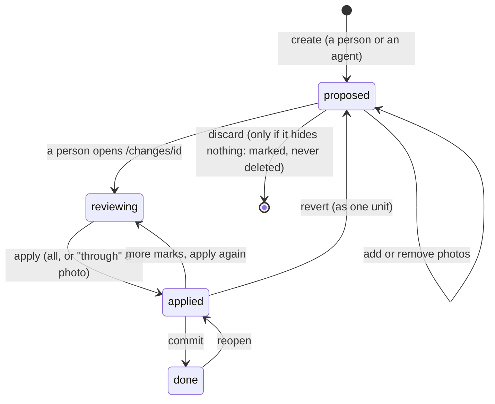

# 26. Albums, change sets and agents

A library of 100,000 photos needs two things the first chapters did not give it: a way to keep a set
of photos together (an album), and a way to change many photos at once without the risk of changing the
wrong ones. This chapter is both, and how the same two ideas let an agent work on the library without
being trusted with it.

The code is [changes.py](../../photo-estate/changes.py) (albums and change sets),
[changes.html](../../photo-estate/changes.html) (the review page, which is also the review of held photos at `/held`),
[estate_mcp.py](../../photo-estate/estate_mcp.py) (the library as tools for an agent) and
[tasks.py](../../photo-estate/tasks.py) (an agent that runs on the library's computer). On the phone it is
[Albums.swift](../../ios/PhotoEstate/Library/Albums.swift) and
[API.swift](../../ios/PhotoEstate/Catalog/API.swift).

## One idea: an album

An album is a title, a note on what was asked for (its `prompt`), and its photos. There are two kinds:

| Kind | Holds | Example |
|---|---|---|
| **list** | the photos it was given, in that order, each optionally under a *section* ("2014", "Ben") and with a *reason* a person can read | "The best five of every year" |
| **live** | a search, and is whatever that search finds now and later | "matthew on a beach" |

What an album is *for* is its `op`. Most albums are `view`: something to look at, which changes nothing
else about the library. An album that has been put up for hiding is `op = hide`, and that is what a
**change set** is: a bulk edit, proposed first and applied only once a person has looked. One table
(`change_sets`, with its photos in `change_items`) holds both, which is why every `/api/changes` address
also answers under `/api/albums` (appendix B).

Albums are made in three places:

- **The web app and the iPhone app.** A search can be made into an album with one button: a list of
  the photos it finds now, in its order. Albums have their own tab in both apps, where an album can be made
  favourites as a whole or put up for hiding; on the web it can also be renamed and downloaded as one zip
  of originals.
- **An agent, over MCP** (below). "The best five of every year" becomes a list album with a section per
  year, made by an agent that searched each year with `order: best`.
- **The HTTP API** directly, for a script. A live album is made by giving `POST /api/albums` a `query`
  (an agent's `create_album` with a `search` does the same).

An album's cover is a favourite from it, if it has one, as a month's is ([chapter 25](25-best-photos.md)).

**Whose it is.** Every album and change set is its owner's (`change_sets.owner`; those from before members
are the first sysadmin's). A member lists and opens their own, and the albums others have **published**
as a **series** (`POST /api/albums/<id>/publish`, which gives it a row in `lenses`); only the owner changes
one. Inside any album or series, whoever made it, a member sees only the photos their own filters let
through: someone else's series never shows them what they hid ([chapter 11](11-server.md#what-each-member-sees-lenses)).
Subscribing to a series puts it in the member's Albums, live, or as a snapshot copied into an album of
their own.

## Change sets: proposed, looked at, applied



The rules that make this safe:

1. **Nothing changes until a person applies it.** Making a set, and adding ten thousand photos to it,
   changes nothing anyone sees.
2. **The review is a last look, not a decision per photo.** The page shows the set as a wall of photos;
   you mark the exceptions (the photos to *keep*), and every photo not marked is done to as proposed.
   Each mark is saved as it is made, so a review of ten thousand photos can stop and carry on later.
3. **Applying can be partial and repeated.** `apply` makes the library match the marks made so far, for
   the whole set or `through` the last photo you have looked at. Apply as you go.
4. **A set is undone as one unit.** `revert` takes back everything it did, and keeps your marks.
   `commit` says it is finished; nothing about it changes until it is `reopen`ed.
5. **Nothing is deleted, and every step is in the journal.** Discarding a set (or an album) that hides
   nothing marks it `discarded`: its rows stay in the catalog, and it is in no listing and answers no
   request, as if it were gone (its id is never given to another). Each step that changes something
   (made, photos added or taken out, marks, applied, reverted, committed, reopened, put up for hiding,
   renamed, discarded) is one journal entry naming the set and the member it was done for, never one per
   photo ([chapter 11](11-server.md#the-journal)).

**One set, several writers.** Its owner writes a set through `changes.py`, which holds one lock around every
write; but `lenses.py` writes the album's series row, and the series listener (a background thread) its owner's
`series_update` item, each on a connection of its own. So every write of `changes.py` takes the write lock first
(`BEGIN IMMEDIATE`) and reads the set inside that transaction. An album published as a series, or one with new
photos waiting for it, is neither put up for hiding nor discarded (409: stop publishing it, or add the new photos
or none, first); the listener takes the lock and reads the album again before it opens the item, and opens none for
an album that is no longer a series; and a series is published by its lens's own route (`POST
/api/lenses/<id>/publish`) only while its album is one to look at. `specs/ChangeSet.tla` is a TLA+ model of one
set, its photos' marks and hidden rows, its series row and the two inbox items about it, with every writer, checked
by TLC against nine rules: a hidden row is there exactly while its photo is in the set and applied; an album to
look at, or a set put away, hides nothing, and an album is never done or reverted; a set stored as done has every
photo as marked, and stays as it was committed until it is reopened; one stored as reverted hides nothing; a
published series is an album there to look at; new photos wait only for a series; a review item is about a hiding
set. The model's `Guarded = FALSE` is the code before, which broke four of them: a series with new photos waiting
could be put up for hiding, applied, committed and then given the new photo from the inbox (stored as done, with a
photo not as marked, which write's refusals and `reopen` then no longer took to be done); put up for hiding or away
with the item left open; a published series could be put up for hiding or away, still published and out of its
owner's reach; and the listener could open an item for an album made no series while its search ran.
`tests/test_change_set_states.py` replays each on the real code.

The page keeps itself honest about what the server has
([app/changes-flow.js](../../photo-estate/app/changes-flow.js), issue #80). A mark shows at once and is
saved behind it; marks, apply, revert, commit and reopen are sent one at a time in the order made, so an
apply never overtakes the mark made just before it. If one of them fails, the page reads the set again
once nothing more is on its way and shows that, with a toast saying what could not be saved; if the set
can not be read either, it says the page may not show the set as it is and offers **Read it again**.
After an apply or a revert the app re-reads the library, and the page asks the set's `check` every 700 ms
until it has; after two minutes it stops, says "Still updating" (the change itself is saved) and offers
**Check again**, instead of asking for ever.

The first (and so far only) operation is **hide**: the photo stays in the store and the catalog and is
left out of every view (search, the Library, People's lists, and the copy a phone keeps) of the members
who see through the set's **lens**. Files are never touched. The `hidden` table is keyed by photo *and*
set, so a photo two sets hide stays hidden until both are undone. A set's lens is chosen when it is first
applied (`change_sets.lens_id`): by default the owner's own filter ("Hidden photos", made then),
so one member's hides hide nothing for anyone else; a sysadmin may apply to the Estate defaults instead,
which every member sees through unless they opt out ([chapter 11](11-server.md#what-each-member-sees-lenses),
[issue 47](https://github.com/jflam/photo-estate/issues/47)).


## Lenses on the pages

Phase 3 of the multiplayer plan made hiding personal ([chapter 11](11-server.md#what-each-member-sees-lenses));
these are the places a member meets it. The machines and the words are
[app/lens-flow.js](../../photo-estate/app/lens-flow.js), unit-tested in `app/tests/lens-flow.test.js`.

- **The Albums tab** shows, as cards, the member's own albums and the series they subscribe to (badged
  with the owner's name; a published album of their own says *Published*). Under them, **Filters**, a row
  each: theirs (*Yours: always on*, how many photos it hides, *What it hides* to its sets on `/changes`,
  **Publish** or **Stop publishing**, **Propose as an estate default**); for a sysadmin, those *waiting to
  decide* (**Make it an estate default**, **Decline**); the **estate defaults** (**Opt out**, **Opt back
  in**, **Keep a copy instead**); and those **published by others** (**Subscribe**, **Keep a copy**,
  **Unsubscribe**). A filter is not opened: its row says what it hides and whether it is on, and the line
  over them says what a filter is and how many photos those on hide, with **See them**: Search with
  `hidden=1`, under a *Hidden from you* chip. Last, the **series published by others**: opened like an
  album, with **Subscribe** and **Keep a copy**. Beside each Subscribe the page says what it does, in the
  plan's words: a filter's "changes what you see everywhere", a series' "adds it to your Albums". One change
  at a time; the lenses are asked for again after each, and the Library and Search after a filter changed.
  A snapshot ("keep a copy") ends a live subscription: the server keeps one mode per member and lens.
- **An album's ⋯ menu**: an album of one's own can be **published as a series** (or no longer); someone
  else's series offers subscribing, a copy, favourites and the download, and nothing that changes it.
- **The review page** (`/changes/<id>`) says whom the set hides from. Before it hides anything, a sysadmin
  chooses **Hide from You | Everyone** (the Estate defaults); a member has one choice and is told *hidden
  from you*. The choice goes with the first apply (`{lens}`); after that the page names the lens, "Hidden
  from you through your lens *Hidden photos*", until the set is reverted. A set or album that is not the
  member's answers 404, and the page says so plainly: *This change set is not here*, *This album is not here*.
  In the Albums tab, a hiding set's photos are badged *Hidden from you* or, when the set hides for the estate
  defaults, *Hidden from everyone*, as the review page says it.
- **The viewer's why line.** Each photo that stays on screen a quarter of a second is asked about
  (`GET /api/photos/<sha>/why`); for one the member's filters hide (in a hiding set's review, in **See
  them**, wherever else it is opened) a line under the caption says why, "Hidden by your lens *Hidden
  photos* on Nov 23", with **Show it anyway**, and once shown, **Hide it again**. The page words the line
  itself from the answer's `reasons`, and says the day in the viewer's own time zone (the server's `text`
  says it in UTC). The lists behind the viewer are asked for again when it closes.
- **The Library's ⋯ menu** names the member (*You are Ada*, from `GET /api/me`), offers **Inbox** with how
  many things wait there (below), **Members** and **Library info** (`/stats`) to a sysadmin, and on the demo,
  **Be another member**.

## Private photos on the pages

Phase 5 of the multiplayer plan lets a member keep a photo they shared to themselves ([chapter
11](11-server.md#private-photos) has the rule and the API). The machines and the words are
[app/private-flow.js](../../photo-estate/app/private-flow.js), unit-tested in `app/tests/private-flow.test.js`.

- **The viewer's private line**, under the why line (the same answer feeds both: the why answer's `private`):
  for a photo private to the member, "*Private to you* since Nov 22: held: it looks like a receipt, a
  screenshot or a document", or "you withdrew it", with "It is released by itself on Dec 26" once a day is
  set, and when someone else shares it too, that the family still sees it. It offers **Release** and
  **Release on a day…** (a menu over the viewer with a date; once set, **No release day** instead).
- **Withdraw**: a photo the member shared and the family is shown has a row in the viewer's details,
  *Shared by you*, **Withdraw from the family**; withdrawn, the line takes its place. The lists behind the
  viewer are asked for again when it closes.
- **A mark in the grid**: a small lock on each photo private to the member, wherever their own lists show it.
- **The held view** is Search for `is:held`: *Held as private*, and a bar. Being a search, it obeys the view
  options and the member's hides, so its bar says so ("This search shows 4,439 of the 7,992 photos held for you:
  your view options (screenshots, stacks) and what you hide leave the rest out", from `GET /api/held?count=1`),
  says how many wait to be looked over, and leads to the review of every one (**Look over all N**, `/held`,
  below). **Choose…** remains: a tile tapped is then chosen (outlined), not opened, and **Release N** releases
  exactly those (**Cancel** stops choosing). There is no "Release all": it released every held photo, those the
  search never showed included. `is:private` lists everything private to the member, held or withdrawn;
  `is:withdrawn` only what they withdrew.

### Looking held photos over

The `held` inbox item opens **`/held`**: the change-set review page in its held mode, the same wall with the
roles swapped. On a change set every photo will be hidden unless it is marked to keep; here every photo stays
private unless it is marked to **release**. It lists every held photo of the member's that waits to be looked
over, whatever the view options, stacks or hides ([chapter 11](11-server.md#private-photos) has the order and
the API), under headings: *Someone is named in them* (the likeliest mistakes), *Just over the line*, *Receipts
and documents*, *Screenshots, and the surest*, and last *Already hidden from you* (each tile there says
*Hidden*). Each tile's tooltip, and the zoomed photo's line, say why it was held ("Looks like a receipt
(0.112)", "The phone marked it a screenshot").

Everything the change-set page does with the wall it does here, with the same code: the tile sizes (− and +),
moving with the arrow keys or the pointer, Space to zoom, a click (or **R**) to mark, shift-click for a run,
and the filter (*All*, *To release*). The dock says what **Reviewed up to here** (**U**) would do from the
photo the member is on ("Up to here: release 2, keep 3 private · 7 after it"): the marked photos up to it are
released, the rest up to it stay private and leave the review, and what comes after waits, so 8,000 are looked
over a stretch at a time. **Done: keep the rest private** (**A**, after a confirm) does the same for the whole
list. Marks are kept in the browser (per member) until they are sent, so a reload keeps them; the request
names every photo it covers, so nothing is released that was not marked, and a photo held after the page read
the list is not touched (the page says when more have been held since, and offers to read the list again). A
photo kept is still private, and still found by `is:held`. The machine and the words are
[app/held-flow.js](../../photo-estate/app/held-flow.js) (a strict `flow()`: loading, reviewing, sending,
failed), unit-tested in `app/tests/held-flow.test.js`; tests/test_held_browser.py drives the page.

## The inbox

Whatever waits for a member's decision is in their **inbox** (phase 4 of the multiplayer plan; the items,
what makes and closes each, and the API are [chapter 11](11-server.md#the-inbox)). The page is
**`/inbox`** (inbox.html; its machine in [app/inbox-flow.js](../../photo-estate/app/inbox-flow.js),
unit-tested in `app/tests/inbox-flow.test.js`): a card per open item, newest first, with what kind it is
(*Asking to be let in*, *To look over*, *Proposed estate default*, *A lens you follow*, *Kept private to
you*), what it is about and the day, a button that opens the screen that decides it (**Open Members**, **Look
it over**, **Decide in Albums**, **See it in Albums**, **Open the series** or **Look them over**: the review
of held photos, `/held`) and **Dismiss**. Deciding where it opens takes the
item out of the inbox; nothing is decided on the inbox itself. A lens that changed asks for no decision,
so opening it puts it away. Dismissing a question's card is "I don't know" to every question
in it. The Library's ⋯ button carries a small count when anything is open, and its
menu's **Inbox** row the same; the count is asked for when the page loads, when it is come back to, and
after a lens is decided in Albums. No push notifications: the inbox is read when the app is opened. The
request-access page tells someone who has asked that the sysadmin has been told, in their inbox.

## The library as tools: MCP

The running app is also an [MCP](https://modelcontextprotocol.io/) server at `/mcp`, so any MCP client
(Claude Code, or another harness on a computer on the tailnet: [your own agent](#your-own-agent)) can search the library with the same models you do.
The transport is the simplest form of MCP's streamable HTTP: one JSON-RPC message per POST, answered with
JSON, no stream and no session. The tools:

| To... | Tools |
|---|---|
| Find photos | `library_overview`, `search_photos`, `similar_photos`, `get_photos` (with the stories told about each) |
| Keep them | `list_albums`, `get_album`, `create_album` (with `search` and `grow`, a series), `amend_album` |
| Propose a change | `propose_hiding`, `list_change_sets`, `get_change_set`, `create_change_set`, `amend_change_set` |
| Ask the family | `ask_member` |
| Hand over a big job | `submit_task`, `get_task`, `cancel_task` (not for a member's own agent) |
| Catch up (a member's own agent) | `journal_since`; `amend_album`'s `request_done` |

Two rules are built into the tools, not left to the agent's good behaviour:

- **The agent never sees a photo.** Every tool answers with ids, scores, dates, places, the names of
  people in it, albums and file paths. Nothing of what a photo shows leaves the computer, whichever model
  the agent is.
- **The agent cannot change the library.** It can make albums, which change nothing else, propose
  change sets and ask questions. No tool applies anything.
- **The agent sees what its member sees.** Every tool answers as one member sees the library: the caller's
  login, or the member a run of the estate's agent acts for; acting for no one (the family archivist), only
  what the whole family may see. A photo private to someone else is not there for it at all.

The server's instructions text (`INSTRUCTIONS` in estate_mcp.py) says the same to any client: whose eyes it
answers with, that hiding is the member's own, that private photos are never shown, how and when to ask a
question, and that stories are what people said, attributed and never edited.

Since the agent cannot look, `search_photos` tells it how to read a ranking: each answer carries a
`summary` (how many match, the score at several ranks, the years they come from, how many have a named
person in them), because SigLIP scores fall smoothly with no gap and the agent has to choose where to
stop. The tool descriptions say what a score means (a photo of the thing described scores about
0.085-0.16, an unrelated one under about 0.07) so that choice is made on numbers.

Videos are found by the same searches, by what their frames show (a video's score is its best frame's,
[chapter 10](10-embeddings.md#videos)). `search_photos` takes `kind` (`photo` or `video`) to keep to one
or the other, and a row says `kind: "video"` and `seconds` for a video, and `live_photo: true` for a
Live Photo's still. The agent still sees no frame.

And because a person reviews a change set, `get_change_set` reports which photos they kept: those are
the agent's mistakes, and the best guide it has to doing better next time.

## Your own agent

A member can bring their own agent: Claude Code on their laptop, on their own account, added with one command
that **Connect your agent** (`/agents`, in the Library's menu) shows with this app's own address:

    claude mcp add --transport http photo-estate https://<the mini>.ts.net:8766/mcp

It calls `/mcp` through `tailscale serve`, which says whose login it is, so there is no key to copy. The estate
takes it for *that member's agent on that device* (a binding, [chapter 11](11-server.md#a-members-own-agent)), and
the member is asked, in their inbox, "An agent connected as you from alice-macbook. Allow it?". Until they allow it,
**from another device** (their phone: anything on the agent's own device could be the agent), it can look but not
change anything; every tool that would says so. Allowed, it works as the member, and the journal says it was their
agent. Turned off, it is refused. The page lists the member's agents with each state and offers what can be done,
and asks again every few seconds while it is open, so an agent that has just connected shows up as it happens.

It gets the estate's agent's tools acting for its member, except the task tools: its work runs in the member's own
harness, never on the owner's subscription. And it gets `journal_since`: what changed in what its member may know
of, since the cursor it kept. When new photos may belong in one of the member's series, the series listener asks
*their* agent rather than the estate's (it may know things the estate's agent does not): the entry
`series.update_requested` comes through `journal_since`; the agent looks at the photos, adds those that belong
with `amend_album`, and says it is done with `request_done`, which closes the member's inbox item.

**Where it can run.** Only on a device on the tailnet: Claude Code, or a desktop app whose MCP configuration runs
on that computer. A connector added in claude.ai, Claude Desktop's connectors or the Claude phone app is called
from Anthropic's servers ([Anthropic's help](https://support.claude.com/en/articles/11175166-get-started-with-custom-connectors-using-remote-mcp):
"Claude connects to your remote MCP server from Anthropic's cloud infrastructure"), which are not on the tailnet,
and the tailnet stays closed (no Funnel, no public `/mcp`). That is from the documentation, not tried here.

## An agent on the library's computer: tasks

A request like "hide the photos from Carolyn's school" can mean thousands of photos and many searches.
`submit_task` (or the box on the Changes page) hands it, in the person's words, to an agent that runs on
the computer that holds the library, so it carries on when the chat that started it has ended.

The agent is Claude Code, run headless once per task, with every built-in tool switched off:

```bash
claude -p "<the request>" --system-prompt "<the brief in tasks.py>" \
  --mcp-config '{...only this library...}' --strict-mcp-config \
  --tools "" --allowedTools mcp__photo-estate \
  --output-format stream-json --no-session-persistence --max-turns 80
```

`--tools ""` takes away the shell, the files and the web, so it cannot open a photo or touch anything on
the computer; the only thing it can do is call the library's own tools. Its brief (`BRIEF` in
`tasks.py`) tells it how to work: start with the overview, search with several plain descriptions,
page down each ranking to where the matches thin out, include at the margin (the person will drop a wrong
photo with a click, but never sees one left out), leave the family's named people out unless the request
plainly covers them, and end with a plain report of what it did and what it is least sure of.

Each task's progress is kept as a list of events, so the Changes page can show it working and keep what
it did afterwards. The change sets it makes carry the task's name; the agent is told apart by its run's
token (a random capability minted for the run, honoured only from this computer while the run lasts:
[chapter 11](11-server.md#the-estates-agent-listeners-questions-and-stories)), and is not offered the task tools
itself. It is a member, the estate's agent, and **acts for** the member who submitted the task
(`agent_tasks.acting_for`, fixed by the token): every tool answers as that member sees the library, what it
makes is theirs, and its writes are journaled by the agent, acting for them. With `family: true` a run acts for
no one, as the family archivist; and the estate starts runs itself, when new photos match a family series or
someone answers a question the agent wanted answered (below). Every run, those too, is a row with who or what
started it (`started_by`). A task Ben
submits searches as Ben, not as the sysadmin the agent calls as. It signs in with a
long-lived token from `claude setup-token`, kept in `~/.config/photo-estate/agent.env` and put in the
agent's environment and nowhere else. The model runs in the cloud; what reaches it is the request and
what the tools return.

Tasks run one at a time, and a task's status (queued, running, done, failed, cancelled) moves only as
`TASK_MOVES` in `core/states.py` allows, each move one conditional `UPDATE ... WHERE status=?`
(`Tasks.move`, issue #86). The worker *claims* the oldest queued task (queued to running) and runs it
only if that claim took, so a task withdrawn just as its turn came never starts; a run's ending (running
to done or failed) never overwrites a cancel that got there first. Cancelling, and the hour's timeout,
stop the agent with SIGTERM and then SIGKILL ten seconds later, and a failed task's error ends with the
last of what the agent wrote to stderr, read to the end. `Tasks.update` writes only the task's own
columns, and never its status.

## Series that grow

A **series** is a list album with a search it grows from (`grows_from`): made with `POST /api/albums {title,
grows_from}` or the MCP's `create_album` with `search` and `grow`, it starts as what the search finds and is
added to as photos arrive, never worked out again, so what its owner took out stays out. (A live album is its
search, and needs no one to keep it.) When an ingest has added photos, the series listener runs each series'
search over them as its owner: for a **family series** (one the family archivist made and keeps) the estate's
agent looks at the matches and adds those that belong; for a member's own, the matches wait in their inbox, and
they add them, or none, from there (`/api/albums/<id>/candidates`). Their own agent picking that up is phase 8.

On the pages: the album menu of a search (the button beside the field) has **Keep it growing** when the
question is one a series can grow from (`query.js`'s `growsFrom`: the words, people, one place, album, camera,
trip or event, dates, favourites, photos or videos; not "like this", a stack, a lens or two places at once), and
makes the album with `grows_from` instead of collecting the photos itself. A series' heading says what it is ("A
series: new photos its search finds are offered to you", or for a family series that the estate's agent adds
them). For its owner, the new photos waiting for it are a panel above the photos (`candidatesFlow` in
`albums-flow.js`): all chosen at first, a tap leaves one out, **Add** or **None of these**, which closes the
`series_update` inbox item (its link, `/?album=<id>&candidates=1`, opens the album). Under the heading, the
stories told about the series' photos, newest first, each with its first photo.

**Asking the archivist.** The Ask box on `/changes` (`POST /api/tasks`) has a plain choice under it: **For me** (it
sees what you see, your private photos too; what it makes is yours to look over) or **For the family** (`family:
true`: it sees only what everyone can see; what it makes is published as a family series). A task the archivist
works on says "For the family" in the list. `/members` lists the estate's agent as itself, with nothing to change.

## Questions and stories

Some things only people know. The agent asks with `ask_member`: one member, or the whole family, about photos
they can see, a few plain questions grouped by event. The **inbox decides how many** each member sees: three
items a week (or their own number), photos nobody has told a story about first, then gaps in a series, then the
agent's priority; "three questions about Thanksgiving 1998" is one item. A member answers in the inbox, typed or
spoken (`POST /api/questions/<id>/answer`), or says "I don't know", which puts the question away for good. An
answer is a **story**, attributed and dated; a second member's answer is a second story, never a correction, and
a story can be told about any photo with no question (`POST /api/stories`). A spoken one is uploaded as the
request's body (the iPhone's `.m4a`, a browser's `audio/mp4` or `audio/webm`), kept in the store with no photo
row, and transcribed on the mini, later, by Parakeet (`transcribe.py`). The viewer shows a photo's stories
(`GET /api/photos/<sha>/stories`: who told each, when, the text or the recording and its transcript), a series
the stories told about its photos (`GET /api/albums/<id>/stories`), and plays a recording
(`GET /api/stories/<id>/recording`, with Range). If the agent wanted the answer (`follow_up`), the story wakes
a new run with the question and the answer. Appendix B has the requests exactly.

**On the pages.** A `question` item in the inbox says *Answer* and opens `/inbox?ask=<group>` (the same page,
`ask-flow.js`): the item's questions, each with who asks and for whom ("The estate’s agent asks you, for the
family"), why, and its photos (a tap shows one bigger), and a **teller** (`story-flow.js`, shared with the viewer):
a field to type in, *Record*, *I don’t know*, *Send answer*. The microphone is asked for only when Record is
pressed. Recording shows its clock and stops by itself at fifteen minutes; the clip can be listened to, redone or
thrown away before it is sent. The browser's own `MediaRecorder` makes it, asked for AAC in MP4 first
(`audio/mp4;codecs=mp4a.40.2`: Safari, and Chrome makes it too, so the iPhone plays every story), then any MP4,
WebM or Ogg; it is sent as the request's whole body with its type (`api.js` posts a `Blob` as it is). An answered
question stays on the page with the story under it: "Being written down…" until the mini has written it out, the
page asking again every few seconds (and less often as it goes on) and when it is shown again, never holding a
connection open. In the viewer, the details have the photo's stories (who, when, the words or the transcript, the
recording to play) and one quiet row, **Tell a story about this photo**, which opens the same teller; a photo with
no story shows only that row. While a field has the focus, the viewer's keys are the field's.

## On the phone

The iPhone app's Albums tab asks the server for its albums and keeps the last answer, so it still shows
them with no network. Under them are the albums the services had (Google's, iCloud's), counted from the
phone's own copy of the catalog. An album opens as a grid; a search becomes a new album with one button;
and an album can be made favourites, put up for hiding or discarded. Because the phone never writes its
copy of the catalog ([chapter 19](19-iphone-app.md)), each of those is a request to the server
(`API.swift`), and what it changed arrives with the next sync. Reviewing a change set opens the server's
own review page inside the app (`WebView.swift`, which hides the page's own tab bar under the app's); a native
one is [issue 49](https://github.com/jflam/photo-estate/issues/49). Questions and stories are native
([chapter 19](19-iphone-app.md#starting-up)): a question item opens `QuestionsView`, and the viewer's details
show the photo's stories and **Tell a story**.

## Where to look

| What | Where |
|---|---|
| Albums, change sets, the `hidden` table | [changes.py](../../photo-estate/changes.py) `Changes` |
| The review page | [changes.html](../../photo-estate/changes.html) |
| Looking held photos over (`/held`) | [changes.html](../../photo-estate/changes.html) in its held mode, [app/held-flow.js](../../photo-estate/app/held-flow.js); [private.py](../../photo-estate/private.py) `review_list`, `review`; [test_held_browser.py](../../photo-estate/tests/test_held_browser.py) |
| The MCP tools and their descriptions | [estate_mcp.py](../../photo-estate/estate_mcp.py) `Tools` |
| Running the agent, its briefs, its token, its events | [tasks.py](../../photo-estate/tasks.py) `Tasks`, `BRIEF`, `WORK_BRIEF`, `mint` |
| A member's own agent: bindings, what it may read of the journal, Connect your agent | [members.py](../../photo-estate/members.py) `bind`, `decide_binding`; [journal.py](../../photo-estate/journal.py) `for_member`; [agents.html](../../photo-estate/agents.html), [app/agents-flow.js](../../photo-estate/app/agents-flow.js) |
| Listeners: series kept up to date, an answer that wakes the agent | [listeners.py](../../photo-estate/listeners.py) |
| Questions, the inbox's allowance, stories, recordings | [stories.py](../../photo-estate/stories.py) |
| Transcribing a recording (Parakeet: MLX on a Mac, ONNX elsewhere) | [transcribe.py](../../photo-estate/transcribe.py) |
| Answering and telling on the pages | [inbox.html](../../photo-estate/inbox.html), [app/ask-flow.js](../../photo-estate/app/ask-flow.js), [app/story-flow.js](../../photo-estate/app/story-flow.js); the viewer and series in [search.html](../../photo-estate/search.html), [app/albums-flow.js](../../photo-estate/app/albums-flow.js) `candidatesFlow` |
| Answering and telling on the phone | [QuestionsView.swift](../../ios/PhotoEstate/Gate/QuestionsView.swift), [Teller.swift](../../ios/PhotoEstate/Gate/Teller.swift), [StoryModel.swift](../../ios/PhotoEstate/Gate/StoryModel.swift) |
| Albums on the phone | [Albums.swift](../../ios/PhotoEstate/Library/Albums.swift), [API.swift](../../ios/PhotoEstate/Catalog/API.swift) |
| Tests | [test_albums.py](../../photo-estate/tests/test_albums.py), [test_changes.py](../../photo-estate/tests/test_changes.py), [test_mcp.py](../../photo-estate/tests/test_mcp.py), [test_tasks.py](../../photo-estate/tests/test_tasks.py), [test_agent.py](../../photo-estate/tests/test_agent.py), [test_personal_agents.py](../../photo-estate/tests/test_personal_agents.py), [test_agents_browser.py](../../photo-estate/tests/test_agents_browser.py), [test_listeners.py](../../photo-estate/tests/test_listeners.py), [test_stories.py](../../photo-estate/tests/test_stories.py), [test_stories_browser.py](../../photo-estate/tests/test_stories_browser.py) |
| The HTTP API | [Appendix B](appendix-b-http-api.md#albums-and-change-sets) |
