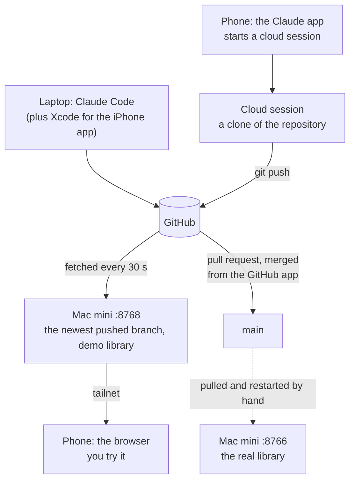

# 27. How it is built: Claude Code, from a laptop and a phone

Every chapter so far is about what the code does. This one is about how it was written, because that
is unusual enough to be worth describing: almost all of it was written by
[Claude Code](https://claude.com/claude-code), directed by one person, and a good part of the web app
was directed from a phone. If you want to work this way on a project of your own, this chapter is the
setup that made it work, and what does not work yet.

## The numbers

From the repository's own history, 2026-11-11 to 2026-11-19:

| | |
|---|---:|
| Days | 9 |
| Commits | 159, of which 133 name a Claude model as co-author |
| Pull requests | 31 |
| Issues (the backlog and the bugs) | about 40 |
| Lines of code at the end ([chapter 2](02-code-tour.md)) | 22,065, of which 16,802 are what you run |
| This book | 27 chapters and three appendices, about 7,000 lines, written the same way |

The co-author lines name three models (Claude Fable 5.2 on 64 commits, Claude Opus 5.5 on 54 and
Claude Sonnet 5.5 on 15), because the model was chosen per session. The person's part was deciding what
to build, looking at the result on a real screen and saying what was wrong with it, and merging.

## Three places the work happens

| Where | What it can do | What it cannot |
|---|---|---|
| **Laptop**: Claude Code in the desktop app or a terminal | Everything: the server, the pages, the iPhone app (Xcode, the Simulator, `ios/deploy.sh` to put a build on the phone), deploying to the Mac mini | Be with you on a walk |
| **Phone**: the Claude app starting a cloud session (Claude Code on the web) | The web app and server on the demo library: change, test, screenshot, push, open a pull request | Build the iPhone app (needs Xcode on a Mac), reach the real library or the Mac mini, deploy |
| **Mac mini**: where the library lives | Serve the real library; show any pushed branch as a preview; run the agent that works on the library ([chapter 26](26-albums-and-agents.md)) | Nothing is developed here |

## Working from a phone

The constraint that shapes everything: a cloud session is a container somewhere else. It is not on
your network, it takes no connections from outside, and it is thrown away after a while. The only thing
that leaves it is what it pushes to GitHub. So the design is to make **a pushed branch** the thing you
look at:

1. In the Claude app, start a session in this repository's cloud environment, with the repository
   selected, and say what you want, in terms of what a person would see ("the album page should say
   how many photos it has, under the title").
2. The session works on a new branch. It runs the app on the demo library, runs the tests, and for a
   change to a page drives the real page with Playwright and looks at its own screenshots, light and
   dark.
3. When there is something to see, it commits and runs
   [`tools/cloud-preview.sh`](../../photo-estate/tools/cloud-preview.sh), which pushes the branch and
   prints `PREVIEW PUSHED`.
4. Within about a minute the Mac mini is serving that branch on the demo library, on its port 8768 on
   the tailnet. You open it in the phone's browser and use it.
5. You say what is wrong; each new commit it pushes replaces the preview.
6. It opens a pull request; you merge it from the GitHub app.

The preview is the piece that makes this pleasant rather than blind: you judge the work by using it,
on the device it is for, not by reading a diff on a small screen. It needs one machine you own that is
always on; here it is the Mac mini that already serves the library.
[deploy/CLOUD-SESSIONS.md](../../photo-estate/deploy/CLOUD-SESSIONS.md) is the full description, and
[deploy/MAC-MINI.md](../../photo-estate/deploy/MAC-MINI.md#its-own-user) the mini's side.

Because the mini runs whatever anyone pushes, the preview runs as a user of its own (`photopreview`)
that cannot read the owner's home folder or the library's disk, and a firewall rule stops it reaching
the other apps on the mini, the home network and the tailnet. If you copy this setup, copy that part
too: a preview server is a machine that runs code from the internet.

### What a phone session cannot do (yet)

- **Build the iPhone app.** Xcode runs only on macOS. iPhone work waits for the laptop.
- **See your real photos.** It works on the 104-photo demo library, which is also why it is safe to
  hand it the repository: no family photo is ever in its context.
- **Deploy.** Merging does not change the real app; on the mini that is a `git pull` and a restart,
  done today from the laptop. A deploy from the phone would need the mini to follow a release branch by
  itself, as the preview does, and go back if the app does not answer. That is not built.
- **Measure speed on the real library.** Performance work ([chapter 16](16-operations.md)) needs the
  real catalog and disk.

What is left fits a phone well: changes to the pages, bugs with a clear way to see them, small
features, and documentation, including chapters of this book.

## What makes a repository easy for an agent

None of the choices below were made for Claude alone (they are the choices the earlier chapters argue
for on their own merits), but each one is why a session, on a laptop or in the cloud, can be useful in
its first minute.

**A short CLAUDE.md.** [CLAUDE.md](../../CLAUDE.md) is what Claude Code reads at the start of every
session. It is about thirty lines: what the project is, the one command that runs the app on the demo
library, how to run the tests, that the demo library must not change, that a change to a page must be
looked at in light and dark mode, and what to do in a cloud session when the work is ready to see. It
says what to do, not how the code works; the code and this book say that.

**A demo library in the repository.** 104 public-domain photos, run through the whole pipeline, with
their catalog checked in ([chapter 17](17-testing-and-demo.md)). Any session can run the real app on
real-looking data with one command, and nobody has to hand an agent their own photos.

**No setup step.** Every script declares its dependencies inline and runs with `uv run`
([chapter 2](02-code-tour.md#why-uv-run-and-inline-dependencies)). A fresh container needs uv and
nothing else; [`tools/cloud-setup.sh`](../../photo-estate/tools/cloud-setup.sh) adds a CPU-only PyTorch,
the search model and exiftool, and ends with a list of what is ready and what is MISSING, so a session
can tell what its environment lacks without guessing.

**Tests that are scripts.** Each file in `tests/` runs on its own with `uv run tests/<file>`, needs
no network, account or model, and says what it checked. A session runs all fifteen after a change, or
`uv run pytest` for all of them at once; CI runs the fast ones on every pull request
([chapter 17](17-testing-and-demo.md#one-command-pytest-ruff-and-ci)).

**Looking, not just testing.** The pages are checked by driving them with Playwright and reading the
screenshots, in light and dark mode; the iPhone app by the Simulator's screenshots. Most of what goes
wrong in an interface (an overlap, a missing state, a colour that disappears in dark mode) passes every
test and shows at once in a picture.

**Code that explains itself where it is.** Each module's docstring lists its commands or its HTTP API
(`changes.py`, `tasks.py`, `intake/api.py`), and each Swift file starts with what it is for. A session
reads one file and knows what it may change.

**One file per feature.** Since the first week, each feature on the server is a module of its own that
`embed.py serve` mounts ([chapter 2](02-code-tour.md)). Two sessions working at once rarely touch the same
file, and a pull request is about one thing.

**Issues as the backlog.** Ideas are GitHub issues, and bugs are issues labelled `bug`, fixed in a
batch when asked. A session can be started from an issue number, and the reasoning stays with the
issue rather than in a chat that ends.

## Claude in the product, too

The same model that wrote the code can use it. The running app is an MCP server
([chapter 26](26-albums-and-agents.md)); add it to Claude Code (or any MCP client) and you can ask, in a
chat, for "the best five pictures of Ben for every year" and get an album. Larger requests go to the
agent on the Mac mini, which works through them with the same tools and ends in a change set for a
person to review. The rules that make that safe (the agent never sees a photo, and cannot change the
library, only propose) are in the tools, not in the prompt.

## Where to look

| What | Where |
|---|---|
| What every session is told | [CLAUDE.md](../../CLAUDE.md) |
| Cloud sessions and the preview, step by step | [deploy/CLOUD-SESSIONS.md](../../photo-estate/deploy/CLOUD-SESSIONS.md) |
| Preparing a cloud container | [tools/cloud-setup.sh](../../photo-estate/tools/cloud-setup.sh) |
| Pushing a branch to the preview | [tools/cloud-preview.sh](../../photo-estate/tools/cloud-preview.sh) |
| The preview on the mini, its own user and firewall | [deploy/preview-branch.sh](../../photo-estate/deploy/preview-branch.sh), [deploy/preview-user-setup.sh](../../photo-estate/deploy/preview-user-setup.sh), [deploy/preview-firewall-setup.sh](../../photo-estate/deploy/preview-firewall-setup.sh) |
| Building and installing the iPhone app | [ios/deploy.sh](../../ios/deploy.sh), [ios/project-sim.yml](../../ios/project-sim.yml) |
| The agent and the MCP tools | [chapter 26](26-albums-and-agents.md) |
| The backlog | [GitHub issues](https://github.com/jflam/photo-estate/issues) |
