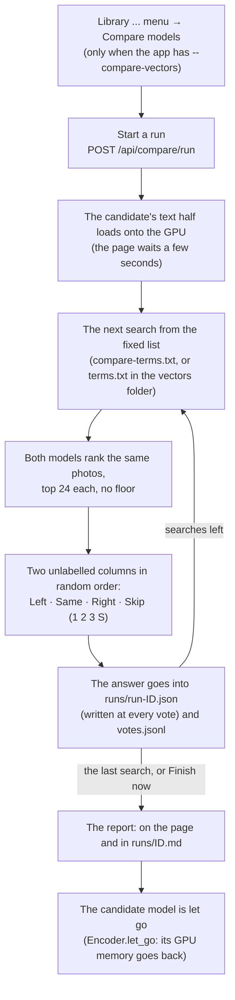

# Putting a new image model through `/compare`

`/compare` is how this project decides whether a different image model finds a family's photos better
than the one the app uses. It is an experiment with a fixed procedure: the same searches every time,
blind votes, a written report. Because the procedure stays the same, the report for one candidate model
can be read beside the report for the next one. [Chapter 10](../book/10-embeddings.md#trying-a-bigger-model-compare)
explains the design. This guide is the checklist for running it.

The first candidate was SigLIP 2 large at 384 px (`google/siglip2-large-patch16-384`) against the app's
SigLIP 2 base. Its vectors are on the Mac mini in `~/photo-estate-lab/siglip2-large-384/vectors`.

## What happens in a run



- **Blind.** You are not told which column is which model until the report. The side is chosen at random
  for each search and saved with the vote, so the server records the vote as a model, not a side.
- **Resumable.** A run is a file, so you can close the page, or restart the app, and carry on where you
  stopped. **Finish now** ends the run with the remaining searches marked unanswered. **Start over**
  abandons it.
- **Nothing is loaded until you start.** Opening the page loads nothing. Starting a run loads the
  candidate's text half (about 3 GB of GPU memory for SigLIP 2 large). Finishing the run lets it go. A run
  that is left open lets it go after `--compare-idle` minutes without use (15 by default), and it loads
  again when you come back.

## Steps for a new candidate model

1. **Pick the model.** The tools load it with `transformers`' `AutoModel` and call `get_image_features`
   and `get_text_features`. This has only been tried with SigLIP 2. Another two-tower family (CLIP, say)
   should load, but check the prompt and the padding in `Encoder.text` ([encoder.py](../../photo-estate/encoder.py))
   before you trust its column.
2. **Export the photos once** (on the library's computer, at low priority). Each photo the Library shows
   is written as a 512 px square JPEG, in tar shards of 2,000. You can reuse an existing export for each
   new candidate, as long as no photos have been ingested since. After an ingest, export into a fresh
   folder.

   ```bash
   nice -n 10 uv run tools/export_squares.py --db ~/estate/estate.db --store /Volumes/estate/store \
     --out ~/photo-estate-lab/squares512
   ```

3. **Embed the shards with the candidate model** (SigLIP 2 so400m in the example below), preferably on a machine with a fast GPU. On an M2 Max,
   SigLIP 2 large took about 65 minutes for 83,000 photos. Give each candidate its own output folder: the
   folder is the candidate, and its runs and votes are stored inside it.

   ```bash
   uv run tools/embed_squares.py --squares ~/photo-estate-lab/squares512 \
     --model google/siglip2-so400m-patch16-384 --out ~/photo-estate-lab/so400m-384/vectors
   ```

   The folder ends up with `shard-NNNN.npy` (float16, unit rows), `shard-NNNN.shas.txt` and `meta.json`
   (which names the model). Copy it to the library's computer.
4. **Download the model's weights on the library's computer.** The app runs with `HF_HUB_OFFLINE=1`, so
   it cannot fetch them:

   ```bash
   uvx --from huggingface_hub hf download google/siglip2-so400m-patch16-384
   ```

5. **Decide on the searches.** By default every run asks the 24 searches in
   [compare-terms.txt](../../photo-estate/compare-terms.txt). Keep that list if you want this candidate's
   report to be comparable with earlier ones. A `terms.txt` in the vectors folder replaces the list for
   that candidate only. A longer list gives a firmer answer (see "Reading the report").
6. **Point the app at the candidate.** Set `--compare-vectors` to the new folder (in the plist on the
   mini, see [MAC-MINI.md](../../photo-estate/deploy/MAC-MINI.md#comparing-a-second-model-compare)) and
   restart. The app can compare one candidate at a time. Earlier candidates keep their reports in their
   own folders.
7. **Run it.** In the Library, open "..." and choose **Compare models**, then **Start the comparison** (**Run it again** once there is a report). Judge each
   search on whether its column holds the photos you meant, not on how pretty the photos are. **Same** is
   a real answer: use it when neither column is clearly better.
8. **Keep the report.** It is `runs/<id>.md` in the vectors folder, and the page lists earlier reports.

## Reading the report

| Part | What it tells you |
|---|---|
| The verdict | A sentence: which model was better on how many searches, and whether that is "a clear difference" (p < 0.05) or only a lean |
| The counts | Searches where each model was better, the same, skipped and not asked |
| Sign test, p | How often a split at least this uneven comes up between two equally good models. Ties and skips are left out, as the test requires |
| Photos in both columns | On average, how many of the 24 photos both models put in their top 24. Near 24 means the candidate barely changes what you see |
| Reading the words, ms | The time each model took to encode a search's words, as both are timed the same way. The candidate is usually slower |
| One row per search | Which model won and the overlap, so you can find the kinds of search where the candidate helps |

With 24 searches the test is coarse. A 17 to 7 split gives p = 0.06, and it takes 18 to 6 to get below
0.05. The verdict sentence says which side of that line a run falls on.

The report cannot tell you two things. First, how the candidate would do as the app's real model: the
columns have no match floor or window, because those are measured for each model, so they would have to
be measured again before switching. Second, the cost: the whole library would need to be embedded again
on the library's computer, and the candidate's text half would be held in memory all the time.

## Where everything is

| | |
|---|---|
| The candidate's vectors | `--compare-vectors DIR` (shards, `meta.json`, and optionally `terms.txt`) |
| Runs and reports | `DIR/runs/run-<id>.json` (the run, written at every vote) and `DIR/runs/<id>.md` (the report) |
| Every vote | `DIR/votes.jsonl` (`--compare-votes` moves it). Votes cast before 2026-11-20, when `/compare` was a free search box, are in this file but not part of any report |
| The searches | [compare-terms.txt](../../photo-estate/compare-terms.txt), or `DIR/terms.txt` |
| The code | [compare.py](../../photo-estate/compare.py) (server), [compare.html](../../photo-estate/compare.html) and [app/compare-flow.js](../../photo-estate/app/compare-flow.js) (page), `Encoder.ensure` / `Encoder.let_go` in [encoder.py](../../photo-estate/encoder.py) |
| The HTTP routes | [Appendix B](../book/appendix-b-http-api.md#comparing-two-models-an-experiment-serve---compare-vectors-dir) |

## Stopping the experiment

Remove the two `--compare-vectors` lines from the plist and restart. The menu item disappears, and the
vectors, runs and votes stay where they are.
