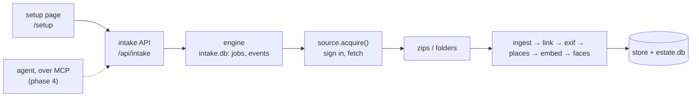

# Intake: bringing photos in from the app

Getting a library started used to mean running `estate.py`, `pull-drive.sh` and `pull-icloud.sh` by
hand, in the right order, with the right flags. Intake moves that into the app: a setup page that
asks where the library should live and where the photos are now, explains how to get them out of
each service, signs in where it has to, and runs the catalogue pipeline with progress you can watch.
The same engine will be exposed to an agent over MCP, so someone's assistant can supervise a long
import and help when something goes wrong.

## The shape of it

- **A source only fetches.** `ingest` recognises Takeout JSON, iCloud XMP and Flickr JSON from the files
  themselves, so a source's job ends when it has put a service's files somewhere `ingest` can read
  them. Everything after that is one shared pipeline (`intake/engine.py`), the same commands as
  `ingest-iphone.sh` and chapter 16 of the book.
- **One engine, several front ends.** The setup page and (later) the MCP server are both clients of
  `/api/intake`, so a person and their agent always see the same jobs.
- **Jobs survive restarts.** A job's stage is saved in `intake.db` beside the catalog (never in it:
  `estate.py` stays the only writer of the catalog). Every stage can run again and does only new work,
  so a job stopped anywhere resumes from the stage it was in.
- **Secrets stay in the app.** A password or a one-time code is typed into the setup page, handed to the
  running job in memory and forgotten. It is never written to disk, never returned by the API, and an
  agent never sees it; it sees "waiting for you: enter the code sent to your iPhone".
- **One writer at a time.** The engine takes the same lock as `ingest-iphone.sh`, so a phone's upload
  run and an intake job never write the catalog at once.

## Adding a source

A source is a class in `intake/sources/`, registered with `@register`:

| Member | What it is |
|---|---|
| `id`, `name`, `blurb`, `group`, `time_hint` | How the setup page shows it |
| `auth` | `none`, `browser` (approve in a browser: OAuth), `password_code` (a password, then a code), `manual` (the service emails a download) |
| `fields` | What the person fills in (a folder, an account name) |
| `guide()` | Step-by-step instructions, with links |
| `checks()` | Prerequisites on this computer (a tool installed, a sign-in present) |
| `preview(config)` | What would come in. Quick, and changes nothing |
| `acquire(config, ctx)` | Fetch, and return the zips and folders for `ingest`. Must be safe to run again |

Inside `acquire`, `ctx.progress(done, total, detail)` reports progress, `ctx.ask(Prompt(...))` waits for
the person (a button, a browser approval, a password, a code), `ctx.staging` is scratch space that is
kept between runs, and `ctx.log(...)` adds a line to the job's details.

`intake/sources/local.py` (files already on this computer) is the simplest. `intake/sources/practice.py`
has one practice source per way of signing in; they only exist with `serve --sandbox`.

## Phases

1. **Done: core.** The source interface, the engine and `intake.db`, the setup page, starting with no
   library (choosing where it lives), sources for files already on this computer (Google Takeout zips,
   Flickr's export, any folder), and `--sandbox` with practice sources for every way of signing in.
   `serve` with no library shows the setup page and turns into the full app (exec, same port) once the
   first photos are searchable; the full app keeps the page at `/setup` for adding more.
2. **rclone sources:** Google Drive (Takeout delivered to Drive: what `pull-drive.sh` does), Dropbox and
   OneDrive. One `RcloneSource` base: `rclone authorize` gives the browser approval (`auth = browser`),
   then `lsjson` for the preview and `copy` with progress for acquire, one zip at a time when they are
   big, with the free-space guard from `pull-drive.sh`. Include a guide for creating your own Google
   OAuth client when the shared one is rate-limited (DISK-SETUP.md has the recipe).
3. **iCloud:** `icloudpd` with the password and code typed into the page (`auth = password_code`). To
   check first: how current icloudpd takes a password and an MFA code when not on a terminal (it has had
   `--password-provider` and a web-UI MFA provider; otherwise run it on a pseudo-terminal). Keep its
   persistent mirror under the library so later runs fetch only new photos; Advanced Data Protection
   needs `--adp-web-access` and an approval on an Apple device, which becomes an `approve` prompt.
4. **MCP:** `/mcp` on the running app (streamable HTTP), so an agent attaches to the same engine as the
   page instead of starting a second one. Tools: `list_sources`, `get_guide`, `check_prerequisites`,
   `preview`, `start_intake`, `get_status`, `get_log`, `retry`, `cancel`, `library_stats`. Never an
   `answer` for secrets: those are typed into the app only.

## Not yet

- Getting the app running at all is still `uv run embed.py serve` in a terminal, which also downloads
  PyTorch before the setup page appears. A double-click launcher (a small Mac app or a `.command` file)
  that installs `uv` and starts the server would remove the last terminal step.
- `pull-drive.sh` and `pull-icloud.sh` stay until phases 2 and 3 replace them.
- Progress during `embed` is reported every 60 seconds (embed.py's own pace), so the bar moves in steps
  on a big import.
